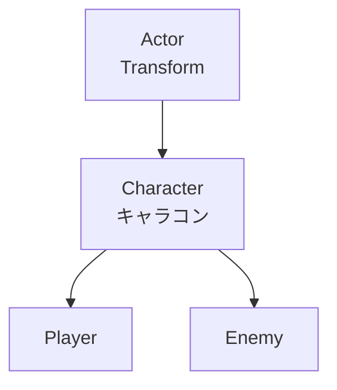
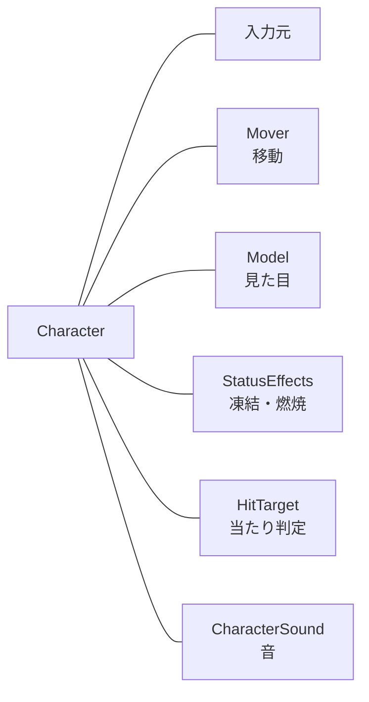
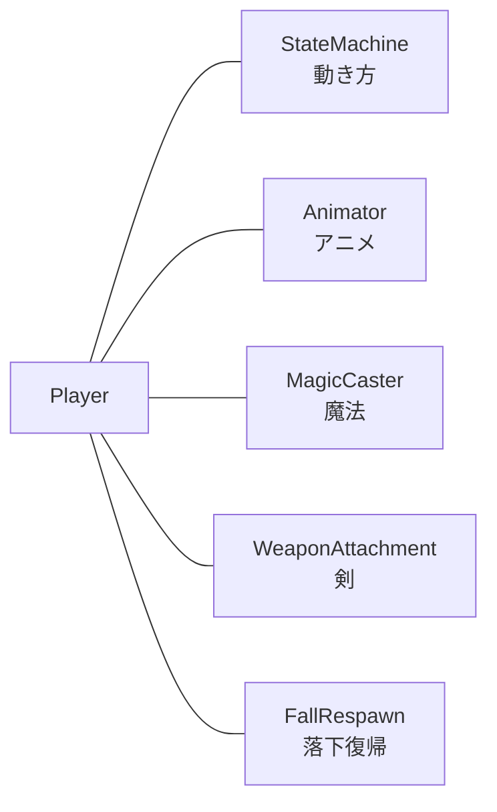
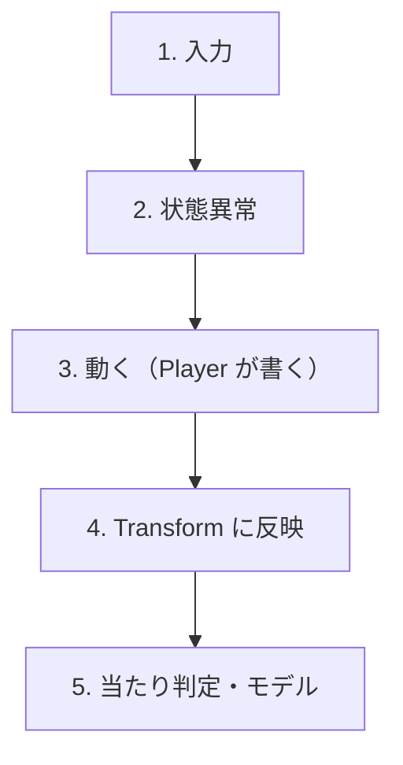
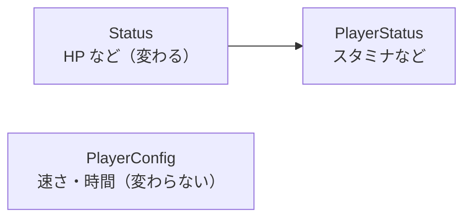
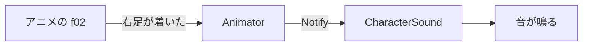

# プレイヤーの構成の設計

> **状態: これから作る形（未実装）。** 今のコードは [キャラクターの構成](../キャラクター/キャラクターの構成.md) を参照。
> 実装したら、このページを「今の形」に直し、[キャラクターの構成](../キャラクター/キャラクターの構成.md) も合わせて直す。

## 1. 方針

1. 継承は **Actor → Character → Player** の3段まで。「〜の一種」の関係にだけ使う。
2. 機能は**部品（コンポーネント）**にする。部品は Player の**メンバー**として持つ（リストに積まない）。
3. Player には「部品の組み立て」と「動き（ステート・魔法）」だけを書く。
4. **1部品1ファイル。** 200行を超えたら、責務が2つ混ざっていないか見直す。

---

## 2. 図

### 図1. 継承（〜の一種）



- 位置は **Actor の Transform が正**。キャラコンは動いた結果を Transform に書く。
- ModelRender は Actor に持たせない（モデルのない Actor もあるため）。

### 図2. Character が持つ部品（全キャラ共通）



### 図3. Player が足す部品



### 図4. 1フレームの順番



- 順番は **Character が決める**。Player は 3 だけを書く（`UpdateAction()` をオーバーライド）。
- Player の 3 の中身: ステート → 魔法 → 落下復帰 → 剣。

### 図5. 値の分け方



- Status は**遊んでいる間に変わる値**。PlayerConfig は**調整用の定数**。混ぜない。
- 凍結・燃焼は StatusEffects（一時的な状態）なので、Status には入れない。

### 図6. 出来事の伝え方（例: 足音）



- 知らせる側は音を知らない。CharacterSound は理由を知らない。
- フラグは使わず、起きた瞬間に関数を呼ぶ。

---

## 3. フォルダ分け

```
Game/Source/
├── Actor/              Actor（Transform）
├── Character/
│   ├── Character       全キャラ共通の土台。Update の順番を決める
│   ├── Status          HP など
│   ├── Input/          CharacterInput・入力元（Player 用・NPC 用）
│   └── Components/     Mover・Model・StatusEffects・HitTarget・CharacterSound
│                       WeaponAttachment・FallRespawn（Enemy でも使える部品）
├── Player/
│   ├── Player          組み立てと UpdateAction だけ
│   ├── PlayerStatus
│   ├── PlayerConfig    調整値（今の Make〇〇Settings をここへ）
│   ├── PlayerAnimator  アニメの切り替え・受け渡し・イベント
│   └── State/          StateMachine と各ステート
├── Enemy/
├── Magic/              （今のまま）
└── Objects/            Stage・GameCamera など
```

---

## 4. 決めたこと

| 項目 | 決めたこと | 理由 |
|---|---|---|
| 位置 | Actor の Transform が正 | 位置を2か所に持たない |
| モデル | Actor に持たせず、Character が持つ | 範囲・トリガー・音など、モデルのない Actor が多い |
| 部品 | メンバーで持つ（汎用リストにしない） | 順番が見える。付け忘れがコンパイルエラーになる。確保は1体1回 |
| Status | `GetStatus()` を共変戻り値にする | Player からはキャストなしで PlayerStatus を触れる |
| Status の中身 | 最初は HP・最大HP だけ | 使わない値を先に入れない |
| 出来事 | フラグでなく通知（関数を呼ぶ） | 下ろし忘れ・取りこぼし・1フレームのずれが起きない |
| 数が多いもの | 弾・エフェクトだけ個別にプールする | 断片化が効くのは数の多い方 |

### 共変戻り値の形

```cpp
class Character : public Actor {
public:
    virtual Status& GetStatus() = 0;          // 共通処理はこれで書く
};
class Player : public Character {
    PlayerStatus m_status;                      // 実体は派生クラスが持つ
public:
    PlayerStatus& GetStatus() override { return m_status; }
};
```

---

## 5. 未定・あとで決めること

1. CharacterSound・SoundPlayer の中身 → `SEの設計.md` を別に作る。
2. .fbx から変換したクリップにアニメーションイベントが入るか未確認。入らなければ、PlayerAnimator に「クリップ名と秒数」の表を持たせる。
3. Enemy にもステートを入れるなら、StateMachine をテンプレートにする。
4. フォルダを分けたら、`Game.vcxproj`（とフィルター）とインクルードパスを直す。
