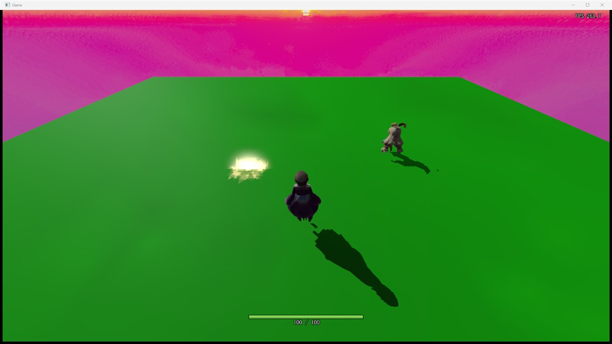

# GPUの選び方の経緯

設計: [GPUの選び方の設計](GPUの選び方の設計.md)

何をして、なぜ今の形になったかの記録です。日付ごとに書き足します。

---

## 2026-11-08 CPU 内蔵の GPU で描いていたのを直した

「アニメーション全体的にカクカクしている」とのことだった。右上の FPS は 30 前後で、カクつくのはキャラクターだけだった。キャラクターのキーフレームは 30fps なので、30fps で描くとキーフレームの間の補間が効かず、1コマずつ切り替わって見える。

FPS の上限はかかっていなかった（`USE_FPS_LIMITTER` は無効）。一時的な計測のコードを入れて Release で動かすと、1フレーム約 31.7ms のうち、更新が 0.4ms、描画の命令づくりが 1ms、GPU の描画を待つ時間が約 30ms で、GPU が重くて 30fps になっていた。

この PC には GPU が2つある（AMD Radeon(TM) Graphics＝CPU 内蔵、AMD Radeon RX 9070 XT）。`CreateD3DDevice()` は名前に「AMD」が入っている GPU を見つけるたびに置き換えていたので、後から見つかった CPU 内蔵の GPU を使っていた。同じメーカーの中では専用のビデオメモリが多い方を選ぶようにすると、RX 9070 XT が選ばれ、約 470〜490fps になった（最小化して測った値）。計測のコードは外した。

| 候補 | 選ばなかった理由 |
|---|---|
| 1フレームの経過時間を、30フレームの平均でなく毎フレームの実際の時間にする | 今回の原因ではなかった。FPS が高ければ、平均との差は小さい |
| VSync を待つようにする | 「上限を解放して、出せるだけ出してほしい」とのことだったので、上限なしのままにした |

---

## 2026-11-08 手順書を書いた

[GPUの選び方の手順](GPUの選び方の手順.md) を書いた。`CreateD3DDevice()` に足した変数とラムダ、NVIDIA・AMD・Intel の3か所の書き換えを diff で並べた。

どう確かめたか: 作業用フォルダーで手順書の diff を逆に当てると、`GraphicsEngine.cpp` は #77 の前のコミットと同じになった。そこから手順1〜3を1つずつ当て、そのたびに Game.sln を Debug x64 でビルドして、すべて通った。最後は main と差がなくなった。

---

## 2026-11-09 NVIDIA と CPU 内蔵の GPU があるノート PC で確かめた

別の PC（ノート PC）でも、どの GPU で描いているかと FPS を確かめた。コードは変えていない。

この PC には GPU が2つある（NVIDIA GeForce RTX 4060 Laptop GPU、Intel(R) UHD Graphics＝CPU 内蔵）。`CreateD3DDevice()` は NVIDIA を最優先するので、RTX 4060 が選ばれるはずである。

置いてあった Release の exe は 11-06 のもので、上の直しが入っていなかったので、今のコード（#92）で Release x64 をビルドし直してから動かした。ゲームの窓は前に出さず、ほかの窓の後ろに置いたまま、窓だけを撮った。

| 見たもの | 結果 |
|---|---|
| `nvidia-smi` | `Game.exe` が RTX 4060 を使っていて、使用率は 98% |
| パフォーマンスカウンター（GPU Engine の 3D） | 一方の GPU が 64%、もう一方が 0% |
| パフォーマンスカウンター（GPU Process Memory の専用メモリ） | 3D を使っている方が 1,370 MB、もう一方が 0 MB（CPU 内蔵の GPU は使っていない） |
| 右上の FPS | 263.7、265.7（2回撮った） |

FPS の上限なしで、GPU の使用率が 98% なので、約 264fps はこの GPU の重さで決まっている。RX 9070 XT のデスクトップ（約 470〜490fps）より低いのは GPU の差による。デスクトップの値は最小化して測ったもので、今回は窓を出したまま測った違いもある。
