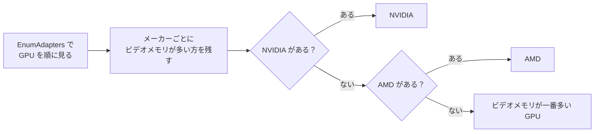

# GPUの選び方の設計

作成日: 2026-11-08
対象: [GraphicsEngine.cpp](../../k2EngineLow/graphics/GraphicsEngine.cpp) の `GraphicsEngine::CreateD3DDevice()`
経緯: [GPUの選び方の経緯](GPUの選び方の経緯.md)
手順: [GPUの選び方の手順](GPUの選び方の手順.md)（どのファイルに何を足し、何を書き換えたか）

PC に GPU が複数あるとき、どれで描くかを決める仕組みです。ゲームが急に重くなったとき、ノート PC や CPU 内蔵の GPU がある PC で動かすときに読んでください。

- **メーカーの順に選ぶ。** NVIDIA → AMD → それ以外（専用のビデオメモリが一番多いもの）。
- **同じメーカーが複数あるときは、専用のビデオメモリが多い方を選ぶ。** CPU 内蔵の GPU（専用のビデオメモリがほぼない）より、専用の GPU を使う。

---

## 1. 流れ



| 見るもの | 使い方 |
|---|---|
| `DXGI_ADAPTER_DESC::Description` | 名前に `NVIDIA`・`AMD`・`Intel` が入っているかで、メーカーを分ける |
| `DXGI_ADAPTER_DESC::DedicatedVideoMemory` | 同じメーカーの中で比べる。CPU 内蔵の GPU はここがほぼ 0 |

NVIDIA の GPU が見つかったら、レイトレーシングが使えるものとする（`m_isPossibleRaytracing`）。ゲームでは `Game.cpp` でレイトレーシングを切っている。

---

## 2. 実装方法

メーカーごとに、選んだ GPU のビデオメモリを `venderVideoMemory` に覚えておき、それより多いときだけ置き換える。

```cpp
auto isBetter = [&](int vender) {
    if (adapterVender[vender] == nullptr) {
        return true;
    }
    return desc.DedicatedVideoMemory > venderVideoMemory[vender];
};
```

---

## 3. 確かめ方

選ばれた GPU は、タスクマネージャーの「パフォーマンス」で、ゲームを動かしている間に使用率が上がる方を見るとわかる。NVIDIA の GPU なら、`nvidia-smi` の一覧に `Game.exe` が出るかでもわかる。

| PC | ある GPU | 選ばれた GPU | FPS（Release、立っているだけ） |
|---|---|---|---|
| デスクトップ（2026-11-08、直す前） | AMD Radeon(TM) Graphics（CPU 内蔵）、AMD Radeon RX 9070 XT | AMD Radeon(TM) Graphics（CPU 内蔵） | 約 31 |
| デスクトップ（2026-11-08、直したあと） | 同上 | AMD Radeon RX 9070 XT | 約 470〜490 |
| ノート PC（2026-11-09） | NVIDIA GeForce RTX 4060 Laptop GPU、Intel(R) UHD Graphics（CPU 内蔵） | NVIDIA GeForce RTX 4060 Laptop GPU | 約 264 |

---

## 4. 決めたこと

| 決めたこと | 理由 |
|---|---|
| メーカーの順（NVIDIA → AMD）は変えない | もとのエンジンの決まり。NVIDIA のときだけレイトレーシングを使えるようにしているため |
| 同じメーカーの中ではビデオメモリで比べる | 名前に「AMD」が入るものを見つけるたびに置き換えていたので、後から見つかった CPU 内蔵の GPU が選ばれていた |
| `IDXGIFactory6::EnumAdapterByGpuPreference`（高性能を優先）は使わない | 今の `IDXGIFactory4` のままで直せる。メーカーの順の決まりとも合わせやすい |
