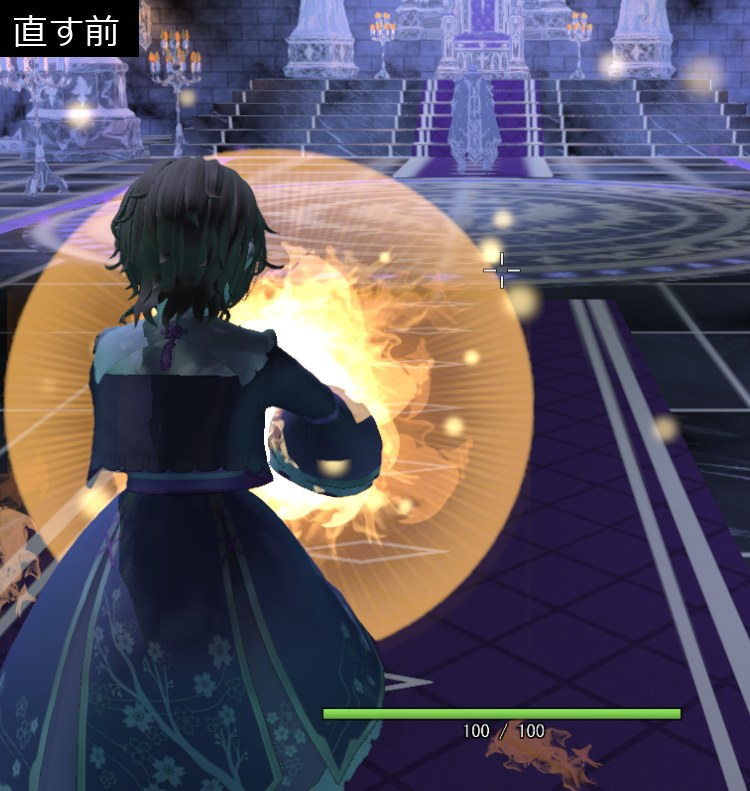
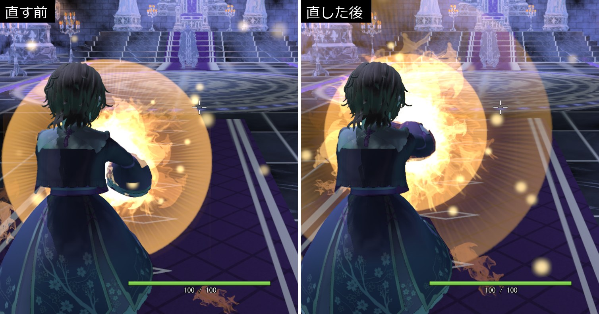

# アニメーションの上半身の層の経緯

設計: [アニメーションの上半身の層の設計](アニメーションの上半身の層の設計.md)
手順: [アニメーションの上半身の層の手順](アニメーションの上半身の層の手順.md)

何をして、なぜ今の形になったかの記録です。日付ごとに書き足します。

---

## 2026-11-17 アニメーションに上半身の層を足した

三人称の溜め撃ち（[三人称の溜め撃ちの経緯](../../ゲーム/プレイヤー/三人称の溜め撃ち/三人称の溜め撃ちの経緯.md)）で、脚は歩いたまま、上半身だけ構えて撃つ形にするために足した（#193 の最初のコミット `9baced62`）。

- `Animation` に骨ごとの重みを持たせ、重みがあれば「層」として、スケルトンへそのまま書かずに下の姿勢へ重ねるようにした。
- 骨の行列は、アニメーションを流しているときはモデルの根元から見た形で入っている（[Skeleton.cpp](../../../k2EngineLow/graphics/Skeleton.cpp) の `Skeleton::Update()`）。そのまま混ぜると、下の歩きで腰が上下しても胸が付いてこないので、親から見た形にしてから混ぜ、親から順に組み直すようにした。
- `ModelRender` に2つ目の `Animation`（`m_layerAnimation`）を持たせ、骨の名前と重みの組から骨ごとの重みを作る `InitAnimationLayer()` と、流す・重み・速さの関数を足した。

もとからあるソースの改造なので、変更前と変更後を並べる（このときの層の速さは、下の速さ `m_animationSpeed` も掛けていた。次の項で直した）。下の表は、次の項の直しも入った #193 の形。

**用語:**

| 用語 | 何のことか |
|---|---|
| 層 | 下のアニメーションの姿勢の上に、骨ごとの重みで重ねるアニメーション |

[Animation.h](../../../k2EngineLow/graphics/Animation.h)

| 行 | 変更前 | 変更後 |
|---|---|---|
| 169 | `/// <summary>` | `/// <summary>` |
|  |  | `/// 層として使う。骨ごとの重み（0〜1）を渡すと、スケルトンに書き込まず、` |
|  |  | `/// 先に流した別のアニメーション（下の層）の姿勢の上に、重みの分だけ重ねる。` |
|  |  | `/// </summary>` |
|  |  | `/// <param name="boneWeights">骨の番号ごとの重み。数は骨の数と同じ。</param>` |
|  |  | `void SetLayerBoneWeights(const std::vector<float>& boneWeights);` |
|  |  | `/// <summary>` |
|  |  | `/// 層か。` |
|  |  | `/// </summary>` |
|  |  | `bool IsLayer() const` |
|  |  | `{` |
|  |  | `return !m_layerBoneWeights.empty();` |
|  |  | `}` |
|  |  | `/// <summary>` |
|  |  | `/// 層の全体の重み（0〜1）。骨ごとの重みに掛ける。` |
|  |  | `/// </summary>` |
|  |  | `void SetLayerWeight(float weight)` |
|  |  | `{` |
|  |  | `m_layerWeight = weight;` |
|  |  | `}` |
|  |  | `float GetLayerWeight() const` |
|  |  | `{` |
|  |  | `return m_layerWeight;` |
|  |  | `}` |
|  |  | `/// <summary>` |
| 170 | `/// ワールド空間でのフットステップの移動量を計算する。` | `/// ワールド空間でのフットステップの移動量を計算する。` |
| 215 | `void UpdateGlobalPose();` | `void UpdateGlobalPose();` |
|  |  | `/// <summary>` |
|  |  | `/// 層のとき、計算した姿勢を下の層の姿勢に重ねて、スケルトンに書き込む。` |
|  |  | `/// </summary>` |
|  |  | `void ApplyAsLayer(const Vector3* scales, const Quaternion* rotations, const Vector3* translations);` |
| 216 | `private:` | `private:` |
| 250 | `float m_deltaTimeOnUpdate = 0.0f;							//Update関数を実行したときのデルタタイム。` | `float m_deltaTimeOnUpdate = 0.0f;							//Update関数を実行したときのデルタタイム。` |
|  |  | `std::vector<float> m_layerBoneWeights;						//層のときの、骨ごとの重み。空なら層ではない。` |
|  |  | `std::vector<int> m_layerBoneOrder;							//層を重ねるときに骨を計算する順（親が先）。` |
|  |  | `float m_layerWeight = 0.0f;									//層の全体の重み。` |
| 251 | `};` | `};` |

[Animation.cpp](../../../k2EngineLow/graphics/Animation.cpp)

| 行 | 変更前 | 変更後 |
|---|---|---|
| 149 | `}` | `}` |
|  |  | `if (IsLayer()) {` |
|  |  | `//層のときは、下の層が書いた姿勢の上に、骨ごとの重みで重ねる。` |
|  |  | `ApplyAsLayer(vGlobalScale, qGlobalPose, vGlobalPose);` |
|  |  | `}` |
|  |  | `else` |
| 150 | `//グローバルポーズをスケルトンに反映させていく。` | `//グローバルポーズをスケルトンに反映させていく。` |
| 199 | `}` | `}` |
|  |  |  |
|  |  | `namespace {` |
|  |  | `// 拡大・回転・平行移動から、ボーン行列を作る（UpdateGlobalPose と同じ順に掛ける）。` |
|  |  | `Matrix ComposeBoneMatrix(const Vector3& scale, const Quaternion& rotation, const Vector3& translation)` |
|  |  | `{` |
|  |  | `Matrix scaleMatrix;` |
|  |  | `scaleMatrix.MakeScaling(scale);` |
|  |  | `Matrix rotMatrix;` |
|  |  | `rotMatrix.MakeRotationFromQuaternion(rotation);` |
|  |  | `Matrix transMat;` |
|  |  | `transMat.MakeTranslation(translation);` |
|  |  | `return scaleMatrix * rotMatrix * transMat;` |
|  |  | `}` |
|  |  | `// ボーン行列を、拡大・回転・平行移動に分ける。` |
|  |  | `void DecomposeBoneMatrix(Matrix m, Vector3& scale, Quaternion& rotation, Vector3& translation)` |
|  |  | `{` |
|  |  | `translation = *(Vector3*)m.m[3];` |
|  |  | `m.m[3][0] = 0.0f;` |
|  |  | `m.m[3][1] = 0.0f;` |
|  |  | `m.m[3][2] = 0.0f;` |
|  |  | `scale.x = (*(Vector3*)m.m[0]).Length();` |
|  |  | `scale.y = (*(Vector3*)m.m[1]).Length();` |
|  |  | `scale.z = (*(Vector3*)m.m[2]).Length();` |
|  |  | `for (int i = 0; i < 3; i++) {` |
|  |  | `m.m[0][i] /= scale.x;` |
|  |  | `m.m[1][i] /= scale.y;` |
|  |  | `m.m[2][i] /= scale.z;` |
|  |  | `}` |
|  |  | `rotation.SetRotation(m);` |
|  |  | `}` |
|  |  | `// 親の骨から見た行列にする。ルートの骨は、そのまま。` |
|  |  | `Matrix ToParentSpace(const Matrix* rootSpaceMatrices, int boneNo, int parentNo)` |
|  |  | `{` |
|  |  | `if (parentNo < 0) {` |
|  |  | `return rootSpaceMatrices[boneNo];` |
|  |  | `}` |
|  |  | `Matrix invParent;` |
|  |  | `invParent.Inverse(rootSpaceMatrices[parentNo]);` |
|  |  | `return rootSpaceMatrices[boneNo] * invParent;` |
|  |  | `}` |
|  |  | `}` |
|  |  |  |
|  |  | `void Animation::SetLayerBoneWeights(const std::vector<float>& boneWeights)` |
|  |  | `{` |
|  |  | `m_layerBoneWeights = boneWeights;` |
|  |  | `// 親を子より先に計算できるよう、親から順に並べておく。` |
|  |  | `const int numBone = m_skeleton->GetNumBones();` |
|  |  | `std::vector<bool> isAdded(numBone, false);` |
|  |  | `m_layerBoneOrder.clear();` |
|  |  | `for (int boneNo = 0; boneNo < numBone; boneNo++) {` |
|  |  | `// 根元までさかのぼってから、根元に近い方から足していく。` |
|  |  | `std::vector<int> chain;` |
|  |  | `for (int no = boneNo; no >= 0 && !isAdded[no]; no = m_skeleton->GetBone(no)->GetParentBoneNo()) {` |
|  |  | `chain.push_back(no);` |
|  |  | `}` |
|  |  | `for (auto it = chain.rbegin(); it != chain.rend(); ++it) {` |
|  |  | `isAdded[*it] = true;` |
|  |  | `m_layerBoneOrder.push_back(*it);` |
|  |  | `}` |
|  |  | `}` |
|  |  | `}` |
|  |  |  |
|  |  | `void Animation::ApplyAsLayer(const Vector3* scales, const Quaternion* rotations, const Vector3* translations)` |
|  |  | `{` |
|  |  | `// 骨の姿勢は、親からではなく、モデルの根元から見た行列で持っている。` |
|  |  | `// そのまま差し替えると、下の層で腰が上下しても胸が付いてこないので、` |
|  |  | `// 親から見た姿勢に直してから混ぜ、根元から見た姿勢に組み直す。` |
|  |  | `const int numBone = m_skeleton->GetNumBones();` |
|  |  | `Matrix* baseRoot = (Matrix*)alloca(sizeof(Matrix) * numBone);   // 下の層が書いた姿勢。` |
|  |  | `Matrix* layerRoot = (Matrix*)alloca(sizeof(Matrix) * numBone);  // この層の姿勢。` |
|  |  | `Matrix* mixedRoot = (Matrix*)alloca(sizeof(Matrix) * numBone);  // 混ぜたあとの姿勢。` |
|  |  | `for (int boneNo = 0; boneNo < numBone; boneNo++) {` |
|  |  | `baseRoot[boneNo] = m_skeleton->GetBone(boneNo)->GetLocalMatrix();` |
|  |  | `layerRoot[boneNo] = ComposeBoneMatrix(scales[boneNo], rotations[boneNo], translations[boneNo]);` |
|  |  | `}` |
|  |  | `for (int boneNo : m_layerBoneOrder) {` |
|  |  | `const int parentNo = m_skeleton->GetBone(boneNo)->GetParentBoneNo();` |
|  |  | `const float weight = m_layerBoneWeights[boneNo] * m_layerWeight;` |
|  |  | `Matrix mixedLocal = ToParentSpace(baseRoot, boneNo, parentNo);` |
|  |  | `if (weight > 0.0f) {` |
|  |  | `Vector3 baseScale, layerScale, baseTrans, layerTrans;` |
|  |  | `Quaternion baseRot, layerRot;` |
|  |  | `DecomposeBoneMatrix(mixedLocal, baseScale, baseRot, baseTrans);` |
|  |  | `DecomposeBoneMatrix(ToParentSpace(layerRoot, boneNo, parentNo), layerScale, layerRot, layerTrans);` |
|  |  | `const float rate = min(weight, 1.0f);` |
|  |  | `baseScale.Lerp(rate, baseScale, layerScale);` |
|  |  | `baseRot.Slerp(rate, baseRot, layerRot);` |
|  |  | `baseTrans.Lerp(rate, baseTrans, layerTrans);` |
|  |  | `mixedLocal = ComposeBoneMatrix(baseScale, baseRot, baseTrans);` |
|  |  | `}` |
|  |  | `mixedRoot[boneNo] = parentNo < 0 ? mixedLocal : mixedLocal * mixedRoot[parentNo];` |
|  |  | `m_skeleton->SetBoneLocalMatrix(boneNo, mixedRoot[boneNo]);` |
|  |  | `}` |
|  |  | `}` |
| 200 | `}` | `}` |

[ModelRender.h](../../../k2Engine/graphics/ModelRender.h)

| 行 | 変更前 | 変更後 |
|---|---|---|
| 145 |  |  |
|  |  | `/// <summary>` |
|  |  | `/// アニメーションの層を作る。上半身だけ別のアニメーションを流す、などに使う。` |
|  |  | `/// 骨の名前と重みの組を渡すと、その骨とその子孫に重みが付く（子孫に別の組があれば、そちらが優先）。` |
|  |  | `/// 組に入らない骨は、重み 0（下のアニメーションのまま）。クリップは Init に渡したものを使う。` |
|  |  | `/// </summary>` |
|  |  | `void InitAnimationLayer(const std::vector<std::pair<const wchar_t*, float>>& boneWeights);` |
|  |  | `/// <summary>` |
|  |  | `/// 層のアニメーションを、startTime 秒の位置から、interpolateTime 秒の補間つきで再生する。` |
|  |  | `/// </summary>` |
|  |  | `void PlayLayerAnimationFromTime(int animNo, float interpolateTime, float startTime)` |
|  |  | `{` |
|  |  | `m_layerAnimation.PlayFromTime(animNo, interpolateTime, startTime);` |
|  |  | `}` |
|  |  | `/// <summary>` |
|  |  | `/// 層の全体の重み（0〜1）。0 なら層を進めず、下のアニメーションのままになる。` |
|  |  | `/// </summary>` |
|  |  | `void SetLayerWeight(float weight)` |
|  |  | `{` |
|  |  | `m_layerAnimation.SetLayerWeight(weight);` |
|  |  | `}` |
|  |  | `/// <summary>` |
|  |  | `/// 層のアニメーションの再生速度（倍）。0 にすると、その姿勢で止まる。` |
|  |  | `/// </summary>` |
|  |  | `void SetLayerAnimationSpeed(float speed)` |
|  |  | `{` |
|  |  | `m_layerAnimationSpeed = speed;` |
|  |  | `}` |
|  |  |  |
| 146 | `/// <summary>` | `/// <summary>` |
| 518 | `Animation					m_animation;						// アニメーション。` | `Animation					m_animation;						// アニメーション。` |
|  |  | `Animation					m_layerAnimation;					// 上に重ねるアニメーションの層（InitAnimationLayer で作る）。` |
|  |  | `float						m_layerAnimationSpeed = 1.0f;		// 層の再生速度。` |
| 519 | `ComputeAnimationVertexBuffer m_computeAnimationVertexBuffer;	// アニメーション済み頂点バッファの計算処理。` | `ComputeAnimationVertexBuffer m_computeAnimationVertexBuffer;	// アニメーション済み頂点バッファの計算処理。` |

[ModelRender.cpp](../../../k2Engine/graphics/ModelRender.cpp)

| 行 | 変更前 | 変更後 |
|---|---|---|
| 183 |  |  |
|  |  | `void ModelRender::InitAnimationLayer(const std::vector<std::pair<const wchar_t*, float>>& boneWeights)` |
|  |  | `{` |
|  |  | `if (m_animationClips == nullptr \|\| !m_skeleton.IsInited()) {` |
|  |  | `return;` |
|  |  | `}` |
|  |  | `m_layerAnimation.Init(m_skeleton, m_animationClips, m_numAnimationClips);` |
|  |  | `// 骨ごとに、自分から根元へさかのぼって、最初に見つかった組の重みを使う。` |
|  |  | `const int numBone = m_skeleton.GetNumBones();` |
|  |  | `std::vector<float> weights(numBone, 0.0f);` |
|  |  | `for (int boneNo = 0; boneNo < numBone; boneNo++) {` |
|  |  | `for (int no = boneNo; no >= 0; no = m_skeleton.GetBone(no)->GetParentBoneNo()) {` |
|  |  | `const wchar_t* name = m_skeleton.GetBone(no)->GetName();` |
|  |  | `auto it = std::find_if(boneWeights.begin(), boneWeights.end(),` |
|  |  | `[name](const auto& pair) { return wcscmp(pair.first, name) == 0; });` |
|  |  | `if (it != boneWeights.end()) {` |
|  |  | `weights[boneNo] = it->second;` |
|  |  | `break;` |
|  |  | `}` |
|  |  | `}` |
|  |  | `}` |
|  |  | `m_layerAnimation.SetLayerBoneWeights(weights);` |
|  |  | `}` |
|  |  |  |
| 184 | `void ModelRender::InitInstancingDraw(int maxInstance)` | `void ModelRender::InitInstancingDraw(int maxInstance)` |
| 471 | `m_animation.Progress(g_gameTime->GetFrameDeltaTime() * m_animationSpeed);` | `m_animation.Progress(g_gameTime->GetFrameDeltaTime() * m_animationSpeed);` |
|  |  | `//層のアニメーションを、下のアニメーションの上に重ねる。` |
|  |  | `//速さは、下のアニメーションの速さ（m_animationSpeed）とは別にする（歩く速さに合わせた再生の速さに、つられないように）。` |
|  |  | `if (m_layerAnimation.IsInited() && m_layerAnimation.GetLayerWeight() > 0.0f) {` |
|  |  | `m_layerAnimation.Progress(g_gameTime->GetFrameDeltaTime() * m_layerAnimationSpeed);` |
|  |  | `}` |
| 472 |  |  |

## 2026-11-17 層の再生の速さを、下のアニメーションの速さにつられないようにした

### 1. 現状の問題

溜め撃ちで構えたまま歩く形（後ろ歩き・横歩き。#193 の2つ目のコミット `c30d1766`）を作ったとき、歩きの再生の速さを動く速さに合わせるようにした（構えて歩くと 0.6倍なので、歩きのクリップもゆっくり流す）。そのままだと、上半身の層も同じ割合で速くなったり遅くなったりする。

溜め始めに上半身を止めるコマは、上半身の部品が「経過時間」で数えて決めているので、層が遅く進むと、止めるコマまで来ないうちに止まる。前へ歩きながら溜めると、右腕が腰の高さで曲がったまま止まり、構えきらない（下の画像。`c30d1766` で、この直しだけを戻した版）。



### 2. ソースコードの問題箇所

[ModelRender.cpp](../../../k2Engine/graphics/ModelRender.cpp) の `ModelRender::Update()` で、層を下の速さ（`m_animationSpeed`）× 層の速さ（`m_layerAnimationSpeed`）で進めていた。

```cpp
m_layerAnimation.Progress(g_gameTime->GetFrameDeltaTime() * m_animationSpeed * m_layerAnimationSpeed);
```

上半身の部品（`PlayerUpperBody`）は、層のクリップの位置を「経過時間 × 層の速さ」で自分でも数えて、止めるコマ・戻し始めるコマを決めている。下の速さまで掛かると、層の本当の位置と部品が数えた位置がずれる。

### 3. 直し方

層の速さは、下の速さと別にする。下の速さは掛けない。

### 4. ソースコードの直し

```diff
+		//速さは、下のアニメーションの速さ（m_animationSpeed）とは別にする（歩く速さに合わせた再生の速さに、つられないように）。
 		if (m_layerAnimation.IsInited() && m_layerAnimation.GetLayerWeight() > 0.0f) {
-			m_layerAnimation.Progress(g_gameTime->GetFrameDeltaTime() * m_animationSpeed * m_layerAnimationSpeed);
+			m_layerAnimation.Progress(g_gameTime->GetFrameDeltaTime() * m_layerAnimationSpeed);
 		}
```

直した後は、歩きながらでも、止めるコマ（Attack3 の 7コマ目）まで上半身が進み、両手が胸の前まで上がる。



### 5. どう確かめたか

コミットのときに確かめた記録は残っていない。下の「手順書を書いた」の確かめで、今のコードがこの形でビルドが通ることは確かめた。

画像は、2026-11-19 に、作業用フォルダ（git worktree）で `c30d1766` を取り出して撮った。直す前は、この直しの1行だけを戻した版。

- 撮影用の変更（コミットしていない）: キーボードを読まない（ほかのアプリの入力を拾わない）。起動から少したったら右クリックを押しっぱなしにしたことにし、ずっと前へ歩かせる。
- 撮り方: ゲームを最小化・非アクティブで起動し、窓を透明・クリックを素通り・いちばん奥にしてから、アクティブにしないで元の大きさに戻し、`PrintWindow` で窓だけを撮る。撮ったらすぐに終了させる。
- 直す前と直した後で、起動してから同じ時間（溜め始めて約2秒）に撮った2枚から、プレイヤーのまわりを切り出して並べた。歩いている脚のコマは同じではない。

## 2026-11-19 手順書を書いた

[アニメーションの上半身の層の手順](アニメーションの上半身の層の手順.md) を書いた。#193 の差分を、`Animation` の重み → 行列を組む・分ける関数 → 骨の順 → 重ねる → `UpdateGlobalPose()` の分かれ道 → `ModelRender` の6手順に分けた。

どう確かめたか:

- 作業用フォルダ（git worktree）に、#195 の main から #193 のソースの変更（エンジンとゲームの両方。`Game.vcxproj` も）を逆に当てた形を作り、Game.sln を Debug x64 でビルドして通ることを確かめた。
- 手順書の `<!-- add: … -->` などの印だけを読んでコードを当てるスクリプトを作り、手順1から1つずつ当てて、そのたびに Game.sln を Debug x64 でビルドした。6回とも、エラーなくビルドが通った（ログで `Animation.cpp`・`ModelRender.cpp` がコンパイルされたことも見た）。
- そのあと続けて [三人称の溜め撃ちの手順](../../ゲーム/プレイヤー/三人称の溜め撃ち/三人称の溜め撃ちの手順.md) も当て、最後に `Animation.h/.cpp`・`ModelRender.h/.cpp` が main と1行も違わないことを確かめた。
- 画面での確かめはしていない（この手順だけでは、ゲームの動きは変わらない）。
