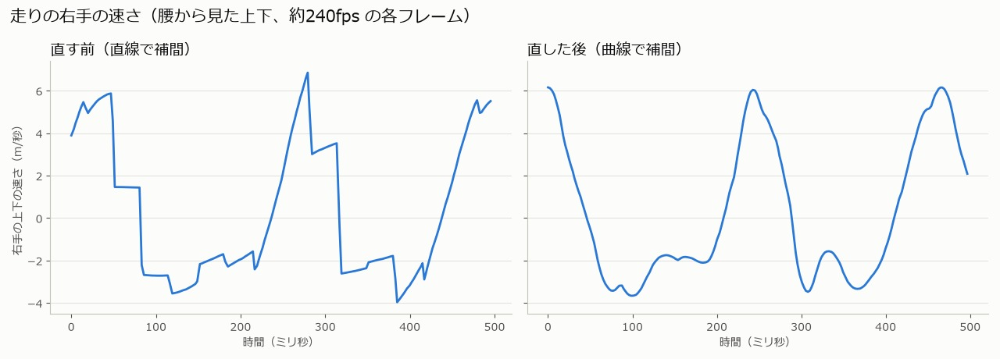

# アニメーションの再生の経緯

設計: [アニメーションの再生の設計](アニメーションの再生の設計.md)
手順: [アニメーションの再生の手順](アニメーションの再生の手順.md)

何をして、なぜ今の形になったかの記録です。日付ごとに書き足します。

---

## 2026-11-08 手順書を書いた

キーフレームの間の補間（#48）と、クリップの切り替えの補間を曲線にした変更（#53）を、[アニメーションの再生の手順](アニメーションの再生の手順.md) にした。diff は `git diff` から作ったので、コードは変更のときと同じ。

どう確かめたか: 作業用フォルダー（main を `git worktree` で取り出したもの）で、手順書の diff を逆に当てた。`AnimationPlayController.cpp` は #48 の前、`AnimationPlayController.h` は #53 の前のコミットと同じになった。そこから手順1〜4を1つずつ当て、そのたびに Game.sln を Debug x64 でビルドして、すべて通った。最後は main と差がなくなった。画面での確かめはしていない（コードは main と同じ）。

## 2026-11-09 キーフレームの間を曲線で補間するようにした

### 1. 現状の問題

「アニメーションがカクカクしている」「ずっと走っている間も続く」「30フレームだからじゃないかな。今は 240フレームくらいが平均で、500フレームまで伸びるときもある」とのことだった。

静止画ではカクカクが見えないので、画面の代わりに、走っている間の右手の動きを測った。撮影用の版（作業用フォルダで、ずっと前へ走るようにしたもの）で、プレイヤーの腰から見た右手の位置を、フレームごとにログへ出した（約240fps）。手はどのフレームでも動いていて補間は効いていたが、上下の速さが、キーフレームのところで 587 → 146 cm/秒、144 → -222 cm/秒のように1フレームで急に変わっていた（下の図の左）。

### 2. ソースコードの問題箇所

[AnimationPlayController.cpp](../../k2EngineLow/graphics/AnimationPlayController.cpp) の `SamplingBoneMatrixFromAnimationClip()` は、1つ前のキーフレームと今のキーフレームの間を直線で補間していた（回転は Slerp）。

```cpp
const float t = max(0.0f, min(1.0f, (m_time - prev->time) / span));
m_boneMatrix[keyframe->boneIndex] = InterpolateBoneMatrix(prev->transform, keyframe->transform, t);
```

直線の補間では、手足はキーフレームを結んだ折れ線の上を、キーフレームの間は同じ速さで動き、キーフレームのところで向きと速さが急に変わる。走りのクリップは 30fps なので、この角が1秒に約30回ある。FPS が 30 くらいなら目立たないが、240fps では角と角の間の8フレームほどがまっすぐ動いて角で折れるのが見え、カクカクする。

ゲームの時間（直近30フレームの平均）と実際のフレームの間隔のずれも調べた。中央値で 8% ほどずれていたが、速さが急に変わる量はキーフレームのところ（数百 cm/秒）の方がずっと大きかったので、今回は直していない。

### 3. 直し方

前後のキーフレームも使い、4つのキーフレームを通る曲線（Catmull-Rom）で補間する。平行移動・拡大・回転に分け、それぞれの成分を曲線にする。回転はクォータニオンの向きをそろえてから成分ごとに曲線にし、正規化する（Slerp を4点に広げた Squad より簡単で、キーフレームの間隔が 1/30 秒と短いので見た目の差はない）。

| 候補 | 選ばなかった理由 |
|---|---|
| UE で 60fps・120fps に書き出し直す | UE もキーフレームの間は直線で補間するので、角が細かくなるだけ。曲線で間を埋めるスクリプトが別に要り、クリップごとに作り直しになる |
| ゲームの時間を平均にしない | 測ると、カクカクの大きさはキーフレームの角の方がずっと大きかった |

### 4. ソースコードの直し

`InterpolateBoneMatrix()`（直線）を `InterpolateBoneMatrixCurve()`（曲線）に置き換え、`SamplingBoneMatrixFromAnimationClip()` で前後のキーフレームを選ぶようにした。コードは [アニメーションの再生の手順](アニメーションの再生の手順.md) の手順1〜3にある。

同じ撮影用の版で、補間だけを直線と曲線で入れ替えて測った（走っている2.4秒の間）。

| | 1フレームでの速さの変わり方（中央値） | 95% の値 | 最大 | 100 cm/秒より大きく変わったフレーム |
|---|---|---|---|---|
| 直す前（直線） | 17 cm/秒 | 143 cm/秒 | 503 cm/秒 | 62 |
| 直した後（曲線） | 35 cm/秒 | 58 cm/秒 | 84 cm/秒 | 0 |

中央値が少し上がったのは、直線ではキーフレームの間がまっすぐ（変化 0）だったのが、曲線では毎フレーム少しずつ変わるようになったため。



### 5. どう確かめたか

- 上の計測は、作業用フォルダで、移動の入力をずっと前・左Shift を押しっぱなしにし、`ModelRender::Update()` でプレイヤーのモデルだけ、腰から見た右手の位置と時間を CSV に書く撮影用の変更を入れた版で行った。ゲームは最小化・非アクティブ・透明で起動し、8秒で終了させた。
  - はじめは、同じ骨格の敵のモデルのログが出ていて、直線と曲線で同じ結果になった。プレイヤーのモデルだけを出すように直して測り直した。
  - k2EngineLow だけを直して並列ビルドすると、Game.exe が古いライブラリのままリンクされていた（Game.exe の時刻が k2EngineLow.lib より古い）。Game.exe を消してビルドし直してから測った。手順書にも注意を書いた。
- 手順書は、元の形（#3 の `AnimationPlayController.cpp`・`.h`）から手順1〜5を1つずつ当て、そのたびに Game.sln を Debug x64 でビルドして通ることを確かめた。最後はブランチのコードと同じになった。

