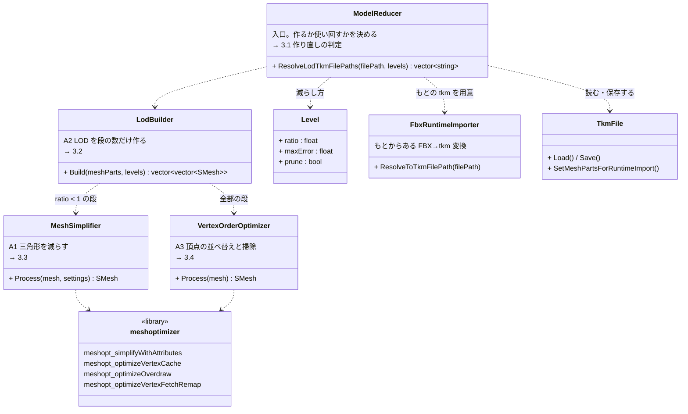
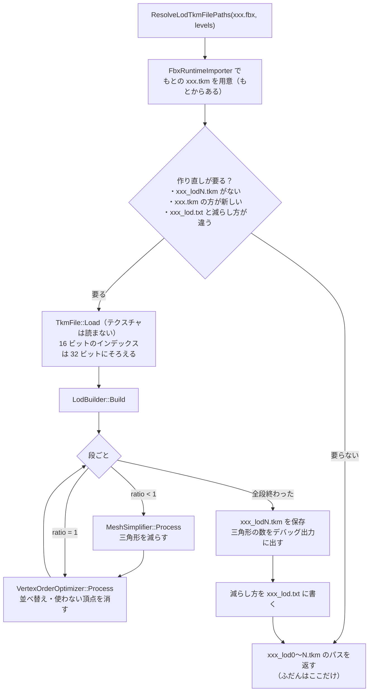

# モデルの軽量化の設計

作成日: 2026-11-10
対象: [tkFile/ModelReducer/](../../k2EngineLow/tkFile/ModelReducer/)（ModelReducer・LodBuilder・MeshSimplifier・VertexOrderOptimizer）、[exlib/meshoptimizer/](../../exlib/meshoptimizer/)（meshoptimizer 1.3、MIT ライセンス）
経緯: [ステージの軽量化の経緯](../ゲーム/ステージ/ステージの軽量化の経緯.md)

モデル（.fbx か .tkm）を渡すと、三角形を減らしたモデル（LOD）と、GPU が速く描ける順に並べ替えたモデルを tkm で作って返す仕組みのページです。ステージの部品（[ステージの部品の描き方の設計](../ゲーム/ステージ/ステージの部品の描き方の設計.md)）で使っています。

- **起動のたびには作らない。** 作るのは、LOD の tkm がない・もとのモデルの方が新しい・減らし方が変わった、のどれかのときだけ。作った tkm は git に入れる。
- **もとの `xxx.tkm` は変えない。** LOD は `xxx_lod0.tkm`・`xxx_lod1.tkm` … として別に作るので、ほかのモデルの読み込みには影響しない。
- **1つの仕事 = 1つのクラス。** 受け取ったメッシュから新しいメッシュを作って返すだけで、入力は変えない。

---

## 1. 全体像（クラス図）



| 記号 | 方法 | クラス | 何をするか |
|---|---|---|---|
| A1 | 簡略化 | `MeshSimplifier` | 形・UV の継ぎ目・法線をなるべく崩さずに、マテリアルごとに三角形を減らす |
| A2 | LOD を作る | `LodBuilder` | 段ごとに A1 → A3 を通して、細かさの違うモデルを作る |
| A3 | 頂点の並べ替え | `VertexOrderOptimizer` | 頂点キャッシュに当たりやすい順・重ね塗りの少ない順に並べ、使っていない頂点を消す（見た目は変わらない） |

## 2. 流れ（フローチャート）



## 3. 実装方法

### 3.1 作り直しの判定（ModelReducer）

減らし方は `version 1` の行と、段ごとの `ratio 0.35 maxError 0.04 prune 0` の行を並べた文字列にして、`xxx_lod.txt` に書いておく。次の起動では、この文字列と今の減らし方を比べる。ファイルの日時は `GetFileAttributesExA` で取る（エンジンは C++14 なので `std::filesystem` を使わない）。減らし方の書き方を変えたときは `SETTINGS_VERSION` を上げると、全部作り直される。

### 3.2 LOD を作る（LodBuilder）

```cpp
for (const Level& level : levels) {
    for (const auto& mesh : meshParts) {
        if (level.ratio < 1.0f) {
            parts.push_back(VertexOrderOptimizer::Process(MeshSimplifier::Process(mesh, level)));
        } else {
            parts.push_back(VertexOrderOptimizer::Process(mesh));  // 0 段目は並べ替えだけ
        }
    }
}
```

### 3.3 三角形を減らす（MeshSimplifier）

- `meshopt_simplifyWithAttributes` に、位置のほかに UV（重み 1.0）と法線（重み 0.5）を渡す。UV の継ぎ目や角が崩れにくい。
- 目標の三角形の数は `元の数 × ratio`。ただし形のずれが `maxError`（モデルの大きさを 1 とした割合）を超える所では止まるので、目標まで減らないこともある。
- `prune` が true の段は `meshopt_SimplifyPrune` を付け、小さく離れた部品（細い葉など）を消してでも減らす。遠い段だけに使う。
- インデックスだけを減らし、頂点バッファはそのまま返す（使わなくなった頂点の掃除は A3 の仕事にした）。全部消えたマテリアルは、もとのインデックスを残す（空だと描画で困るため）。

### 3.4 並べ替え（VertexOrderOptimizer）

1. マテリアルごとに `meshopt_optimizeVertexCache` → `meshopt_optimizeOverdraw`（しきい値 1.05）で三角形の順を並べ替える。
2. 全マテリアルのインデックスをつないで `meshopt_optimizeVertexFetchRemap` で新しい頂点番号を作り、頂点を使う順に並べ直す。使われない頂点は消える。

## 4. 使い方

```cpp
#include "tkFile/ModelReducer/ModelReducer.h"

std::vector<nsK2EngineLow::ModelReducer::Level> levels = {
    { 1.0f },               // 0 段目: 並べ替えだけ
    { 0.35f, 0.04f },       // 1 段目: 35% まで、ずれ 4% まで
    { 0.12f, 0.10f, true }, // 2 段目: 12% まで、小さい部品は消してよい
};
auto paths = nsK2EngineLow::ModelReducer::ResolveLodTkmFilePaths("Assets/modelData/xxx.fbx", levels);
// paths[0] = ".../xxx_lod0.tkm" など。空なら作れなかったので、もとのモデルを使う。
modelRender.Init(paths[1].c_str(), ...);
```

- 作った `xxx_lodN.tkm` と `xxx_lod.txt` はコミットする（ほかの PC で起動のたびに作らないように）。

## 5. 決めたこと

- 簡略化は自分で書かず meshoptimizer を使った。UV の継ぎ目や輪郭を崩さない簡略化を自分で書くのは手間が大きく、Godot などのエンジンでも LOD 作りに使われているため。使う5ファイルだけを `exlib/meshoptimizer/` に置き、`ModelReducer` の部品の中からだけ使う。
- LOD はゲームの起動中に作る（初回だけ）。FBX→tkm 変換と同じく、日時で判定して使い回す形にそろえた。

## 6. 既知の課題

- 小石・石畳・茂みは `maxError` で止まり、ほとんど減らない（例: `RockPath_Round_Small_1` は 998 → 954）。`maxError` を上げるか、LOD を使わない設定にする。
- 減らすときにスキン（ボーンの重み）は見ていない。アニメーションするモデルに使うと、関節が崩れることがある。

## 7. 関連するページ

- [ステージの部品の描き方の設計](../ゲーム/ステージ/ステージの部品の描き方の設計.md)
- [モデル読み込みの設計](モデル読み込みの設計.md)（FBX→tkm 変換）
- [インスタンス描画の設計](インスタンス描画の設計.md)
