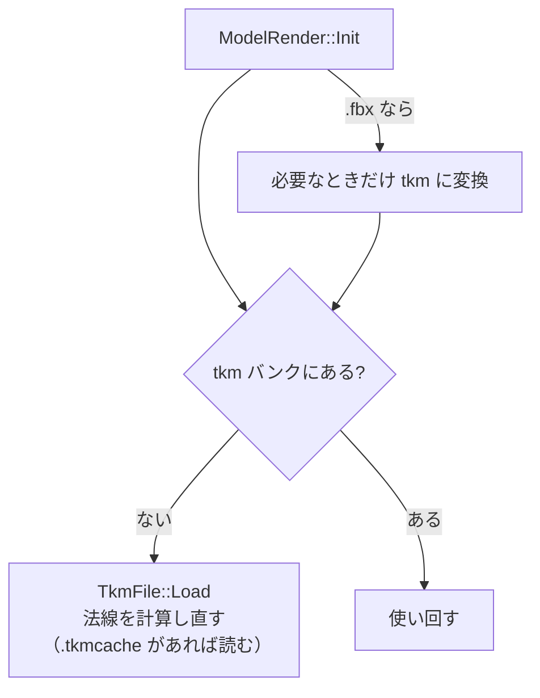

# モデル読み込みの設計

作成日: 2026-11-05（2026-11-07 に法線スムージングを [法線スムージングとBSPの設計](../法線スムージングとBSP/法線スムージングとBSPの設計.md) へ分けた）
対象: `k2EngineLow` のモデル読み込み（FBX→tkm 変換、tkm 読み込み）
経緯: [起動時のモデルロード高速化の経緯](../../最適化/起動/起動時のモデルロード高速化/起動時のモデルロード高速化の経緯.md)、[FBXランタイムインポートの経緯](../FBXランタイムインポート/FBXランタイムインポートの経緯.md)、[モデル読み込みの経緯](モデル読み込みの経緯.md)
手順: [モデル読み込みの手順](モデル読み込みの手順.md)（FBX を tkm に変換する仕組みを、何もない状態から作る）

`ModelRender::Init()` にモデルを渡してから描画できる状態になるまでに、エンジンの中で何が行われているかのページです。起動時間に大きく関わるので、モデル読み込み・FBX インポーターを触るときは先に読んでください。

- **FBX は必要なときだけ変換する。** 更新日時を比べ、変換結果（tkm/tks/tka）は git で管理する。
- **変換のときに重複した頂点をまとめる。** GPU に渡す頂点数を減らす。
- **同じ tkm は1回だけ読み込む。** tkm を使う所は、どこも tkm バンクを通す。

**用語:**

| 用語 | 何のことか |
|---|---|
| FBX | 3D モデルのデータを入れるファイルの形式（`.fbx`）。Autodesk 社のもの |
| tkm | k2Engine のモデルのファイル（`.tkm`）。頂点・面・マテリアルが入っている |
| tks | k2Engine のスケルトン（骨の構造）のファイル（`.tks`） |
| 頂点 | モデルの形を作る点。座標・法線・UV などを持つ |
| tkm バンク | 読み込んだ tkm を、ファイルのパスを名前にして覚えておく入れ物。同じ tkm をもう一度読まないために使う（1章） |

---

## 1. 全体の流れ



**用語:**

| 用語 | 何のことか |
|---|---|
| 法線 | 面や頂点が向いている方向（長さ 1 の `Vector3`）。光の当たり方の計算に使う |
| `.tkmcache` | このプロジェクトで足した、計算し直した法線などを保存しておくファイル。`.tkm` の隣に作る |

| 段階 | 処理 | コード |
|---|---|---|
| ① | FBX→tkm/tks/tka 変換とキャッシュ判定 | [FbxRuntimeImporter.cpp](../../../k2EngineLow/tkFile/FbxRuntimeImporter.cpp) |
| ② | tkm バンクの確認 | [Model.cpp](../../../k2EngineLow/graphics/Model.cpp)、[ComputeAnimationVertexBuffer.cpp](../../../k2EngineLow/graphics/ComputeAnimationVertexBuffer.cpp) |
| ③〜⑤ | tkm 読み込みと法線スムージング | [TkmFile.cpp](../../../k2EngineLow/tkFile/TkmFile.cpp) の `Load()`、`BuildTangentAndBiNormal()` |
| ⑤ | 同じ座標の頂点の探索 | [BSP.cpp](../../../k2EngineLow/geometry/BSP.cpp) |

**用語:**

| 用語 | 何のことか |
|---|---|
| BSP | Binary Space Partitioning（二分空間分割）。空間を平面で2つに分けることを繰り返して木にし、点を速く探せるようにする方法 |
| 法線スムージング | 同じ座標の頂点どうしで法線を平均して、陰影を滑らかにすること |

法線の計算は [法線スムージングとBSPの設計](../法線スムージングとBSP/法線スムージングとBSPの設計.md) にあります。計算した結果は `.tkmcache` に書いておき、次の起動から使い回します（[法線のキャッシュの設計](../../最適化/起動/法線のキャッシュ/法線のキャッシュの設計.md)）。

### tkm バンク

`ModelRender::Init()` の中では、同じ tkm を2か所で使います。

| 使う所 | 何に使うか |
|---|---|
| `ComputeAnimationVertexBuffer::Init()`（先に呼ばれる） | アニメーションした頂点を GPU で作るための、元の頂点とインデックス |
| `Model::Init()`（G-Buffer・Z プリパス・シャドウの描画用に3回） | メッシュとマテリアル（テクスチャ） |

**用語:**

| 用語 | 何のことか |
|---|---|
| インデックス | 三角形が「何番目の頂点を使うか」を並べた番号の配列。同じ頂点を、いくつもの三角形で共有できる |
| メッシュ | 頂点とインデックスをまとめた、モデルの形のひとかたまり |
| マテリアル | 面の見え方の設定。シェーダーと、テクスチャ（色・法線・スペキュラ）が入っている |
| G-Buffer | 色・法線・位置などを、画面と同じ大きさの画像に分けて書き出したもの。あとでまとめてライティングする |
| Z プリパス | 色を塗る前に、深度（奥行き）だけを先に書く描画。あとの描画で、見えない所を塗らずに済む |
| シャドウ | 影をつけるために、光から見た深度の画像（シャドウマップ）を描く描画 |
| アニメーションした頂点 | ボーンの動きを反映して動かした頂点。ここでは GPU で計算する |

どちらも、まず `g_engine->GetTkmFileFromBank()` で読み込み済みのものを探し、なければ読み込んで `RegistTkmFileToBank()` で登録します。読み込むときは、どちらもテクスチャまで読みます（先に読むのは `ComputeAnimationVertexBuffer` ですが、あとで `Model` が同じものを使うため）。tkm の読み込みでは法線を計算し直すので、どこかがバンクを通さずに読むと、そのぶん起動が遅くなります。

### マテリアルバンク

`MeshParts` は、メッシュのマテリアルを作るときに、シェーダーのファイル・入口の関数・描く先の形式・半透明・深度・テクスチャ3枚（色・法線・スペキュラ）の名前を「, 」でつないだ文字列を名前にして、マテリアルバンクで探します。同じ名前のマテリアルがあれば使い回し、なければ作って登録します。

**用語:**

| 用語 | 何のことか |
|---|---|
| シェーダー | GPU で動くプログラム。色や位置の計算をする |
| 法線マップ | 面の細かい凹凸の向き（法線）を入れたテクスチャ |
| スペキュラ | 光の反射（つや）の強さ。スペキュラマップは、その強さを入れたテクスチャ |

名前の長さは決まっていないので、`snprintf` で先に長さを数えてから、その長さの `std::string` に書きます（テクスチャの名前が長いと 260文字（`MAX_PATH`）を超えるため。[モデル読み込みの経緯](モデル読み込みの経緯.md)）。

```cpp
// MeshParts::CreateMeshFromTkmMesh
std::string materiayKey(formatMaterialKey(nullptr, 0), '\0');  // 長さを数える
formatMaterialKey(&materiayKey[0], materiayKey.size() + 1);    // 書く
auto mat = materialBank.Get(materiayKey.c_str());
```

**名前:**

| ジャンル | 名前 | 何のためのもの | 何をするためのもの | どこから来たもの |
|---|---|---|---|---|
| 変数 | `materiayKey` | マテリアルを見分ける名前を入れるため | シェーダーのファイル・入口の関数・描く先の形式・テクスチャ 3枚の名前などを「, 」でつないだ文字列。バンクで探すときの名前になる | k2EngineLow（エンジン）の [MeshParts.cpp](../../../k2EngineLow/graphics/MeshParts.cpp)（`CreateMeshFromTkmMesh()` の中。綴りは `materiay` のまま） |
| 変数 | `formatMaterialKey` | 同じ書き方を、長さを数えるときと書くときの2回使うため | 書く先と大きさを受け取り、`snprintf` で名前を書くラムダ式。書く先が `nullptr`・大きさ 0 なら、書かずに要る長さだけを返す | k2EngineLow（エンジン）の [MeshParts.cpp](../../../k2EngineLow/graphics/MeshParts.cpp) |
| C++ の書き方 | `std::string(長さ, '\0')` | 長さが決まった入れ物を作るため | `'\0'`（文字列の終わりを表す文字）を長さぶん並べた文字列を作る | C++ の標準ライブラリ（`<string>`） |
| C++ の書き方 | `&materiayKey[0]` | `std::string` の中身に、`snprintf` で直接書くため | 先頭の文字のアドレスを取る。書き込める `char*` として渡せる | C++ の書き方 |
| 変数 | `materialBank` | 作ったマテリアルを覚えておくため | 名前（文字列）から `Material` を探せる入れ物（`TResourceBank<Material>`） | k2EngineLow（エンジン）の [MeshParts.cpp](../../../k2EngineLow/graphics/MeshParts.cpp)（`GetMaterialBank()` が返す） |
| 関数 | `Get()` | 名前から、登録済みのものを探すため | あればそのポインターを、なければ `nullptr` を返す | k2EngineLow（エンジン）の [TResourceBank.h](../../../k2EngineLow/util/TResourceBank.h) |
| 関数 | `c_str()` | `std::string` を、`const char*` を受け取る関数に渡すため | 文字列の先頭を指す `const char*` を返す | C++ の標準ライブラリ（`std::string` のメンバー） |

---

## 2. FBX→tkm 変換とキャッシュ

| 出力 | 作り直す条件 | 関数 |
|---|---|---|
| `xxx.tkm` / `xxx.tks` | tkm が無い、または FBX の方が新しい | `ResolveToTkmFilePath()` → `IsConversionNeeded()` |
| アニメーションの `xxx.tka` | tka が無い、アニメーション FBX の方が新しい、またはスケルトン（tks）の方が新しい | `ResolveAnimationFbxToTka()` |
| テクスチャの `xxx.dds` | dds が無い、または元画像の方が新しい | `ConvertTextureToDDS()`（texconv.exe を起動） |

> **注意: インポーターのコードを変えても、既存の tkm は作り直されません。**
> 判定は日付だけなので、変換処理を直したときは対象の `.tkm` を手で消してから起動してください。
> 変換された tkm/tks/tka は git で管理しているので、作り直したらコミットします。

---

## 3. 頂点の統合（FBX インポーター）

FBX は法線・UV を**面の角（corner）ごと**に持ち、GPU（tkm）は位置・法線・UV・スキンを**まとめて1つの頂点**として扱う。角ごとにそのまま頂点を作ると、同じ頂点が何個も重複する。
そこで、tkm に保存されるものすべて（座標・法線・UV・スキンウェイト・ボーン番号）が**全部同じ頂点だけ**を1つにまとめる。UV の継ぎ目や角ばった部分は別のまま残る。

**用語:**

| 用語 | 何のことか |
|---|---|
| 角（corner） | 三角形の3つの角。FBX は、角ごとに法線・UV を持つ |
| UV | 頂点に貼るテクスチャの座標。UV が切り替わる所が「UV の継ぎ目」で、同じ座標でも頂点が2つに分かれる |
| スキンウェイト・ボーン番号 | 頂点が、どのボーン（骨）に、どれだけの割合で引っ張られるか。ボーンの動きに合わせて頂点を動かすこと（スキン）に使う |

| | 統合前 | 統合後 |
|---|---|---|
| 頂点数 | 124,521 | **28,493** |
| インデックス数（ポリゴン数×3） | 124,521 | 124,521 |
| SK_Player.tkm のサイズ | 7.5MB | 2.1MB |

---

## 4. 実装方法（頂点の統合）

属性をバイト列のキーにしてハッシュマップで引く。

**用語:**

| 用語 | 何のことか |
|---|---|
| 属性 | 頂点が持つ値（座標・法線・UV・スキンウェイト・ボーン番号） |
| バイト列 | メモリに並んだ、1バイトずつの値。同じ型のデータは、同じ値なら同じバイト列になる |
| ハッシュマップ | 鍵から値を速く探せる入れ物。鍵から作った数（ハッシュ値）で、入れる場所を決める。C++ では `std::unordered_map` |

```cpp
// FbxRuntimeImporter.cpp
struct VertexKey {
    float pos[3];
    float normal[3];
    float uv[2];
    float skinWeights[4];
    int indices[4];
    bool operator==(const VertexKey& rhs) const {
        return std::memcmp(this, &rhs, sizeof(VertexKey)) == 0;   // バイト列で比べる
    }
};
static_assert(sizeof(VertexKey) == 4 * 16, "VertexKeyにパディングが入っています。");

struct VertexKeyHash {   // FNV-1a（64bit）をバイト列にかける
    size_t operator()(const VertexKey& key) const { ... }
};
```

**名前:**

| ジャンル | 名前 | 何のためのもの | 何をするためのもの | どこから来たもの |
|---|---|---|---|---|
| 型 | `VertexKey` | 2つの頂点が全部同じかを比べるため | 座標・法線・UV・スキンウェイト・ボーン番号だけを並べた構造体 | k2EngineLow（エンジン）の [FbxRuntimeImporter.cpp](../../../k2EngineLow/tkFile/FbxRuntimeImporter.cpp) |
| C++ の書き方 | `operator==` | `==` で2つの `VertexKey` を比べられるようにするため | `std::unordered_map` が、同じ鍵かを調べるときに使う | C++ の書き方 |
| 関数 | `std::memcmp()` | 2つのメモリの中身を、バイト単位で比べるため | 同じなら 0 を返す | C++ の標準ライブラリ（`<cstring>`。[FbxRuntimeImporter.cpp](../../../k2EngineLow/tkFile/FbxRuntimeImporter.cpp) で読み込み） |
| C++ の書き方 | `static_assert` | 条件をビルドのときに確かめるため | 条件が偽ならビルドを止め、メッセージを出す。ここでは `VertexKey` の大きさが 4バイト × 16個ちょうど（パディングなし）かを確かめる | C++ の書き方 |
| 型 | `VertexKeyHash` | `std::unordered_map` が `VertexKey` のハッシュ値を作るため | `operator()` で、`VertexKey` のバイト列から FNV-1a でハッシュ値を作って返す | k2EngineLow（エンジン）の [FbxRuntimeImporter.cpp](../../../k2EngineLow/tkFile/FbxRuntimeImporter.cpp) |
| C++ の書き方 | `operator()` | 構造体を、関数のように呼べるようにするため | `VertexKeyHash` を `std::unordered_map` に渡すと、鍵ごとに呼ばれる | C++ の書き方 |
| 型 | `size_t` | 大きさや個数を表すため | 符号なしの整数 | C++ の標準ライブラリ（`<cstddef>`） |

**用語:**

| 用語 | 何のことか |
|---|---|
| パディング | 構造体のメンバーの間や後ろに、コンパイラーが境目をそろえるために入れる、使われない隙間 |
| ハッシュ値 | データから作る数。同じデータからは同じ数ができ、ハッシュマップが入れる場所を決めるのに使う |
| FNV-1a | ハッシュ値を作る方法の1つ。バイトを1つずつ `^`（排他的論理和）で混ぜ、決まった数をかけることを繰り返す |

```cpp
// BuildMeshParts()：メッシュごとにマップを1つ持つ
std::unordered_map<VertexKey, uint32_t, VertexKeyHash> vertexIndexMap;
vertexIndexMap.reserve(mesh->num_indices);

// 三角形の角（corner）ごとに頂点を作り…
uint32_t newIndex = (uint32_t)dstMesh.vertexBuffer.size();
auto inserted = vertexIndexMap.emplace(MakeVertexKey(v), newIndex);
if (inserted.second) {
    dstMesh.vertexBuffer.push_back(v);              // 初めて出てきた頂点だけ足す
}
dstIb.indices.push_back(inserted.first->second);  // インデックスは既存の番号を使う
```

**名前:**

| ジャンル | 名前 | 何のためのもの | 何をするためのもの | どこから来たもの |
|---|---|---|---|---|
| 型 | `std::unordered_map` | 頂点から、その番号を速く探すため | 鍵から値を探せる入れ物（ハッシュマップ）。ここでは「頂点 → 頂点バッファの番号」 | C++ の標準ライブラリ（`<unordered_map>`。[FbxRuntimeImporter.cpp](../../../k2EngineLow/tkFile/FbxRuntimeImporter.cpp) で読み込み） |
| テンプレートの引数 | `<VertexKey, uint32_t, VertexKeyHash>` | 鍵・値・ハッシュ値の作り方を決めるため | 順に、鍵の型・値の型・鍵のハッシュ値を作る型 | C++ の書き方 |
| 型 | `uint32_t` | 頂点の番号を入れるため | 32ビットの符号なし整数 | C++ の標準ライブラリ（`<cstdint>`） |
| 変数 | `vertexIndexMap` | すでに作った頂点の番号を覚えるため | `VertexKey` から、頂点バッファの番号を引く。メッシュごとに1つ | k2EngineLow（エンジン）の [FbxRuntimeImporter.cpp](../../../k2EngineLow/tkFile/FbxRuntimeImporter.cpp)（`BuildMeshParts()` の中） |
| 関数 | `reserve()` | 入れる数がわかっているとき、途中で作り直すのを避けるため | 先に入れ物の大きさを用意する。ここでは角の数（`mesh->num_indices`）個 | C++ の標準ライブラリ（`std::unordered_map` のメンバー） |
| メンバー変数 | `mesh->num_indices` | 角の数を知るため | メッシュ全体の角の数 | 外部ライブラリ（ufbx）の [ufbx.h](../../../k2EngineLow/ExEngine/ufbx/ufbx.h) の `ufbx_mesh` |
| 変数 | `newIndex` | 新しい頂点が入るときの番号にするため | 今の頂点バッファの大きさ（次に入る場所の番号） | k2EngineLow（エンジン）の [FbxRuntimeImporter.cpp](../../../k2EngineLow/tkFile/FbxRuntimeImporter.cpp)（`BuildMeshParts()` の中） |
| 変数 | `dstMesh` | 変換した結果のメッシュを持つため | `TkmFile::SMesh`。頂点バッファ・インデックスバッファ・マテリアルを持つ | k2EngineLow（エンジン）の [TkmFile.h](../../../k2EngineLow/tkFile/TkmFile.h) |
| メンバー変数 | `vertexBuffer` | メッシュの頂点を並べるため | `SVertex` の配列 | k2EngineLow（エンジン）の [TkmFile.h](../../../k2EngineLow/tkFile/TkmFile.h) の `SMesh` |
| 関数 | `emplace()` | 「探す」と「入れる」を1回の検索でするため | 鍵がまだなければ入れ、あれば何もしない。戻り値は（入れた場所, 新しく入れたか）の組（`std::pair`） | C++ の標準ライブラリ（`std::unordered_map` のメンバー） |
| 関数 | `MakeVertexKey()` | 頂点から鍵を作るため | `TkmFile::SVertex` の座標・法線・UV・スキンウェイト・ボーン番号を詰めた `VertexKey` を返す | k2EngineLow（エンジン）の [FbxRuntimeImporter.cpp](../../../k2EngineLow/tkFile/FbxRuntimeImporter.cpp) |
| 変数 | `v` | 角ごとに作った頂点を持つため | `TkmFile::SVertex`。座標・法線・UV・スキンウェイトなどが入る | k2EngineLow（エンジン）の [TkmFile.h](../../../k2EngineLow/tkFile/TkmFile.h) |
| 変数 | `inserted` | 新しい頂点かを知るため | `inserted.second` が `true` なら新しい頂点。`inserted.first->second` が、その頂点の番号（新しくても既存でも） | C++ の書き方（`emplace()` の戻り値） |
| 変数 | `dstIb` | マテリアルごとのインデックスバッファを作るため | `TkmFile::SIndexBuffer32`。`indices` に、頂点の番号を三角形の順に並べる | k2EngineLow（エンジン）の [TkmFile.h](../../../k2EngineLow/tkFile/TkmFile.h) |

| 書き方 | 理由 |
|---|---|
| 全メンバを4バイト型にして `static_assert` で確かめる | パディングがないので、`memcmp` とバイト列のハッシュで正しく比べられる |
| `emplace` の戻り値で、新しいか既存かを1回の検索で判定する | 探してから入れる、の2回の検索をしない |
| マップをメッシュごとに持つ | 1つのメッシュの頂点バッファは、そのメッシュの全マテリアル（インデックスバッファ）で共有しているため |

浮動小数点をバイト単位で比べるので、`0.0` と `-0.0` は別の頂点になります。まとまらないだけで、表示はおかしくなりません。

---

## 5. 使い方

### FBX インポーターの変換処理を変えたとき

1. 対象の `.tkm`（アニメーションなら `.tka`）を手で消す。日付だけで判定しているので、消さないと作り直されない。
2. 起動して作り直す。
3. 作り直した tkm/tks/tka をコミットする。

### tkm に保存する頂点の属性を足すとき

`VertexKey` にもメンバーを足します。4バイトの型にして、パディングを入れないでください（`static_assert` で確かめています）。足さないと、その属性が違う頂点がまとめられてしまいます。

---

## 6. 既知の課題

- **起動直後の数秒はシェーダーのコンパイル。** `Shader::Load()` は起動のたびに `D3DCompileFromFile` でコンパイルし、`K2_DEBUG` では最適化なしになる（[Shader.cpp](../../../k2EngineLow/graphics/Shader.cpp)）。さらに速くするなら、コンパイル結果のキャッシュが候補。

---

## 7. 関連ファイル

| ファイル | 内容 |
|---|---|
| [k2Engine/graphics/ModelRender.cpp](../../../k2Engine/graphics/ModelRender.cpp) | `Init()` の入口。FBX なら tkm のパスに差し替える |
| [k2EngineLow/tkFile/FbxRuntimeImporter.cpp](../../../k2EngineLow/tkFile/FbxRuntimeImporter.cpp) | FBX→tkm/tks/tka 変換、キャッシュ判定、頂点の統合（`VertexKey`、`BuildMeshParts()`） |
| [k2EngineLow/graphics/Model.cpp](../../../k2EngineLow/graphics/Model.cpp) | tkm バンクの確認と `TkmFile::Load()` の呼び出し |
| [k2EngineLow/graphics/MeshParts.cpp](../../../k2EngineLow/graphics/MeshParts.cpp) | メッシュとマテリアルを作る。マテリアルバンクで同じマテリアルを使い回す |
| [k2EngineLow/graphics/ComputeAnimationVertexBuffer.cpp](../../../k2EngineLow/graphics/ComputeAnimationVertexBuffer.cpp) | アニメーションした頂点を作るための tkm を、tkm バンクから取る |
| [k2EngineLow/tkFile/TkmFile.cpp](../../../k2EngineLow/tkFile/TkmFile.cpp) | tkm 読み込み、法線の計算とスムージング、法線のキャッシュ（`.tkmcache`） |
| [k2EngineLow/geometry/BSP.cpp](../../../k2EngineLow/geometry/BSP.cpp) / [BSP.h](../../../k2EngineLow/geometry/BSP.h) | BSP の構築と探索 |
| [Game/Assets/modelData/player/Model/](../../../Game/Assets/modelData/player/Model) | SK_Player.FBX と、変換後の SK_Player.tkm / .tks |
