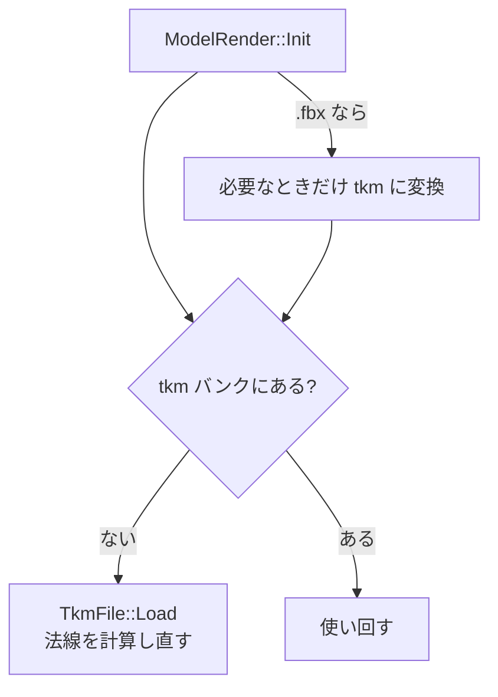

# モデル読み込みの設計

作成日: 2026-11-05（2026-11-07 に法線スムージングを [法線スムージングとBSPの設計](法線スムージングとBSPの設計.md) へ分けた）
対象: `k2EngineLow` のモデル読み込み（FBX→tkm 変換、tkm 読み込み）
経緯: [起動時のモデルロード高速化の経緯](起動時のモデルロード高速化の経緯.md)、[FBXランタイムインポートの経緯](FBXランタイムインポートの経緯.md)

`ModelRender::Init()` にモデルを渡してから描画できる状態になるまでに、エンジンの中で何が行われているかのページです。起動時間に大きく関わるので、モデル読み込み・FBX インポーターを触るときは先に読んでください。

- **FBX は必要なときだけ変換する。** 更新日時を比べ、変換結果（tkm/tks/tka）は git で管理する。
- **変換のときに重複した頂点をまとめる。** GPU に渡す頂点数を減らす。

---

## 1. 全体の流れ



| 段階 | 処理 | コード |
|---|---|---|
| ① | FBX→tkm/tks/tka 変換とキャッシュ判定 | [FbxRuntimeImporter.cpp](../../k2EngineLow/tkFile/FbxRuntimeImporter.cpp) |
| ② | tkm バンクの確認 | [Model.cpp](../../k2EngineLow/graphics/Model.cpp) |
| ③〜⑤ | tkm 読み込みと法線スムージング | [TkmFile.cpp](../../k2EngineLow/tkFile/TkmFile.cpp) の `Load()`、`BuildTangentAndBiNormal()` |
| ⑤ | 同じ座標の頂点の探索 | [BSP.cpp](../../k2EngineLow/geometry/BSP.cpp) |

法線の計算は [法線スムージングとBSPの設計](法線スムージングとBSPの設計.md) にあります。

---

## 2. FBX→tkm 変換とキャッシュ

| 出力 | 作り直す条件 | 関数 |
|---|---|---|
| `xxx.tkm` / `xxx.tks` | tkm が無い、または FBX の方が新しい | `ResolveToTkmFilePath()` → `IsConversionNeeded()` |
| アニメーションの `xxx.tka` | tka が無い、アニメーション FBX の方が新しい、またはスケルトン（tks）の方が新しい | `ResolveAnimationFbxToTka()` |
| テクスチャの `xxx.dds` | dds が無い、または元画像の方が新しい | `ConvertTextureToDDS()`（texconv.exe を起動） |

> **注意: インポーターのコードを変えても、既存の tkm は作り直されません。**
> 判定は日付だけなので、変換処理を直したときは対象の `.tkm` を手で消してから起動してください。
> 変換された tkm/tks/tka は git で管理しているので、作り直したらコミットします。

---

## 3. 頂点の統合（FBX インポーター）

FBX は法線・UV を**面の角（corner）ごと**に持ち、GPU（tkm）は位置・法線・UV・スキンを**まとめて1つの頂点**として扱う。角ごとにそのまま頂点を作ると、同じ頂点が何個も重複する。
そこで、tkm に保存されるものすべて（座標・法線・UV・スキンウェイト・ボーン番号）が**全部同じ頂点だけ**を1つにまとめる。UV の継ぎ目や角ばった部分は別のまま残る。

| | 統合前 | 統合後 |
|---|---|---|
| 頂点数 | 124,521 | **28,493** |
| インデックス数（ポリゴン数×3） | 124,521 | 124,521 |
| SK_Player.tkm のサイズ | 7.5MB | 2.1MB |

---

## 4. 実装方法（頂点の統合）

属性をバイト列のキーにしてハッシュマップで引く。

```cpp
// FbxRuntimeImporter.cpp
struct VertexKey {
    float pos[3];
    float normal[3];
    float uv[2];
    float skinWeights[4];
    int indices[4];
    bool operator==(const VertexKey& rhs) const {
        return std::memcmp(this, &rhs, sizeof(VertexKey)) == 0;   // バイト列で比べる
    }
};
static_assert(sizeof(VertexKey) == 4 * 16, "VertexKeyにパディングが入っています。");

struct VertexKeyHash {   // FNV-1a（64bit）をバイト列にかける
    size_t operator()(const VertexKey& key) const { ... }
};
```

```cpp
// BuildMeshParts()：メッシュごとにマップを1つ持つ
std::unordered_map<VertexKey, uint32_t, VertexKeyHash> vertexIndexMap;
vertexIndexMap.reserve(mesh->num_indices);

// 三角形の角（corner）ごとに頂点を作り…
uint32_t newIndex = (uint32_t)dstMesh.vertexBuffer.size();
auto inserted = vertexIndexMap.emplace(MakeVertexKey(v), newIndex);
if (inserted.second) {
    dstMesh.vertexBuffer.push_back(v);              // 初めて出てきた頂点だけ足す
}
dstIb.indices.push_back(inserted.first->second);  // インデックスは既存の番号を使う
```

| 書き方 | 理由 |
|---|---|
| 全メンバを4バイト型にして `static_assert` で確かめる | パディングがないので、`memcmp` とバイト列のハッシュで正しく比べられる |
| `emplace` の戻り値で、新しいか既存かを1回の検索で判定する | 探してから入れる、の2回の検索をしない |
| マップをメッシュごとに持つ | 1つのメッシュの頂点バッファは、そのメッシュの全マテリアル（インデックスバッファ）で共有しているため |

浮動小数点をバイト単位で比べるので、`0.0` と `-0.0` は別の頂点になります。まとまらないだけで、表示はおかしくなりません。

---

## 5. 使い方

### FBX インポーターの変換処理を変えたとき

1. 対象の `.tkm`（アニメーションなら `.tka`）を手で消す。日付だけで判定しているので、消さないと作り直されない。
2. 起動して作り直す。
3. 作り直した tkm/tks/tka をコミットする。

### tkm に保存する頂点の属性を足すとき

`VertexKey` にもメンバーを足します。4バイトの型にして、パディングを入れないでください（`static_assert` で確かめています）。足さないと、その属性が違う頂点がまとめられてしまいます。

---

## 6. 既知の課題

- **起動直後の数秒はシェーダーのコンパイル。** `Shader::Load()` は起動のたびに `D3DCompileFromFile` でコンパイルし、`K2_DEBUG` では最適化なしになる（[Shader.cpp](../../k2EngineLow/graphics/Shader.cpp)）。さらに速くするなら、コンパイル結果のキャッシュが候補。

---

## 7. 関連ファイル

| ファイル | 内容 |
|---|---|
| [k2Engine/graphics/ModelRender.cpp](../../k2Engine/graphics/ModelRender.cpp) | `Init()` の入口。FBX なら tkm のパスに差し替える |
| [k2EngineLow/tkFile/FbxRuntimeImporter.cpp](../../k2EngineLow/tkFile/FbxRuntimeImporter.cpp) | FBX→tkm/tks/tka 変換、キャッシュ判定、頂点の統合（`VertexKey`、`BuildMeshParts()`） |
| [k2EngineLow/graphics/Model.cpp](../../k2EngineLow/graphics/Model.cpp) | tkm バンクの確認と `TkmFile::Load()` の呼び出し |
| [k2EngineLow/tkFile/TkmFile.cpp](../../k2EngineLow/tkFile/TkmFile.cpp) | tkm 読み込み、法線の計算とスムージング |
| [k2EngineLow/geometry/BSP.cpp](../../k2EngineLow/geometry/BSP.cpp) / [BSP.h](../../k2EngineLow/geometry/BSP.h) | BSP の構築と探索 |
| [Game/Assets/modelData/player/Model/](../../Game/Assets/modelData/player/Model) | SK_Player.FBX と、変換後の SK_Player.tkm / .tks |
