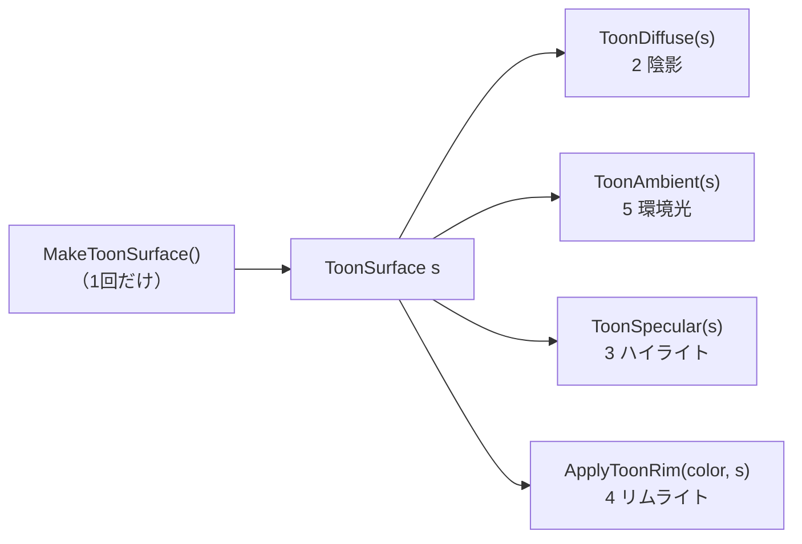

# アニメ調ライティングの設計

作成日: 2026-11-08
対象: キャラクターとステージのライティング全体（[RenderingEngine.cpp](../../../../k2Engine/graphics/RenderingEngine.cpp)、[Game/Assets/shader](../../../../Game/Assets/shader/)、[Game.cpp](../../../../Game/Source/Core/Game.cpp)）
経緯: [アニメ調ライティングの経緯](アニメ調ライティングの経緯.md)
状態: 設計案（まだ実装していない）

原神のような、明るく、キャラクターが背景から浮き立つアニメ調のライティングにするための、全体の組み立てのページです。陰影・リムライトなどの要素ごとの中身は、それぞれの設計書に書きます（このページの「2. 要素の一覧」）。このページは、これから作る形を書いています。比較画像は、要素ごとに実装してから各設計書に貼ります。

- **キャラクターだけフォワード描画のトゥーンにし、ステージは今のディファードライティング（PBR）のままにする。** キャラクターごとのテクスチャと調整値を使えるようにするため。
- **シェーダーは要素ごとのファイルと、それらを組み合わせる大枠のファイルに分ける。** 要素同士は呼び合わず、組み合わせ方は大枠だけが決める。
- **数値はデバッグUI（ImGui）で、ゲームを動かしたまま合わせる。** そのため、デバッグUIを最初に入れる。

**用語:**

| 用語 | 何のことか |
|---|---|
| PBR | Physically Based Rendering。光の反射を、物理の式に近づけて計算する描き方 |
| ZPrepass | 色を塗る前に、深度だけを先に描いておく処理。あとの描画で、隠れるピクセルの無駄な計算を省ける |
| ライトカリング | 画面を小さな区画（タイル）に分け、区画ごとに届くポイントライト・スポットライトだけを選んでおく処理 |
| アウトライン | モデルの輪郭に付ける線 |
| 背面法 | モデルの表裏を裏返して少し太らせ、単色で塗って、輪郭の線に見せる方法 |
| ポストエフェクト | 描き終わった絵の全体にかける処理（[ブルーム](../../../用語集.md#描画)、明るさの自動調整など） |
| 明るさの自動調整 | 画面全体の明るさを調べ、暗いときは明るく、明るいときは暗く見えるように、見える明るさを自動で変える処理 |
| IBL | Image Based Lighting。空などの画像から、[環境光](../../../用語集.md#描画)を引く方法（`IBL.h`） |
| ハイライト | 光が当たって、つやのある所が白く光って見える部分（鏡面反射） |
| リムライト | 輪郭に沿って付ける、光の縁 |
| ランプ | 光の当たり方（N·L など）から、色や明るさを引くための、グラデーションの小さな画像 |
| スクリーン合成 | 2つの色を、明るくなる方向にだけ混ぜる合成。元の色より暗くならない |
| 定数バッファ | C++ から、シェーダーへ数値をまとめて渡す入れ物。1回の描画の間は、どのピクセルでも同じ値になる |
| 16バイトの区切り | 定数バッファの中の値の並べ方の決まり（float 4つ分ごとに区切る）。C++ と HLSL で並びがずれると、値が違う所に入る |
| スキニング | ボーン（骨）の動きに合わせて、モデルの頂点を動かす処理 |
| ポイントライト | 1点から、まわり全体に広がる光 |
| SSAO | 画面に描いた深度から、すき間や隅の暗さを後から足す処理 |
| SSR | 画面に描いたものだけを使って、床などへの映り込みを後から足す処理 |

[トゥーン・フォワード描画・ディファードライティング・G-Buffer・N·L・ディレクションライト（平行光）](../../../用語集.md#描画) は用語集にあります。

---

## 1. 全体像

今の描画の流れ（`RenderingEngine::Execute()`）のうち、キャラクターの描き方だけを変えます。

```
ZPrepass
ライトカリング
G-Buffer に描く           ← ステージ（今のまま）
ディファードライティング   ← ステージを PBR で照らす（今のまま）
フォワード描画            ← ★キャラクターをトゥーンのシェーダーで描く ＋ ★アウトライン
ポストエフェクト           ← ★明るさを自動で合わせるのをやめ、明るく見える値に固定する
2D の描画
```

フォワード描画は、エンジンにすでにある道を使います。`ModelRender::InitForwardRendering()` で初期化したモデルは、ディファードライティングのあとに、`ModelInitData::m_fxFilePath` で指定したシェーダーで描かれます。深度は G-Buffer の深度を共有するので、ステージとの前後関係は正しく出ます。

## 2. 要素の一覧

| # | 要素 | 何をするか | シェーダーのファイル（予定） | 設計書 |
|---|---|---|---|---|
| 1 | 全体 | 描く順番、要素の組み合わせ方、調整値の持ち方 | `toon/ToonModel.fx`（大枠） | このページ |
| 2 | トゥーン陰影 | 光の当たり方を2段に分け、影を黒ではなく色の付いた影にする。ステージから落ちる影も同じ段差に入れる | `toon/ToonDiffuse.h` | トゥーン陰影の設計（予定） |
| 3 | ハイライト | くっきりした形のハイライトを、明るい側にだけ出す | `toon/ToonSpecular.h` | ハイライトの設計（予定） |
| 4 | リムライト | 輪郭に光の縁を付け、背景から浮き立たせる | `toon/ToonRim.h` | リムライトの設計（予定） |
| 5 | キャラクターの環境光 | 環境光を平らにして、影の側も暗くなりすぎないようにする | `toon/ToonAmbient.h` | キャラクターの環境光の設計（予定） |
| 6 | 顔の影 | 法線ではなく、影の形を描いたテクスチャで顔の影を決める | `toon/ToonFace.h` | 顔の影の設計（予定） |
| 7 | アウトライン | 裏返したモデルを少し太らせて描く（背面法） | `toon/ToonOutline.fx` | アウトラインの設計（予定） |
| 8 | ステージの明るさ | 明るさの自動調整・ブルーム・IBL・ライトの色を、明るい絵に合わせる | （シェーダーは変えない） | ステージの明るさの設計（予定） |
| 9 | デバッグUI | 数値をゲームを動かしたまま変える ImGui の窓 | — | [デバッグUIの設計](../../デバッグUI/デバッグUIの設計.md) |

シェーダーのファイルは `Action/Game/Assets/shader/toon/` にまとめます。どの要素のファイルからも使う共通の入力は `toon/ToonSurface.h` に置きます。

## 3. 実装方法

### 要素は ToonSurface を受け取って色や割合を返すだけ

ピクセルシェーダーの最初に、次の値を1回だけ計算し、`ToonSurface` にまとめます。

- 法線
- 光の向き
- N·L（光と面の向きの角度）
- 影の割合
- 各テクスチャの値

各要素のファイルは `ToonSurface` を受け取り、色か割合を返すだけにします。

- **要素のファイルから、ほかの要素のファイルは include しません。**
- 「リムライトは明るい側にだけ出す」のような要素同士の関係も、`ToonSurface` の N·L や影の割合を見て、各要素の中で決めます。



各要素は `s` を見るだけで、要素どうしは呼び合いません。

### 組み合わせ方は大枠だけが決める

組み合わせ方は要素ごとに違います（陰影は[アルベド](../../../用語集.md#描画)に掛ける、ハイライトは明るい側だけに足す、リムは足すかスクリーン合成）。そのため、順番と混ぜ方は大枠の `ToonModel.fx` にだけ書きます。

```hlsl
// ToonModel.fx のピクセルシェーダー（形の見本。中身は各要素の設計で決める）
float4 PSMain(SPSIn psIn) : SV_Target0
{
    ToonSurface s = MakeToonSurface(psIn);   // 共通の入力を1回だけ計算する
    float3 color = ToonDiffuse(s);           // 2: 段差の陰影と色の付いた影（アルベドを掛けた色）
    color += ToonAmbient(s);                 // 5: 平らにした環境光
    color += ToonSpecular(s);                // 3: 明るい側だけのハイライト
    color = ApplyToonRim(color, s);          // 4: リムライト（混ぜ方はリムの設計で決める）
    return float4(color, s.alpha);
}
```

**名前:**

| ジャンル | 名前 | 何のためのもの | 何をするためのもの | どこから来たもの |
|---|---|---|---|---|
| 関数 | `PSMain()` | ピクセルシェーダーの入口にするため | 1ピクセルの色を返す。ここでは形の見本 | まだない（作る予定の `ToonModel.fx`。今ある `model.fx` の `PSMainSoftShadow()` などと同じ形） |
| 型 | `SPSIn` | 頂点シェーダーからピクセルシェーダーへ渡す値をまとめるため | 画面上の位置・法線・UV・ワールド座標などを持つ構造体 | ゲームの [model.fx](../../../../Game/Assets/shader/model.fx) |
| 型 | `ToonSurface` | 光の計算に使う値を、各要素に同じ形で渡すため | 法線・光の向き・N·L・影の割合・各テクスチャの値・`alpha`（不透明度）をまとめた構造体 | まだない（作る予定の `toon/ToonSurface.h`） |
| 関数 | `MakeToonSurface()` | 共通の入力を1回だけ計算するため | `SPSIn` から `ToonSurface` を作って返す | まだない（作る予定の `ToonModel.fx`） |
| 関数 | `ToonDiffuse()`・`ToonAmbient()`・`ToonSpecular()`・`ApplyToonRim()` | 要素ごとの色を出すため | 順に、陰影（アルベドを掛けた色）・平らにした環境光・ハイライト・リムライトを混ぜた色を返す | まだない（作る予定。ファイルは、2章の表の「シェーダーのファイル」の列） |

`float4`・`float3`（HLSL の小数の組）と `SV_Target0`（描き先の0番へ書く印）は HLSL の組み込みなので、ここでは載せません。影の割合は、今の `Shadowing.h` の `CalcShadowRate()` をそのまま使います。影の計算は作り直しません。

### 調整値はキャラクター（マテリアル）ごとに持つ

影の色やリムの強さはキャラクターごとに変えたいので、`RenderingEngine` に1つだけ置くのではなく、モデルごとの定数バッファ（`ModelInitData::m_expandConstantBuffer`）で渡します。C++ 側の構造体は1つのファイルにまとめ、中を要素ごとの小さな構造体（陰影・ハイライト・リム・環境光）に分けます。定数バッファは C++ と HLSL で並び（16バイトの区切り）をぴったり合わせる必要があるので、ファイルまで分けると、ずれに気付きにくくなるためです。

ImGui の窓は、キャラクターを選んで、その調整値をさわる形にします。決まった値は JSON に保存し、起動のときに読みます。

## 4. 実装の順番

| 順番 | 要素 | この順番にした理由 |
|---|---|---|
| 1 | 9 デバッグUI | 以降の調整をすべて、ゲームを動かしたまま行うため |
| 2 | 8 ステージの明るさ | 明るさの自動調整が動いたままだと、色を合わせても画面の明るさで見え方が変わるため、先に固定する |
| 3 | 2 トゥーン陰影 | フォワード描画のトゥーンのシェーダー（大枠と ToonSurface）もここで作る。ほかの要素の土台 |
| 4 | 5 キャラクターの環境光 | 影の側の明るさを決める。2 と合わせて「明るいアニメ調」の大部分になる |
| 5 | 4 リムライト | キャラクターを背景から浮き立たせる |
| 6 | 3 ハイライト | 髪や金属など、つやを足す |
| 7 | 7 アウトライン | 線の太さは、色が決まってから合わせる |
| 8 | 6 顔の影 | 影の形のテクスチャを描く必要があり、手間が大きいので最後 |

要素ごとに「設計書 → 手順書 → 実装 → 比較画像を貼る」の順で進めます。

## 5. 決めたこと

- **ディファードの中でトゥーンにする案はやめた。** G-Buffer にキャラクターごとのテクスチャ（ランプ・影の形など）を入れる場所がなく、全キャラクターが同じ調整値になるため。
- **アウトラインは画面全体にかける方法ではなく、背面法にした。** 部位ごとに線の太さを変えられるため。
- **比較画像は実装してから貼る。** 手元で再現した見本ではなく、ゲームの実際の絵で比べるため。

## 6. 既知の課題・まだ確かめていないこと

- フォワード描画の道で、今のキャラクターのアニメーション（スキニング）と影（シャドウマップへの描画）が正しく動くかは、まだ動かしていない。2 の実装の最初に1キャラクターで確かめる。
- フォワード描画のシェーダー（今の `model.fx`）は平行光と IBL だけを計算し、ポイントライトは計算しない。キャラクターは平行光と環境光で照らす前提にする。
- キャラクターは G-Buffer に描かれないので、SSAO・SSR がかからない（アニメ調では、むしろかからない方がよい）。
- アウトラインのために、同じポーズのモデルをもう一度描く方法（モデルを2つ持つか、1つのモデルを2回描くか）は、7 の設計で決める。

## 7. 関連するページ

- [デバッグUIの設計](../../デバッグUI/デバッグUIの設計.md) — 調整用の窓
- [キャラクターモデルの設計](../../../ゲーム/キャラクター/キャラクターモデル/キャラクターモデルの設計.md) — キャラクターのモデルの読み込み（フォワード描画に変える場所）
- [JSON読み込みの設計](../../../ゲーム/システム/JSON読み込み/JSON読み込みの設計.md) — 調整値の保存先
