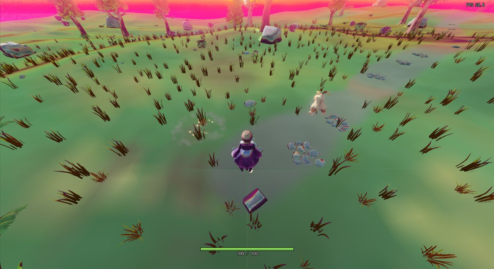
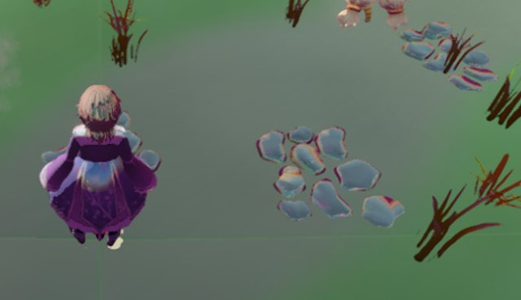
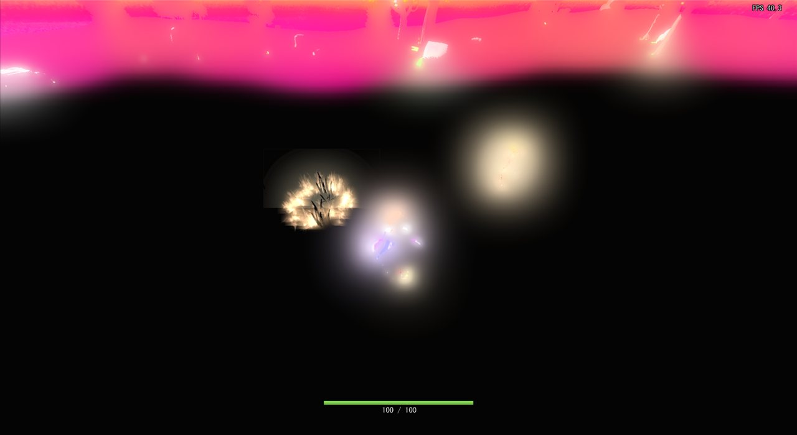
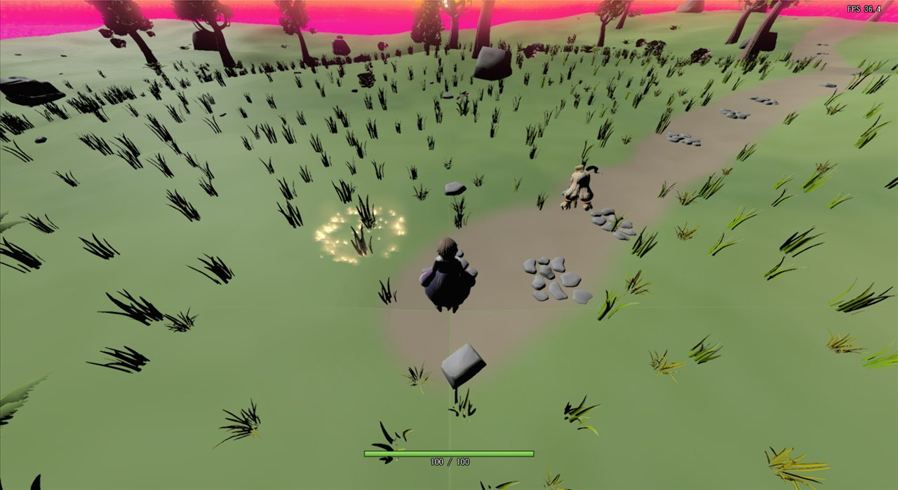
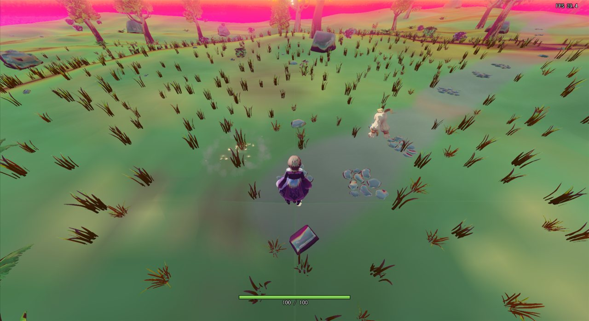
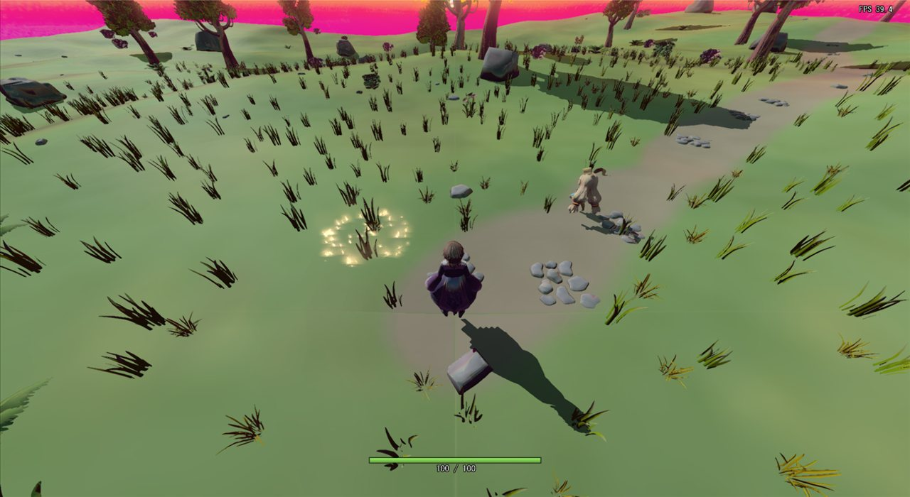
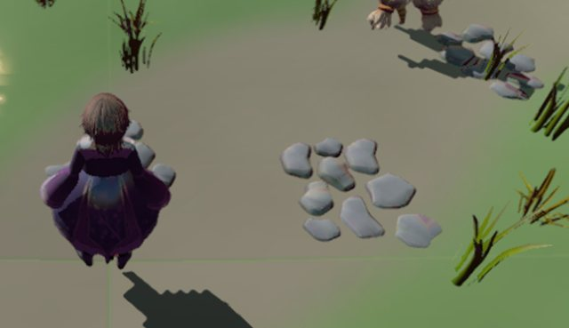

# シャドウマップのクリアの経緯

設計: [シャドウマップのクリアの設計](シャドウマップのクリアの設計.md)
手順: [シャドウマップのクリアの手順](シャドウマップのクリアの手順.md)

---

## 2026-11-09: 影を落とす物がない所が全部影になるのを直した

### 1. 現状の問題

「スペキュラがひどい」という要望を受けて、先に [鏡面反射](../鏡面反射/鏡面反射の経緯.md) の式を直したが、ユーザーから「まだキラキラしている、変わっていない」と言われた。

**用語:**

| 用語 | 何のことか |
|---|---|
| スペキュラ（鏡面反射） | 光が面に当たって、見ている向きへ照り返すこと。つやのある所が白く光って見える |

ゲームを起動してすぐの画面（Stage ブランチ、鏡面反射を直したあと）では、岩・小石・キャラクターの服が、空を映した鏡のようにテカっている。岩の縁は、空の地平線の色（ピンク）に光っている。地面にはプレイヤーや木の影が落ちていない。



| 直す前（岩とキャラクターの拡大） |
|---|
|  |

### 2. ソースコードの問題箇所

シェーダーを1つずつ切って撮り比べ、どこが原因かを絞った。

| 試したこと | 画面 | わかったこと |
|---|---|---|
| IBL（空の映り込みで足す環境光、`IBL.h`）を切る |  | 地面もキャラクターも真っ黒になる。光っているのは炎などの点光源だけ。**太陽の光がどこにも当たっておらず、IBL だけで照らされていた** |
| IBL と影（`Shadowing.h` の `CalcShadowRate()`）を切る |  | 太陽の光が当たり、テカりが消える。**影が画面全体を覆っていた** |
| 配置 JSON で部品（木・岩）の影を全部切る（IBL と影は戻す） |  | 直す前と同じ。**部品の影のせいではない** |

**用語:**

| 用語 | 何のことか |
|---|---|
| 点光源 | 1点から、まわり全体に広がる光（ポイントライト） |
| JSON | 値の名前と中身を `{ }` の中に並べて書く、人にも読めるデータの書き方。ここでは、ステージの部品の置き方を書いたファイル |

IBL は反射の向きで空を引くので、IBL だけで照らされると、全部が空を映した鏡のように見える。これが「スペキュラがひどい・キラキラする」の正体だった。

影を落とす物がない所まで影になる理由は、[ShadowMapRender.cpp](../../../../k2Engine/graphics/preRender/ShadowMapRender.cpp) のシャドウマップのクリアの値だった。

**用語:**

| 用語 | 何のことか |
|---|---|
| シャドウマップ | ライトから見た深度を、画像に描いておいたもの。照らすときに、そのピクセルが影になるかを調べるのに使う |
| クリア | 描く前に、画像全体を決まった値で埋めること |

```cpp
    void ShadowMapRender::Init(bool isSoftShadow)
    {
 
        float clearColor[4] = { 1.0f, 1.0f, 1.0f, 1.0f };   // ← 1.0 でクリアしている
```

**名前:**

| ジャンル | 名前 | 何のためのもの | 何をするためのもの | どこから来たもの |
|---|---|---|---|---|
| 関数 | `ShadowMapRender::Init()` | シャドウマップを作るため | 近景・中景・遠景の3枚のシャドウマップを作る。この抜き出しは、その最初のクリアの値を決める所 | k2Engine（エンジン）の [ShadowMapRender.cpp](../../../../k2Engine/graphics/preRender/ShadowMapRender.cpp) |
| 引数 | `isSoftShadow` | ソフトシャドウかを受け取るため | true ならソフトシャドウ用、false ならハードシャドウ用のシャドウマップを作る | k2Engine（エンジン）の [ShadowMapRender.cpp](../../../../k2Engine/graphics/preRender/ShadowMapRender.cpp) の `Init()` の引数 |
| 変数 | `clearColor` | クリアの値を持つため | r・g・b・a の4つの値。`RenderTarget::Create()` に渡す | k2Engine（エンジン）の [ShadowMapRender.cpp](../../../../k2Engine/graphics/preRender/ShadowMapRender.cpp) の `Init()` の中 |

このエンジンの影は指数シャドウマップで、シャドウマップに `exp(40 × 深度)` を書き、照らすときに `exp(40 × このピクセルの深度)` がそれ以上なら影にする（[Shadowing.h](../../../../Game/Assets/shader/Shadowing.h)）。

**用語:**

| 用語 | 何のことか |
|---|---|
| 指数シャドウマップ（ESM） | シャドウマップに、深度そのものではなく、深度を指数にした値を書く方式 |
| 深度 | ライトから見て、どれだけ奥にあるかを表す値。0.0 がライトのすぐ前、1.0 がいちばん奥 |

```hlsl
            float pos = exp(INFINITY * zInLVP);          // INFINITY = 40
            ...
            }else if(pos >= shadowValue.r ){             // シャドウマップの値以上なら影
                shadow = 1.0f;
```

**名前:**

| ジャンル | 名前 | 何のためのもの | 何をするためのもの | どこから来たもの |
|---|---|---|---|---|
| 変数 | `pos` | 照らすピクセルの深度を、シャドウマップと同じ形にするため | `exp(40 × 深度)` | ゲームの [Shadowing.h](../../../../Game/Assets/shader/Shadowing.h) の `CalcShadowRate()` の中 |
| 関数 | `exp()` | e の何乗かを出すため | e の x 乗を返す | HLSL（シェーダーの言語）の組み込み関数 |
| 値 | `INFINITY` | 指数の 40 を、シェーダーの中で1か所にまとめるため | 40。シャドウマップを描くときの指数と同じ値 | ゲームの [Shadowing.h](../../../../Game/Assets/shader/Shadowing.h) |
| 変数 | `zInLVP` | 照らすピクセルの、ライトから見た深度を持つため | 0.0〜1.0 の深度 | ゲームの [Shadowing.h](../../../../Game/Assets/shader/Shadowing.h) の `CalcShadowRate()` の中 |
| 変数 | `shadowValue` | シャドウマップの値を持つため | シャドウマップから読んだ値。r に `exp(40 × 深度)` が入っている | ゲームの [Shadowing.h](../../../../Game/Assets/shader/Shadowing.h) の `CalcShadowRate()` の中 |
| 変数 | `shadow` | 影になる割合を持つため | 0 なら光が当たり、1 なら影 | ゲームの [Shadowing.h](../../../../Game/Assets/shader/Shadowing.h) の `CalcShadowRate()` の中 |

1.0 は `exp(40 × 0)` と同じなので、「ライトのすぐ前に遮る物がある」ことになる。影を落とす物が描かれなかった所は、どの深度でも `pos ≥ 1.0` になり、全部影になる。

前のステージ（`kariAsiba`）は地面が影を落としていて、シャドウマップが地面で埋まっていたので目立たなかった。Stage ブランチの新しい地形（`StageChunk`）は「影は受けるが落とさない」設定なので、シャドウマップがほとんどクリアされたままになり、全体が影になった。

### 3. 直し方

クリアの値を、いちばん奥（深度 1.0）を表す `exp(40)` にする。照らすときに比べる深度は 0.98 未満だけなので、`pos` は必ず `exp(40)` より小さくなり、影を落とす物がない所には光が当たる。

- ソフトシャドウでは、シャドウマップの g に2乗を書いて分散に使うので、g は `exp(80)` にする。float の上限（約 3.4 × 10^38）に収まる。
- 指数の 40 はシェーダーの `INFINITY` と同じ値にする必要があるので、C++ 側に定数 `SHADOW_MAP_EXPONENT` を置く。
- シェーダー側で「クリアされたままなら光が当たる」と判定する方法もあるが、クリアの値を正しくすればシェーダーは今のままで正しく動くので、こちらにした。

**用語:**

| 用語 | 何のことか |
|---|---|
| r・g | 画像の1ピクセルが持つ値のうちの、1つ目（r）と2つ目（g）。ここではシャドウマップの値を入れている |
| ソフトシャドウ | 影のふちをぼかして、影になる割合（0〜1）で出す影 |
| 分散 | 値のばらつきの大きさ。ソフトシャドウでは、g（2乗の平均）から r の2乗を引いて出す |

エンジンの直しなので、main から `ShadowMapClear` ブランチを切って直し、Stage に取り込んだ。

### 4. ソースコードの直し

[ShadowMapRender.cpp](../../../../k2Engine/graphics/preRender/ShadowMapRender.cpp)

```diff
 namespace nsK2Engine {
+    namespace {
+        // 指数シャドウマップの指数。DrawShadowMap.fx と Shadowing.h の INFINITY と同じ値にする。
+        constexpr float SHADOW_MAP_EXPONENT = 40.0f;
+    }
+
     void ShadowMapRender::Init(bool isSoftShadow)
     {
- 
-        float clearColor[4] = { 1.0f, 1.0f, 1.0f, 1.0f };
+        // 影を落とす物が描かれなかった所は、いちばん奥（深度 1.0）の値 exp(40) にしておき、光が当たるようにする。
+        // 1.0 でクリアすると exp(40 × 0) と同じになり、「ライトのすぐ前に遮る物がある」として全部影になる。
+        // ソフトシャドウでは g に2乗を入れる（DrawShadowMap.fx と同じ）。exp(80) でも float に収まる。
+        const float farValue = expf(SHADOW_MAP_EXPONENT);
+        float clearColor[4] = { farValue, farValue * farValue, 0.0f, 1.0f };
```

**名前:**

| ジャンル | 名前 | 何のためのもの | 何をするためのもの | どこから来たもの |
|---|---|---|---|---|
| C++ の書き方 | `namespace { }` | 定数を、このファイルの中だけで使うため | 名前を付けない namespace。中に置いた名前は、このファイルの外から見えない | C++ の書き方 |
| 変数 | `SHADOW_MAP_EXPONENT` | 指数の 40 を、C++ 側で1か所にまとめるため | 40.0。シェーダーの `INFINITY` と同じ値にする | k2Engine（エンジン）の [ShadowMapRender.cpp](../../../../k2Engine/graphics/preRender/ShadowMapRender.cpp) |
| 変数 | `farValue` | いちばん奥を表す値を持つため | `exp(40)` | k2Engine（エンジン）の [ShadowMapRender.cpp](../../../../k2Engine/graphics/preRender/ShadowMapRender.cpp) の `Init()` の中 |
| 関数 | `expf()` | e の何乗かを出すため | e の x 乗を返す（`float` 用） | C の標準ライブラリ（<math.h>。[k2EngineLowPreCompile.h](../../../../k2EngineLow/k2EngineLowPreCompile.h) で読み込み済み） |
| C++ の書き方 | `nsK2Engine` | エンジンの名前を、ゲームの名前とぶつけないため | k2Engine のコードを入れる namespace | k2Engine（エンジン）の [ShadowMapRender.cpp](../../../../k2Engine/graphics/preRender/ShadowMapRender.cpp) |

直したあとは、地面に太陽の光が当たり、プレイヤー・敵・木の影が地面に落ちる。岩や服の鏡のようなテカりも消えた（炎のまわりの光る粒は、炎のエフェクト）。

| 直す前 | 直した後 |
|---|---|
|  |  |
|  |  |

### 5. どう確かめたか

- Stage ブランチ（`ShadowMapClear` を取り込んだもの）を Debug / x64 で MSBuild でビルドし、通ることを確かめた。
- 画像はどれも、ゲームを起動してすぐの同じ場所から、ゲームの窓だけを撮った。
  - 撮り方: ユーザーの画面を邪魔しないように、ゲームを最小化・非アクティブで起動する。窓を透明（不透明度 1/255）・クリックを素通り・いちばん奥にしてから、アクティブにしないで元の大きさに戻し、`PrintWindow` で窓だけを撮る。撮ったらすぐに終了させる。
  - 最初は、窓を画面の外に置いてから戻す方法を試した。しかし `SetWindowPlacement` が位置を画面の中に直したため、窓が一瞬だけ画面の左上に出た。すぐに最小化して終了させ、この方法はやめた。
  - 切り分けの画像は、Stage から切った作業用フォルダで、シェーダーや配置 JSON だけを変えて撮った（シェーダーは起動のときにコンパイルされるので、ビルドし直さなくてよい）。
- 手順書は、main から切った作業用フォルダで手順の `diff` をそのまま当て、出来上がった `ShadowMapRender.cpp` がこのブランチのものと同じになることを確かめた。ビルドは、同じコードを取り込んだ Stage ブランチのビルドで確かめた。

**名前:**

| ジャンル | 名前 | 何のためのもの | 何をするためのもの | どこから来たもの |
|---|---|---|---|---|
| 関数 | `PrintWindow` | 画面に出ていない窓の中身も、画像として撮るため | 指定した窓の中身を、画像として取り出す | Windows の API（<windows.h>） |
| 関数 | `SetWindowPlacement` | 窓の大きさ・位置・最小化などの状態を決めるため | 窓の状態をまとめて設定する | Windows の API（<windows.h>） |
