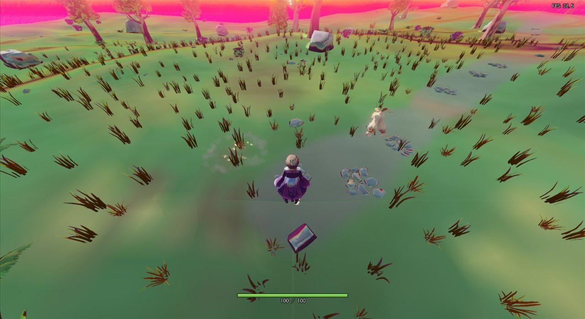
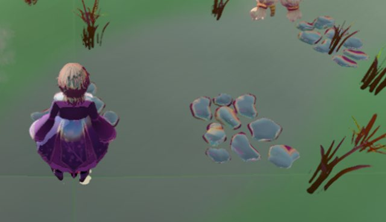
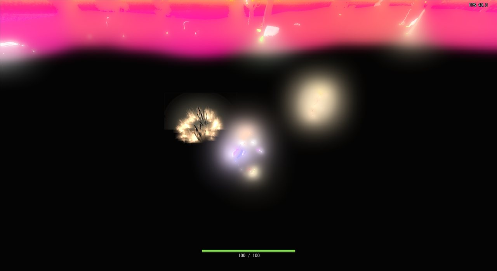
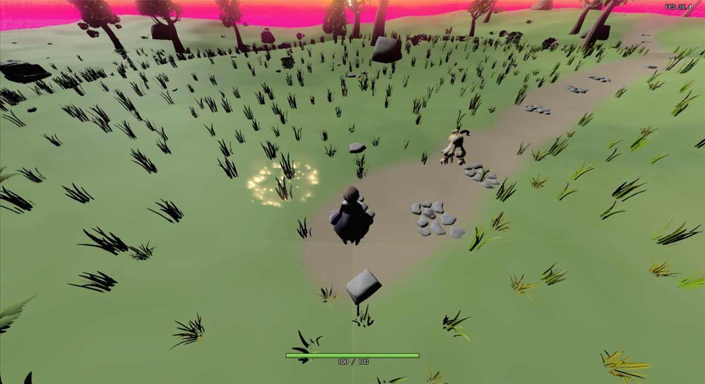
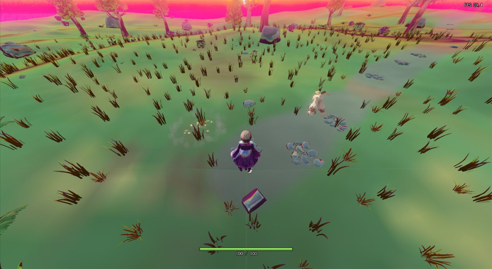
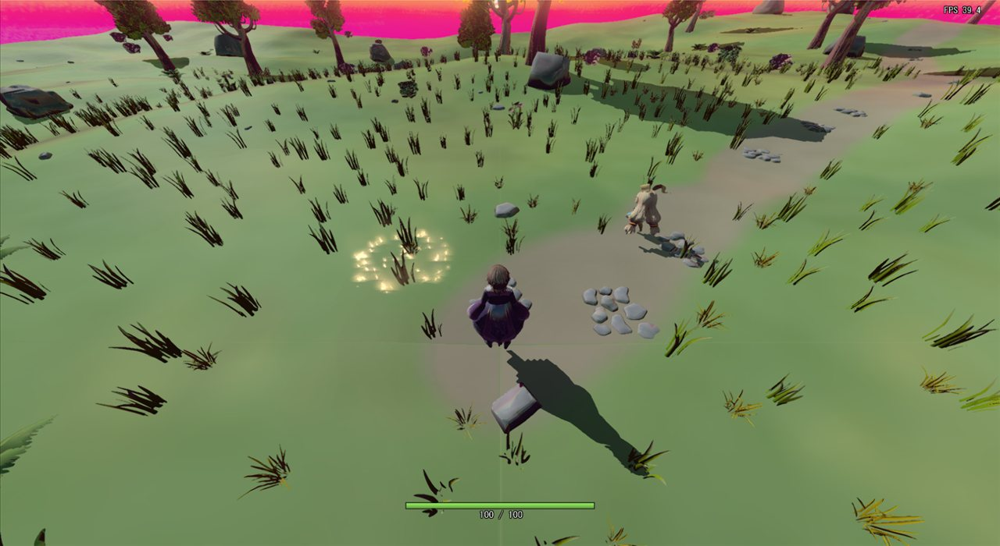
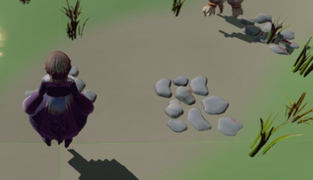

# シャドウマップのクリアの経緯

設計: [シャドウマップのクリアの設計](シャドウマップのクリアの設計.md)
手順: [シャドウマップのクリアの手順](シャドウマップのクリアの手順.md)

---

## 2026-11-09: 影を落とす物がない所が全部影になるのを直した

### 1. 現状の問題

「スペキュラがひどい」という要望を受けて、先に [鏡面反射](鏡面反射の経緯.md) の式を直したが、ユーザーから「まだキラキラしている、変わっていない」と言われた。

ゲームを起動してすぐの画面（Stage ブランチ、鏡面反射を直したあと）では、岩・小石・キャラクターの服が、空を映した鏡のようにテカっている。岩の縁は、空の地平線の色（ピンク）に光っている。地面にはプレイヤーや木の影が落ちていない。



| 直す前（岩とキャラクターの拡大） |
|---|
|  |

### 2. ソースコードの問題箇所

シェーダーを1つずつ切って撮り比べ、どこが原因かを絞った。

| 試したこと | 画面 | わかったこと |
|---|---|---|
| IBL（空の映り込みで足す環境光、`IBL.h`）を切る |  | 地面もキャラクターも真っ黒になる。光っているのは炎などの点光源だけ。**太陽の光がどこにも当たっておらず、IBL だけで照らされていた** |
| IBL と影（`Shadowing.h` の `CalcShadowRate()`）を切る |  | 太陽の光が当たり、テカりが消える。**影が画面全体を覆っていた** |
| 配置 JSON で部品（木・岩）の影を全部切る（IBL と影は戻す） |  | 直す前と同じ。**部品の影のせいではない** |

IBL は反射の向きで空を引くので、IBL だけで照らされると、全部が空を映した鏡のように見える。これが「スペキュラがひどい・キラキラする」の正体だった。

影を落とす物がない所まで影になる理由は、[ShadowMapRender.cpp](../../../k2Engine/graphics/preRender/ShadowMapRender.cpp) のシャドウマップのクリアの値だった。

```cpp
    void ShadowMapRender::Init(bool isSoftShadow)
    {
 
        float clearColor[4] = { 1.0f, 1.0f, 1.0f, 1.0f };   // ← 1.0 でクリアしている
```

このエンジンの影は指数シャドウマップで、シャドウマップに `exp(40 × 深度)` を書き、照らすときに `exp(40 × このピクセルの深度)` がそれ以上なら影にする（[Shadowing.h](../../../Game/Assets/shader/Shadowing.h)）。

```hlsl
            float pos = exp(INFINITY * zInLVP);          // INFINITY = 40
            ...
            }else if(pos >= shadowValue.r ){             // シャドウマップの値以上なら影
                shadow = 1.0f;
```

1.0 は `exp(40 × 0)` と同じなので、「ライトのすぐ前に遮る物がある」ことになる。影を落とす物が描かれなかった所は、どの深度でも `pos ≥ 1.0` になり、全部影になる。

前のステージ（`kariAsiba`）は地面が影を落としていて、シャドウマップが地面で埋まっていたので目立たなかった。Stage ブランチの新しい地形（`StageChunk`）は「影は受けるが落とさない」設定なので、シャドウマップがほとんどクリアされたままになり、全体が影になった。

### 3. 直し方

クリアの値を、いちばん奥（深度 1.0）を表す `exp(40)` にする。照らすときに比べる深度は 0.98 未満だけなので、`pos` は必ず `exp(40)` より小さくなり、影を落とす物がない所には光が当たる。

- ソフトシャドウでは、シャドウマップの g に2乗を書いて分散に使うので、g は `exp(80)` にする。float の上限（約 3.4 × 10^38）に収まる。
- 指数の 40 はシェーダーの `INFINITY` と同じ値にする必要があるので、C++ 側に定数 `SHADOW_MAP_EXPONENT` を置く。
- シェーダー側で「クリアされたままなら光が当たる」と判定する方法もあるが、クリアの値を正しくすればシェーダーは今のままで正しく動くので、こちらにした。

エンジンの直しなので、main から `ShadowMapClear` ブランチを切って直し、Stage に取り込んだ。

### 4. ソースコードの直し

[ShadowMapRender.cpp](../../../k2Engine/graphics/preRender/ShadowMapRender.cpp)

```diff
 namespace nsK2Engine {
+    namespace {
+        // 指数シャドウマップの指数。DrawShadowMap.fx と Shadowing.h の INFINITY と同じ値にする。
+        constexpr float SHADOW_MAP_EXPONENT = 40.0f;
+    }
+
     void ShadowMapRender::Init(bool isSoftShadow)
     {
- 
-        float clearColor[4] = { 1.0f, 1.0f, 1.0f, 1.0f };
+        // 影を落とす物が描かれなかった所は、いちばん奥（深度 1.0）の値 exp(40) にしておき、光が当たるようにする。
+        // 1.0 でクリアすると exp(40 × 0) と同じになり、「ライトのすぐ前に遮る物がある」として全部影になる。
+        // ソフトシャドウでは g に2乗を入れる（DrawShadowMap.fx と同じ）。exp(80) でも float に収まる。
+        const float farValue = expf(SHADOW_MAP_EXPONENT);
+        float clearColor[4] = { farValue, farValue * farValue, 0.0f, 1.0f };
```

直したあとは、地面に太陽の光が当たり、プレイヤー・敵・木の影が地面に落ちる。岩や服の鏡のようなテカりも消えた（炎のまわりの光る粒は、炎のエフェクト）。

| 直す前 | 直した後 |
|---|---|
|  |  |
|  |  |

### 5. どう確かめたか

- Stage ブランチ（`ShadowMapClear` を取り込んだもの）を Debug / x64 で MSBuild でビルドし、通ることを確かめた。
- 画像はどれも、ゲームを起動してすぐの同じ場所から、ゲームの窓だけを撮った。
  - 撮り方: ユーザーの画面を邪魔しないように、ゲームを最小化・非アクティブで起動する。窓を透明（不透明度 1/255）・クリックを素通り・いちばん奥にしてから、アクティブにしないで元の大きさに戻し、`PrintWindow` で窓だけを撮る。撮ったらすぐに終了させる。
  - 最初は、窓を画面の外に置いてから戻す方法を試した。しかし `SetWindowPlacement` が位置を画面の中に直したため、窓が一瞬だけ画面の左上に出た。すぐに最小化して終了させ、この方法はやめた。
  - 切り分けの画像は、Stage から切った作業用フォルダで、シェーダーや配置 JSON だけを変えて撮った（シェーダーは起動のときにコンパイルされるので、ビルドし直さなくてよい）。
- 手順書は、main から切った作業用フォルダで手順の `diff` をそのまま当て、出来上がった `ShadowMapRender.cpp` がこのブランチのものと同じになることを確かめた。ビルドは、同じコードを取り込んだ Stage ブランチのビルドで確かめた。
