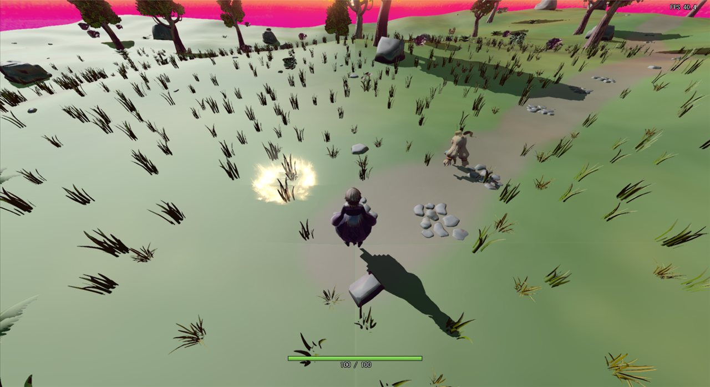
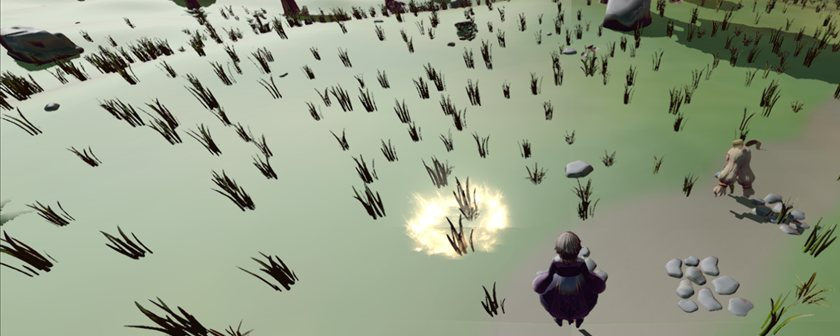
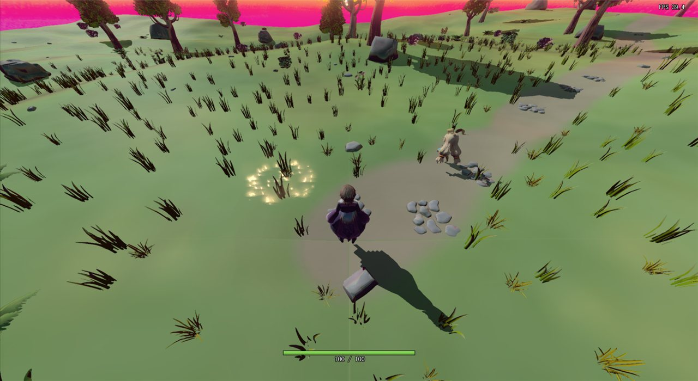
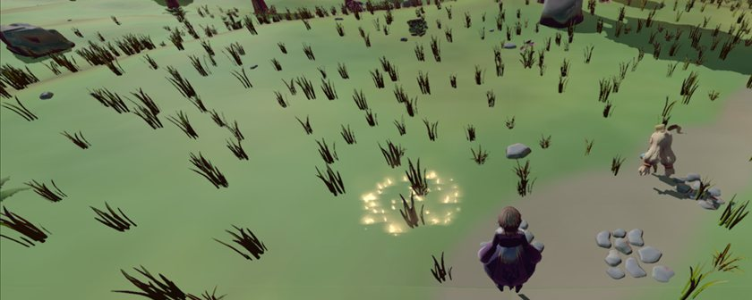

# 鏡面反射の経緯

設計: [鏡面反射の設計](鏡面反射の設計.md)
手順: [鏡面反射の手順](鏡面反射の手順.md)

---

## 2026-11-08: 鏡面反射が強すぎるのを直した

この項の画像は、11-09 に [シャドウマップのクリア](../シャドウマップのクリア/シャドウマップのクリアの経緯.md) を直したあとの状態で、シェーダーの式だけを前の式と今の式で入れ替えて撮ったもの（影が直る前は、画面全体が影でこの差が見えなかった）。

**用語:**

| 用語 | 何のことか |
|---|---|
| シェーダー | GPU で動くプログラム。画面のピクセルの色や、頂点の位置を計算する。このゲームでは HLSL という言語で書く |
| シャドウマップ | ライトから見た深度を描いておいた画像。影になるかを調べるのに使う |

### 1. 現状の問題

「スペキュラがひどいので調整してほしい」という要望から始めた。前の式では、地面を斜めから見る所（画面の奥や左側）が白っぽく飛び、小石も白く光る。

**用語:**

| 用語 | 何のことか |
|---|---|
| スペキュラ（鏡面反射） | 光が面に当たって、見ている向きへ照り返すこと。つやのある所が白く光って見える |



| 直す前（地面と小石の拡大） |
|---|
|  |

### 2. ソースコードの問題箇所

[PBRLighting.h](../../../../Game/Assets/shader/PBRLighting.h) の `CookTorranceSpecular()` で、次の4つが重なって、照り返しが強すぎていた。

```hlsl
float CookTorranceSpecular(float3 L, float3 V, float3 N, float smooth)
{
    // マイクロファセットが小さくなりすぎると、鏡面反射が強くなりすぎることがあるので、
    // 下限を0.5にした。
    float microfacet = min( 0.5f, 1.0f - smooth );     // ← 3: min なので上限になっている
    ...
    float f0 = 0.5;                                     // ← 1: 反射率 0.5 固定
    ...
    float NdotL = max( saturate(dot(N, L)), 0.001f );
    float NdotV = max( saturate(dot(N, V)), 0.001f );
    ...
    float m = PI * NdotV * NdotH;
    return max(F * D * G / m, 0.0);                     // ← 2: N·V で割る、4: N·L を掛けていない
}
```

**名前:**

| ジャンル | 名前 | 何のためのもの | 何をするためのもの | どこから来たもの |
|---|---|---|---|---|
| 関数 | `CookTorranceSpecular()` | 光が当たった面の鏡面反射の強さを出すため | 光・視線・法線の向きと滑らかさから、鏡面反射の値を返す | ゲームの [PBRLighting.h](../../../../Game/Assets/shader/PBRLighting.h) の `CookTorranceSpecular()` |
| 引数 | `L`・`V`・`N` | 3つの向きを受け取るため | `L` は光源に向かう向き、`V` は視点に向かう向き、`N` は法線 | ゲームの [PBRLighting.h](../../../../Game/Assets/shader/PBRLighting.h) の `CookTorranceSpecular()` |
| 引数 | `smooth` | 滑らかさを受け取るため | 0〜1 の滑らかさ。大きいほど滑らか | ゲームの [PBRLighting.h](../../../../Game/Assets/shader/PBRLighting.h) の `CookTorranceSpecular()` |
| 変数 | `microfacet` | 粗さを持つため | 粗さ。`min(0.5, 1 − smooth)` で出していた | ゲームの [PBRLighting.h](../../../../Game/Assets/shader/PBRLighting.h) の `CookTorranceSpecular()`（今はない。この経緯の 2026-11-08 で書き換えた） |
| 関数 | `min()`・`max()` | 小さい方・大きい方を選ぶため | 2つの値のうち、小さい方・大きい方を返す | HLSL（シェーダーの言語）の組み込み関数 |
| 変数 | `f0` | 正面から見たときの反射率を持つため | 0.5 に固定していた | ゲームの [PBRLighting.h](../../../../Game/Assets/shader/PBRLighting.h) の `CookTorranceSpecular()`（今はない。この経緯の 2026-11-08 で書き換えた） |
| 変数 | `NdotL` | 光の当たり具合を見るため | 法線 N と、光に向かう向き L の内積。0.001 より小さくしていなかった | ゲームの [PBRLighting.h](../../../../Game/Assets/shader/PBRLighting.h) の `CookTorranceSpecular()`（今はない。この経緯の 2026-11-08 で書き換えた） |
| 変数 | `NdotV` | 視線の浅さを見るため | 法線 N と、視線に向かう向き V の内積 | ゲームの [PBRLighting.h](../../../../Game/Assets/shader/PBRLighting.h) の `CookTorranceSpecular()`（今はない。この経緯の 2026-11-08 で書き換えた） |
| 関数 | `saturate()` | 値を 0〜1 に収めるため | 0 より小さければ 0、1 より大きければ 1 にして返す | HLSL（シェーダーの言語）の組み込み関数 |
| 関数 | `dot()` | 2つの向きの近さを調べるため | 内積を返す | HLSL（シェーダーの言語）の組み込み関数 |
| 変数 | `NdotH` | ハイライトの向きの揃い具合を見るため | 法線 N とハーフベクトル H の内積（0〜1）。抜き出しで省いた行で計算している | ゲームの [PBRLighting.h](../../../../Game/Assets/shader/PBRLighting.h) の `CookTorranceSpecular()`（今はない。この経緯の 2026-11-08 で書き換えた） |
| 変数 | `m` | 最後に割る値を作るため | `π × N·V × N·H` | ゲームの [PBRLighting.h](../../../../Game/Assets/shader/PBRLighting.h) の `CookTorranceSpecular()`（今はない。この経緯の 2026-11-08 で書き換えた） |
| 値 | `PI` | 円周率を使うため | 3.1415926 | ゲームの [PBRLighting_const.h](../../../../Game/Assets/shader/PBRLighting_const.h) |
| 変数 | `F`・`D`・`G` | 鏡面反射の3つの項を持つため | フレネル・分布・遮蔽の値。抜き出しで省いた行で計算している | ゲームの [PBRLighting.h](../../../../Game/Assets/shader/PBRLighting.h) の `CookTorranceSpecular()`（今はない。この経緯の 2026-11-08 で書き換えた） |

**用語:**

| 用語 | 何のことか |
|---|---|
| マイクロファセット | 表面にある、目に見えないほど細かいでこぼこ。その大きさが粗さで、大きいほどハイライトが広く弱くなる |
| ハーフベクトル | 光に向かう向きと、視線に向かう向きの真ん中の向き（H）。ハイライトは、法線がこの向きに近い所で強く出る |
| D項・F項・G項 | 鏡面反射の3つの式。D は分布（でこぼこの向きの揃い具合）、F はフレネル、G は遮蔽 |
| フレネル | 見る角度が浅い（面すれすれ）ほど、反射が強くなる現象 |
| 反射率 | 光が当たったとき、どれだけを反射するかの割合 |

| # | 以前の書き方 | 何が起きていたか |
|---|---|---|
| 1 | 反射率 `f0 = 0.5` 固定 | 金属でない物の値（約 0.04）の12倍。正面から見ても半分が照り返しになる |
| 2 | 最後に `π·N·V·N·H` で割る | 視線が面すれすれ（N·V が 0 に近い）だと、割り算で大きくなる。三人称のカメラから見る地面や草はこの角度が多い |
| 3 | `min(0.5, 1 − 滑らかさ)` | コメントは「下限を 0.5 にした」だが、`min` なので上限になっていた。滑らかさが高いと粗さが 0 に近づき、ベックマン分布が跳ね上がる |
| 4 | N·L を掛けていない | 光が斜めに当たる面でも、ハイライトが弱くならない |

**用語:**

| 用語 | 何のことか |
|---|---|
| ベックマン分布 | でこぼこの向きの揃い具合を表す式の1つ。粗さが 0 に近いと、値が大きく跳ね上がる |

スペキュラマップのないステージのモデルは、`specMap_None.DDS`（BC7 の 4×4。最初のブロックを読むと a が 92/255 ≒ 0.36）で滑らかさ 0.36 になり、2 と 1 の影響をそのまま受けていた。

**用語:**

| 用語 | 何のことか |
|---|---|
| スペキュラマップ | 金属度と滑らかさを、ピクセルごとに入れたテクスチャ |
| DDS | テクスチャの画像ファイルの形式の1つ（`.DDS`） |
| BC7 | テクスチャを小さくして持つ圧縮の形式の1つ。4×4 ピクセルを1ブロックにして持つ |

### 3. 直し方

関数を、GGX 分布と Smith の遮蔽（Schlick-GGX）のふつうのクックトランスモデルに書き換える。

- 反射率は 0.04（金属でない物の値）にする。
- G 項を 4·N·L·N·V で割った形でまとめて出し、分母に k が残るようにして、N·V が 0 に近くても割り算で跳ね上がらないようにする。最後に N·L を掛ける。
- 粗さの下限は 0.3 にする。0.2 だとユニティちゃんのように滑らかさの高いモデル（滑らかさ 0.8 と仮定）で、正面のハイライトがおよそ 3.2 になってブルームで光るため、0.3（同じ条件でおよそ 0.63）にした。
- それでも滑らかさ 0.8 では、逆光で面すれすれに見ると、新しい式でも 25（視線が面から 10°）〜 110（面すれすれ）まで明るくなった。そのため、ライトの色に掛ける前の値に上限 `SPECULAR_MAX = 1.0` を付ける。

**用語:**

| 用語 | 何のことか |
|---|---|
| クックトランスモデル | 鏡面反射を、D項・F項・G項の3つの式から計算するモデル |
| GGX 分布 | でこぼこの向きの揃い具合を表す式の1つ（D項）。ベックマン分布より、すれすれでも値が跳ね上がりにくい |
| Smith の遮蔽 | でこぼこが、光や視線を隠してしまう割合を表す式（G項） |
| Schlick-GGX | Smith の遮蔽を、係数 `k = a / 2` で近似した形 |
| ブルーム | 明るい所のまわりをにじませて、光って見せる効果 |

`CalcLighting()` の、拡散反射と鏡面反射を滑らかさで混ぜる部分と、金属度でスペキュラカラーを付ける部分は変えない。

### 4. ソースコードの直し

[PBRLighting.h](../../../../Game/Assets/shader/PBRLighting.h) の `CookTorranceSpecular()` の上に調整値を足し、中身を書き換えた（全体の差分は [鏡面反射の手順](鏡面反射の手順.md) の手順1・2）。

```hlsl
static const float SPECULAR_F0 = 0.04f;
static const float SPECULAR_MIN_ROUGHNESS = 0.3f;
static const float SPECULAR_MAX = 1.0f;

float CookTorranceSpecular(float3 L, float3 V, float3 N, float smooth)
{
    float NdotL = dot(N, L);
    if (NdotL <= 0.0f) {
        return 0.0f;
    }
    float NdotV = max(dot(N, V), 0.001f);
    float3 H = normalize(L + V);
    float NdotH = saturate(dot(N, H));
    float VdotH = saturate(dot(V, H));

    float roughness = max(1.0f - smooth, SPECULAR_MIN_ROUGHNESS);
    float a = roughness * roughness;
    float a2 = a * a;

    float d = NdotH * NdotH * (a2 - 1.0f) + 1.0f;
    float D = a2 / (PI * d * d);                          // GGX 分布
    float F = SpcFresnel(SPECULAR_F0, VdotH);             // Schlick 近似
    float k = a * 0.5f;
    float vis = 0.25f / ((NdotL * (1.0f - k) + k) * (NdotV * (1.0f - k) + k));   // Smith の遮蔽

    return min(D * F * vis * NdotL, SPECULAR_MAX);
}
```

**名前:**

| ジャンル | 名前 | 何のためのもの | 何をするためのもの | どこから来たもの |
|---|---|---|---|---|
| C++ の書き方 | `static const` | 調整値を、シェーダーの定数として置くため | 書き換えない値にする。HLSL でも、`static const` で定数を置ける | HLSL（シェーダーの言語）の書き方 |
| 値 | `SPECULAR_F0` | 正面から見たときの反射率を、1か所で決めるため | 0.04（金属でない物の値） | ゲームの [PBRLighting.h](../../../../Game/Assets/shader/PBRLighting.h) |
| 値 | `SPECULAR_MIN_ROUGHNESS` | 粗さの下限を、1か所で決めるため | 0.3。これより粗さを小さくしない | ゲームの [PBRLighting.h](../../../../Game/Assets/shader/PBRLighting.h) |
| 変数 | `H` | ハーフベクトルを持つため | `L + V` を正規化した向き | ゲームの [PBRLighting.h](../../../../Game/Assets/shader/PBRLighting.h) の `CookTorranceSpecular()` の中 |
| 関数 | `normalize()` | 向きを変えずに、長さを 1 にするため | 正規化したベクトルを返す | HLSL（シェーダーの言語）の組み込み関数 |
| 変数 | `VdotH` | フレネルの角度を見るため | 視線に向かう向き V と H の内積（0〜1） | ゲームの [PBRLighting.h](../../../../Game/Assets/shader/PBRLighting.h) の `CookTorranceSpecular()` の中 |
| 変数 | `roughness` | 粗さを、下限つきで持つため | `1 − smooth`。0.3 より小さくしない | ゲームの [PBRLighting.h](../../../../Game/Assets/shader/PBRLighting.h) の `CookTorranceSpecular()` の中 |
| 変数 | `a` | 見た目の粗さに合わせるため | `roughness` の2乗 | ゲームの [PBRLighting.h](../../../../Game/Assets/shader/PBRLighting.h) の `CookTorranceSpecular()` の中 |
| 変数 | `a2` | GGX の式で、a の2乗を使うため | `a` の2乗 | ゲームの [PBRLighting.h](../../../../Game/Assets/shader/PBRLighting.h) の `CookTorranceSpecular()` の中 |
| 変数 | `d` | D項の分母の中身を作るため | `NdotH² × (a² − 1) + 1` | ゲームの [PBRLighting.h](../../../../Game/Assets/shader/PBRLighting.h) の `CookTorranceSpecular()` の中 |
| 関数 | `SpcFresnel()` | フレネルを Schlick 近似で出すため | 正面の反射率 `f0` と、視線と H の内積から、反射の割合を返す | ゲームの [PBRLighting.h](../../../../Game/Assets/shader/PBRLighting.h) |
| 変数 | `k` | Schlick-GGX の係数にするため | `a` の半分 | ゲームの [PBRLighting.h](../../../../Game/Assets/shader/PBRLighting.h) の `CookTorranceSpecular()` の中 |
| 変数 | `vis` | G項を 4·N·L·N·V で割った値を持つため | 分母に `k` が残るので、N·V が 0 に近くても有限になる | ゲームの [PBRLighting.h](../../../../Game/Assets/shader/PBRLighting.h) の `CookTorranceSpecular()` の中 |

**用語:**

| 用語 | 何のことか |
|---|---|
| Schlick 近似 | フレネルの式を、`f0 + (1 − f0)(1 − u)^5` で軽く近似したもの（`SpcFresnel()` の中身） |

直したあとは、地面の白い飛びと小石の白い光りが消えた。

| 直す前 | 直した後 |
|---|---|
|  |  |
|  |  |

### 5. どう確かめたか

- 作業用フォルダ（git worktree）で、Windows SDK の `fxc.exe`（ps_5_0）で `DeferredLighting.fx` の `PSMainSoftShadow`・`PSMainHardShadow` と、`model.fx` の `PSMainSoftShadow` をコンパイルし、通ることを確かめた。`DeferredLighting.fx` の 94 行目の警告（`col_1` が初期化されていないかもしれない）は、もとからあるもの。
- 値は、以前の式と新しい式を PowerShell（C# の Add-Type）で書き写し、視線と光の向きを 1° 刻みで振って、ライトの色 2.0 と滑らかさ（`CalcLighting()` で混ぜるときの割合）を掛けたあとの最大値を比べた（下の表）。上限を付ける前の値。

**用語:**

| 用語 | 何のことか |
|---|---|
| `fxc.exe` | Windows SDK に入っている、HLSL のシェーダーをコンパイルするコマンド |
| `ps_5_0` | ピクセルシェーダーの版。`fxc.exe` に、この版としてコンパイルするよう伝える |
| `Add-Type` | PowerShell の中で、C# のコードを書いて動かすためのコマンド |

| 滑らかさ | 見る向き | 以前 | 新しい式 |
|---|---|---|---|
| 0.36（ステージ） | 正面 | 0.115 | 0.014 |
| 0.36（ステージ） | 面から 10° まで | 1.0 | 0.21 |
| 0.36（ステージ） | 面すれすれまで | 12.6 | 0.46 |
| 0.8（仮定） | 正面 | 1.59 | 0.63 |
| 0.8（仮定） | 面から 10° まで | 13.1 | 25.3 |

- 11-08 の時点では、ゲームの画面では確かめていなかった。11-09 に、シャドウマップのクリアを直した Stage ブランチの Debug ビルドで、ゲームの窓だけを撮って比べた（撮り方は [シャドウマップのクリアの経緯](../シャドウマップのクリア/シャドウマップのクリアの経緯.md) の「どう確かめたか」）。直す前の画像は、Stage から切った作業用フォルダで `PBRLighting.h` だけを main の `2fd5d101`（直す前）のものに戻して撮った。

## 2026-11-09: キャラクターの滑らかさを確かめた

### 何をしたか

「キャラクターも全部スペキュラに対応しているか」という質問から、キャラクターの描き方とスペキュラマップを確かめた。

- プレイヤー・敵・剣・銃・弾は、どれも `ModelRender::Init()` で G-Buffer に描かれ、ステージと同じディファードライティングで照らされる。直した `CookTorranceSpecular()` は全部に効く。
- スペキュラマップを持っているのは敵（ユニティちゃん）の `utc_spec.DDS` だけだった。プレイヤー（`SK_Player.FBX`。VRM 用の MToon のテクスチャだけ）と、剣・銃・弾は持っていないので、ステージと同じ `specMap_None.DDS`（滑らかさ約 0.36）になる。
- `utc_spec.DDS`（DXT5、1024×1024）の a（滑らかさ）を読むと、96% が 0.1 未満で、平均は 0.01 だった。

**用語:**

| 用語 | 何のことか |
|---|---|
| G-Buffer | 色・法線・メタリックなどを、画面と同じ大きさの画像に分けて描いておいたもの |
| ディファードライティング | G-Buffer を読んで、画面全体に光の計算をする処理 |
| VRM・MToon | VRM は人型キャラクターのモデルのファイル形式。MToon は、その VRM で使われる、アニメ調に描くためのマテリアル |
| FBX | モデルやアニメーションを入れるファイル形式の1つ |
| DXT5 | テクスチャを小さくして持つ圧縮の形式の1つ。透明度（a）を、細かいまま持てる |

11-08 の項で、粗さの下限 0.3 と上限 `SPECULAR_MAX` を決めるときに「ユニティちゃんのように滑らかさの高いモデル（滑らかさ 0.8 と仮定）」と書いたが、この仮定は外れていた。今のキャラクターには滑らかさの高いモデルはなく、どのキャラクターにもハイライトはほとんど出ない。下限と上限は、滑らかさの高いモデルを足したときに白く飛ばないための守りとして、値を変えずに残す。

キャラクターにくっきりしたハイライトを付けるのは、[アニメ調ライティングの設計](../アニメ調ライティング/アニメ調ライティングの設計.md) の「ハイライト」で作る。

### どう確かめたか

- `ModelRender::InitModelOnRenderGBuffer()` が `RenderToGBufferFor3DModel.fx` を使うことと、キャラクターの初期化（`CharacterModel.cpp`・`WeaponAttachment.cpp`・`GameCamera.cpp`）が `ModelRender::Init()` を呼んでいることをコードで見た。
- 各モデル（tkm）に入っているテクスチャのファイル名を読み、スペキュラマップがあるかを見た。
- `utc_spec.DDS` の a は、DXT5 のアルファのブロックを PowerShell（C# の Add-Type）で読み、0.1 刻みの割合と平均を出した。

**用語:**

| 用語 | 何のことか |
|---|---|
| tkm | k2Engine のモデルのファイル（`.tkm`）。頂点・面・マテリアルが入っている |

## 2026-11-09: 手順書を書いた

### 何をしたか

[鏡面反射の手順](鏡面反射の手順.md) を書いた。手順は「調整値の定数を足す → `CookTorranceSpecular()` の説明コメントと中身を書き換える」の2つにした。上限 `SPECULAR_MAX` で止める行を別の手順にすると、前の手順で書いた `return` の行をあとで書き換えることになるので、定数3つを先に足し、関数は1回で最終の形に書き換えるようにした。

手順書を書く前に今のコードを読み直したら、11-08 に書き換えたとき、前の関数の説明コメント（`/// <summary>` から `/// <param name="smooth">` まで）が、足した定数の上に残っていた。これを消してから手順書を書いた。

### どう確かめたか

- main から作業用フォルダ（git worktree）を切り、手順書の `diff` のブロックを、そのまま「前の行 → 後の行」の置き換えとして当てた（前の行がファイルの中にちょうど1か所あることも見た）。
- 各手順のあとで、`fxc.exe`（ps_5_0）で `DeferredLighting.fx` の `PSMainSoftShadow`・`PSMainHardShadow` と `model.fx` の `PSMainSoftShadow` をコンパイルし、どれも通った。
- 手順2のあとの `PBRLighting.h` が、`Specular` ブランチの `PBRLighting.h` と同じになった（改行コードを除いて差分なし）。
- ゲームの画面での確認は、ユーザーにお願いしている。

**用語:**

| 用語 | 何のことか |
|---|---|
| `diff` | 変更前と変更後の違いを、足す行に `+`、消す行に `-` を付けて見せる書き方 |

## 2026-11-09: 「キラキラ」の正体は鏡面反射ではなかった

### 何をしたか

鏡面反射の式を直したあと、ユーザーから「まだキラキラしている、変わっていない」と言われた。ゲームの窓を撮って切り分けると、影が画面全体を覆って太陽の光がどこにも当たらず、IBL（反射の向きで空を引く環境光）だけで照らされていたため、全部が鏡のように見えていた。原因はシャドウマップのクリアの値で、[シャドウマップのクリアの経緯](../シャドウマップのクリア/シャドウマップのクリアの経緯.md) で直した。

**用語:**

| 用語 | 何のことか |
|---|---|
| IBL | Image Based Lighting。空などの画像から、反射の向きに合わせて環境光を引く方法 |

この項までに直した鏡面反射の式（反射率 0.5・N·V での割り算・粗さの `min`）は、それ自体が誤りだったので、そのまま残す。ただし、ユーザーが見ていたテカりは、この式ではなく影の不具合から来ていた。

### どう確かめたか

- シャドウマップのクリアを直したあと、ゲームの窓を撮り、岩や服のテカりが消えたことを確かめた（[シャドウマップのクリアの経緯](../シャドウマップのクリア/シャドウマップのクリアの経緯.md)）。
