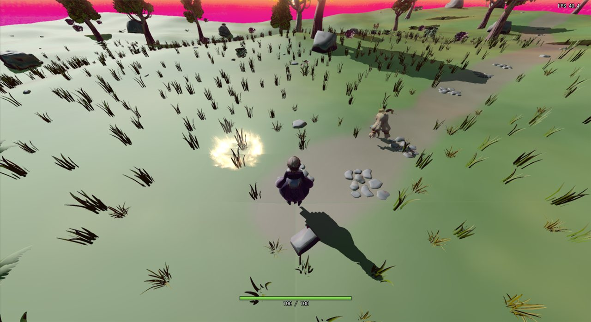
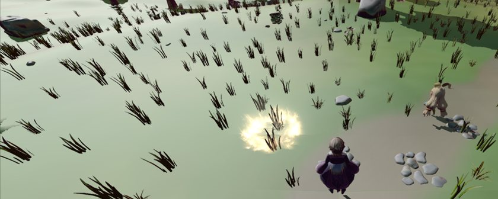
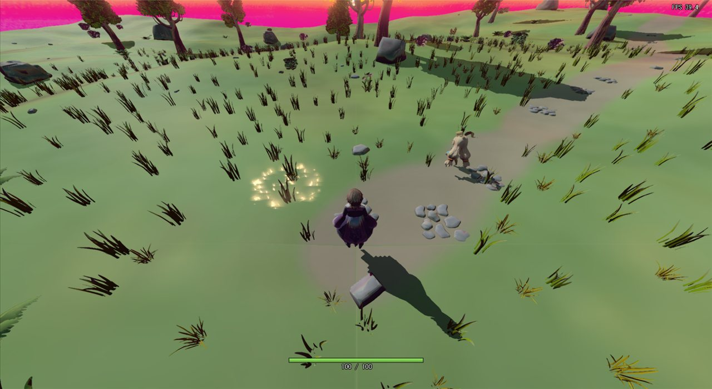
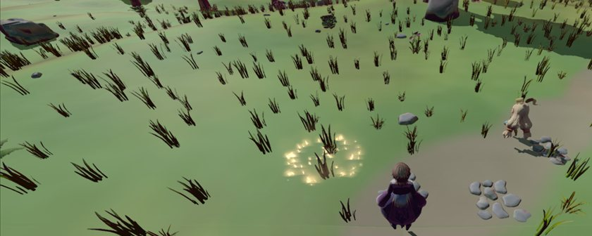

# 鏡面反射の経緯

設計: [鏡面反射の設計](鏡面反射の設計.md)
手順: [鏡面反射の手順](鏡面反射の手順.md)

---

## 2026-11-08: 鏡面反射が強すぎるのを直した

この項の画像は、11-09 に [シャドウマップのクリア](シャドウマップのクリアの経緯.md) を直したあとの状態で、シェーダーの式だけを前の式と今の式で入れ替えて撮ったもの（影が直る前は、画面全体が影でこの差が見えなかった）。

### 1. 現状の問題

「スペキュラがひどいので調整してほしい」という要望から始めた。前の式では、地面を斜めから見る所（画面の奥や左側）が白っぽく飛び、小石も白く光る。



| 直す前（地面と小石の拡大） |
|---|
|  |

### 2. ソースコードの問題箇所

[PBRLighting.h](../../../Game/Assets/shader/PBRLighting.h) の `CookTorranceSpecular()` で、次の4つが重なって、照り返しが強すぎていた。

```hlsl
float CookTorranceSpecular(float3 L, float3 V, float3 N, float smooth)
{
    // マイクロファセットが小さくなりすぎると、鏡面反射が強くなりすぎることがあるので、
    // 下限を0.5にした。
    float microfacet = min( 0.5f, 1.0f - smooth );     // ← 3: min なので上限になっている
    ...
    float f0 = 0.5;                                     // ← 1: 反射率 0.5 固定
    ...
    float NdotL = max( saturate(dot(N, L)), 0.001f );
    float NdotV = max( saturate(dot(N, V)), 0.001f );
    ...
    float m = PI * NdotV * NdotH;
    return max(F * D * G / m, 0.0);                     // ← 2: N·V で割る、4: N·L を掛けていない
}
```

| # | 以前の書き方 | 何が起きていたか |
|---|---|---|
| 1 | 反射率 `f0 = 0.5` 固定 | 金属でない物の値（約 0.04）の12倍。正面から見ても半分が照り返しになる |
| 2 | 最後に `π·N·V·N·H` で割る | 視線が面すれすれ（N·V が 0 に近い）だと、割り算で大きくなる。三人称のカメラから見る地面や草はこの角度が多い |
| 3 | `min(0.5, 1 − 滑らかさ)` | コメントは「下限を 0.5 にした」だが、`min` なので上限になっていた。滑らかさが高いと粗さが 0 に近づき、ベックマン分布が跳ね上がる |
| 4 | N·L を掛けていない | 光が斜めに当たる面でも、ハイライトが弱くならない |

スペキュラマップのないステージのモデルは、`specMap_None.DDS`（BC7 の 4×4。最初のブロックを読むと a が 92/255 ≒ 0.36）で滑らかさ 0.36 になり、2 と 1 の影響をそのまま受けていた。

### 3. 直し方

関数を、GGX 分布と Smith の遮蔽（Schlick-GGX）のふつうのクックトランスモデルに書き換える。

- 反射率は 0.04（金属でない物の値）にする。
- G 項を 4·N·L·N·V で割った形でまとめて出し、分母に k が残るようにして、N·V が 0 に近くても割り算で跳ね上がらないようにする。最後に N·L を掛ける。
- 粗さの下限は 0.3 にする。0.2 だとユニティちゃんのように滑らかさの高いモデル（滑らかさ 0.8 と仮定）で、正面のハイライトがおよそ 3.2 になってブルームで光るため、0.3（同じ条件でおよそ 0.63）にした。
- それでも滑らかさ 0.8 では、逆光で面すれすれに見ると、新しい式でも 25（視線が面から 10°）〜 110（面すれすれ）まで明るくなった。そのため、ライトの色に掛ける前の値に上限 `SPECULAR_MAX = 1.0` を付ける。

`CalcLighting()` の、拡散反射と鏡面反射を滑らかさで混ぜる部分と、金属度でスペキュラカラーを付ける部分は変えない。

### 4. ソースコードの直し

[PBRLighting.h](../../../Game/Assets/shader/PBRLighting.h) の `CookTorranceSpecular()` の上に調整値を足し、中身を書き換えた（全体の差分は [鏡面反射の手順](鏡面反射の手順.md) の手順1・2）。

```hlsl
static const float SPECULAR_F0 = 0.04f;
static const float SPECULAR_MIN_ROUGHNESS = 0.3f;
static const float SPECULAR_MAX = 1.0f;

float CookTorranceSpecular(float3 L, float3 V, float3 N, float smooth)
{
    float NdotL = dot(N, L);
    if (NdotL <= 0.0f) {
        return 0.0f;
    }
    float NdotV = max(dot(N, V), 0.001f);
    float3 H = normalize(L + V);
    float NdotH = saturate(dot(N, H));
    float VdotH = saturate(dot(V, H));

    float roughness = max(1.0f - smooth, SPECULAR_MIN_ROUGHNESS);
    float a = roughness * roughness;
    float a2 = a * a;

    float d = NdotH * NdotH * (a2 - 1.0f) + 1.0f;
    float D = a2 / (PI * d * d);                          // GGX 分布
    float F = SpcFresnel(SPECULAR_F0, VdotH);             // Schlick 近似
    float k = a * 0.5f;
    float vis = 0.25f / ((NdotL * (1.0f - k) + k) * (NdotV * (1.0f - k) + k));   // Smith の遮蔽

    return min(D * F * vis * NdotL, SPECULAR_MAX);
}
```

直したあとは、地面の白い飛びと小石の白い光りが消えた。

| 直す前 | 直した後 |
|---|---|
|  |  |
|  |  |

### 5. どう確かめたか

- 作業用フォルダ（git worktree）で、Windows SDK の `fxc.exe`（ps_5_0）で `DeferredLighting.fx` の `PSMainSoftShadow`・`PSMainHardShadow` と、`model.fx` の `PSMainSoftShadow` をコンパイルし、通ることを確かめた。`DeferredLighting.fx` の 94 行目の警告（`col_1` が初期化されていないかもしれない）は、もとからあるもの。
- 値は、以前の式と新しい式を PowerShell（C# の Add-Type）で書き写し、視線と光の向きを 1° 刻みで振って、ライトの色 2.0 と滑らかさ（`CalcLighting()` で混ぜるときの割合）を掛けたあとの最大値を比べた（下の表）。上限を付ける前の値。

| 滑らかさ | 見る向き | 以前 | 新しい式 |
|---|---|---|---|
| 0.36（ステージ） | 正面 | 0.115 | 0.014 |
| 0.36（ステージ） | 面から 10° まで | 1.0 | 0.21 |
| 0.36（ステージ） | 面すれすれまで | 12.6 | 0.46 |
| 0.8（仮定） | 正面 | 1.59 | 0.63 |
| 0.8（仮定） | 面から 10° まで | 13.1 | 25.3 |

- 11-08 の時点では、ゲームの画面では確かめていなかった。11-09 に、シャドウマップのクリアを直した Stage ブランチの Debug ビルドで、ゲームの窓だけを撮って比べた（撮り方は [シャドウマップのクリアの経緯](シャドウマップのクリアの経緯.md) の「どう確かめたか」）。直す前の画像は、Stage から切った作業用フォルダで `PBRLighting.h` だけを main の `2fd5d101`（直す前）のものに戻して撮った。

## 2026-11-09: キャラクターの滑らかさを確かめた

### 何をしたか

「キャラクターも全部スペキュラに対応しているか」という質問から、キャラクターの描き方とスペキュラマップを確かめた。

- プレイヤー・敵・剣・銃・弾は、どれも `ModelRender::Init()` で G-Buffer に描かれ、ステージと同じディファードライティングで照らされる。直した `CookTorranceSpecular()` は全部に効く。
- スペキュラマップを持っているのは敵（ユニティちゃん）の `utc_spec.DDS` だけだった。プレイヤー（`SK_Player.FBX`。VRM 用の MToon のテクスチャだけ）と、剣・銃・弾は持っていないので、ステージと同じ `specMap_None.DDS`（滑らかさ約 0.36）になる。
- `utc_spec.DDS`（DXT5、1024×1024）の a（滑らかさ）を読むと、96% が 0.1 未満で、平均は 0.01 だった。

11-08 の項で、粗さの下限 0.3 と上限 `SPECULAR_MAX` を決めるときに「ユニティちゃんのように滑らかさの高いモデル（滑らかさ 0.8 と仮定）」と書いたが、この仮定は外れていた。今のキャラクターには滑らかさの高いモデルはなく、どのキャラクターにもハイライトはほとんど出ない。下限と上限は、滑らかさの高いモデルを足したときに白く飛ばないための守りとして、値を変えずに残す。

キャラクターにくっきりしたハイライトを付けるのは、[アニメ調ライティングの設計](アニメ調ライティングの設計.md) の「ハイライト」で作る。

### どう確かめたか

- `ModelRender::InitModelOnRenderGBuffer()` が `RenderToGBufferFor3DModel.fx` を使うことと、キャラクターの初期化（`CharacterModel.cpp`・`WeaponAttachment.cpp`・`GameCamera.cpp`）が `ModelRender::Init()` を呼んでいることをコードで見た。
- 各モデル（tkm）に入っているテクスチャのファイル名を読み、スペキュラマップがあるかを見た。
- `utc_spec.DDS` の a は、DXT5 のアルファのブロックを PowerShell（C# の Add-Type）で読み、0.1 刻みの割合と平均を出した。

## 2026-11-09: 手順書を書いた

### 何をしたか

[鏡面反射の手順](鏡面反射の手順.md) を書いた。手順は「調整値の定数を足す → `CookTorranceSpecular()` の説明コメントと中身を書き換える」の2つにした。上限 `SPECULAR_MAX` で止める行を別の手順にすると、前の手順で書いた `return` の行をあとで書き換えることになるので、定数3つを先に足し、関数は1回で最終の形に書き換えるようにした。

手順書を書く前に今のコードを読み直したら、11-08 に書き換えたとき、前の関数の説明コメント（`/// <summary>` から `/// <param name="smooth">` まで）が、足した定数の上に残っていた。これを消してから手順書を書いた。

### どう確かめたか

- main から作業用フォルダ（git worktree）を切り、手順書の `diff` のブロックを、そのまま「前の行 → 後の行」の置き換えとして当てた（前の行がファイルの中にちょうど1か所あることも見た）。
- 各手順のあとで、`fxc.exe`（ps_5_0）で `DeferredLighting.fx` の `PSMainSoftShadow`・`PSMainHardShadow` と `model.fx` の `PSMainSoftShadow` をコンパイルし、どれも通った。
- 手順2のあとの `PBRLighting.h` が、`Specular` ブランチの `PBRLighting.h` と同じになった（改行コードを除いて差分なし）。
- ゲームの画面での確認は、ユーザーにお願いしている。

## 2026-11-09: 「キラキラ」の正体は鏡面反射ではなかった

### 何をしたか

鏡面反射の式を直したあと、ユーザーから「まだキラキラしている、変わっていない」と言われた。ゲームの窓を撮って切り分けると、影が画面全体を覆って太陽の光がどこにも当たらず、IBL（反射の向きで空を引く環境光）だけで照らされていたため、全部が鏡のように見えていた。原因はシャドウマップのクリアの値で、[シャドウマップのクリアの経緯](シャドウマップのクリアの経緯.md) で直した。

この項までに直した鏡面反射の式（反射率 0.5・N·V での割り算・粗さの `min`）は、それ自体が誤りだったので、そのまま残す。ただし、ユーザーが見ていたテカりは、この式ではなく影の不具合から来ていた。

### どう確かめたか

- シャドウマップのクリアを直したあと、ゲームの窓を撮り、岩や服のテカりが消えたことを確かめた（[シャドウマップのクリアの経緯](シャドウマップのクリアの経緯.md)）。
