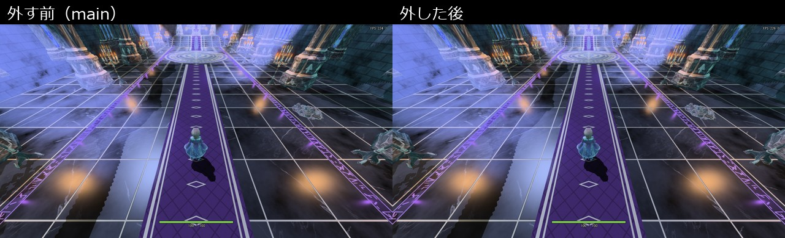
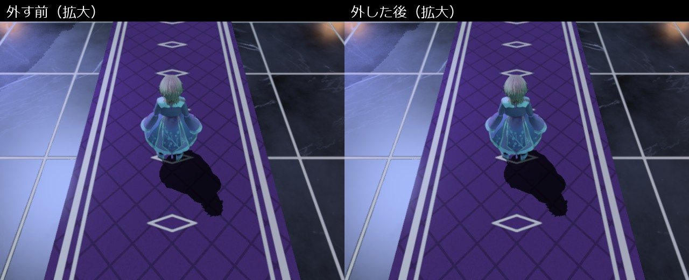
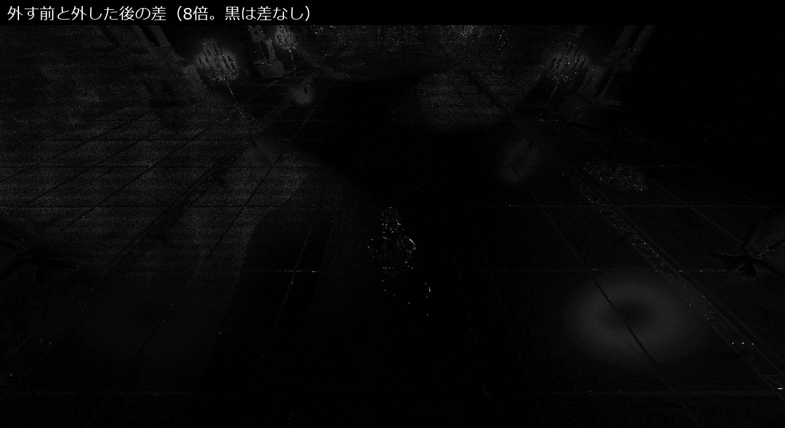
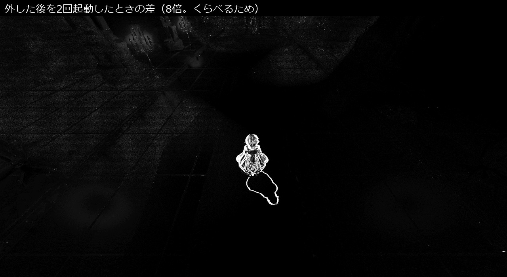

# レイトレーシングの削除の経緯

作成日: 2026-11-15
対象: RemoveRaytracing ブランチ
関連: [GPUの選び方の設計](GPUの選び方の設計.md)（もとは GPU の種類でレイトレーシングを使えるかを決めていた）

エンジンからレイトレーシング（DXR）を外したときの記録です。日付ごとに書き足します。

---

## 2026-11-15 使っていないレイトレーシングを、見た目を変えずにエンジンから外した

### なぜ外したか

ゲームは `Game.cpp` で `DisableRaytracing()` を呼んで、レイトレーシングを使っていなかった。それでもエンジンには本体（`k2EngineLow/graphics/raytracing/` の18ファイル、1,801行）と `raytracing.fx` が組み込まれたままで、約25ファイルから使われていた。被写界深度（#146）と同じように、見た目を変えずに外すことにした。

### 外す前にどこまで動いていたか

- `DisableRaytracing()` で `m_isEnableRaytracing` は常に false だった。毎フレームのレイトレーシング（`DispatchRaytracing`）と GI テクスチャのぼかしは動いていなかった。DeferredLighting.fx の `isEnableRaytracing` も常に 0 で、シェーダーは IBL の分岐を通っていた。
- ただし `m_isPossibleRaytracing` は、名前に RTX の入った NVIDIA の GPU が1枚でも見つかると true になった。そのときは、起動時にモデルを読むたびにレイトレーシングの世界へ登録し（`CreateRaytracingInstance`）、DeferredLighting のスプライトに拡張 SRV の 2〜6番を付けていた。どちらも描画の結果には使われていない。
- `raytracing.fx` は最初の Dispatch のときに初めてコンパイルされるので、一度もコンパイルされていなかった。
- 確かめた PC の GPU は AMD Radeon RX 9070 XT なので、上の RTX のときの処理も通っていなかった。

### 描画の結果が変わりうる所

左が変更前、右が変更後です。「行」は変更前の行番号です。片側が空いている行は、消した行か足した行です。両側が同じ行は、場所を示すための変えない行です。長い関数を丸ごと消した所は、最初と最後の行だけを載せ、間を「…（中身 N行）」と略しています。

#### 1. GI と映り込み — [DeferredLighting.fx](../../Game/Assets/shader/DeferredLighting.fx)（Shift-JIS のまま直した）

今通っている IBL の分岐を先頭にし、レイトレーシングの映り込みの分岐と、それだけが使う関数・定数を消した。通っている道は変えていない。

| 行 | 変更前 | 変更後 |
|---|---|---|
| 10 | `static const int NUM_REFLECTION_TEXTURE = 5;    // 反射テクスチャ。` | |
| 72 | `/*!` | |
| 73 | ` *@brief	GIライトをサンプリング` | |
| 74〜96 | `…（SampleReflectionColor の中身 23行）` | |
| 97 | `}` | |
| 98 | （空行） | |
| 367 | `if(light.isEnableRaytracing){` | |
| 368 | `// レイトレを行う場合はレイトレで作った反射テクスチャとIBLテクスチャを合成する。` | |
| 369〜385 | `…（反射テクスチャを使う分岐 17行）` | |
| 386 | `}` | |
| 387 | `}else if (light.isIBL == 1) {` | `if (light.isIBL == 1) {` |
| 388 | `// 視線からの反射ベクトルを求める。` | `// 視線からの反射ベクトルを求める。` |
| 389〜400 | `…（IBL・環境光。変えない）` | `…（IBL・環境光。変えない）` |

#### 2. ライトの定数バッファの並び

`isEnableRaytracing` は、C++ の `SDeferredLightingCB` でも HLSL の `LightCB` でも最後の項目だった。そのため、消しても前の項目の位置はずれない。`LightCB` は DeferredLighting.fx だけでなく、前向き描画の model.fx（b1）でも使っている。C++ と HLSL は同時に消した。C++ だけ消すと、HLSL がバッファの外を読み、その値が 0 でなければ映り込みの分岐に入ってしまう。

[RenderingEngine.h](../../k2Engine/graphics/RenderingEngine.h)

| 行 | 変更前 | 変更後 |
|---|---|---|
| 80 | `float m_iblLuminance;       // IBLの明るさ。` | `float m_iblLuminance;       // IBLの明るさ。` |
| 81 | `int m_isIBL;                // IBLを行う。` | `int m_isIBL;                // IBLを行う。` |
| 82 | `int m_isEnableRaytracing;   // レイトレが行われている。` | |

[PBRLighting_struct.h](../../Game/Assets/shader/PBRLighting_struct.h)

| 行 | 変更前 | 変更後 |
|---|---|---|
| 57 | `int isIBL;              // IBLを行う。` | `int isIBL;              // IBLを行う。` |
| 58 | `int isEnableRaytracing; // レイトレが有効。` | |

[PBRLighting_cb_body.h](../../Game/Assets/shader/PBRLighting_cb_body.h)（どこからも include されていないが、並びをそろえておく）

| 行 | 変更前 | 変更後 |
|---|---|---|
| 18 | `int isIBL;              // IBLを行う。` | `int isIBL;              // IBLを行う。` |
| 19 | `int isEnableRaytracing; // レイトレが有効。` | |

#### 3. ディスクリプタの番号

拡張 SRV は t20 から始まる（`EXPAND_SRV_REG__START_NO = 20`）。0番（t20）と1番（t21）はポイントライトとスポットライトのリストで、2〜6番（t22〜t26）は RTX のときだけ付けていたレイトレーシングの出力とぼかしだった。2〜6番をやめても、t20・t21・t15（スカイキューブ）・シャドウマップ・IBL の番号は変わらない。RTX でない PC の、外す前と同じ状態になる。

[DeferredLighting_srv_uav_register.h](../../Game/Assets/shader/DeferredLighting_srv_uav_register.h)

| 行 | 変更前 | 変更後 |
|---|---|---|
| 17 | `StructuredBuffer<uint> spotLightListInTile : register(t21);` | `StructuredBuffer<uint> spotLightListInTile : register(t21);` |
| 18 | `Texture2D<float4> g_reflectionTextureArray[NUM_REFLECTION_TEXTURE] : register(t22);` | |

[RenderingEngine.cpp](../../k2Engine/graphics/RenderingEngine.cpp)（`InitDefferedLighting_Sprite`）

| 行 | 変更前 | 変更後 |
|---|---|---|
| 70 | `spriteInitData.m_expandShaderResoruceView[1] = &m_spotLightNoListInTileUAV;` | `spriteInitData.m_expandShaderResoruceView[1] = &m_spotLightNoListInTileUAV;` |
| 71 | `if (g_graphicsEngine->IsPossibleRaytracing()) {` | |
| 72 | `// レイトレを行うことが可能。` | |
| 73 | `spriteInitData.m_expandShaderResoruceView[2] = &g_graphicsEngine->GetRaytracingOutputTexture();` | |
| 74 | `spriteInitData.m_expandShaderResoruceView[3] = &m_giTextureBlur[eGITextureBlur_1024x1024].GetBokeTexture();` | |
| 75 | `spriteInitData.m_expandShaderResoruceView[4] = &m_giTextureBlur[eGITextureBlur_512x512].GetBokeTexture();` | |
| 76 | `spriteInitData.m_expandShaderResoruceView[5] = &m_giTextureBlur[eGITextureBlur_256x256].GetBokeTexture();` | |
| 77 | `spriteInitData.m_expandShaderResoruceView[6] = &m_giTextureBlur[eGITextureBlur_128x128].GetBokeTexture();` | |
| 78 | `}` | |

#### 4. SSR — [PostEffect.cpp](../../k2Engine/graphics/postEffect/PostEffect.cpp)

「レイトレーシングをしていなければ SSR」だったので、今は常に SSR が動いていた。条件を外して、常に実行にした。

| 行 | 変更前 | 変更後 |
|---|---|---|
| 66 | `if (g_renderingEngine->IsEnableRaytracing() == false) {` | |
| 67 | `// レイトレをしていないならSSRを行う。` | `// スクリーンスペースリフレクション。` |
| 68 | `m_ssr.Render(rc, mainRenderTarget);` | `m_ssr.Render(rc, mainRenderTarget);` |
| 69 | `}` | |

### 見た目には関わらない所

#### 5. RenderingEngine

[RenderingEngine.cpp](../../k2Engine/graphics/RenderingEngine.cpp)

| 行 | 変更前 | 変更後 |
|---|---|---|
| 221 | `m_iblData.m_intencity = intencity;` | `m_iblData.m_intencity = intencity;` |
| 222 | `g_graphicsEngine->SetRaytracingSkyCubeBox(m_iblData.m_texture);` | |
| 226 | `// GIテクスチャを作成するためのブラー処理を初期化する。` | |
| 227 | `m_giTextureBlur[eGITextureBlur_1024x1024].Init(&g_graphicsEngine->GetRaytracingOutputTexture(), 1024, 1024);` | |
| 228 | `m_giTextureBlur[eGITextureBlur_512x512].Init(&m_giTextureBlur[eGITextureBlur_1024x1024].GetBokeTexture(), 512, 512);` | |
| 229 | `m_giTextureBlur[eGITextureBlur_256x256].Init(&m_giTextureBlur[eGITextureBlur_512x512].GetBokeTexture(), 256, 256);` | |
| 230 | `m_giTextureBlur[eGITextureBlur_128x128].Init(&m_giTextureBlur[eGITextureBlur_256x256].GetBokeTexture(), 128, 128);` | |
| 231 | （空行） | |
| 324 | `m_deferredLightingCB.m_light = m_sceneLight.GetSceneLight();` | `m_deferredLightingCB.m_light = m_sceneLight.GetSceneLight();` |
| 325 | `m_deferredLightingCB.m_isEnableRaytracing = IsEnableRaytracing() ? 1 : 0;` | |
| 326 | （空行） | |
| 327 | `// レイトレ用のライトデータをコピー。` | |
| 328 | `m_raytracingLightData.m_directionalLight = m_sceneLight.GetSceneLight().directionalLight[0];` | |
| 329 | `m_raytracingLightData.m_iblIntencity = m_iblData.m_intencity;` | |
| 330 | `m_raytracingLightData.m_ambientLight = m_sceneLight.GetSceneLight().ambinetLight;` | |
| 331 | `m_raytracingLightData.m_enableIBLTexture = m_iblData.m_texture.IsValid() ? 1 : 0;` | |
| 348 | `// レイトレで映り込み画像を作成する。` | |
| 349 | `if (IsEnableRaytracing()) {` | |
| 350 | `g_graphicsEngine->DispatchRaytracing(rc);` | |
| 351 | `for (auto& blur : m_giTextureBlur) {` | |
| 352 | `blur.ExecuteOnGPU(rc, 5);` | |
| 353 | `}` | |
| 354 | `}` | |
| 355 | （空行） | |
| 356 | `// ディファードライティング` | `// ディファードライティング` |
| 372 | `CopyMainRenderTargetToFrameBuffer(rc);` | `CopyMainRenderTargetToFrameBuffer(rc);` |
| 373 | `#ifdef COPY_RAYTRACING_FRAMEBUFFER` | |
| 374 | `g_graphicsEngine->DispatchRaytracing(rc);` | |
| 375 | `//レイトレの結果をフレームバッファに書き戻す。` | |
| 376 | `g_graphicsEngine->CopyToFrameBuffer(rc, g_graphicsEngine->GetRaytracingOutputTexture().Get());` | |
| 377 | `#endif` | |

[RenderingEngine.h](../../k2Engine/graphics/RenderingEngine.h)

| 行 | 変更前 | 変更後 |
|---|---|---|
| 24 | `///     頂点バッファをまとめる理由はDXRの高速化のため。` | `///     頂点バッファをまとめるのは、もとはDXR（レイトレーシング）を速くするためだった。` |
| 25 | `///     DXRではレイトレワールドに登録するオブジェクトの数が多くなると、効率的なBVHが構築できなくなり、` | |
| 26 | `///     大きく速度が低下する。このオブジェクトを１つの頂点バッファに纏めることで大幅な高速化が可能となる。` | |
| 44 | `/// 6. レイトレーシングで映り込み画像を作成する。` | `/// 6. （欠番。もとはレイトレーシングで映り込み画像を作るパス）` |
| 45〜49 | `…（RTX・ENABLE_DXR_ON_RTX_ONLY の説明 5行）` | |
| 59 | `///     9.1 スクリーンスペースリフレクション(レイトレを行っている場合は処理されない。)` | `///     9.1 スクリーンスペースリフレクション` |
| 84 | `/// 
` | |
| 85 | `/// レイトレ用のライトデータ。` | |
| 86〜92 | `…（struct RaytracingLightData の中身 7行）` | |
| 93 | `};` | |
| 139 | `/// 
` | |
| 140 | `/// レイトレワールドにモデルを追加。` | |
| 141〜161 | `…（AddModelToRaytracingWorld・RequestRebuildRaytracingWorld・RemoveModelFromRaytracingWorld の中身 21行）` | |
| 162 | `}` | |
| 477 | `/// 
` | |
| 478 | `/// レイトレーシングが有効かどうかを判定する。` | |
| 479〜507 | `…（IsEnableRaytracing・EnableRaytracing・DisableRaytracing・GetRaytracingLightData の中身 29行）` | |
| 508 | `}` | |
| 622 | `/// 
` | |
| 623 | `/// GIテクスチャを作るためのブラー処理。` | |
| 624〜631 | `…（enum EGITextureBlur の中身 8行）` | |
| 632 | `RaytracingLightData m_raytracingLightData;                      // レイトレ用のライトデータ。` | |
| 655 | `SIBLData m_iblData;                                             // IBLデータ。` | `SIBLData m_iblData;                                             // IBLデータ。` |
| 656 | `bool m_isEnableRaytracing = true;                               // レイトレーシングが有効？` | |
| 657 | `GaussianBlur m_giTextureBlur[eGITextureBlur_Num];                                // GIテクスチャにブラーをかける処理。` | |

#### 6. ModelRender

[ModelRender.cpp](../../k2Engine/graphics/ModelRender.cpp)

| 行 | 変更前 | 変更後 |
|---|---|---|
| 23 | `}` | `}` |
| 24 | `if (m_addRaytracingWorldModel) {` | |
| 25 | `g_renderingEngine->RemoveModelFromRaytracingWorld(*m_addRaytracingWorldModel);` | |
| 26 | `}` | |
| 94 | `InitGeometryDatas(maxInstance);` | `InitGeometryDatas(maxInstance);` |
| 95 | `if (m_isRaytracingWorld) {` | |
| 96 | `// レイトレワールドに追加。` | |
| 97 | `g_renderingEngine->AddModelToRaytracingWorld(m_translucentModel);` | |
| 98 | `m_addRaytracingWorldModel = &m_translucentModel;` | |
| 99 | `}` | |
| 124 | `InitGeometryDatas(1);` | `InitGeometryDatas(1);` |
| 125 | `// レイトレワールドに追加。` | |
| 126 | `// g_renderingEngine->AddModelToRaytracingWorld(m_forwardRenderModel);` | |
| 127 | `// m_addRaytracingWorldModel = &m_forwardRenderModel;` | |
| 161 | `UpdateWorldMatrixInModes();` | `UpdateWorldMatrixInModes();` |
| 162 | （空行） | |
| 163 | `if (m_isRaytracingWorld) {` | |
| 164 | `// レイトレワールドに追加。` | |
| 165 | `g_renderingEngine->AddModelToRaytracingWorld(m_renderToGBufferModel);` | |
| 166 | `m_addRaytracingWorldModel = &m_renderToGBufferModel;` | |
| 167 | `}` | |

[ModelRender.h](../../k2Engine/graphics/ModelRender.h)

| 行 | 変更前 | 変更後 |
|---|---|---|
| 362 | `/// 
` | |
| 363 | `/// レイトレワールドに登録するかのフラグを設定する` | |
| 364 | `/// 頻繁に生成するモデル（弾など）をInitする前に引数falseで実行してください。` | |
| 365 | `/// 
` | |
| 366 | `void SetRaytracingWorld(bool flag) {` | |
| 367 | `m_isRaytracingWorld = flag;` | |
| 368 | `}` | |
| 369 | `private:` | `private:` |
| 527 | `Model*						m_addRaytracingWorldModel = nullptr;// レイトレワールドに登録したモデル。` | |
| 545 | `bool						m_isRaytracingWorld = true;			//レイトレワールドに登録する？` | |

アニメーション済み頂点の計算（`ComputeAnimationVertexBuffer`）は、普通の描画にも全部使っているので残した。

#### 7. GraphicsEngine

GPU の選び方の中で、RTX かどうかを見て旗を立てていた所を消した。**どの GPU を選ぶかの順番は変えていない。** `ID3D12Device5`・`ID3D12GraphicsCommandList4` の型は、ほぼ全部のファイルに関わり、今回の目的から外れるので残した。

[GraphicsEngine.cpp](../../k2EngineLow/graphics/GraphicsEngine.cpp)

| 行 | 変更前 | 変更後 |
|---|---|---|
| 9 | `/// 
` | |
| 10 | `/// DXRがサポートされているかを調べる。` | |
| 11〜23 | `…（IsSupportDXR の中身 13行）` | |
| 24 | `}` | |
| 85 | `UINT frameBufferHeight,` | `UINT frameBufferHeight` |
| 86 | `const raytracing::InitData& raytracingInitData` | |
| 103 | `}` | `}` |
| 104 | `// DXRのサポートを調べる。` | |
| 105 | `if (IsSupportDXR(m_d3dDevice)) {` | |
| 106 | `// DXRがサポートされていて、かつRTXシリーズならレイトレ可能にする。` | |
| 107 | `m_isPossibleRaytracing = m_isPossibleRaytracing && true;` | |
| 108 | `}` | |
| 177 | `m_fontEngine.Init();` | `m_fontEngine.Init();` |
| 178 | `//レイトレエンジンを初期化。` | |
| 179 | `m_raytracingEngine.Init(raytracingInitData);` | |
| 236 | `//NVIDIA製` | `//NVIDIA製` |
| 237 | `#ifdef ENABLE_DXR_ON_RTX_ONLY` | |
| 238 | `std::wstring adapterName =desc.Description;` | |
| 239 | `if (adapterName.find(L"RTX") != std::string::npos) {` | |
| 240 | `// RTXシリーズのGPU。` | |
| 241 | `m_isPossibleRaytracing = true;` | |
| 242 | （空行） | |
| 243 | `}` | |
| 244 | `#else // #ifdef ENABLE_DXR_ON_RTX_ONLY` | |
| 245 | `m_isPossibleRaytracing = true;` | |
| 246 | `#endif // #ifdef ENABLE_DXR_ON_RTX_ONLY` | |
| 247 | `if (isBetter(GPU_VenderNvidia)) {` | `if (isBetter(GPU_VenderNvidia)) {` |

[GraphicsEngine.h](../../k2EngineLow/graphics/GraphicsEngine.h)

| 行 | 変更前 | 変更後 |
|---|---|---|
| 12 | `#include "rayTracing/RaytracingEngine.h"` | |
| 55 | `/// <param name="raytracingInitData">レイトレの初期化情報</param>` | |
| 60 | `UINT frameBufferHeight,` | `UINT frameBufferHeight` |
| 61 | `const raytracing::InitData& raytracingInitData` | |
| 170 | `/// 
` | |
| 171 | `/// レイトレの結果のテクスチャを取得。` | |
| 172〜227 | `…（GetRaytracingOutputTexture・RegistModelToRaytracingWorld・RequestRebuildRaytracingWorld・RemoveModelFromRaytracingWorld・DispatchRaytracing・SetRaytracingSkyCubeBox の中身 56行）` | |
| 228 | `}` | |
| 286 | `/// 
` | |
| 287 | `/// レイトレーシングを行うことが可能か判定。` | |
| 288〜292 | `…（IsPossibleRaytracing の中身 5行）` | |
| 293 | `}` | |
| 402 | `raytracing::Engine m_raytracingEngine;		// レイトレエンジン。` | |
| 408 | `bool m_isPossibleRaytracing = false;		// レイトレーシングを行うことが可能？` | |

#### 8. エンジンの初期化の呼び出しとまとめのヘッダー

[k2Engine.cpp](../../k2Engine/k2Engine.cpp)

| 行 | 変更前 | 変更後 |
|---|---|---|
| 15 | （空行） | （空行） |
| 16 | `raytracing::InitData raytracintInitData;` | |
| 17 | `raytracintInitData.m_expandShaderResource = &m_renderingEngine.GetRaytracingLightData();` | |
| 18 | `raytracintInitData.m_expandShaderResourceSize = sizeof(m_renderingEngine.GetRaytracingLightData());` | |
| 19 | `#ifdef COPY_RAYTRACING_FRAMEBUFFER` | |
| 20 | `// フレームバッファにコピーする場合は、レイトレの出力先のカラーバッファのフォーマットを` | |
| 21 | `// フレームバッファと同じにする。` | |
| 22 | `raytracintInitData.m_outputColorBufferFormat = DXGI_FORMAT_R8G8B8A8_UNORM;` | |
| 23 | `#endif // #ifdef COPY_RAYTRACING_FRAMEBUFFER` | |
| 27 | `initData.frameBufferHeight,` | `initData.frameBufferHeight` |
| 28 | `raytracintInitData` | |

[k2EnginePreCompile.h](../../k2Engine/k2EnginePreCompile.h)

| 行 | 変更前 | 変更後 |
|---|---|---|
| 4 | （空行） | |
| 5 | `// #define COPY_RAYTRACING_FRAMEBUFFER		// 有効でレイトレの結果をフレームバッファに書き出す。` | |

[k2EngineLow.cpp](../../k2EngineLow/k2EngineLow.cpp)

| 行 | 変更前 | 変更後 |
|---|---|---|
| 29 | `UINT frameBufferHeight,` | `UINT frameBufferHeight` |
| 30 | `const raytracing::InitData& raytracingInitData` | |
| 39 | `frameBufferHeight,` | `frameBufferHeight` |
| 40 | `raytracingInitData` | |

[k2EngineLow.h](../../k2EngineLow/k2EngineLow.h)

| 行 | 変更前 | 変更後 |
|---|---|---|
| 16 | `namespace raytracing {` | |
| 17 | `struct InitData;` | |
| 18 | `}` | |
| 66 | `UINT frameBufferHeight,` | `UINT frameBufferHeight` |
| 67 | `const raytracing::InitData& raytracingInitData` | |

[k2EngineLowPreCompile.h](../../k2EngineLow/k2EngineLowPreCompile.h)

DXC（`dxcompiler.lib`・`dxcapi.h`）は `Shader::LoadRaytracing` からしか使われていなかったので、一緒に外した。`DescriptorHeap.h` の読み込みは、`GraphicsEngine.h` の前へ移した（理由は「ビルドで起きたこと」）。

| 行 | 変更前 | 変更後 |
|---|---|---|
| 5 | `#pragma comment(lib, "dxcompiler.lib")` | |
| 23 | `#include <dxcapi.h>` | |
| 45 | `#define ENABLE_DXR_ON_RTX_ONLY	// 有効でDXRはRTXシリーズのみ有効。` | |
| 68 | `#include "graphics/RootSignature.h"` | `#include "graphics/RootSignature.h"` |
| 69 | `#include "graphics/raytracing/Raytracing.h"` | `#include "graphics/DescriptorHeap.h"` |
| 70 | `#include "graphics/GraphicsEngine.h"` | `#include "graphics/GraphicsEngine.h"` |
| 71 | `#include "graphics/DescriptorHeap.h"` | |

#### 9. RenderContext・Shader・DescriptorHeap

[RenderContext.h](../../k2EngineLow/graphics/RenderContext.h)

| 行 | 変更前 | 変更後 |
|---|---|---|
| 9 | `namespace raytracing {` | |
| 10 | `class PSO;` | |
| 11 | `}` | |
| 125 | `/// 
` | |
| 126 | `/// レイトレ用のパイプラインステートオブジェクトを設定。` | |
| 127 | `/// 
` | |
| 128 | `/// <param name="pso"></param>` | |
| 129 | `void SetPipelineState(raytracing::PSO& pso);` | |
| 130 | （空行） | |
| 378 | `/// 
` | |
| 379 | `/// GPUでレイトレーシングアクセラレーション構造のビルドを行います。` | |
| 380〜391 | `…（BuildRaytracingAccelerationStructure・DispatchRays の中身 12行）` | |
| 392 | `}` | |

[RenderContext_inline.h](../../k2EngineLow/graphics/RenderContext_inline.h)

| 行 | 変更前 | 変更後 |
|---|---|---|
| 126 | `inline void RenderContext::SetPipelineState(raytracing::PSO& pso)` | |
| 127 | `{` | |
| 128 | `m_commandList->SetPipelineState1(pso.Get());` | |
| 129 | `}` | |

[Shader.h](../../k2EngineLow/graphics/Shader.h)

| 行 | 変更前 | 変更後 |
|---|---|---|
| 24 | `/// 
` | |
| 25 | `/// レイトレーシング用のシェーダーをロード。` | |
| 26 | `/// 
` | |
| 27 | `void LoadRaytracing(const wchar_t* filePath);` | |
| 36 | `IDxcBlob* GetCompiledDxcBlob() const` | |
| 37 | `{` | |
| 38 | `return m_dxcBlob;` | |
| 39 | `}` | |
| 65 | `IDxcBlob* m_dxcBlob = nullptr;	//DXCコンパイラを使用したときのシェーダーデータ。` | |

[Shader.cpp](../../k2EngineLow/graphics/Shader.cpp)

| 行 | 変更前 | 変更後 |
|---|---|---|
| 22 | `ReleaseD3D12Object(m_blob);` | `ReleaseD3D12Object(m_blob);` |
| 23 | `ReleaseD3D12Object(m_dxcBlob);` | |
| 68 | （空行） | |
| 69 | `void Shader::LoadRaytracing(const wchar_t* filePath)` | |
| 70〜153 | `…（DXC でコンパイルする中身 84行）` | |
| 154 | `}` | |

[DescriptorHeap.h](../../k2EngineLow/graphics/DescriptorHeap.h)（3つの関数は、レイトレーシングからしか使われていなかった）

| 行 | 変更前 | 変更後 |
|---|---|---|
| 197 | `/// 
` | |
| 198 | `/// UAVディスクリプタが始まる配列番号を取得する。` | |
| 199〜230 | `…（GetOffsetUAVDescriptorFromTableStart・GetOffsetSRVDescriptorFromTableStart・GetOffsetConstantBufferDescriptorFromTableStart の中身 32行）` | |
| 231 | `}` | |
| 232 | `private:` | `private:` |

#### 10. コメントだけ

[Model.cpp](../../k2EngineLow/graphics/Model.cpp)（コメントアウトしてある確認はそのまま）

| 行 | 変更前 | 変更後 |
|---|---|---|
| 8 | `/* レイトレ向けの初期化の時にはm_fxFilePathは指定されていない場合があるのでスルーする。` | `/* m_fxFilePathは指定されていない場合があるのでスルーする。` |

[TkmFile.h](../../k2EngineLow/tkFile/TkmFile.h)

| 行 | 変更前 | 変更後 |
|---|---|---|
| 43 | `/// <remarks>` | |
| 44 | `/// ここを編集したら、レイトレのシェーダーで定義されている頂点構造体も変更する必要がある。` | |
| 45 | `/// </remarks>` | |

#### 11. ゲーム側 — [Game.cpp](../../Game/Source/Core/Game.cpp)

| 行 | 変更前 | 変更後 |
|---|---|---|
| 50 | `{` | `{` |
| 51 | `// レイトレーシングは現状未使用のため無効化。` | |
| 52 | `g_renderingEngine->DisableRaytracing();` | |
| 53 | `// カスケードシャドウの各分割領域の近距離比率を設定。近くを細かく、遠くを粗くする。` | `// カスケードシャドウの各分割領域の近距離比率を設定。近くを細かく、遠くを粗くする。` |

#### 12. ファイルごと消したもの

- `k2EngineLow/graphics/raytracing/` の18ファイル（BLASBuffer・Raytracing・RaytracingDescriptorHeaps・RaytracingEngine・RaytracingInstance・RaytracingPSO・RaytracingShaderTable・RaytracingWorld・RaytracingWorld_Inline・TLASBuffer、1,801行）
- `Game/Assets/shader/raytracing.fx`
- 上の2つを、`k2EngineLow.vcxproj`・`k2EngineLow.vcxproj.filters` から外した（`graphics\raytracing` のフィルターも外した）。

### ビルドで起きたこと

1回目のビルドは、[RenderContext.h](../../k2EngineLow/graphics/RenderContext.h) の 141行目で `DescriptorHeap` が「認識できない型」になって止まった。`RenderContext.h` はインライン関数の中で `DescriptorHeap` を使っている。今までは、まとめのヘッダーで `GraphicsEngine.h` より前にある `Raytracing.h` → `RaytracingEngine.h` が `DescriptorHeap.h` を読んでいたので、たまたま間に合っていた。消した `Raytracing.h` の位置に `DescriptorHeap.h` を移して（8 の表）、通るようになった。

### どう確かめたか

- 作業用フォルダ（git worktree）で外し、Game.sln を **Debug x64・Release x64 のどちらもビルドして通った**。警告は外部ライブラリの PDB がないものだけ。
- 外したあと、エンジン・ゲーム・シェーダーの中に `raytrac`・`IsPossibleRaytracing`・`dxc` が残っていないことを検索で確かめた（`d3dx12.h` と外部ライブラリは除く）。
- 外す前（main）と外した後を、どちらも Release x64 で、交互に3回ずつ起動して比べた。
  - 撮り方: ゲームを最小化・非アクティブで起動し、窓を透明（不透明度 1/255）・クリックを素通り・いちばん奥にしてから、アクティブにしないで元の大きさに戻し、`PrintWindow` で窓だけを撮る。撮ったらすぐに終了させた。各版とも、キャッシュ（DDS・法線）を作るために、先に1回起動しておいた。
  - 操作はせず、起動したときの位置・向きのまま、画面が初めて描かれてから 10・15・20・25・30 秒の画面を撮った。

#### 見た目

同じ秒の画面を1ピクセルずつ比べると、差の平均（0〜255）は次のとおりだった（右上の FPS の数字は除く）。

| 比べたもの | 10秒 | 15秒 | 20秒 |
|---|---|---|---|
| 外す前1回目 と 外した後1回目 | 0.79 | 1.03 | 0.93 |
| 外す前1回目 と 外した後2回目 | 1.02 | 1.14 | 1.02 |
| 外した後1回目 と 外した後2回目（同じ版どうし） | 0.94 | 0.97 | 0.96 |

前後の差は、同じ版を2回起動したときの差と同じ大きさだった。差の出る所も同じで、床のざらつき・スポットライトのまわり・燭台の炎・キャラクターの輪郭（待機の動き）だった。キャラクターのまわりは、同じ版どうしの方が大きく出ている。**見た目は変わっていない。**

#### FPS と起動の時間

| | 外す前 | 外した後 |
|---|---|---|
| FPS（右上の表示。15〜30秒のうち、カメラが動かなかった時間だけ） | 平均 225.9（5か所、224.7〜227.5） | 平均 225.0（6か所、222.9〜227.4） |
| 起動してから画面が初めて描かれるまで（6回） | 平均 7.82秒（7.20〜8.38） | 平均 7.81秒（7.01〜8.55） |

FPS は、同じ版でも回によって 219〜227 まで揺れるので、差（約 0.4%）はその範囲に収まっている。起動の時間も変わらなかった。この PC は AMD の GPU で、外す前からレイトレーシングの処理を通っていなかったので、変わらないのが見込みどおり。RTX の PC では、起動時のモデルの登録がなくなる分だけ速くなるはずだが、測っていない。

### わかったこと（今回は直していない）

- **ゲームは、窓が後ろにあってもキーボードを読む。** `GamePad::UpdateKeyboard()`（[GamePad.cpp](../../k2EngineLow/HID/GamePad.cpp)）と `PlayerInputSource::IsKeyPressed()` は `GetAsyncKeyState` を使っていて、窓がアクティブかを見ていない。測っている間に別の窓で打ったキーで、6回のうち4回はカメラが動いた（上の表に入れたのは、カメラが動かなかった回と時間だけ）。マウスで見回すのは、窓がアクティブなときだけになっている。
- [ゲームの土台の手順](../ゲーム/土台/ゲームの土台の手順.md) は、まだ `DisableRaytracing()` を書く形のままで、そのとおりに書くとビルドが通らない（README の「注意事項」に書いた）。
