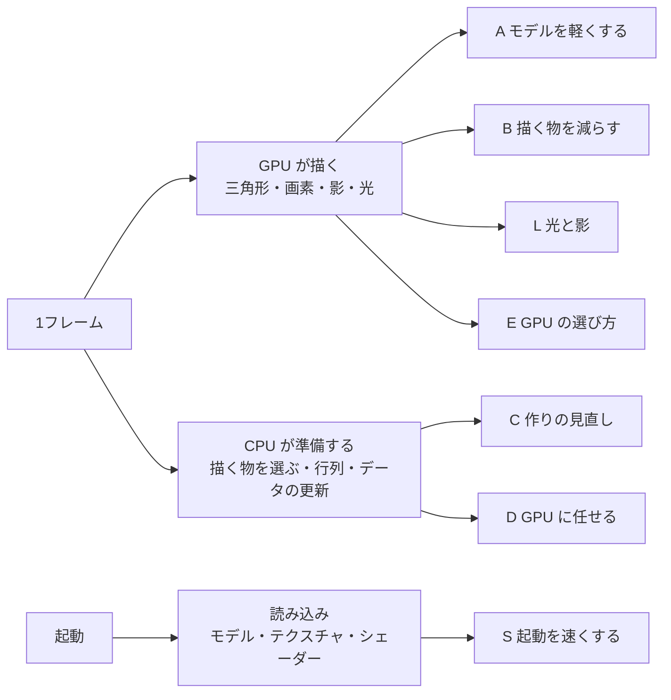

# 最適化の方法の設計

作成日: 2026-11-15
対象: ゲーム全体（描画・CPU の処理・起動）。それぞれの方法のコードは、各ページの「対象」にある
経緯: [最適化の方法の経緯](最適化の方法の経緯.md)

ゲームを軽くする方法を、種類ごとに一覧にしたページです。どの方法の仕組みがもうあるか、どれだけ効いたか、まだ試していない方法は何かを並べます。方法ごとの作りは、表のリンク先のページにあります。

- **推測で直さず、先に測る。** 何かを外して FPS を比べ、どこが重いかを決めてから方法を選ぶ（4. 使い方）。
- **1つの方法に1つの記号を付ける。** 種類の頭文字と番号で呼び、番号は付け直さない。新しい方法は続きの番号を付ける。
- 方法を足した・試したら、このページの表の「仕組み」と「効果」を直す。

---

## 1. 全体像

1フレームの重さは、大きく次の4つに分かれます。どれが重いかで、効く方法が変わります。

| 記号 | 種類 | 何を減らすか |
|---|---|---|
| A | モデルを軽くする | 1つのモデルの三角形・頂点・テクスチャ |
| B | 描く物を減らす | そのフレームで描くモデルの数 |
| C | 作りの見直し | CPU が毎フレームする計算 |
| D | GPU に任せる | CPU が描く物を選ぶ・命令を出す手間 |
| E | GPU の選び方 | 遅い GPU で描いてしまうこと |
| L | 光と影 | 光の数・影を描く回数・画面全体の効果 |
| S | 起動を速くする | 起動のときの読み込みと計算 |

## 2. 方法の一覧

「仕組み」の「ある」は main にコードがあるもの。効果は、この PC（RX 9070 XT）・Release で、ボス戦の広間で測った値です。

### A モデルを軽くする

| 記号 | 方法 | 仕組み | 効果 | ページ |
|---|---|---|---|---|
| A1 | 三角形を減らす（簡略化） | ある | 広間ではまだ使っていない | [モデルの軽量化の設計](モデルの軽量化の設計.md) |
| A2 | 距離で細かさを変える（LOD） | ある | 同上 | 同上 |
| A3 | 頂点を GPU が速く読める順に並べる | ある | 見た目は変わらない。広間ではまだ使っていない | 同上 |
| A5 | 遠くの物を板（ビルボード）にする | まだ | ― | ― |
| A6 | テクスチャを縮める | ある | 広間の DDS 163MB → 46MB。起動の時間はほぼ変わらず | [ボス戦の広間のテクスチャの経緯](../ゲーム/ステージ/ボス戦の広間のテクスチャの経緯.md) |

### B 描く物を減らす

| 記号 | 方法 | 仕組み | 効果 | ページ |
|---|---|---|---|---|
| B1 | 画面に入らない物を描かない（視錐台） | ある | 広間ではまだ使っていない | ― |
| B3 | 影に描く物を近くに絞る | まだ | ― | ― |
| B4 | 画面で小さく見える物を描かない | ある | 広間ではまだ使っていない | ― |
| B5 | 壁や柱に隠れた物を描かない | まだ | ― | ― |
| B6 | 1つにまとまったモデルを部品に分け、B1・A2 を効かせる | まだ | ― | ― |

### C 作りの見直し（CPU）

| 記号 | 方法 | 仕組み | 効果 | ページ |
|---|---|---|---|---|
| C1 | 地面をマスに分け、遠い・画面の外のマスを中を見ずに飛ばす | ある | 広間ではまだ使っていない | ― |
| C2 | 動かない物の行列を最初に1回だけ計算する | ある | 同上 | [インスタンス描画の設計](インスタンス描画の設計.md) |
| C3 | 幾何学データの更新を、影を落とす・描いた番号だけにする | ある | 同上 | 同上 |
| C4 | 同じモデルをまとめて1回で描く（GPU インスタンシング） | ある | 同上 | 同上 |

### D GPU に任せる

| 記号 | 方法 | 仕組み | 効果 | ページ |
|---|---|---|---|---|
| D1 | 描く物を GPU で選ぶ | まだ | ― | ― |
| D2 | 種類の違う物も GPU でまとめて描く | まだ | ― | ― |

### E GPU の選び方

| 記号 | 方法 | 仕組み | 効果 | ページ |
|---|---|---|---|---|
| E1 | GPU が複数あるとき、専用の GPU で描く | ある | 約 30 → 約 470〜490 FPS | [GPUの選び方の設計](GPUの選び方の設計.md) |

### L 光と影

| 記号 | 方法 | 仕組み | 効果 | ページ |
|---|---|---|---|---|
| L1 | 点の光の数を減らす | まだ | 広間の約 90 個を全部消しても +2 FPS（168 → 170） | [最適化の方法の経緯](最適化の方法の経緯.md) |
| L2 | 光の筋（ボリュームスポットライト）を減らす | まだ | 広間の 5 本を全部消して +9 FPS（168 → 177） | 同上 |
| L3 | 影を落とす物を減らす | まだ | 広間の影を全部消して +15 FPS（168 → 183） | 同上 |

### S 起動を速くする

| 記号 | 方法 | 仕組み | 効果 | ページ |
|---|---|---|---|---|
| S1 | BSP の探索の空のループ・コピーをなくす | ある | Debug の起動が約 6 秒に | [法線スムージングとBSPの設計](法線スムージングとBSPの設計.md) |
| S2 | FBX から変換するとき、重なった頂点をまとめる | ある | S1 と合わせて | [起動時のモデルロード高速化の経緯](起動時のモデルロード高速化の経緯.md) |
| S3 | シェーダーを起動のたびにコンパイルしない | まだ | ― | 同上（残っている起動コスト） |

## 3. 実装方法

方法ごとのコードの置き場所です。くわしい書き方は、表のページの「実装方法」にあります。

| 記号 | どこに書いたか | どう書いたか |
|---|---|---|
| A1〜A3 | [tkFile/ModelReducer/](../../k2EngineLow/tkFile/ModelReducer/) | meshoptimizer で減らした LOD を `xxx_lod0.tkm` … に保存し、もとのモデルが新しいときだけ作り直す |
| B1・B4 | [Objects/StageRender/](../../Game/Source/Objects/StageRender/) | 描く物を選ぶ条件を `IPropFilter` にそろえ、順に通す。1つの方法 = 1つのクラスで、入り切りできる |
| C1 | 同上（`GridSpatialIndex`） | 8m のマスごとに物を持ち、マスの箱で先に判定する |
| C2・C3・C4 | [ModelRender.cpp](../../k2Engine/graphics/ModelRender.cpp) | `UpdateInstancingData(番号, 行列)` で計算済みの行列を渡す。`IsGeometryDataActive(番号)` で要らない番号の更新を飛ばす |
| E1 | [GraphicsEngine.cpp](../../k2EngineLow/graphics/GraphicsEngine.cpp) | 同じメーカーの GPU が複数あれば、ビデオメモリが多い方を選ぶ |
| S1・S2 | [BSP.cpp](../../k2EngineLow/geometry/BSP.cpp)・FBX のインポーター | 探索の空のループを消し、引数を参照にする。重なった頂点を1つにする |

## 4. 使い方

FPS が下がったとき、または軽くしたいときの進め方です。

1. **ほかのゲームを止める。** ほかの作業用フォルダの `Game.exe` が動いていると、GPU を取られて FPS が半分ほどになる。
2. **Release で測る。** Debug は最適化がなく、D3D12 のデバッグレイヤーも動くので、遅く出る。起動してから読み込みが終わるまで（ボス戦の広間なら約 60 秒）待ってから、右上の FPS を読む。
3. **1つずつ外して比べる。** モデル・光・影などを1つずつ描かないようにして FPS を比べ、上がり幅がいちばん大きい物を探す。
4. **重い物の中身を見る。** モデルなら、三角形の数・部品の数・画面の外の物も描いているか。
5. **1. 全体像で種類を決め、2. の表から方法を選ぶ。** 方法を使ったら、表の「仕組み」と「効果」を直し、測った結果を経緯に書く。

## 5. 決めたこと

- 記号の番号は付け直さない。ほかのページの経緯にその記号で書いてあるため。使わなくなった方法を消したところ（A4・B2）は、番号を空けたままにする。
- 効果は FPS だけでなく、できるだけ 1フレームの時間（ms）でも書く。FPS が高いときは、同じ 1ms でも FPS の差が大きく見えるため。

## 6. 既知の課題

- **ボス戦の広間が重い。** 広間のモデル（`BossHall.tkm`）は 84 個の部品が1つにまとまり、三角形が約 62 万ある。広間では約 168 FPS で、広間のモデルを描かないと約 380 FPS（[最適化の方法の経緯](最適化の方法の経緯.md)）。A1・A2・B6 が候補。
- エフェクトを出すと重くなる（[やりたいこと](../やりたいこと.md) の 12）。どの段階で重いかはまだ測っていない。

## 7. 関連するページ

- [モデルの軽量化の設計](モデルの軽量化の設計.md): ModelReducer（A1〜A3）
- [インスタンス描画の設計](インスタンス描画の設計.md): C2〜C4
- [GPUの選び方の設計](GPUの選び方の設計.md): E1
- [フレームレートの設計](フレームレートの設計.md): FPS の上限（今は無制限）
- [FPSの表示の設計](../ゲーム/UI/FPSの表示の設計.md): 右上の FPS の数え方
