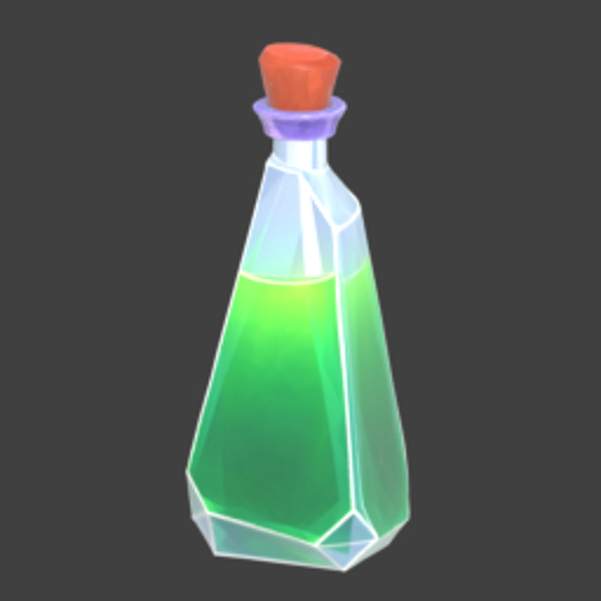
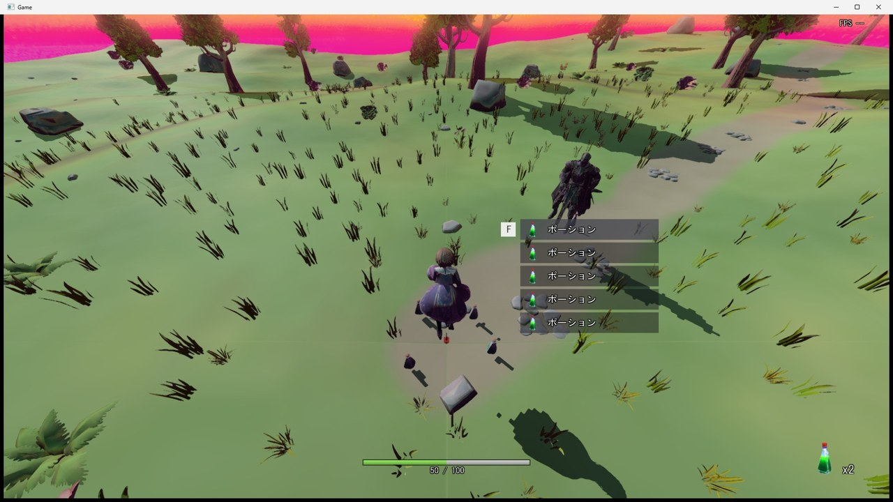
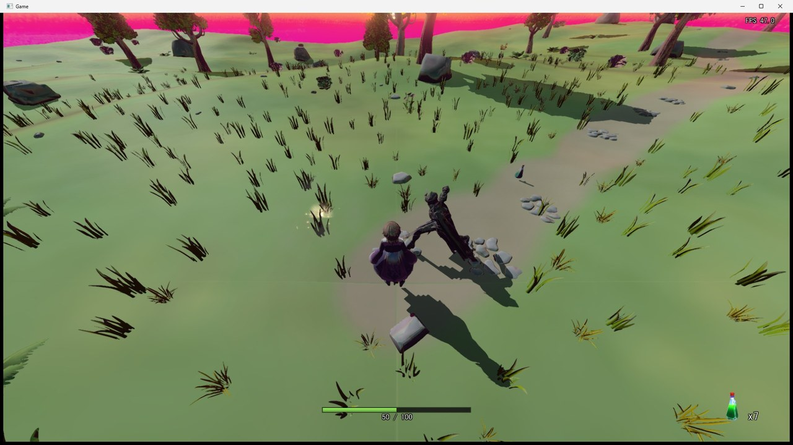
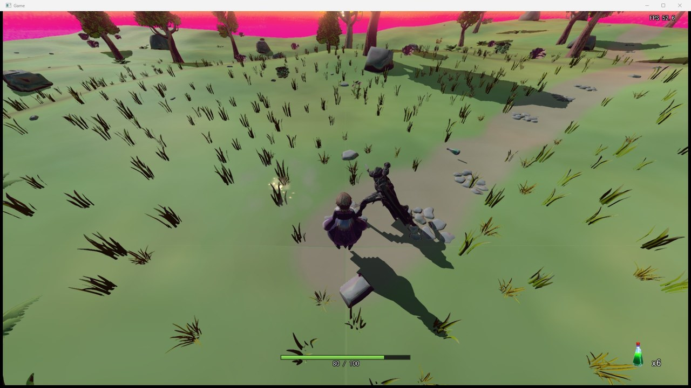
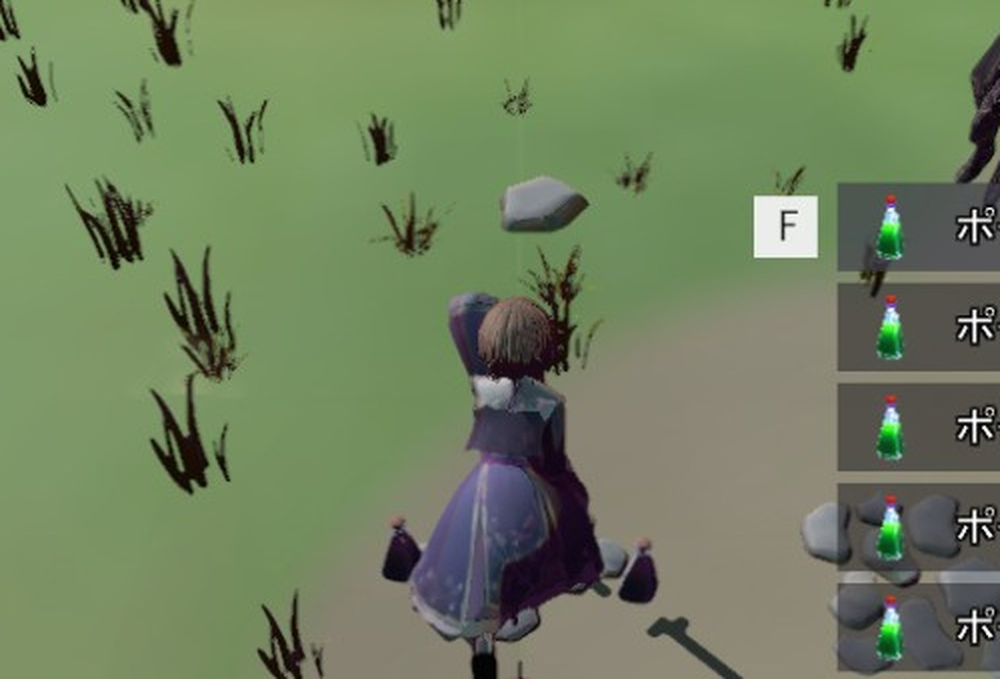
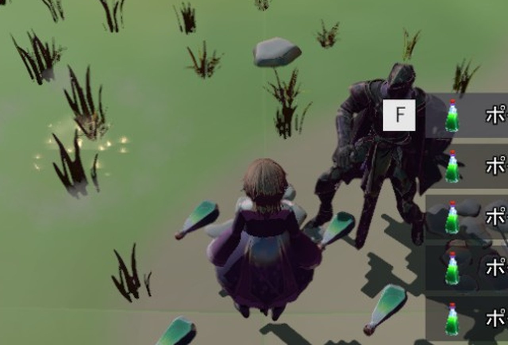
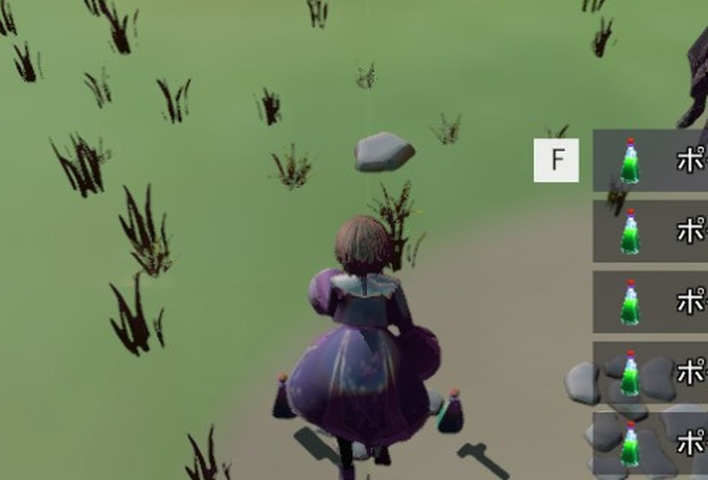

# アイテムの経緯

設計: [アイテムの設計](アイテムの設計.md)、[ポーションの設計](ポーションの設計.md)
手順: [アイテムの手順](アイテムの手順.md)、[ポーションの手順](ポーションの手順.md)

---

## 2026-11-11: 落ちているポーションを拾って、R で飲めるようにした

### 設計を決めた

ユーザーと相談しながら、形を次の順に決めた。

1. 「落ちているアイテムを拾うと、画面右下のストックが増える」。ダークソウルのエスト瓶のように、数に限りのある回復を、すきのある動作で飲む。
2. 最初は、拾う係（`ItemPickup` が自分でプレイヤーとの距離を見て、自分を消す）と、数を持つ部品（`ItemPouch`）を別に作る案を出した。
   - 「今のクラスから見た関係がわからない」と言われたので、今あるクラスの図に、足すもの・書き足すものを書き込んで見せた。
   - 数は、もとから「Player だけの値はここへ足す」とある `PlayerStatus` に持たせることにして、`ItemPouch` はやめた。
3. ユーザーの指示で、形を変えた。
   - アイテムは `Actor → Item → Potion` の継承にする。
   - 拾ったかどうかは、プレイヤーのステートで決める。
4. 落ちているアイテムの一覧は、static の登録簿（`HitTargetRegistry` と同じ形）ではなく、`ItemManager` が持つことにした（ユーザーの指示）。置くのも消すのも ItemManager だけにした。
5. 拾い方は、アニメーションなしで、ボタンを押して拾う形にした。近づくと、原神のように、何が落ちていて何を拾うかを、絵と名前の一覧で出す。
   - 候補の一覧は、ステート（拾う）と UI（描く）が両方見るので、`ItemPicker` に分けた。
   - ホイールで選ぶ形も考えたが、F でいちばん上（いちばん近いもの）を拾う形にした。F を長押しすると、まとめて拾う。
   - 拾えないステートの間も、一覧は出しておく。
6. ポーションは、飲んだ瞬間にまとめて回復する。上限はなし。始めに2つ持つ。落ちて戻っても残す。ボタンはひとまず R。

### 実装した

- Meshy で作ったポーションの FBX（ユーザーがダウンロードしたもの）を `Assets/modelData/item/Potion/` に置き、`Potion.fbx` に名前を変えた。テクスチャの PNG は Meshy の名前のまま（FBX の中にその名前で書いてあるため）。tkm と色の DDS は、初めて読んだときにエンジンが作った。
- 一覧と右下に出すアイコンは、Blender でモデルを斜め上から撮って作った（[make_item_icon.py](../../../tools/BlenderScripts/make_item_icon.py)）。背景が透明な 256×256 の PNG を、texconv で `Assets/sprite/item/potion.dds` にした。



- フォントに「×」がないので、数は `x2` と書く。カタカナ・漢字はある。
- 新しいファイルは、もとのファイルと同じ UTF-8（BOM 付き）・CRLF にした。BOM がないと、`L"ポーション"` が Shift-JIS として読まれてしまう。

### どう確かめたか

ビルド（Debug|x64）が通り、ゲーム側のコードに警告が出ないことを確かめた。

画面は、ゲームを最小化・非アクティブで起動し、窓を透明・クリックを素通り・いちばん奥にしてから `PrintWindow` で窓だけを撮った。キーは `GetAsyncKeyState` で読んでいるので、キーを送るやり方は使っていない（ユーザーが使っているアプリにも入るため）。かわりに、撮るときだけ次の仮の変更を入れたビルドで撮り、撮り終えたら元に戻した。

- `item.json` の `potionSpawns` を、プレイヤーの周り（150 以内）に5つと、遠くに1つにする。
- 入力が始まってから 9秒目に F を1フレーム、11〜12秒目に F を押し続け、14秒目に R を1フレーム押したことにする。
- 始めに HP を 50 減らす（満タンだと飲めないため）。

| 確かめたこと | 結果 |
|---|---|
| 近づくと、近い順に一覧が出る。1行目に F の印 | 5行出た。右下は x2 |
| F を押した瞬間に、1行目を1つ拾う | 一覧が4行になり、x3 になった |
| F を押し続けると、まとめて拾う | 一覧が消え、x7 になった（2 + 5） |
| R で1つ飲み、まとめて回復する | x6 になり、HP が 50 → 80 になった |







（3枚目だけ、下の「瓶の見た目」を調べている途中のビルドで撮った。瓶はもう全部拾ってあるので、画面は最後の形と同じ。）

### 瓶の見た目を調べた（直す所はなかった）

#### 1. 現状の問題

最初に撮ったとき、床の瓶が小さく、黒っぽい斜めの棒のように見えた。横に倒れていると思った。



#### 2. ソースコードの問題箇所（と思ったところ）

```cpp
result.upAxis = enModelUpAxisY;  // Meshy の FBX は Y が上。
```

FBX の中の `UpAxis` は 1（Y が上）なので Y を渡していた。

#### 3. 切り分け

- `enModelUpAxisZ` にすると、瓶が緑に見えたが、栓が下を向いていた。さらに X で 180° 回す（`rotationOffsetDeg` を足した）と、回るたびに斜めに傾いた。Z を上にすると、エンジンが X で -90° 回すので（`Model::CalcWorldMatrix`）、瓶は横に倒れて回っていた。緑に見えたのは、倒れて日の当たる面が見えていたからだった。



- できた `Potion.tkm` の頂点を読むと、X が -19〜19、Y が -47.5〜47.5、Z が -19〜19 で、瓶は Y に沿って立っていた。エンジンの FBX の読み込み（`FbxRuntimeImporter`）は軸を変えない。つまり **Y のままで正しかった**。
- 暗い紫に見える理由を調べた。
  - UV の上下: エンジンはテクスチャを作るときに上下を返している（texconv の `-vflip`）。返さない DDS にすると、栓の色まで変わったので、今のままで合っている。
  - ミップマップ: Meshy のテクスチャは小さな島の寄せ集めで、全体の平均は紫に近い。遠くで縮小した画像の色が混ざったのかと思い、ミップマップなしの DDS にしたが、変わらなかった。



  - 光の向き: 太陽は `{ 1, -1, -1 }` の向き（奥から手前へ）に当たる。カメラはプレイヤーの後ろから奥を見ているので、見えている瓶の面は影の側になり、トゥーンの影の色（紫寄り）で暗く見える。プレイヤーの背中が暗いのと同じ。

#### 4. ソースコードの直し

直す所はなかった。`enModelUpAxisY` に戻し、試しに足した `rotationOffsetDeg` も消した。DDS もエンジンが作ったものに戻した。大きさだけ、0.35 → 0.5 にした（`item.json` の `potion.modelScale`）。

暗く見えることは、[ポーションの設計](ポーションの設計.md) の「既知の課題」に書いた。

### 手順書

[アイテムの手順](アイテムの手順.md)（11手順）と [ポーションの手順](ポーションの手順.md)（6手順）を作った。

- 最終形（コミット de53627d）の各行を、どの手順で足すかの表にし、そこから手順ごとの途中の形と、手順書のコードの枠をツールで作った。手で写していないので、手順書のコードは今のコードと一字一句同じ。
- アイテムの手順の時点では「飲む」がまだないので、そこに触れるコメント3か所（`PlayerItemSettings` のコメント、`ItemConfig.h`、`Potion.h`）と、`item.json` の行末の `,` だけは途中の形で書き、ポーションの手順で書き換えの枠（前・後）で直す。
- main（#119）から作業用フォルダ（git worktree）を作り、手順書を上から読んで組み込んだ。アイテムの手順の終わりと、ポーションの手順の終わりで、それぞれ Debug|x64 のビルドが通った。
- 組み込んだ結果は、de53627d の `Action/Game/Source` と `Assets/data` と同じだった（36ファイル。改行・BOM まで同じ）。手順書の途中の形での画面の確認はしていない。
