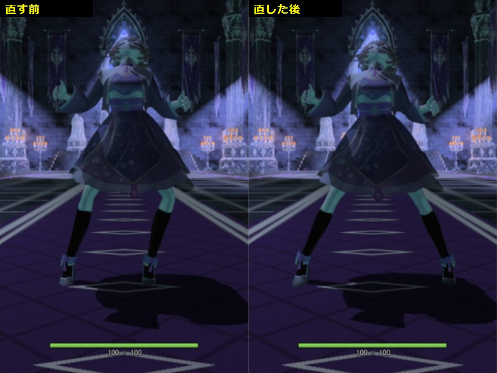

# PowerUpのポーズの経緯

作成日: 2026-11-20
対象: ブランチ `PowerUpTry`
設計: [PowerUpのポーズの設計](PowerUpのポーズの設計.md)

---

## 2026-11-20 フィギュアの写真から PowerUp を作った

ユーザーが撮ったフィギュアの写真4枚（正面・横・後ろ・横）から、足を開いて拳を構え、顔を上へ向けるポーズのクリップを試しに作り、ImGui から流せるようにした。

1. 最初は、写真をざっと見た角度で作った（胴体 95°・首 105°・腕を外へ 45°・脚を外へ 22°）。書き出したポーズの左右の開きは測っていなかった。
2. 作り直すときに、写真に方眼を重ねて関節の位置を読み、角度を測り直した（設計の「調整用の数値」の表）。
3. 書き出したポーズの左右の開きを測れるよう、`log_frames` に正面から見た開き（太もも・すね・上腕・前腕）を足した。

## 2026-11-20 脚が写真より閉じていたのを直した

### 1. 現状の問題

太ももを外へ 24° 開く設定（`out_deg`）で作ると、ゲームの画面で足の幅が写真の半分くらいしかなかった（下の左）。写真は足首の間が背の高さの約半分。



### 2. ソースコードの問題箇所

`log_frames` で測ると、太ももは左 28°・右 26° 開いているのに、すねは左 16°・右 -16°（内へ）だった。`out_deg` はロトスコープの前に回す（[adjust_bone_rotation.py](../../../../tools/UnrealScripts/adjust_bone_rotation.py) の `adjust`）。元のクリップ（Run の 0コマ目）は膝が曲がっているので、曲がった脚を開いてから、ロトスコープが膝を左右の軸まわりに伸ばすと、すねの向きが外へ開いたまま残らない。すねにも `out_deg` を足して試したが、右のすねは足すほど内へ入った（-16° → -30°）。

### 3. 直し方

ロトスコープで膝をまっすぐにした**あとで**、太ももをワールドの前後の軸まわりに回す処理（`open_after`）を足した。子のボーンは一緒に回るので、まっすぐな脚のまま開く。足には同じ角度を負で入れて足の裏を戻し、足が浮いた分だけ腰を下げる。

### 4. ソースコードの直し

`adjust_bone_rotation.py` に `open_after` を足し、`main` でロトスコープのあとに呼ぶ。`powerup_roto.json` は、脚の `out_deg` を消して、`open_after` に太もも 27°・足 -27° を書いた。

```diff
             if clip.get("crouch") and after_roto:
                 crouch(anim, clip["crouch"])
+            # open_after: ロトスコープでポーズを作ってから、脚・腕を外へ開く（足を開いて立つポーズ）。
+            if clip.get("open_after"):
+                open_after(anim, clip["open_after"])
```

直した後は、太もも 32°/29°・すね 25°/23°（左/右）で、足の幅が写真に近くなった（上の右）。

### 5. どう確かめたか

- UE のログで、ロトスコープの最後の差が 0.5° 以下、測り直した角度が設計の表のとおりであることを見た。
- ゲームの画面で、正面と横から撮って写真と並べた（設計の冒頭の2枚）。撮影用の一時変更（コミットしていない）を入れてビルドし、起動から3秒後に PowerUp を流して、プレイヤーをカメラへ向け（正面）、または左へ向け（横）、カメラを近くに置いた。撮影中は入力を空にし、カメラの切り替えを止めた。窓は最小化・透明・クリックを素通り・いちばん奥にして、`PrintWindow` で窓だけを撮り、撮ってすぐ終了させた。
- 最初の撮影では、一人称に切り替わった。パッドの B ボタン（カメラの切り替え）はキーボードのキーにも割り当てられていて、ほかのアプリで打ったキーを拾ったと見ている（今回の変更より前からある動き）。
