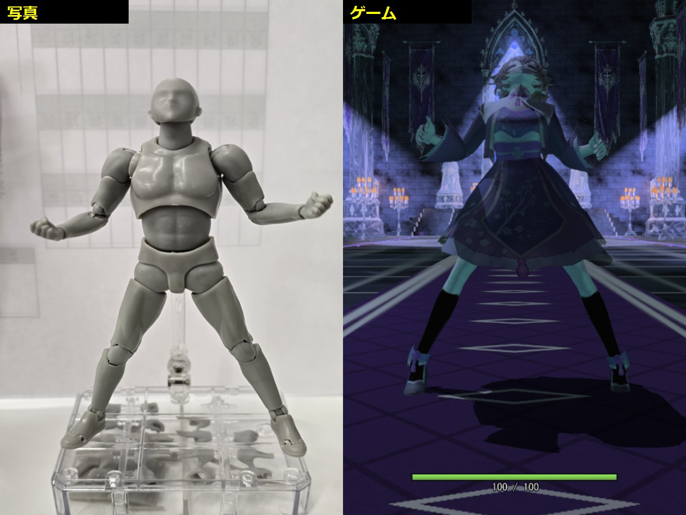
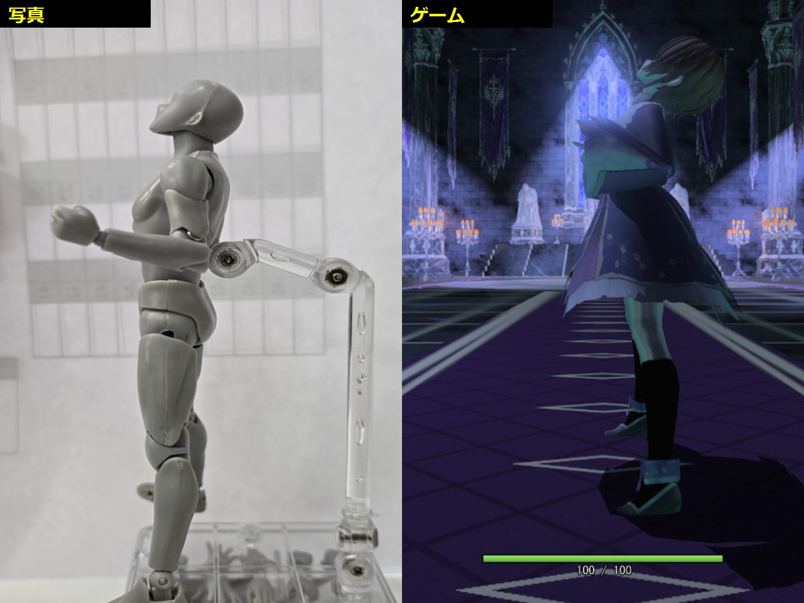

# PowerUpのポーズの設計

作成日: 2026-11-20
対象: ブランチ `PowerUpTry`、`PowerUp.fbx`、[powerup_roto.json](../../../../tools/UnrealScripts/powerup_roto.json)
経緯: [PowerUpのポーズの経緯](PowerUpのポーズの経緯.md)

フィギュアの写真（正面・横・後ろ）から作った、力を溜めて叫ぶ立ち姿のクリップ（PowerUp）です。足を大きく開いて立ち、拳を握って脇で構え、胸を張って顔を上へ向けます。今は試しに作ったもので、ImGui の「アニメーションの確認」から流します（[アニメーションの確認の設計](../../プレイヤー/アニメーションの確認/アニメーションの確認の設計.md)）。

- **写真は1ポーズなので、30コマとも同じポーズにする。** 入るときの動きは、ゲームの補間（0.3秒）に任せる。
- **前後の向きは、ダッシュと同じロトスコープで合わせる。** 左右の開きは、ロトスコープのあとで脚・腕を外へ回して合わせる。
- **写真から測った角度を、書き出したポーズで測り直して合わせる**（測り直しは UE のログ）。





---

## 1. 全体像

[adjust_bone_rotation.py](../../../../tools/UnrealScripts/adjust_bone_rotation.py) を UE（コマンドライン）で動かし、次の順に PowerUp.fbx を作ります。

| 順 | 処理 | 何をするか |
|---|---|---|
| 1 | `out_deg`・`splay_deg` | 元のクリップ（`ThirdPersonRunPlayer_Run.fbx` の 0コマ目）の上腕を外へ回し、前腕を外へ開く |
| 2 | `frames` | 0コマ目だけを切り出し、29コマ足して30コマにする |
| 3 | `rotoscope` | [powerup_pose.json](../../../../tools/UnrealScripts/powerup_pose.json) の角度（前後の向き）に合わせる。顔の向きは `face_deg` |
| 4 | `open_after` | 脚を外へ開き、足の裏を床と平らに戻す。浮いた分だけ腰を下げる |

コマは 30fps で、クリップの先頭を 0コマ目と数えます。

## 2. 実装方法

### 前後の向き（`powerup_pose.json`）

ダッシュと同じ決まり（前 0°・真上 90°・真下 -90°、横から見た骨の向き）で、横の写真から測った角度を30コマ同じに並べます。

### 脚の開き（`open_after`）

ロトスコープのあとで、太ももをワールドの前後の軸まわりに回します。子のボーン（すね・足）も一緒に回るので、ロトスコープでまっすぐにした脚が、まっすぐのまま開きます。

```python
a = q_rotate(q_inv(parent_rot), fwd)          # 前後の軸を、親のローカルで表す
half = math.radians(deg) * 0.5
t["rot"].append(q_mul(unreal.Quat(a.x * sn, a.y * sn, a.z * sn, math.cos(half)), local.rotation))
```

回す向きは、太ももの先が体の外へ動く向きを、側ごとに求めます（左右でボーンの軸の向きが違うため）。足には脚と同じ角度を負で入れて、足の裏を戻します。最後に、一番低いつま先の高さが回す前と同じになるよう、腰を下げます。

| 名前 | 何をするものか | どこから来たもの |
|---|---|---|
| `q_rotate`・`q_inv`・`q_mul` | クォータニオンで向きを回す・逆にする・掛ける | このゲームの `adjust_bone_rotation.py` |
| `unreal.Quat` | UE のクォータニオン（x, y, z, w） | UE の Python API |

### 腕の開き（`out_deg`・`splay_deg`）

腕はロトスコープの前に開きます（Run の腕の開きと同じ）。元のクリップは左右で腕の向きが違うので、角度は左右別にし、書き出したポーズの開きを測りながら決めました。

## 3. 調整用の数値（`powerup_roto.json`・`powerup_pose.json`）

| 内容 | 写真から測った値 | 書き出したポーズ（測り直し） | 設定 |
|---|---|---|---|
| 胴体（腰 → 首） | 95° | 97° | `torso` 95 |
| 首（首 → 頭） | 110° | — | `neck` 110 |
| 顔の向き（水平から上） | 約 60° | — | `face_deg` 60 |
| 太もも・すね（横から） | -90°・-88° | -90°・-93°（膝 3°） | `thigh` -90・`shin` -93 |
| 脚の開き（正面から、真下から外へ） | 26〜31° | 太もも 32°/29°・すね 25°/23°（左/右） | `open_after` 27、足 -27 |
| 上腕（横から） | -107° | -107° | `upper` -107 |
| 上腕の開き（正面から） | 約 29° | 30°/30° | `out_deg` 左 11・右 -3 |
| 前腕（横から） | 11° | 11° | `fore` 11 |
| 前腕の開き（前から外へ） | 約 34° | 34°/32° | `splay_deg` 左 42・右 37 |

## 4. 決めたこと

| 決めたこと | 理由 |
|---|---|
| 脚は `out_deg` でなく `open_after` で開く | 元のクリップは膝が曲がっていて、開いてからロトスコープで膝を伸ばすと、すねが内へ戻った（右のすねは -16°、角度を足すほど内へ入った）。足の幅が写真の半分くらいになった |
| 入るまでの動き（溜めてから構える）は作らない | 写真は1ポーズで、動きを一から手で付けないため。動きが要るなら、Web にある既存のアニメーションを探して当てる |

## 5. 既知の課題

- 袖とスカートが大きく暗いので、腕の形が写真ほどは見えない。
- 足を開くときの足の滑りは、ゲームの補間（0.3秒）のまま。

## 6. 関連するページ

- [走りとダッシュのモーションの設計](../走りとダッシュのモーション/走りとダッシュのモーションの設計.md)（ロトスコープの数値の決まり）
- [動画からアニメーションを作る設計](../動画からアニメーションを作る/動画からアニメーションを作る設計.md)（UE で動かすコマンド）
