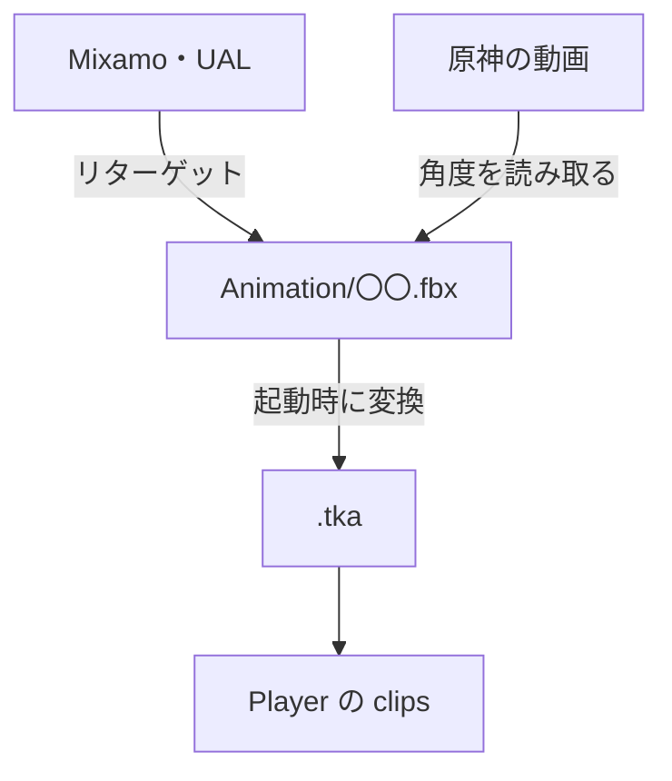

# プレイヤーのアニメーションの設計

作成日: 2026-11-06（2026-11-07 に設計と経緯を分けた）
対象: `Game/Assets/modelData/player/Animation/`、[player.json](../../../Game/Assets/data/player.json) の `animation.clips`
経緯: [プレイヤーのアニメーションの経緯](プレイヤーのアニメーションの経緯.md)

プレイヤー（SK_Player、VRM のモデル）のモーションを、どこから持ってきて、どうゲームで使える形にしているかのページです。

- **骨格の違いはゲームの外（UE）で解決する。** ゲームには SK_Player と同じ骨格の FBX だけを置く。
- **UE の作業はスクリプトにして、コマンドラインで流す。**
- **歩くモーションは、足が地面を送る速さに合わせて再生速度を変える。** 足が地面の上を滑らないように。

---

## 1. 全体像

| 作り方 | ページ |
|---|---|
| Mixamo などのモーションを SK_Player に移す | [リターゲットの設計](リターゲットの設計.md) |
| 動画から関節の角度を読み取って作る | [動画からアニメーションを作る設計](動画からアニメーションを作る設計.md) |
| できたモーションの姿勢を少し直す | [姿勢補正スクリプトの設計](姿勢補正スクリプトの設計.md) |

---

## 2. 今のモーション

| クリップ | 元 | ループ | 長さ | 再生速度 |
|---|---|---|---|---|
| Idle | Mixamo「Breathing Idle」 | ○ | 9.9秒 | 1 |
| Walk | Mixamo「Female Walk」（In Place、上半身を起こす補正あり） | ○ | 1.17秒 | 歩く速さ ÷ 130（約1.3） |
| Run | 原神の動画の走りの1周期（34.25〜34.72秒） | ○ | 0.47秒 | 1 |
| JumpStart / JumpLoop / JumpLand | Universal Animation Library のジャンプ（[ジャンプの設計](../プレイヤー/ジャンプの設計.md)） | × / ○ / × | 1.33秒 / 2.53秒 / 1.30秒 | 1 |
| Dash | 原神の動画 33.41〜33.94秒（[ダッシュの設計](../プレイヤー/ダッシュの設計.md)） | × | 0.53秒 | 1 |
| StopL / StopR | 原神の動画 29.78〜30.89秒（[止まるモーションの設計](止まるモーションの設計.md)） | × | 1.1秒 | 1 |

元のファイルは `MaxData/player/model/` にも同じものを置いている。

---

## 3. 歩くモーションの再生速度

`PlayerWalkState` が `歩く速さ ÷ walkAnimMoveSpeed` で再生する。`walkAnimMoveSpeed`（130）は、Walk を等速で流したときに接地している足が後ろへ動く速さ。

- [measure_foot_speed.py](../../../tools/UnrealScripts/measure_foot_speed.py) で UE の値（114.7 cm/秒）を測り、モデルの大きさ 1.128 を掛けた。
- 接地しているフレーム間の速さの**中央値**を使う。平均だと、かかとが着く・つま先が離れる瞬間の遅いフレームに引っぱられる。
- 歩く速さを変えても再生速度は自動で合う。ただし 0.7〜1.5倍の外だと早送り・スローに見えるので、モーションを替える。
- 歩くモーションを替えたら、測り直して `× 1.128` を `MakeStateSettings()` に入れる。

---

## 4. 決めたこと

| 決めたこと | 理由 |
|---|---|
| モーションは Mixamo から持ってくる | 原神のような軽くて女性らしい歩き・穏やかな待機に近いものが無料で手に入る。UE の Game Animation Sample はリアル寄り、UE4 マネキンは硬くて男性的 |
| エンジンでリターゲットしない | エンジンの変換はボーン名が一致した姿勢をそのままコピーするだけ。骨の長さや基準のポーズの違いを吸収するには IK Rig が要り、UE にすでにある |
| 姿勢の補正もゲームの外で行う | ゲームに置く FBX は SK_Player の骨格そのまま、という決まりを守る。`.tka` を書き換えても、FBX が新しいと起動時に作り直されて消える |

---

## 5. 既知の課題

- **髪・スカートが揺れない。** `J_Sec_*` のボーンはモーションに含まれない。揺れものの物理（スプリングボーン）が別に必要。
- **Idle の背骨は補正していない。** 背骨の形は Walk と同じだが、反りは小さめ。腕だけ、体の横へ下ろすよう直した（[姿勢補正スクリプトの設計](姿勢補正スクリプトの設計.md)）。
- **見た目の確認は実機だけ。** スクリプトで確かめているのは、ボーン構成と、ループの最初と最後の姿勢が合っていることだけ。
