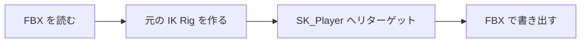

# リターゲットの設計

作成日: 2026-11-07（[プレイヤーのアニメーションの設計](プレイヤーのアニメーションの設計.md) から分けた）
対象: [retarget_to_player.py](../../../tools/UnrealScripts/retarget_to_player.py)、[mixamo_idle_walk.json](../../../tools/UnrealScripts/mixamo_idle_walk.json)
経緯: [プレイヤーのアニメーションの経緯](プレイヤーのアニメーションの経緯.md)

Mixamo などのモーションを、UE で SK_Player の骨格に移して FBX で書き出すスクリプトです。

- **エディターを開かず、コマンドラインで流す。**
- **IK Rig とリターゲッターは自動で作り、2回目からは使い回す。**

---

## 1. 流れ



| 手順 | 使う API | 理由 |
|---|---|---|
| 元のモデル（Y Bot）を読む | `AssetImportTask` + `FbxImportUI` | アニメーションだけの FBX には骨格の基準がない |
| 元の IK Rig を作る | `apply_auto_generated_retarget_definition()`・`apply_auto_fbik()` | Mixamo やマネキンは UE が骨格を見分けてチェーンを作れる |
| リターゲッターを作る | `auto_map_chains(FUZZY)` | 元と先でチェーン名がほぼ同じ |
| ポーズを合わせる（A ポーズのときだけ） | `auto_align_all_bones(SOURCE)` | Mixamo と VRM はどちらも T ポーズなので不要 |
| リターゲットする | `IKRetargetBatchOperation.run_batch_retarget()` | 5.8 では `duplicate_and_retarget` が非推奨 |
| 書き出す | `AnimSequenceExporterFBX`（`export_preview_mesh = False`） | 骨格とアニメーションだけにする |

使い回すのは、UE では読み込み済みの資産を消してから同じ名前で作ろうとすると失敗するため。

| UE の資産 | 内容 |
|---|---|
| `/Game/01_PlayerVRM/SK_Player` | VRM4U で読み込んだモデル。ゲームの `SK_Player.FBX` はここから書き出した |
| `/Game/01_PlayerVRM/IK_Player_Mannequin` | リターゲット先の IK Rig（チェーン名は UE のマネキン式） |
| `/Game/04_Retarget/<作業名>/` | スクリプトが作る資産 |

---

## 2. 使い方（Mixamo のモーションを足す）

1. Mixamo からダウンロードし、`D:\04_dawnload\mixamo\` に置く。
   - キャラクター「Y Bot」: FBX Binary・T-pose
   - モーション: FBX Binary・Without Skin・30fps・Keyframe Reduction は none。移動するものは **In Place**
2. `mixamo_idle_walk.json` の `clips` に `{"name": "書き出す名前", "fbx": "元のFBX"}` を足す。
3. UE のエディターを閉じてから実行する（Git Bash では `MSYS_NO_PATHCONV=1` を付ける）。

   ```bash
   T=D:/02_git/01_my/01_Action/Action/tools/UnrealScripts
   MSYS_NO_PATHCONV=1 "D:/01_software/13_UnrealEngine/UE_5.8/Engine/Binaries/Win64/UnrealEditor-Cmd.exe" \
     "D:/03_data/AssetMigrate_Combat 5.8 - 2/AssetMigrate_Combat.uproject" -run=pythonscript \
     "-script=$T/retarget_to_player.py $T/mixamo_idle_walk.json" -unattended -nop4 -nosplash -NullRHI
   ```

4. `log` のファイルの最後が `DONE` か確かめる。
5. 新しいクリップなら `EnPlayerAnimClip` に番号を足し、`PlayerConfig.cpp` の `MakeModelDesc()` にパスを書く。
6. ゲームを1回起動して `.tka` を作り、`.fbx` と `.tka` をコミットする。

---

## 3. 既知の課題

- **UE のプロジェクトと元のファイルはリポジトリにない。** `D:\03_data\AssetMigrate_Combat 5.8 - 2` と `D:\04_dawnload\mixamo\` は、このPCにしかない。
- **Walk をリターゲットし直すと補正が消える。** そのあと [姿勢補正スクリプト](姿勢補正スクリプトの設計.md) を1回流し直す。
