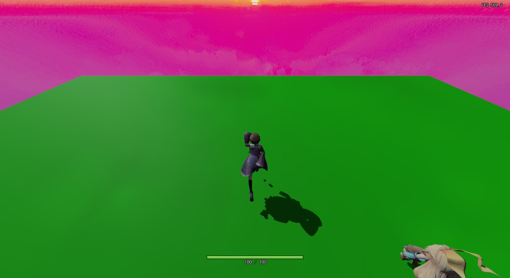
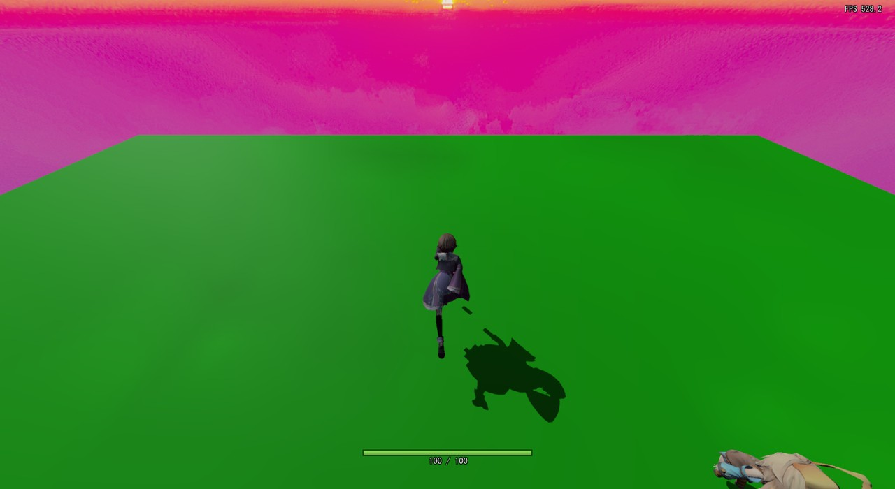
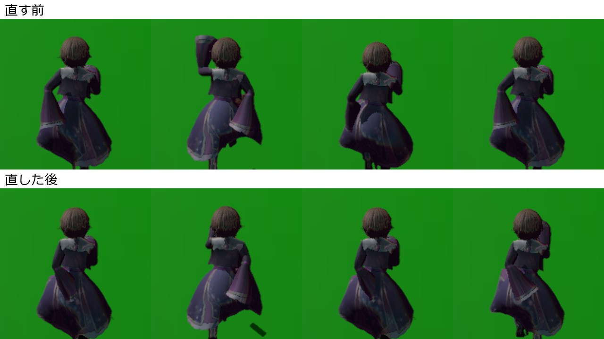
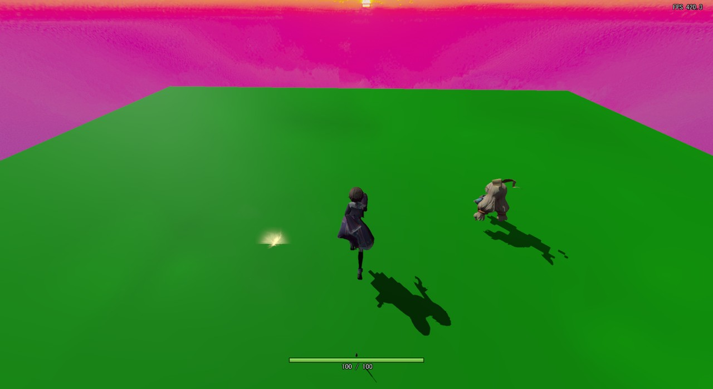
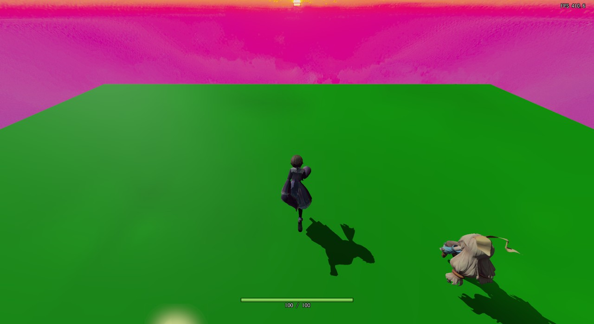
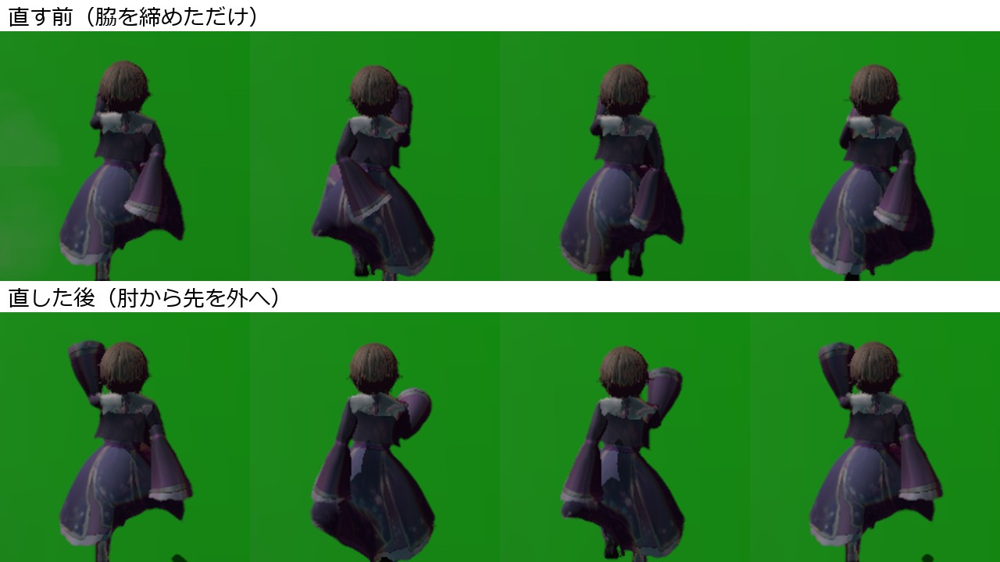

# 動画からアニメーションを作る経緯

設計: [動画からアニメーションを作る設計](動画からアニメーションを作る設計.md)、[走りとダッシュのモーションの設計](走りとダッシュのモーションの設計.md)

何をして、なぜ今の形になったかの記録です。日付ごとに書き足します。止まるモーションの記録は [走りから止まる経緯](../プレイヤー/走りから止まる経緯.md) にあります。

---

## 2026-11-06 角度を足して直すやり方をやめ、動画から作り直した

それまでのダッシュは、Run の骨の角度を足して形を作り、短いクリップ（しゃがみ・一蹴り・着地）を3本つないでいた（[プレイヤーのアニメーションの経緯](プレイヤーのアニメーションの経緯.md)）。ゲームの録画を原神の動画と並べると、次のことがわかった。

- しゃがみが1コマで終わって見えない
- 滑るポーズが止まった人形のように固まる
- 着地で一気に起き上がる
- しゃがみ込みのクリップの最初の数コマに Run の形が残り、かかとが跳ね上がる

角度を足すやり方では、つなぎ目と途中の形を細かく作り込めないので、動画から関節の角度を読み取って一から作るやり方に変えた。ダッシュは「しゃがむ → 蹴って低く滑る → 着地」を切り替えなしの1本にし、走りも原神の走りの1周期にした。

| 候補 | 選ばなかった理由 |
|---|---|
| 角度を足すやり方のまま直し続ける | つなぎ目と途中の形が作れず、直すたびに別のところが不自然になった |
| Mixamo などのモーションをリターゲットする | 原神の動きとは違う。リターゲット用の UE プロジェクトもこのPCにない |
| 動画を見ながら手でポーズを打つ | 1コマずつ角度を目で読むのは時間がかかり、ぶれる |

## 2026-11-06 速く走るときの下半身に合わせた

「速く走るときは上半身の前傾が強くなるが、下半身はどうなるか」という話から、次の形に合わせた。

- 前傾は腰で折らず、足首から体全体を倒す → `leg_lean_deg` で脚も前へ倒した。走りの着地は、足首が腰のほぼ真下（前後 -1〜+4cm）になった。
- 振り戻す脚は、かかとをお尻へたたんで短い振り子にする → `tuck_knee_deg`。太ももがまだ後ろにあるうちにたたむと、かかとが 85cm まで跳ね上がったので、腰の下を通るところ（-95° から）だけにした。
- ダッシュは動画のとおり膝を深く曲げているので、たたむのは入れなかった（入れると、着地で腰が 47cm まで沈んだ）。

## 2026-11-06 頭・前傾・腕の調整

- 前傾（`lean_deg`）: 「もっと前傾姿勢に」とのことで、走り 10°、ダッシュ 8° にした。走りの上半身は地面から約38〜47°、ダッシュの低く滑るところは約24〜31°。
- 頭（`head_pitch_deg`）: 「若干顔を斜め前を見て」で 12°、「若干顔、前を見て」で 20°、「もうちょっと顔上げて」で 30° にした。
- 走りの腕: 読み取りの値をならすと、振りが打ち消し合ってほとんど振れなかった（片方は -77〜-116° の間だけ、もう片方は同じ側の脚と同じ向き）。「腕がちゃんと振れていない」とのことで、反対側の太ももから作るようにした。はじめは上腕 = -165° + 120°×割合だったが、「もっと後ろまで振って」とのことで後ろを 25° 広げた。

## 2026-11-06 走りの足を頭の下の方へ踏み込むようにした

「頭の下の場所に踏み込む感じで前に出して」とのことで、走りは脚を倒すの（`leg_lean_deg` 6°）をやめ、`shift_feet` で足を腰の 22〜28cm 前へ着くようにした（前は 0〜4cm）。はじめ最大 22cm ずらしたら、着いた足が1コマ約 30cm 後ろへ動いて滑って見えたので、最大 16cm に減らした。あわせて、足が着いている間に腰を最大 6cm 沈めて膝で受け止めるようにした（`crouch`）。

## 2026-11-07 ゲームの録画を測り、足していた前傾を外した

ゲームの録画（`E:\backup\03_picture\旧PC\movie\Captures\Game 2026-11-07 23-06-21.mp4`、ダッシュ → 走り → 止まる）を原神の動画と並べ、ゲームの録画にも `detect_pose.py` をかけて角度を測った。

| | 原神 | ゲーム（直す前） |
|---|---|---|
| ダッシュの低く滑るところの上半身（地面から） | 約34〜45° | 約28〜32° |
| 走りの上半身 | 約49〜58° | 約41〜44° |
| 止まるで踏ん張るところの上半身 | 約76〜86° | 約67〜78° |

どれも、足していた前傾（`lean_deg` 走り・止まる 10°、ダッシュ 8°）の分だけ前かがみだった。見た目では「ダッシュが腹ばいに見える」「走りが沈んだまま」「止まるで後ろへ反らない」と感じたが、測ると腰の高さ・脚の角度・起き上がる速さは原神とほぼ同じで、違いは上半身の角度だった（原神も止まるでは後ろへ反っておらず、ほぼまっすぐ立つ）。
「原神と見比べて違うところを全部直して」とのことで、`lean_deg` と `leg_lean_deg` を全部 0 にした。前の値は、11-06 に「もっと前傾姿勢に」と言われて足したもの。

## 2026-11-07 走りで腰を沈め足すのをやめた

同じ録画で、走りの腰の上下は原神が脚の長さの約0.05倍（約4cm）、ゲームが約0.15倍（約11cm）だった。腰の高さはロトスコープで原神のデータに合わせてあり、そこへ `crouch` で最大 6cm 沈め足していたため。`lower_cm` を 0 にすると、Run の腰の高さは 75.2〜87.8cm（12.6cm の上下）から 80.6〜87.8cm（7.2cm）になった。足が着いているコマで足を地面に着ける分（`height: "hips"` の補正）があるので、データの 4cm よりは少し大きい。

## 2026-11-07 止まるで、立ったときに上を向かないようにした

「止まったときに上向くのやめてほしい」とのことだった。止まるにも走りと同じく顔を 30° 起こす設定（`head_pitch_deg: -30`）が通しでかかっており、起き上がって体がまっすぐになると上を向いて見えた。走りとつながる始めは 30° のまま残し、起き上がる StopL / StopR の 14〜30コマ目で 0° へ戻すようにした（`rotoscope` に `head_pitch_to_deg`・`head_pitch_frames` を足した）。

## 2026-11-07 止まるの顔の向きと首を、Idle にそろえた

上の直しのあとも「まだくいって上を向いてから Idle に移行してる」とのことだった。UE で顔の向き（水平から、+ が上）と首の角度をコマごとに測ると、次のとおりだった。

| | 顔の向き | 首（首 → 頭の線） |
|---|---|---|
| 止まるの始め | -16° | 23° |
| 止まるの 15〜22コマ目 | **+11° まで上がる** | 42 → 59° |
| 止まるの最後 | -9° | 59° |
| Idle | -4° | 84° |

- 起き上がるとき、データでは首が約20°起きる。頭に足す角度を 30° → 0° にしても、首が起きる方が大きく、いったん上を向いていた。
- 止まるの最後と Idle で首が 25° 違い、Idle へ移る 0.3秒で頭が後ろへ引かれていた。

頭に足す角度で決めるのをやめ、顔の向きそのものを -16° → -4°（Idle と同じ）へ一方向に動かすようにした（`face_deg`・`face_frames`）。首も起き上がるところで最大 25° 起こし、最後を Idle と同じ約84°にした（`neck_add_deg`・`neck_add_frames`）。直したあとの止まるの最後は、顔 -4.0°・首 84.4° で、Idle（-4.2°・84.1°）とほぼ同じ。`head_pitch_to_deg`・`head_pitch_frames` は使わなくなったので消した。

## 2026-11-08 ダッシュの低く滑るところで、腕を止めた

「ダッシュ時に腕がばたばたしている」「原神見てみて」とのことだった。原神の動画（33.40〜33.93秒）を1コマずつ見ると、低く滑るところ（Dash の 5〜13コマ目、33.57〜33.84秒）では、手前の腕は肘を曲げて拳を胸の前へ出し、向こう側の腕は後ろへまっすぐ伸ばして拳が頭の高さにあり、どちらもほとんど動かなかった。

読み取りの値では、向こう側の腕（右）が体に隠れて乱れていた。

| 動画の時刻 | 右上腕 | 右肘の曲がり |
|---|---|---|
| 33.64 | -155° | 45° |
| 33.67 | -221° | 50° |
| 33.71 | -186° | 116° |
| 33.74 | -167° | 139° |
| 33.81 | -152° | 49° |

手で直していたのは 33.61・33.64秒の2コマだけで、そのあとが残っていた。手前の腕（左）は -57〜-73° で落ち着いていて、原神と合っていた。

はじめ「前の拳が頭の高さ」と見えたので、前の腕を上げるか聞いて「原神準拠で」となった。大きく切り出して見直すと、頭の高さにあるのは後ろへ伸ばした向こう側の腕で、前の腕は今の高さで合っていた。そこで `rotoscope` に `arm_hold` を足し、低く滑るところだけ、前の腕を読み取りの平均（上腕 -66°・前腕 6°）、後ろの腕を動画から測った値（上腕 -200°・前腕 -180°）で止めた。しゃがむところと着地の腕の振りは原神にもあるので、読み取りの値のままにした。

## 2026-11-08 走りの前へ出る脚がばたつくのを直した

FPS が約30から約480に上がったあと、「走りの前へ出る足がバタバタしているように見える」とのことだった。UE でコマごとに測ると、右脚が着地する直前（Run の 0〜1コマ目）に膝が 130〜133° 折りたたまれ、右足が前に着く 2コマ目で 23° まで一気に伸びていた（すねが1コマで 81° 振り出され、次のコマで 30° 戻る）。左脚にはなかった。

振り戻す脚の膝をたたむ処理（`tuck_knee_deg`）は「足が浮いていて、太ももが -95〜-35°」で決めていた。右脚は着地の直前に太ももが -53° まで戻ってくるので、着地しようとしている脚までたたんでいた。左脚は太ももが -27° より前にあるうちに着地するので、条件に入らなかった。

たたむのを、太ももが一番後ろから一番前まで振られていく間だけにした。右脚の膝は 109 → 79 → 32 → 5 → 23 → 49° と伸びるようになり、左脚（85 → 49 → 14 → 36 → 60°）とほぼ同じ形になった。はじめは「前のコマより太ももが前へ出ているか」で決めようとしたが、右脚は着地の直前（1コマ目）に 1.8° だけ前へ戻るコマがあり、そこでまた膝が折れるのでやめた。


## 2026-11-09 走るときの脇を締めた

### 1. 現状の問題

「走る時もっと脇締めて走ってください」とのことだった。後ろから見ると、走りで腕を振るたびに、肘と袖が体の横から外へはみ出している。



### 2. ソースコードの問題箇所

ロトスコープ（[adjust_bone_rotation.py](../../../tools/UnrealScripts/adjust_bone_rotation.py) の `rotoscope`）は、横から見た平面の角度だけを合わせ、キャラクターの左右の軸まわりにしか回さない。そのため、腕の横への開きは、元にしたクリップ（`ThirdPersonRunPlayer_Run.fbx`）の 0コマ目のままで、全コマ同じだけ開いている。

UE で、肩から見た肘と手の、体の外への距離を測った（`log_frames` に足した `out(elbow=… hand=…)`）。

| | 肘 | 手 |
|---|---|---|
| 左腕 | 6.7cm | 3.9cm |
| 右腕 | 11.4cm | 10.2cm |

右腕の方が大きく開いていた。左右の軸まわりにしか回さないので、腕をどこへ振っても、この距離は変わらない。

### 3. 直し方

Run の設定（[dash_roto.json](../../../tools/UnrealScripts/dash_roto.json)）に `out_deg` を負の値で入れ、ロトスコープの前に、元のクリップの上腕を体の側へ回す。左右の軸まわりの回転では外への距離が変わらないので、ロトスコープのあとも、締めた分がどのコマにも残る。

左右で開きが違うので、回す角度も分けた。UE で試した値は次のとおり。

| 上腕を回す角度（左・右） | 左の肘・手 | 右の肘・手 |
|---|---|---|
| 0°・0°（直す前） | 6.7・3.9cm | 11.4・10.2cm |
| -6°・-6° | 4.5・1.8cm | 10.1・6.9cm |
| -12°・-12° | 2.2・-0.3cm | 8.6・3.6cm |
| **-8°・-25°（選んだ値）** | **3.7・1.1cm** | **5.2・-3.8cm** |
| -10°・-40° | 3.0・0.4cm | 1.0・-12.0cm |

-10°・-40° では右手が体の前を横切るので、肘が左右とも 4〜5cm になる -8°・-25° にした。Dash は変えていない。

### 4. ソースコードの直し

```diff
   {
    "in": "../../Game/Assets/modelData/player/Animation/ThirdPersonRunPlayer_Run.fbx",
    "out": "../../Game/Assets/modelData/player/Animation/Run.fbx",
+   "out_deg": {
+    "J_Bip_L_UpperArm": -8.0,
+    "J_Bip_R_UpperArm": -25.0
+   },
    "frames": {
```

この設定で UE に流して Run.fbx を作り直し、ゲームを起動して Run.tka を作り直した。上が直す前、下が直した後（どちらも Run の途中の4コマ。撮る時刻がずれるので、脚の形が近いコマを並べた）。直した後は、肘と袖が体の幅の中に収まる。





### 5. どう確かめたか

- UE のログで、ロトスコープの最後の差が 0.1° 以下で、腕の前後の角度（`arm=`）が直す前と同じことを見た。
- 画像は、作業用フォルダ（git worktree）で、移動の入力をずっと前・左Shift を押しっぱなしにする撮影用の変更だけを入れてビルドし、Run.fbx と Run.tka を入れ替えて撮った。ゲームは最小化・非アクティブで起動し、窓を透明・クリックを素通り・いちばん奥にしてから `PrintWindow` で窓だけを撮り、起動から8秒後に撮ってすぐ終了させた。キーの入力は `GetAsyncKeyState` で読んでいるので、キーを送って走らせるやり方は使っていない（ユーザーが使っているアプリにも入るため）。
- 後ろから撮っているので、腕が胴体にめり込んでいないかは、前や横からは確かめていない。

## 2026-11-09 走るときの肘から先を外へ出した

### 1. 現状の問題

脇を締めたものを見て、「脇はしまっているんだけど肘から下が内側に入っていておかしい」「肩から手の先にかけて自然に外側に出る感じ」とのことだった（原神の、後ろから見た走りの画像を見せてもらった。肘は体に寄せ、前腕は外へ開いている）。後ろから見ると、前腕と袖が背中やお尻の側へ回り込んでいる。



### 2. ソースコードの問題箇所

前腕の横の向きも、元のクリップの 0コマ目のまま。脇を締めた後に測ると、手は肘より内側にあった。

| | 肘 | 手 |
|---|---|---|
| 左腕 | 3.7cm | 1.1cm |
| 右腕 | 5.2cm | -3.8cm（肩より内側） |

はじめ前腕にも `out_deg` を正の値で入れたが、右手は外へ出たのに、左手は 28° 回しても動かなかった（1.1 → 0.8cm）。`out_deg` は前後の軸まわりに回すので、元のクリップで前を向いている左の前腕では、骨のねじれになるだけだった。

### 3. 直し方

[adjust_bone_rotation.py](../../../tools/UnrealScripts/adjust_bone_rotation.py) に `splay_deg` を足した。コマごとに「骨の向き × 外向き」の軸を作り、その軸まわりに回すので、骨がどちらを向いていても、先の端（前腕なら手）が体の外へ出る。脇の締めと同じく、ロトスコープは左右の軸まわりにしか回さないので、外へ出した分はどのコマにも残る。

| 前腕を開く角度（左右とも） | 左の手 | 右の手 |
|---|---|---|
| 0°（直す前） | 1.1cm | -3.8cm |
| 15° | 6.6cm | 1.4cm |
| 25° | 10.3cm | 5.1cm |
| 35° | 13.7cm | 8.7cm |

左右で手の位置がそろい、肘より手が 6cm ほど外へ出るように、左 25°・右 42° にした。肘は変えていない（左 3.7cm・右 5.2cm）ので、肩から肘はほぼ下へ、肘から手は外へ開く形になる。

### 4. ソースコードの直し

```diff
    "out_deg": {
     "J_Bip_L_UpperArm": -8.0,
     "J_Bip_R_UpperArm": -25.0
    },
+   "splay_deg": {
+    "J_Bip_L_LowerArm": 25.0,
+    "J_Bip_R_LowerArm": 42.0
+   },
```

UE で測ると、手は左 10.3cm・右 11.2cm になった。上が直す前（脇を締めただけ）、下が直した後（撮る時刻がずれるので、脚の形が近いコマを並べた）。直した後は、肘を体に寄せたまま、前腕と袖が体の外へ出る。





### 5. どう確かめたか

- UE のログで、ロトスコープの最後の差が 0.1° 以下で、腕の前後の角度（`arm=`）と肘の位置が直す前と同じことを見た。
- 画像は、脇を締めたときと同じやり方（作業用フォルダで、ずっと前へ走る撮影用の版を作り、裏で起動して窓だけを撮る）で撮った。
- 後ろからしか撮っていないので、前や横からの見た目は確かめていない。
