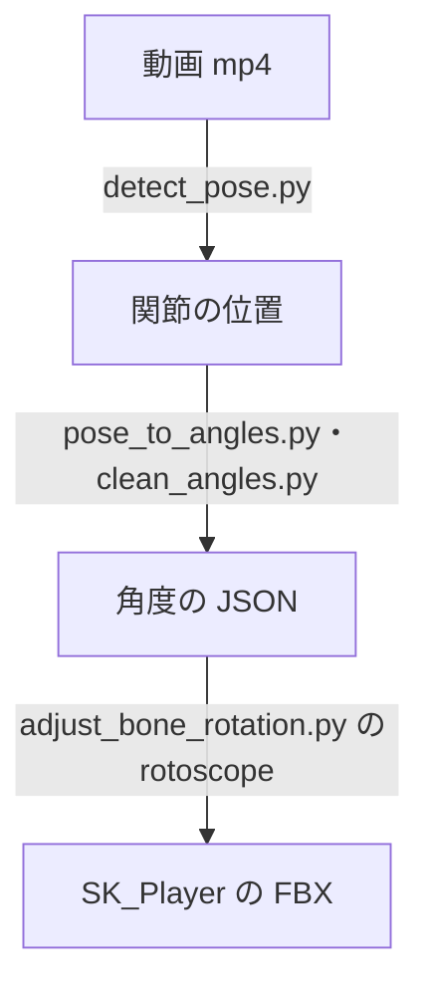

# 動画からアニメーションを作る設計（ロトスコープ）

作成日: 2026-11-06（2026-11-07 に走り・ダッシュの数値と経緯を分けた）
対象: `tools/Rotoscope/`、[adjust_bone_rotation.py](../../../tools/UnrealScripts/adjust_bone_rotation.py) の `rotoscope`
経緯: [動画からアニメーションを作る経緯](動画からアニメーションを作る経緯.md)

参考にしたいゲームの動画から、コマごとに関節の位置を読み取り、その角度で SK_Player のポーズを作ってアニメーションにする仕組みです。
今の走り・ダッシュ（[走りとダッシュのモーションの設計](走りとダッシュのモーションの設計.md)）と止まる（[止まるモーションの設計](止まるモーションの設計.md)）は、原神の動画からこの手順で作っています。

- **読み取りは MediaPipe、ポーズ作りは UE。** 間に角度の JSON を挟み、乱れたコマだけ手で直す。
- **横から見た平面の角度だけを合わせる。**

---

## 1. 流れ



| ファイル | 役割 |
|---|---|
| [detect_pose.py](../../../tools/Rotoscope/detect_pose.py) | 動画の指定した範囲のコマを切り出し、MediaPipe の PoseLandmarker（heavy）で関節の位置を読み取る。確かめ用に骨を描いた画像も出す |
| [pose_to_angles.py](../../../tools/Rotoscope/pose_to_angles.py) | 関節の位置を角度に直す。左右の脚・腕が入れ替わったコマは、前のコマに近い方へそろえる。`flip` を付けると左右を反転して読む（キャラクターが画面の左へ進む場面） |
| [clean_angles.py](../../../tools/Rotoscope/clean_angles.py) | 3コマの中央値と 1:2:1 の平均でならし、棒人間の絵を描く |
| [adjust_bone_rotation.py](../../../tools/UnrealScripts/adjust_bone_rotation.py) の `rotoscope` | 角度のデータどおりに、コマごとに SK_Player のボーンを回し、腰の高さを決める |

元の動画は個人用 OneDrive の `02_Action参考資料/原神/` にある（ゲームの映像なので、公開リポジトリには入れない）。

---

## 2. 角度の測り方

横から見た平面（キャラクターの前後と上下）で、骨の向きを測ります。前 = 0°、真上 = 90°、真下 = -90°、真後ろ = ±180° です。ゲームの側の `segment_angle`（ボーン → 子のボーンの線）と同じ測り方です。

| データの名前 | 動画で測る線（MediaPipe の点） | SK_Player で合わせる線 |
|---|---|---|
| `thigh` / `shin` / `foot` | 腰 → 膝 / 膝 → 足首 / 足首 → つま先 | UpperLeg → LowerLeg / LowerLeg → Foot / Foot → ToeBase |
| `upper` / `fore` | 肩 → 肘 / 肘 → 手首 | UpperArm → LowerArm / LowerArm → Hand |
| `torso` | 両腰の真ん中 → 両肩の真ん中 | Hips → Neck |
| `neck` | 両肩の真ん中 → 両耳の真ん中 | Neck → Head |
| `toeA` / `toeB` / `hipH` | 地面からのつま先・腰の高さ ÷ 脚の長さ（腰 → 膝 → 足首） | 同じ割合 × SK_Player の脚の長さ（76.8cm） |

- 地面は、読み取った全コマで一番低い足の位置とします（カメラが上下に動かない範囲を使う）。
- A・B は脚、a・b は腕です。どれをこのキャラクターの左右に当てるかは、設定の `map` で決めます（`StopR` は `StopL` の左右を入れ替えただけ）。

---

## 3. UE での作り方（rotoscope）

1. 元のクリップ（`ThirdPersonRunPlayer_Run.fbx`）の1コマを、データのコマ数だけくり返したクリップにします（`frames: {start: 0, count: 1, hold: コマ数-1}`）。角度を決めない骨（手の指など）が勝手に動かないようにするためです。
2. コマごとに、親から順に「目標の角度 − 今の角度」だけ、キャラクターの左右の軸まわりに回します。
   - 胴体は、腰・Spine・Chest・UpperChest に 4:2:2:2 で分けて回します（`torso_split`）。
   - 首は Neck を回します。
   - 脚は腰の回転を、腕は胴体の回転を差し引いてから、太もも → すね → 足、上腕 → 前腕の順に回します。
   - 腕は少し横へ開いているので1回では合わないため、測り直して4回くり返します（最後の差は 0.3° 以下）。
3. 腰の高さを決めます。
   - `height: "toe"`（ダッシュ）: コマごとに、一番低いつま先がデータの高さになるようにします。しゃがむ・浮く・着地の高さがそのまま出ます。
   - `height: "hips"`（走り）: 腰の高さの動きをデータに合わせ、クリップ全体で一番低いつま先が 0.5cm になるよう全体を上下させます。走りでは両足が浮くコマがあり、`toe` だとそこで体ごと 15cm 跳ね上がったためです。
     そのうえで、動画で足が地面に着いているコマ（つま先が脚の長さの 0.08 未満）は、浮いた分だけ腰を下げて足を着けます。1コマで腰が跳ねないよう、下げる量は前後のコマへなだらかに広げます（腰の動きは1コマ最大 4cm）。

---

## 4. 使い方

### 同じ動画のまま、作り直す

```bash
T=$(cd Action/tools/UnrealScripts && pwd -W)
MSYS_NO_PATHCONV=1 "<UE_5.8>/Engine/Binaries/Win64/UnrealEditor-Cmd.exe" "<空の>.uproject" -run=pythonscript \
  "-script=$T/adjust_bone_rotation.py $T/dash_roto.json" -unattended -nop4 -nosplash -NullRHI
```

ログは `%TEMP%/adjust_bone_rotation.txt` に出ます（`rotoscope pass 3 worst residual` が小さいことを確かめる）。そのあとゲームを1回起動すると `.tka` が作り直されます。

### 別の動画・別の場面から作る

1. `pip install mediapipe opencv-python-headless` を入れ、モデル `pose_landmarker_heavy.task` をダウンロードする（URL は `detect_pose.py` の先頭）。
2. 動画を1コマずつ見て、使う範囲（秒）と、キャラクターが入る切り出し範囲（ピクセル）を決める。
3. `python detect_pose.py 動画.mp4 33.30 30 pose.json 850 330 1700 980 pose_landmarker_heavy.task check.jpg` で読み取り、`check.jpg` で骨が体に重なっているか確かめる。
4. `python pose_to_angles.py pose.json angles.json`（キャラクターが画面の左へ進むなら最後に `flip`）→ `python clean_angles.py angles.json clean.json stick.jpg` で角度にして、棒人間の絵で確かめる。腕が上を通って回るなど、読み取りの乱れが残ったコマは `clean.json` を手で直す。
5. `clean.json` を `tools/UnrealScripts/` に置き、設定の `rotoscope.data`・`start`・`count`・`map` を書いて UE で流す。
6. ループさせる走りなどは、同じ形に戻るまでの1周期を選び、最後のコマを最初のコマと同じにする。

---

## 5. 決めたこと

| 決めたこと | 理由 |
|---|---|
| 角度を足して形を作るのでなく、動画から一から作る | つなぎ目と途中の形を細かく作り込めなかった（[経緯](動画からアニメーションを作る経緯.md)） |
| MediaPipe で読み取る（手でポーズを打たない） | 目で読むと時間がかかり、ぶれる。乱れたコマだけ直せばよい |

---

## 6. 既知の課題

- **読み取りの乱れ。** 奥側の腕・脚は体に隠れて乱れることがある。ならしても残れば手で直す。
- **ひねり・横の動きはない。** 腰や肩のひねり、腕の開きは元のクリップの1コマのまま。腕の開きは `out_deg` で元のクリップを回して決める（走りの脇の締め。[走りとダッシュのモーションの設計](走りとダッシュのモーションの設計.md)）。
- **体の比率の違い。** 原神のキャラクターと SK_Player は脚の長さの比が違うので、足の位置は少しずれる。
