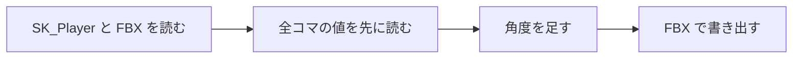

# 姿勢補正スクリプトの設計

作成日: 2026-11-07（[プレイヤーのアニメーションの設計](../プレイヤーのアニメーション/プレイヤーのアニメーションの設計.md) から分けた）
対象: [adjust_bone_rotation.py](../../../../tools/UnrealScripts/adjust_bone_rotation.py)、設定: [walk_upright.json](../../../../tools/UnrealScripts/walk_upright.json)、[idle_arms.json](../../../../tools/UnrealScripts/idle_arms.json)、[walk_arms.json](../../../../tools/UnrealScripts/walk_arms.json) など
経緯: [プレイヤーのアニメーションの経緯](../プレイヤーのアニメーション/プレイヤーのアニメーションの経緯.md)の「2026-11-06 Walk の上半身を前へ 20° 起こした」「2026-11-08 Idle の腕を、体の横へ下ろした」ほか

できたモーションの FBX に、ボーンを前後に傾ける角度などを足して書き出し直すスクリプトです。走り・ダッシュ・止まるのモーションを[動画から作る](../動画からアニメーションを作る/動画からアニメーションを作る設計.md)ときにも使います。

- **リポジトリにある FBX だけで動く。** UE のプロジェクトは空のものでよいので、どの PC でも使える。
- **設定は JSON に書く。** 何をどれだけ直したかが残る。

| 用語 | 何のことか |
|---|---|
| `SK_Player` | UE の中にある、プレイヤーの骨格つきのモデル（スケルタルメッシュ）。ゲームの `SK_Player.FBX` と同じもの（[リターゲットの設計](../リターゲット/リターゲットの設計.md) の資産の表） |
| T ポーズ | 腕を真横に伸ばして立つ、基準の姿勢 |
| ローカルの回転 | 親のボーンから見た、そのボーンの回転。親が動くと、子はそれにつられて動く |
| クォータニオン | 3D の回転を、4つの数（x・y・z・w）で表す方法。回転を続けて掛けても向きが崩れない |

---

## 1. 基本の流れ



- 先に全コマを読んでから書く。書きながら読むと、あとのコマの値が変わる。
- 左右の軸は T ポーズのかかと→つま先で決める（モーション中は足が開いていて、向きがずれる）。
- 角度は「親の向きで見た左右の軸」まわりの回転として、ローカルの回転の前に掛ける。親と子の補正がそのまま足し算になる。
- UE の Python の `Quat` には逆・回転の関数が無いものがあるので、クォータニオンの計算はスクリプトの中に書いている。

| ジャンル | 名前 | 何のためのもの | 何をするためのもの | どこから来たもの |
|---|---|---|---|---|
| 型 | `Quat` | 回転（クォータニオン）を持つため | x・y・z・w を持つ。`unreal.Quat(x, y, z, w)` で作る | 外部ライブラリ（Unreal Engine の Python の `unreal`） |

### 例: Walk の上半身を起こす

[walk_upright.json](../../../../tools/UnrealScripts/walk_upright.json) の中身は、読む FBX と書き出す FBX（`clips`）と、ボーンごとの角度（`pitch_deg`）だけ。

```json
"clips": [{"in": ".../Walk.fbx", "out": ".../Walk.fbx"}],
"pitch_deg": {"J_Bip_C_Spine": 5.0, "J_Bip_C_Neck": -8.0}
```

実行のしかたは「3. 使い方」。

---

## 2. 設定（JSON）

| 設定 | 内容 |
|---|---|
| `pitch_deg` | ボーンごとに足す角度（度、正が前に倒す）。全コマ同じだけ。向きは下の図 |
| `out_deg` | ボーンごとに、前後の軸まわりに回して下の端を体の外へ開く角度（度、正が外）。外の向きは、基準のポーズでボーンが腰のどちら側にあるかで決めるので、左右とも正で外へ開く。全コマ同じだけ |
| `splay_deg` | ボーンごとに、ボーン → 子の線を体の外の向きへ倒す角度（度、正が外）。全コマ同じだけ。軸はコマごとの「骨の向き × 外向き」なので、骨が前を向いていてもねじれにならない（`out_deg` は前後の軸に固定なので、前を向いた骨ではねじれになる） |
| `motion_scale` | **体全体**の動きを、全コマの平均のポーズを中心に k 倍にする（全ボーンの回転と位置。Root も含む）。全部の関節を同じ割合で縮めるので、地面に着いた足はほぼその場に残る。`pitch_deg`・`out_deg` は縮めたあとに足す。Idle の横揺れを半分にするときに使った |
| `swing_scale` | **ボーンごと**に、そのボーンの回転の振り幅を、平均の回転を中心に k 倍する。書いたボーンだけが変わる（例: 太ももの振りを 1.3 倍）。`motion_scale` と違い、位置は変えない |
| `keep_feet_on_ground` | 角度を足して脚ごと倒すと足が浮くので、書き換えたあと、つま先の一番低い高さが元と同じになるまで腰を上下させる |
| `clips[].frames` / `hold` | コマを切り出す。`hold` は最後のコマをくり返して足す |
| `clips[].pose_to` | `ramp_start` のコマから `ramp_end` のコマにかけて、`angle_deg` に書いたボーン（太もも・すね・足・腕）の向きを目標の角度へ [smoothstep](../../../用語集.md#動きを近づける) で寄せる（最後のコマで目標に着く。`ramp_end` を省略したとき）。`drift_deg`・`lift_cm`・`ground_toe_cm` で後半の動きと高さを決める。膝が反らないよう `min_knee_deg` を守る。回すのは左右の軸まわりだけなので、横へ開いた腕などは少しずれる。そのため、測り直して残りの差を足すのを3回くり返す |
| `clips[].crouch` | 足首（Foot）の位置を動かさずに腰を `lower_cm` × `weights`（コマごとの割合）だけ下げ、膝を前へ曲げる。太ももとすねの向きは、2本の骨（太もものつけ根→膝→足首）の IK で決める |
| `clips[].blend_from` | 先に同じ実行で作ったクリップ（`clip`）の最後のポーズを、`weights`（先頭のコマから）の割合で混ぜて始める。つなぎ目をなめらかにする。混ぜてつま先が地面より下になったら、その分だけ腰を上げる（`bend_knees` が true なら、上げた腰を `crouch` で戻して膝を曲げる） |
| `clips[].log_frames` / `out_skip` | コマごとの形（脚と腕の向き、肩から見た肘・手の体の外への距離など）をログに出す。書き出さずに測るだけにもできる |

`pitch_deg` の向き（横から見る。左が後ろ、右が前。下の端を中心に、上の端が動く）:

```
  負（後ろに起こす）   もとの形   正（前に倒す）
     ● 上の端           ● 上        　　　● 上の端
      ╲                 │          　　 ╱
       ● 下の端         ● 下        　● 下の端
```

下を向いた腕に正を足すと、手（下の端）は**後ろ**へ、負を足すと**前**へ動く。

| ジャンル | 名前 | 何のためのもの | 何をするためのもの | どこから来たもの |
|---|---|---|---|---|
| 値 | `drift_deg` | 目標に着いたあとも、止まったポーズにしないため | 目標に着いたコマから最後のコマまで、ボーンごとに少しずつ足していく角度（度、正が前に倒す） | [adjust_bone_rotation.py](../../../../tools/UnrealScripts/adjust_bone_rotation.py) の `pose_to` の設定（JSON のキー） |
| 値 | `lift_cm` | 宙に浮く・低く飛ぶ動きを付けるため | 腰を上下させる量（cm、正が持ち上げる） | [adjust_bone_rotation.py](../../../../tools/UnrealScripts/adjust_bone_rotation.py) の `pose_to` の設定（JSON のキー） |
| 値 | `ground_toe_cm` | しゃがんだポーズで足を地面に着けるため | 最後のコマで一番低いつま先がこの高さ（cm）になるよう腰を上下させる。`lift_cm` の代わりに使う | [adjust_bone_rotation.py](../../../../tools/UnrealScripts/adjust_bone_rotation.py) の `pose_to` の設定（JSON のキー） |
| 値 | `min_knee_deg` | 膝が反らないようにするため | 膝の曲がりの下限（度）。これより小さいコマは、すねをその分だけ曲げる。省略すると 3° | [adjust_bone_rotation.py](../../../../tools/UnrealScripts/adjust_bone_rotation.py) の `pose_to` の設定（JSON のキー） |

ログの `shape` の行には、全コマの平均で上半身・脚の前傾、その差（体の折れ）、つま先の一番低い高さが出る。体の折れが大きいほど、腰で「く」の字に曲がって見える。

---

## 3. 使い方（Walk の上半身を起こす例）

**`walk_upright.json` は `in` と `out` が同じファイルなので、実行するたびに角度が足されていく。** Walk をリターゲットし直したときに1回だけ流す（`idle_arms.json`・`walk_arms.json` も同じ）。

| ジャンル | 名前 | 何のためのもの | 何をするためのもの | どこから来たもの |
|---|---|---|---|---|
| 値 | `in`・`out` | 読むモーションと、書き出すモーションを決めるため | `clips` の1つごとに、元の FBX と書き出す FBX のパスを書く。同じパスにすると、上書きする | `adjust_bone_rotation.py` の設定（JSON のキー） |

1. `walk_upright.json` の `pitch_deg` にボーンと角度を書く。
2. 空の UE プロジェクト（`{"FileVersion":3,"EngineAssociation":"5.8"}` だけの `.uproject`）で実行する。書き方は[リターゲットの設計](../リターゲット/リターゲットの設計.md)の「2. 使い方」3 と同じで、`retarget_to_player.py` を `adjust_bone_rotation.py` に、設定の JSON を `walk_upright.json` に、`.uproject` を空のものにする（[UE をコマンドラインで動かす](../../../用語集.md#アニメーション制作)）。
3. `%TEMP%djust_bone_rotation.txt` の最後が `DONE` か確かめる。`before` / `after` の行に、頭が腰より何 cm 前にあるかと前傾の角度が出る。
4. ゲームを1回起動して `.tka` を作り直し、`.fbx` と `.tka` をコミットする。`MaxData/player/model/` の控えも差し替える。

| Walk の補正（`walk_upright.json`） | 角度 |
|---|---|
| 背骨（Spine・Chest・UpperChest） | 前へ 5°・6°・9° |
| 首（Neck） | 後ろへ 8° |
| 頭（Head） | 前へ 6°（顎を引いた形） |

表の「背骨（Spine…）」は、`SK_Player` の骨の名前 `J_Bip_C_Spine` などの部位（[`J_Bip_*`](../../../用語集.md#左右と向き)）。

Idle の腕も同じやり方で直している（`idle_arms.json`）。Walk の腕は、上半身とは別の設定で前へ出している（`walk_arms.json`。`walk_upright.json` のあとで1回だけ流す）。結果は、肩から見た手などの位置（前後は前が正、横は体の外へが正）。

| 補正 | 設定 | 見る所 | 直す前 | 直したあと |
|---|---|---|---|---|
| Idle の上腕（左右の UpperArm） | `pitch_deg` 6°（肘が肩のほぼ真下へ） | 手の前後 | 10〜15cm 前 | 3〜5cm 前 |
| Idle の前腕（左右の LowerArm） | `pitch_deg` 14°（手が肩の少し前へ） | （上の行と合わせた結果） | | |
| Idle の前腕（左右の LowerArm） | `out_deg` 20°（袖が体にかぶらないよう、肘から先を横へ開く。上腕は開かず、肘は下げたまま） | 手の横 | 約 9cm | 15〜18cm（肘は肩から 21cm 下・横へ 7cm） |
| Idle の体全体 | `motion_scale` 0.5（横揺れを半分に） | 腰の横移動 / 頭 | 16.2cm / 22.8cm | 8.2cm / 11.4cm（足の横のずれは 0.3cm 以内） |
| Walk の上腕（左右の UpperArm） | `pitch_deg` -8° | 手の前後 | 14.7cm 後ろ〜3.4cm 前 | 6.9cm 後ろ〜11.0cm 前 |
| Walk の前腕（左右の LowerArm） | `pitch_deg` -6° | （上の行と合わせた結果） | | |
