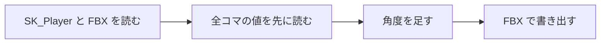

# 姿勢補正スクリプトの設計

作成日: 2026-11-07（[プレイヤーのアニメーションの設計](../プレイヤーのアニメーション/プレイヤーのアニメーションの設計.md) から分けた）
対象: [adjust_bone_rotation.py](../../../../tools/UnrealScripts/adjust_bone_rotation.py)、設定: [walk_upright.json](../../../../tools/UnrealScripts/walk_upright.json)、[idle_arms.json](../../../../tools/UnrealScripts/idle_arms.json)、[walk_arms.json](../../../../tools/UnrealScripts/walk_arms.json) など
経緯: [プレイヤーのアニメーションの経緯](../プレイヤーのアニメーション/プレイヤーのアニメーションの経緯.md)

できたモーションの FBX に、ボーンを前後に傾ける角度などを足して書き出し直すスクリプトです。走り・ダッシュ・止まるのモーションを動画から作るときにも使います（[動画からアニメーションを作る設計](../動画からアニメーションを作る/動画からアニメーションを作る設計.md)）。

- **リポジトリにある FBX だけで動く。** UE のプロジェクトは空のものでよいので、どの PC でも使える。
- **設定は JSON に書く。** 何をどれだけ直したかが残る。

**用語:**

| 用語 | 何のことか |
|---|---|
| FBX | 3D モデルやアニメーションを入れるファイルの形式（`.fbx`）。ここでは、モーション1本が FBX 1つになっている |
| ボーン | キャラクターの骨。モーションは、ボーンごとの回転や位置を、コマごとに並べたもの |
| UE | Unreal Engine。このスクリプトは UE をコマンドラインで動かし、中の Python から FBX を読み書きする |
| JSON | 設定を書くためのテキストの形式。`{"名前": 値}` の形で書く |

---

## 1. 基本の流れ



**用語:**

| 用語 | 何のことか |
|---|---|
| `SK_Player` | UE の中にある、プレイヤーの骨格つきのモデル（スケルタルメッシュ）。ゲームの `SK_Player.FBX` と同じもの（[リターゲットの設計](../リターゲット/リターゲットの設計.md) の資産の表） |

- 先に全コマを読んでから書く。書きながら読むと、あとのコマの値が変わる。
- 左右の軸は T ポーズのかかと→つま先で決める（モーション中は足が開いていて、向きがずれる）。
- 角度は「親の向きで見た左右の軸」まわりの回転として、ローカルの回転の前に掛ける。親と子の補正がそのまま足し算になる。
- UE の Python の `Quat` には逆・回転の関数が無いものがあるので、クォータニオンの計算はスクリプトの中に書いている。

**用語:**

| 用語 | 何のことか |
|---|---|
| T ポーズ | 腕を真横に伸ばして立つ、基準の姿勢 |
| ローカルの回転 | 親のボーンから見た、そのボーンの回転。親が動くと、子はそれにつられて動く |
| クォータニオン | 3D の回転を、4つの数（x・y・z・w）で表す方法。回転を続けて掛けても向きが崩れない |

**名前:**

| ジャンル | 名前 | 何のためのもの | 何をするためのもの | どこから来たもの |
|---|---|---|---|---|
| 型 | `Quat` | 回転（クォータニオン）を持つため | x・y・z・w を持つ。`unreal.Quat(x, y, z, w)` で作る | 外部ライブラリ（Unreal Engine の Python の `unreal`） |

---

## 2. 設定（JSON）

| 設定 | 内容 |
|---|---|
| `pitch_deg` | ボーンごとに足す角度（度、正が前に倒す）。全コマ同じだけ。「前に倒す」は、ボーンの上の端が前へ出る向き。下を向いた腕に正を足すと手は**後ろ**へ、負を足すと**前**へ動く |
| `out_deg` | ボーンごとに、前後の軸まわりに回して下の端を体の外へ開く角度（度、正が外）。外の向きは、基準のポーズでボーンが腰のどちら側にあるかで決めるので、左右とも正で外へ開く。全コマ同じだけ |
| `splay_deg` | ボーンごとに、ボーン → 子の線を体の外の向きへ倒す角度（度、正が外）。軸はコマごとの「骨の向き × 外向き」なので、骨が前を向いていてもねじれにならない（`out_deg` は前後の軸に固定なので、前を向いた骨ではねじれになる）。全コマ同じだけ
| `motion_scale` | 体全体の動きを、全コマの平均のポーズを中心に k 倍にする（全ボーンの回転と位置。Root も含む）。全部の関節を同じ割合で縮めるので、地面に着いた足はほぼその場に残る。`pitch_deg`・`out_deg` は縮めたあとに足す |
| `swing_scale` | 平均の回転を中心に、振り幅を k 倍する |
| `keep_feet_on_ground` | 書き換えたあと、つま先の一番低い高さが元と同じになるよう腰を上下させる |
| `clips[].frames` / `hold` | コマを切り出す。`hold` は最後のコマをくり返して足す |
| `clips[].pose_to` | 指定のコマで太もも・すね・足・腕が目標の向きになるよう、smoothstep で寄せる。`drift_deg`・`lift_cm`・`ground_toe_cm` で後半の動きと高さを決める。膝が反らないよう `min_knee_deg` を守る |
| `clips[].crouch` | 足首を動かさずに膝を曲げて腰を落とす（2本の骨の IK） |
| `clips[].blend_from` | 先に作ったクリップの最後のポーズから混ぜて始める |
| `clips[].log_frames` / `out_skip` | コマごとの形（脚と腕の向き、肩から見た肘・手の体の外への距離など）をログに出す。書き出さずに測るだけにもできる |

**用語:**

| 用語 | 何のことか |
|---|---|
| smoothstep | 0 から 1 へ、始めと終わりをゆっくり、真ん中を速く変える式（`u × u × (3 − 2u)`）。急に動き出さずに、目標へ寄せられる |
| IK | 手や足の先の位置を決めて、そこへ届くように途中の関節の角度を求める計算（Inverse Kinematics）。ここでは、足首を動かさずに膝を曲げるのに使う |

**名前:**

| ジャンル | 名前 | 何のためのもの | 何をするためのもの | どこから来たもの |
|---|---|---|---|---|
| 値 | `drift_deg` | 目標に着いたあとも、止まったポーズにしないため | 目標に着いたコマから最後のコマまで、ボーンごとに少しずつ足していく角度（度、正が前に倒す） | `adjust_bone_rotation.py` の `pose_to` の設定（JSON のキー） |
| 値 | `lift_cm` | 宙に浮く・低く飛ぶ動きを付けるため | 腰を上下させる量（cm、正が持ち上げる） | `adjust_bone_rotation.py` の `pose_to` の設定（JSON のキー） |
| 値 | `ground_toe_cm` | しゃがんだポーズで足を地面に着けるため | 最後のコマで一番低いつま先がこの高さ（cm）になるよう腰を上下させる。`lift_cm` の代わりに使う | `adjust_bone_rotation.py` の `pose_to` の設定（JSON のキー） |
| 値 | `min_knee_deg` | 膝が反らないようにするため | 膝の曲がりの下限（度）。これより小さいコマは、すねをその分だけ曲げる。省略すると 3° | `adjust_bone_rotation.py` の `pose_to` の設定（JSON のキー） |

ログの `shape` の行には、全コマの平均で上半身・脚の前傾、その差（体の折れ）、つま先の一番低い高さが出る。体の折れが大きいほど、腰で「く」の字に曲がって見える。

---

## 3. 使い方（Walk の上半身を起こす例）

1. `walk_upright.json` の `pitch_deg` にボーンと角度を書く。
2. 空の UE プロジェクト（`{"FileVersion":3,"EngineAssociation":"5.8"}` だけの `.uproject`）で実行する。

   ```bash
   T=<リポジトリ>/Action/tools/UnrealScripts
   MSYS_NO_PATHCONV=1 "<UE_5.8>/Engine/Binaries/Win64/UnrealEditor-Cmd.exe" "<空の>.uproject" -run=pythonscript \
     "-script=$T/adjust_bone_rotation.py $T/walk_upright.json" -unattended -nop4 -nosplash -NullRHI
   ```

   **名前:**

   | ジャンル | 名前 | 何のためのもの | 何をするためのもの | どこから来たもの |
   |---|---|---|---|---|
   | 変数 | `T` | スクリプトと設定の置き場を、何度も書かずに済ませるため | `adjust_bone_rotation.py` と JSON が入っているフォルダ（`Action/tools/UnrealScripts`）のパス | シェルの変数（このコマンドの1行目で決める） |
   | 変数 | `MSYS_NO_PATHCONV` | Git Bash がコマンドの引数を Windows のパスに勝手に書き換えるのを止めるため | `1` にすると、`-script=...` などの引数がそのまま UE に渡る | 外部ライブラリ（Git Bash の MSYS2） |
   | 値 | `UnrealEditor-Cmd.exe` | 画面を出さずに UE を動かすため | UE のコマンドライン版の実行ファイル | 外部ライブラリ（Unreal Engine） |
   | 引数 | `-run=pythonscript` | UE に Python のスクリプトを実行させるため | 続く `-script=` のスクリプトを Python として実行する | 外部ライブラリ（Unreal Engine のコマンドライン） |
   | 引数 | `-script=` | 実行するスクリプトと、その引数を渡すため | `adjust_bone_rotation.py` のあとに、設定の JSON のパスを続ける | 外部ライブラリ（Unreal Engine のコマンドライン） |
   | 引数 | `-unattended` | 途中で確認の窓が出て止まらないようにするため | ダイアログを出さずに最後まで動かす | 外部ライブラリ（Unreal Engine のコマンドライン） |
   | 引数 | `-nop4` | ソース管理（Perforce）につなごうとして止まらないようにするため | Perforce を使わない | 外部ライブラリ（Unreal Engine のコマンドライン） |
   | 引数 | `-nosplash` | 起動の画面を出さないため | スプラッシュ画面を出さない | 外部ライブラリ（Unreal Engine のコマンドライン） |
   | 引数 | `-NullRHI` | 画面に描かずに動かすため | 描画をしない（GPU を使わない）モードで起動する | 外部ライブラリ（Unreal Engine のコマンドライン） |

3. `%TEMP%\adjust_bone_rotation.txt` の最後が `DONE` か確かめる。`before` / `after` の行に、頭が腰より何 cm 前にあるかと前傾の角度が出る。
4. ゲームを1回起動して `.tka` を作り直し、`.fbx` と `.tka` をコミットする。`MaxData/player/model/` の控えも差し替える。

**`walk_upright.json` は `in` と `out` が同じファイルなので、実行するたびに角度が足されていく。** Walk をリターゲットし直したときに1回だけ流す。

**名前:**

| ジャンル | 名前 | 何のためのもの | 何をするためのもの | どこから来たもの |
|---|---|---|---|---|
| 値 | `in`・`out` | 読むモーションと、書き出すモーションを決めるため | `clips` の1つごとに、元の FBX と書き出す FBX のパスを書く。同じパスにすると、上書きする | `adjust_bone_rotation.py` の設定（JSON のキー） |

**用語:**

| 用語 | 何のことか |
|---|---|
| リターゲット | 別のキャラクターのために作ったモーションを、今のキャラクターの骨格に移すこと（[リターゲットの設計](../リターゲット/リターゲットの設計.md)） |

| Walk の補正（`walk_upright.json`） | 角度 |
|---|---|
| 背骨（Spine・Chest・UpperChest） | 前へ 5°・6°・9° |
| 首（Neck） | 後ろへ 8° |
| 頭（Head） | 前へ 6°（顎を引いた形） |

**用語:**

| 用語 | 何のことか |
|---|---|
| `J_Bip_C_Spine` など | `SK_Player` のボーンの名前。`J_Bip_` のあとに、中央（C）・左（L）・右（R）と、部位（`Spine`・`UpperArm` など）を `_` でつなぐ。表の「背骨（Spine…）」は、この部位の名前 |

Idle の腕も同じやり方で直している（`idle_arms.json`。こちらも `in` と `out` が同じなので、Idle をリターゲットし直したときに1回だけ流す）。

| Idle の補正（`idle_arms.json`） | 角度 | 結果（肩から見た手の位置） |
|---|---|---|
| 上腕（左右の UpperArm） | `pitch_deg` 6°（肘が肩のほぼ真下へ） | 前後: 直す前は 10〜15cm 前、直したあとは 3〜5cm 前 |
| 前腕（左右の LowerArm） | `pitch_deg` 14°（手が肩の少し前へ） | |
| 前腕（左右の LowerArm） | `out_deg` 20°（袖が体にかぶらないよう、肘から先を横へ開く。上腕は開かず、肘は下げたまま） | 手の横: 直す前は約 9cm、直したあとは 15〜18cm。肘は肩から 21cm 下・横へ 7cm |
| 体全体 | `motion_scale` 0.5（横揺れを半分に） | 腰の横移動: 16.2cm → 8.2cm、頭: 22.8cm → 11.4cm。足の横のずれは 0.3cm 以内 |

Walk の腕は、上半身とは別の設定で前へ出している（`walk_arms.json`。こちらも `in` と `out` が同じなので、Walk をリターゲットし直したときに、`walk_upright.json` のあとで1回だけ流す）。

| Walk の腕の補正（`walk_arms.json`） | 角度 | 結果（肩から見た手の前後） |
|---|---|---|
| 上腕（左右の UpperArm） | `pitch_deg` -8° | 直す前: 14.7cm 後ろ〜3.4cm 前 |
| 前腕（左右の LowerArm） | `pitch_deg` -6° | 直したあと: 6.9cm 後ろ〜11.0cm 前 |
