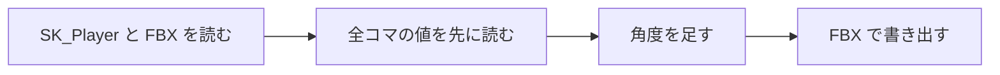

# 姿勢補正スクリプトの設計

作成日: 2026-11-07（[プレイヤーのアニメーションの設計](プレイヤーのアニメーションの設計.md) から分けた）
対象: [adjust_bone_rotation.py](../../../tools/UnrealScripts/adjust_bone_rotation.py)、設定: [walk_upright.json](../../../tools/UnrealScripts/walk_upright.json)、[walk_arms.json](../../../tools/UnrealScripts/walk_arms.json) など
経緯: [プレイヤーのアニメーションの経緯](プレイヤーのアニメーションの経緯.md)

できたモーションの FBX に、ボーンを前後に傾ける角度などを足して書き出し直すスクリプトです。走り・ダッシュ・止まるのモーションを動画から作るときにも使います（[動画からアニメーションを作る設計](動画からアニメーションを作る設計.md)）。

- **リポジトリにある FBX だけで動く。** UE のプロジェクトは空のものでよいので、どの PC でも使える。
- **設定は JSON に書く。** 何をどれだけ直したかが残る。

---

## 1. 基本の流れ



- 先に全コマを読んでから書く。書きながら読むと、あとのコマの値が変わる。
- 左右の軸は T ポーズのかかと→つま先で決める（モーション中は足が開いていて、向きがずれる）。
- 角度は「親の向きで見た左右の軸」まわりの回転として、ローカルの回転の前に掛ける。親と子の補正がそのまま足し算になる。
- UE の Python の `Quat` には逆・回転の関数が無いものがあるので、クォータニオンの計算はスクリプトの中に書いている。

---

## 2. 設定（JSON）

| 設定 | 内容 |
|---|---|
| `pitch_deg` | ボーンごとに足す角度（度、正が前に倒す）。全コマ同じだけ。「前に倒す」は、ボーンの上の端が前へ出る向き。下を向いた腕に負を足すと、手は**前**へ動く |
| `swing_scale` | 平均の回転を中心に、振り幅を k 倍する |
| `keep_feet_on_ground` | 書き換えたあと、つま先の一番低い高さが元と同じになるよう腰を上下させる |
| `clips[].frames` / `hold` | コマを切り出す。`hold` は最後のコマをくり返して足す |
| `clips[].pose_to` | 指定のコマで太もも・すね・足・腕が目標の向きになるよう、smoothstep で寄せる。`drift_deg`・`lift_cm`・`ground_toe_cm` で後半の動きと高さを決める。膝が反らないよう `min_knee_deg` を守る |
| `clips[].crouch` | 足首を動かさずに膝を曲げて腰を落とす（2本の骨の IK） |
| `clips[].blend_from` | 先に作ったクリップの最後のポーズから混ぜて始める |
| `clips[].log_frames` / `out_skip` | コマごとの形をログに出す。書き出さずに測るだけにもできる |

ログの `shape` の行には、全コマの平均で上半身・脚の前傾、その差（体の折れ）、つま先の一番低い高さが出る。体の折れが大きいほど、腰で「く」の字に曲がって見える。

---

## 3. 使い方（Walk の上半身を起こす例）

1. `walk_upright.json` の `pitch_deg` にボーンと角度を書く。
2. 空の UE プロジェクト（`{"FileVersion":3,"EngineAssociation":"5.8"}` だけの `.uproject`）で実行する。

   ```bash
   T=<リポジトリ>/Action/tools/UnrealScripts
   MSYS_NO_PATHCONV=1 "<UE_5.8>/Engine/Binaries/Win64/UnrealEditor-Cmd.exe" "<空の>.uproject" -run=pythonscript \
     "-script=$T/adjust_bone_rotation.py $T/walk_upright.json" -unattended -nop4 -nosplash -NullRHI
   ```

3. `%TEMP%\adjust_bone_rotation.txt` の最後が `DONE` か確かめる。`before` / `after` の行に、頭が腰より何 cm 前にあるかと前傾の角度が出る。
4. ゲームを1回起動して `.tka` を作り直し、`.fbx` と `.tka` をコミットする。`MaxData/player/model/` の控えも差し替える。

**`walk_upright.json` は `in` と `out` が同じファイルなので、実行するたびに角度が足されていく。** Walk をリターゲットし直したときに1回だけ流す。

| Walk の補正（`walk_upright.json`） | 角度 |
|---|---|
| 背骨（Spine・Chest・UpperChest） | 前へ 5°・6°・9° |
| 首（Neck） | 後ろへ 8° |
| 頭（Head） | 前へ 6°（顎を引いた形） |

Walk の腕は、上半身とは別の設定で前へ出している（`walk_arms.json`。こちらも `in` と `out` が同じなので、Walk をリターゲットし直したときに、`walk_upright.json` のあとで1回だけ流す）。

| Walk の腕の補正（`walk_arms.json`） | 角度 | 結果（肩から見た手の前後） |
|---|---|---|
| 上腕（左右の UpperArm） | `pitch_deg` -8° | 直す前: 14.7cm 後ろ〜3.4cm 前 |
| 前腕（左右の LowerArm） | `pitch_deg` -6° | 直したあと: 6.9cm 後ろ〜11.0cm 前 |
