# 黒騎士のモーションの経緯

設計: [黒騎士のモーションの設計](黒騎士のモーションの設計.md)、[敵のステートの設計](../../敵/敵のステート/敵のステートの設計.md)、[黒騎士のAIの設計](../../敵/黒騎士のAI/黒騎士のAIの設計.md)

黒騎士のモーションを作ったときに、何をしたかの記録です。日付ごとに書き足します。このページは 2026-11-15 に、コミットの記録から書き起こしました（そのときの画面の画像はありません）。コマは 30fps で、クリップの先頭を 0コマ目と数えます。

---

## 2026-11-11〜11-13 既存のモーションから移し、攻撃・やられ・死ぬを足した（#120）

| 以前 | 今 |
|---|---|
| 手で付けた7本（Idle・Walk・DashSlash・SpinCombo・LeapSlam・Backstep・FeintDash。`make_black_knight_anims.py`） | 既存のモーションを黒騎士の骨格へ移した8本（Idle・Walk・Run・Attack1〜3・Hit・Dead。`retarget_black_knight.py`） |
| 黒騎士は歩いて近づくだけ | 走る・3種類の攻撃・ひるむ・倒れる |
| 当たっても HP が減らない | 1回当たると 25 減り、4回で倒れる（仮） |

**名前:**

| ジャンル | 名前 | 何のためのもの | 何をするためのもの | どこから来たもの |
|---|---|---|---|---|
| コマンド | `make_black_knight_anims.py` | 黒騎士のモーションを、手で付けて作るため | 手で付けた7本のモーションを、黒騎士の骨格へ書き出していた Python のスクリプト | このゲームの `Action/tools/BlenderScripts/make_black_knight_anims.py`（今はない。このページの 2026-11-11〜11-13 で消した） |
| コマンド | `retarget_black_knight.py` | 既存のモーションを、黒騎士の骨格へ移すため | FBX のモーションを読み、骨の向きをそろえて、黒騎士の骨格の FBX で書き出す Blender の Python のスクリプト | このゲームの [retarget_black_knight.py](../../../../tools/BlenderScripts/retarget_black_knight.py) |

### 1. 移すスクリプトを作った

1. `retarget_black_knight.py` を作り、Kevin Iglesias・Mixamo の FBX の骨の世界での向きを黒騎士の骨格へ移すようにした。腕だけのポーズを重ね（`mask`）、骨を回して調整し（`adjust`）、垂れ布の揺れを付ける（前のスクリプトの処理を移した）。

   **用語:**

   | 用語 | 何のことか |
   |---|---|
   | FBX | 3D モデルやアニメーションを入れるファイルの形式（`.fbx`） |
   | Kevin Iglesias・Mixamo | モーションの入手元の名前（配っている作者・サービス） |
   | 骨格 | キャラクターの、ボーン（骨）の名前と、親子のつながりの全体 |
   | 骨の世界での向き | モデルの中での向きでなく、空間全体（世界）から見た向き。親のボーンが回っていても、見た目の向きが比べられる |

2. Idle（剣を斜めに下ろして立つ）・Walk・Run（剣を右肩に乗せて走る）・仮の Attack を作った。`EnemyRunState` と、歩くか走るかを選ぶ AI を足した。歩く速さ 140、走ると 385（Run の足が地面を送る速さに合わせた）。

   **名前:**

   | ジャンル | 名前 | 何のためのもの | 何をするためのもの | どこから来たもの |
   |---|---|---|---|---|
   | 型 | `EnemyRunState` | 黒騎士が走る間の動きを受け持つため | 敵のステートの1つ。Run のクリップを流して前へ進む | ゲームの [EnemyRunState.h](../../../../Game/Source/Enemy/State/EnemyRunState.h) |

3. 左右の反転（`mirror`）・つないで1本にする（`segments`）・体ごと回す（`spin`）を足し、Kevin Iglesias の無料パックの槍の突き・両手剣の斬り下ろし・片手剣の斬りから、最初の攻撃1〜3（突進して突き → 回転斬り、斬り下ろし2回 → 横一閃、斬撃を5つ飛ばす）を作った。斬撃（当時は `SlashBullet`、今は `SlashMagic`）は、暗めの赤の三日月形の板（`make_slash_wave.py` で作る）を斜めに傾けて飛ばす。

   **名前:**

   | ジャンル | 名前 | 何のためのもの | 何をするためのもの | どこから来たもの |
   |---|---|---|---|---|
   | 型 | `SlashBullet` | 黒騎士が飛ばす斬撃を表すため | 暗めの赤の三日月形の板を、斜めに傾けて飛ばす弾 | ゲームの `SlashBullet`（今はない。魔法と弾をまとめたときに [SlashMagic.h](../../../../Game/Source/Magic/SlashMagic.h) の `SlashMagic` になった） |
   | 関数 | `make_slash_wave.py` | 斬撃の三日月形の板を作るため | 三日月形のモデルを書き出す Blender の Python のスクリプト | このゲームの [make_slash_wave.py](../../../../tools/BlenderScripts/make_slash_wave.py) |

4. 剣を拳で握るように、右手の指をいつも握るポーズにし（`grip`）、剣の柄が曲げた指の輪の中を通るように剣の骨を合わせた。黒騎士のモデルも、籠手の指をミトンとして中指の骨に、親指を親指の骨に重みを付け直した。

   **用語:**

   | 用語 | 何のことか |
   |---|---|
   | ミトン | 指を分けず、1つの袋にした手袋の形。籠手の指は1つながりの形なので、中指の骨にまとめて重みを付けた |
   | 重み付け（スキンウェイト） | モデルの頂点が、どのボーンにどれだけ引っ張られるかの割合。重みを付け直すと、同じボーンの動きでも、頂点の動きが変わる |

5. 動きを確かめるため、黒騎士の動き全体の速さ（`PLAY_SPEED`）を 0.5 にし、AI の距離を2倍にした（中くらい 600 → 1200、遠い 900 → 1800）。速さは確かめ終わってから 1 に戻した。距離は2倍のまま。
6. Walk を Mixamo の Female Walk から Kevin Iglesias（Human Basic Motions FREE）の Walk01_Forward に替え、歩く速さ 140 に合わせて 140 ÷ 229 倍で再生するようにした（足が滑らないように）。
7. 黒騎士の兜を Player の顔と同じ大きさにするため、黒騎士を 1.3 倍から 1.4 倍にした（あご〜頭頂の高さで比べた。1.128 × 0.217 ÷ 0.175 = 1.399）。当たり判定とカプセルも同じ割合で大きくした。

### 2. モーションの見本帳を作った（あとで消した）

使えるモーションを選ぶため、SnSAnimsetPro（UE4 のマネキン）と Meshy のモーションを全部黒騎士へ移し、F1 の画面の窓「黒騎士のモーション」で、分類ごとの一覧から選んで再生できるようにした。

**用語:**

| 用語 | 何のことか |
|---|---|
| SnSAnimsetPro・Meshy のモーション | モーションの入手元の名前。SnSAnimsetPro は UE4 のマネキンの骨格のモーション集 |
| UE4 のマネキン | UE4 が標準で付けている人型のキャラクター。骨の名前や並びが決まっている |

- `retarget_black_knight.py` に元の骨格 `ue4` を足した。UE の骨は Y 軸が骨の向きでないので、次の関節への向きで合わせる。元が 30fps でないとき（SnSAnimsetPro は 60fps）は 30fps に間引いて読む。1コマしかないモーションも移せるようにした。
- `make_anim_catalog.py` で、移す設定とゲームが読む一覧を作った。1本失敗しても残りを続ける（`--keep-going`）。
- `CharacterModel` に、枠にアニメーションを読み直す `ReloadAnimationClip` と、時間を指定した再生を足した。
- 書き出した見本（`AnimCatalog/`）は数が多いのでリポジトリに入れなかった。

**名前:**

| ジャンル | 名前 | 何のためのもの | 何をするためのもの | どこから来たもの |
|---|---|---|---|---|
| 値 | `ue4` | 元のモーションの骨格が UE4 のマネキンであることを、スクリプトに伝えるため | 元の骨格の種類（`rig`）の1つ。骨の名前の対応表（`ue4_map`）を使う | [black_knight_anims.json](../../../../tools/BlenderScripts/black_knight_anims.json) の `rig` の設定（JSON の値） |
| コマンド | `make_anim_catalog.py` | 使えるモーションを、全部黒騎士へ移す設定を作るため | 移す設定と、ゲームが読む一覧を作る Python のスクリプト | このゲームの `Action/tools/BlenderScripts/make_anim_catalog.py`（今はない。2026-11-12 のコミット `41b038e7` で消した） |
| 引数 | `--keep-going` | 数が多いときに、1本失敗しても全部を止めないため | 移すのに失敗したモーションを飛ばして残りを続け、失敗したものを最後にまとめて出す。`make_anim_catalog.py` が作った設定（`catalog_config.json`）で移すときに付ける | このゲームの [retarget_black_knight.py](../../../../tools/BlenderScripts/retarget_black_knight.py) の引数（`make_anim_catalog.py` の引数ではない） |
| 型 | `CharacterModel` | キャラクターのモデルとアニメーションを持つため | モデルの表示・アニメーションの再生を受け持つ部品 | ゲームの [CharacterModel.h](../../../../Game/Source/Character/Components/CharacterModel.h) |
| 関数 | `ReloadAnimationClip()` | 見本の1本を、枠のアニメーションとして読み直すため | 枠にアニメーションを読み直す | ゲームの `CharacterModel`（今はない。2026-11-12 のコミット `41b038e7` で消した） |
| 関数 | `PlayAnimationAtTime()` | 時間を指定して再生するため | 指定した時間のコマからアニメーションを再生する | ゲームの `CharacterModel`（今はない。2026-11-15 のコミット `37b10dc2` で消した） |
| 値 | `AnimCatalog/` | 書き出した見本を置くため | 移した見本の FBX を置いたフォルダ。数が多いのでリポジトリに入れなかった | このゲームの `Assets/` の下（リポジトリにはない） |

攻撃を選び終えたあと、見本の一覧と読み直し・`make_anim_catalog.py` は消し、窓は今の8本だけを選んで再生する形にした。窓そのものも #123 で消した。#143 で `PlayAnimationAtTime` などの使わなくなった関数も消した。

### 3. 攻撃・やられ・死ぬを選び直した

| 順 | クリップ | したこと |
|---|---|---|
| 1 | Attack2 | SnS の斬り3本（R → RL → RLLR）をつないだ1本（3.7秒）にした |
| 2 | Hit・Dead | Hit は SnS の Sword_Shield_Hit_C_1、Dead は Meshy の Dead。当たったら HP を 25 減らし、攻撃中・凍結中以外ならひるむ。HP がなくなったら倒れ、倒れ終わって2秒で体を隠して当たり判定を外す（`HitTarget::SetEnabled` を足した） |
| 3 | Attack1 | KinemIQ の Sword - dash slash（左腰に構えて溜め → 一気に踏み込んで横に斬り抜ける）。スクリプトで glTF を読めるようにし、`in_place` で腰の水平の動きを消してコマごとに進んだ距離を出すようにした。ゲームは構えのコマ（5.5コマ目）で止めて溜め、腰が進んだ分（約3.7m）だけ黒騎士ごと前へ動かす。溜めの秒数は F1 の窓「黒騎士の攻撃」で変えられるようにした（窓は #123 で消した。既定の 0.6秒のまま） |
| 4 | Attack1・2 | KinemIQ の In Place 版に替えた（Attack2 は slash combo）。Attack1 は作り直された 48コマのものに差し替えた |
| 5 | Attack2・3 | slash combo を攻撃3に移し、剣が体の前を通る5回の振り（12・49.5・62・78・90コマ目）で斬撃を出すようにした。傾きは振る向きに合わせた（+45°・-45°・+45°・0°・90°）。攻撃2は SnS の3本つなぎに戻した |
| 6 | Attack2 | KinemIQ の Sword - heavy combo（4.3秒）に替えた。その場で振る（腰は上下するだけ）ので黒騎士は動かさない。近いときに攻撃2をする間隔を 4.8 → 5.4秒にした（終わってからの間 1.1秒は同じ） |

**名前:**

| ジャンル | 名前 | 何のためのもの | 何をするためのもの | どこから来たもの |
|---|---|---|---|---|
| 関数 | `HitTarget::SetEnabled()` | 死んだ黒騎士の当たり判定を外すため | `false` にすると、攻撃が当たらなくなる | ゲームの [HitTarget.h](../../../../Game/Source/Character/Components/HitTarget.h) |
| 値 | `in_place` | 腰が前へ進むモーションを、その場で動く形にするため | `true` のとき、腰の水平の動きを消し、コマごとに進んだ距離を出す | [black_knight_anims.json](../../../../tools/BlenderScripts/black_knight_anims.json) の設定（JSON のキー） |

**用語:**

| 用語 | 何のことか |
|---|---|
| KinemIQ | モーションの入手元の名前（Sword - dash slash などを配っている） |
| In Place | モーションの中で体が前へ進まず、その場で動く形のもの。進む分は、ゲームが体を動かして足す |
| glTF | 3D モデルやアニメーションを入れるファイルの形式の1つ（`.glb`）。FBX と同じように読める |

---

## 2026-11-17 Run で右腕がつぶれるのを直した

| 以前 | 今 |
|---|---|
| Run の右肘は 116° 曲がり、前腕の籠手が上腕と胸・肩当てにめり込む | 右肘を 80° まで開き、めり込まない |
| 剣は胸の前から後ろへ水平に通り、体を突き抜ける | 剣は右肩の上を斜め後ろへ抜ける（肩に乗せた形） |

### 1. 現状の問題

黒騎士が走ると、剣を持つ右腕がつぶれて見える（歩くときも少し気になる、とのこと）。横から見ると、前腕が胸に押し付けられて上腕が隠れ、剣は胸の前から背中へ水平に体を突き抜けていた。

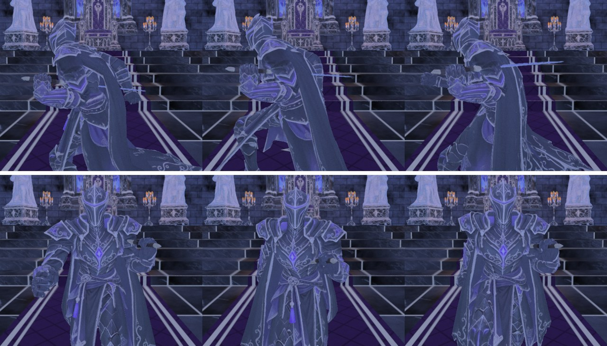

### 2. ソースコードの問題箇所

CLAUDE.md の「不具合を直すとき」に合わせ、「元のファイル → 書き出し（リターゲット）→ ゲームでの読み込み → 再生」の順に、どこからずれているかを確かめた。

| 段 | 確かめたこと | 結果 |
|---|---|---|
| 元のファイル → 書き出し | 元の Run（Kevin Iglesias の Run01_Forward に ObjectGripShoulder01_R を重ねたもの）と、書き出した `Run.fbx` で、骨の向きを同じコマで比べた（Blender で読み、上腕・前腕・手の骨の向きの角度を出す） | 肘の曲がり・上腕と胸の角度は、両腕とも全部のコマで同じ（右肘は 116.1° / 116.1°）。違うのは右の手首だけで、設定の `adjust` で足した分（元 38° → 約 90°） |
| ゲームでの読み込み | 黒騎士のモデルの1つの頂点に効く骨の数を数えた | 最大4本で、エンジンの上限と同じ。切り捨てはない |
| 再生 | Blender で描いた形と、ゲームで撮った形を比べた | 同じ形。キーフレームの間の補間の向き（四元数の符号）も、エンジンがそろえている |

書き出しの段（Blender）で、もうつぶれている。

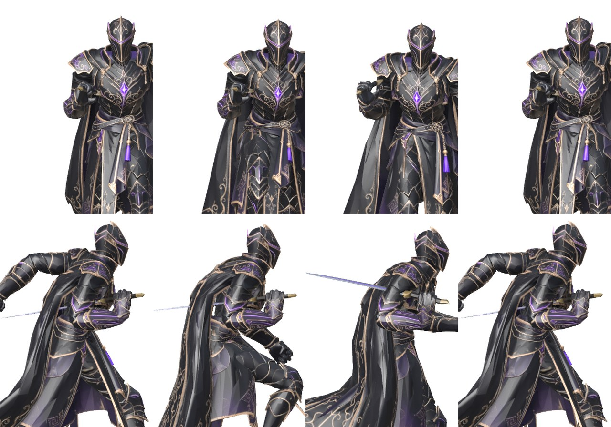

骨の向きは元と同じなので、移し方の誤りではない。つぶれるのは、**細い元の体のために作った「剣を肩に乗せる」ポーズ（肘 116°）を、鎧で太い黒騎士にそのまま当てている**ためだった。設定（[black_knight_anims.json](../../../../tools/BlenderScripts/black_knight_anims.json)）の Run はこうなっていた。

```json
"mask": { "fbx": ".../HumanM@ObjectGripShoulder01_R.fbx", "bones": ["B-shoulder.R", "B-upperArm.R", "B-forearm.R", ...] },
"adjust": [
  {"bone": "J_Bip_R_Hand", "axis": [1, 0, 0], "deg": -55}
]
```

`mask` の腕の骨は、元の Run の回転の代わりに、ObjectGripShoulder01_R の回転（親から見た回転）をそのまま使う。肘の曲がりを変える設定はなかった。

### 3. 直し方

- 肘の曲がりを 116° から 80° にする（ユーザーが決めた）。
- `adjust` の今の書き方（体から見た決まった軸で回す）では、肘を正しく開けない。走っている間に胸がねじれるので、肘の曲がる軸は、体から見て Run の 0コマ目と 12コマ目で 40° くらい向きが変わる。決まった軸で回すと、コマごとに 80° からずれ、前腕もねじれる。
- そこで `adjust` に `bend` を足した。「親の骨との角度を何度にするか」を書くと、そのコマの親の骨とその骨の向きから曲がる軸を出して回す。
- 肘を開くと手の位置が変わり、剣の向きも変わる（12コマ目で刃が兜を通り抜けた）。手首の `adjust` を4通り試し、刃が右肩の上を斜め後ろへ抜け、どのコマでも兜を通らない d（X -55°・Y -40°）にした。

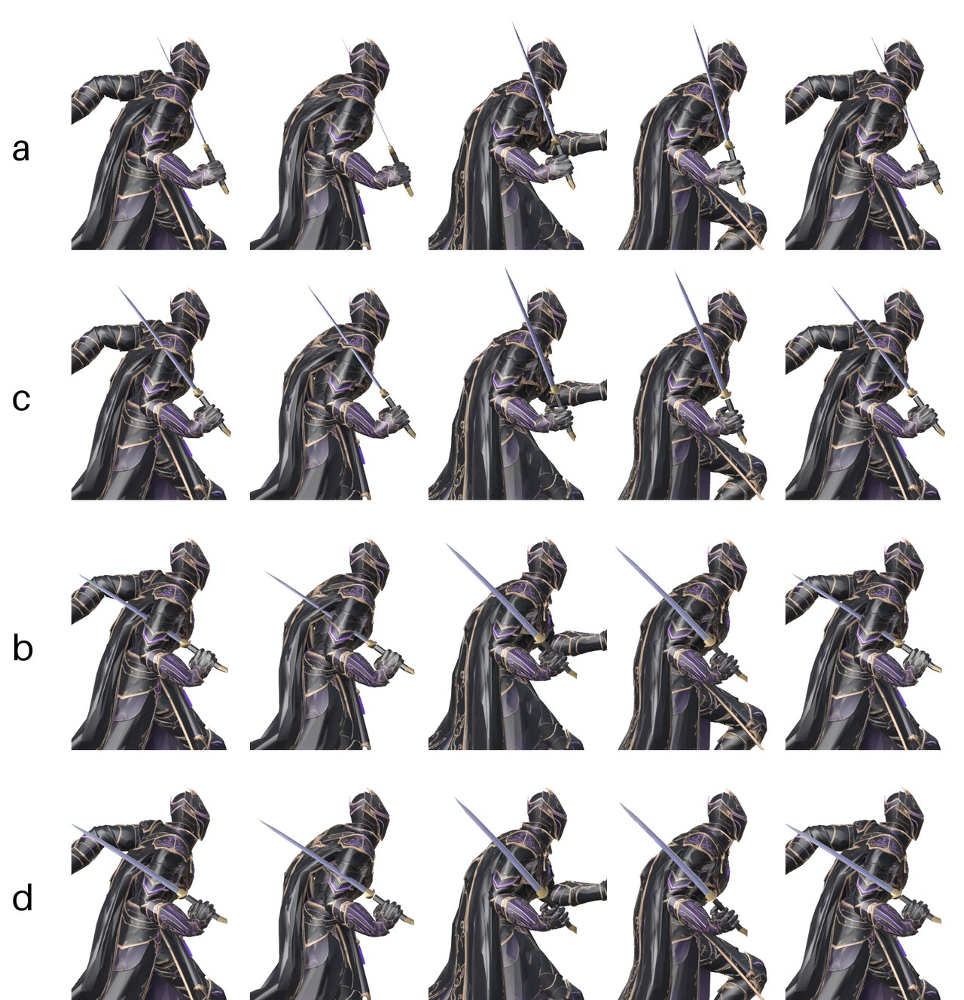

a・c は刃が兜を縦に通り、b は 12コマ目で刃が兜の後ろに近い。d がいちばん離れている。

### 4. ソースコードの直し

[retarget_black_knight.py](../../../../tools/BlenderScripts/retarget_black_knight.py) の `apply_adjust` に `bend` を足した（`up.angle(dn)` は Blender の数学ライブラリ mathutils の、2つの向きの間の角度。`Quaternion(軸, 角度)` は、その軸まわりにその角度だけ回す回転）。

```diff
     for a in adjust:
-        q = yaw @ Quaternion(Vector(a["axis"]).normalized(), math.radians(a["deg"])) @ yaw.inverted()
+        if "bend" in a:
+            n = a["bone"]
+            if n not in W or PARENT[n] not in W:
+                continue
+            up = W[PARENT[n]] @ Vector((0, 1, 0))   # 親の骨（上腕）の向き
+            dn = W[n] @ Vector((0, 1, 0))           # その骨（前腕）の向き
+            axis = up.cross(dn)                     # 曲がる軸（コマごと）
+            if axis.length < 1e-6:
+                continue
+            q = Quaternion(axis.normalized(), math.radians(a["bend"]) - up.angle(dn))
+        else:
+            q = yaw @ Quaternion(Vector(a["axis"]).normalized(), math.radians(a["deg"])) @ yaw.inverted()
         for n in [a["bone"]] + descendants(a["bone"]):
```

設定の Run の `adjust`:

```diff
 "adjust": [
+  {"bone": "J_Bip_R_LowerArm", "bend": 80},
   {"bone": "J_Bip_R_Hand", "axis": [1, 0, 0], "deg": -55},
+  {"bone": "J_Bip_R_Hand", "axis": [0, 1, 0], "deg": -40}
 ]
```

Run だけを書き出し直し（`--only Run`）、ゲームで `Run.tka` を作り直した。

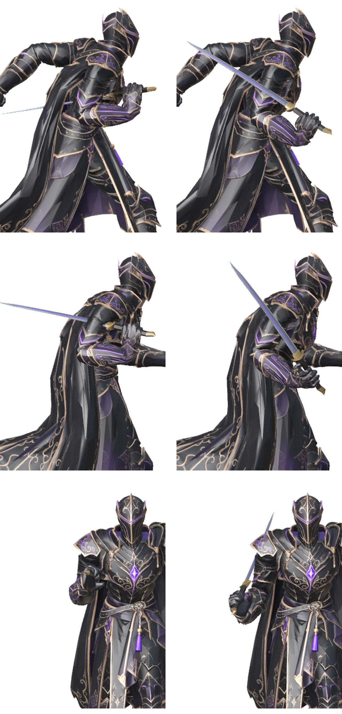

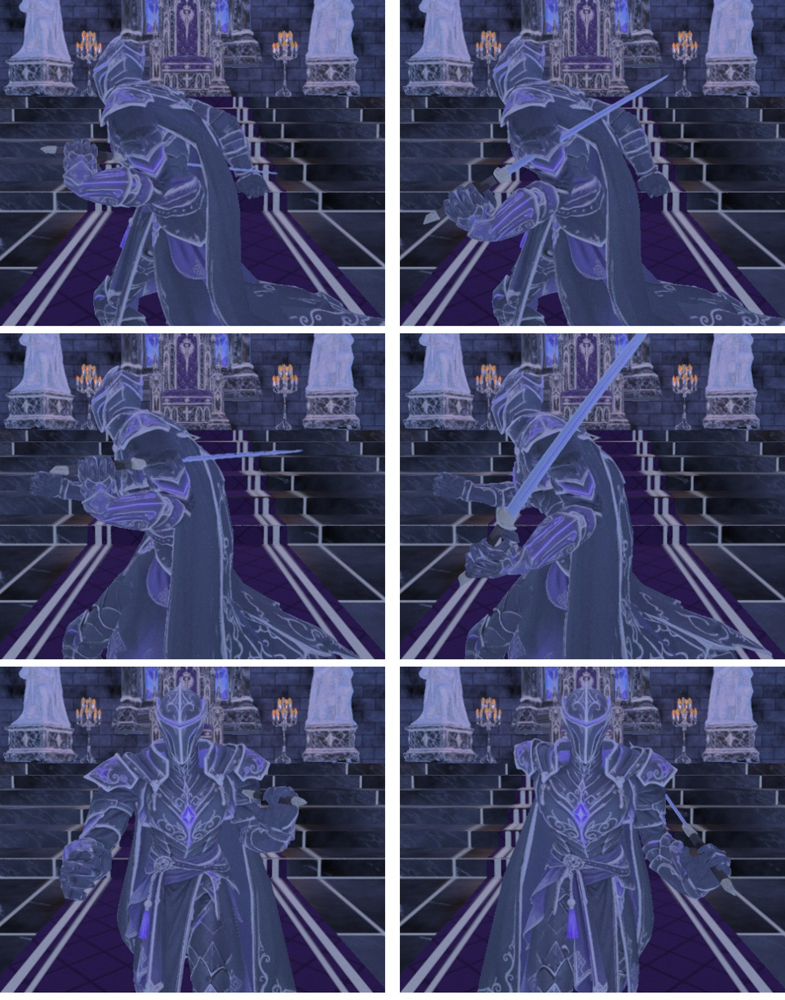

### 5. どう確かめたか

- 書き出した `Run.fbx` を Blender で読み、右肘の曲がりを数えた。全部のコマで 80.0°。曲がる軸の向きは直す前と同じ（開いただけで、ねじれていない）。
- 手首は、元の 38° に対して 38〜92°（コマによる）。今回は変えていない。
- ゲームは、作業用フォルダ（git worktree）に撮影用の変更だけを入れてビルドして撮った。撮影用の変更は次のとおり（コミットしていない）。
  - 環境変数 `CAPTURE_ENEMY`（`walk`・`run`）があれば、黒騎士の AI は攻撃せず、`CAPTURE_YAW` の向きへ歩く・走るだけにする。歩く速さを 0.01 にして、その場で足踏みさせる。
  - カメラを黒騎士の胸の前 190 に置く（`UIManager::Update` で上書きする）。
- 撮り方: ユーザーの画面を邪魔しないように、ゲームを最小化・非アクティブで起動する。窓を透明・クリックを素通り・いちばん奥にしてから、アクティブにしないで元の大きさに戻し、`PrintWindow` で窓だけを撮る。撮ったらすぐに終了させる。直す前は、`Run.fbx`・`Run.tka` を一時的に main のものに戻して撮った。
- Walk は変えていない。Walk の右肘は 29〜38° で、つぶれるほどは曲がっていない。

---

## 2026-11-17 F1 の窓から Walk・Run を流せるようにした

腕の形などをゲームの中で見やすくするため、F1 の開発用の窓（ImGui）に「黒騎士のモーション」を足した。

- Walk・Run を選ぶと、黒騎士は AI の入力を捨て（攻撃もしない）、ステートマシンを止めて、その場でそのクリップを繰り返す。歩く・走る速さで動かないので、カメラを回して同じ場所から見られる。
- 再生の速さを 0.05〜1.5 倍で変えられる。「ゲームの Walk の速さ」ボタンで、ゲームで歩くときの速さ（140 ÷ 229）にする。
- 「AI」に戻すと、ステートマシンを Idle からやり直す（`StateMachine::Reset`）。
- 前にあった窓「黒騎士のモーション」（#123 で消した）は8本を選ぶものだった。今回は Walk・Run だけ。
- Debug / x64 でビルドが通ることを確かめた。窓の操作は、ゲームを前に出して F1 を押す必要があるので、ユーザーに確かめてもらうことにした（Claude は画面を前に出さない決まりのため）。

---

## 2026-11-17 F1 の窓に「右肩 前後」を足した

Run で剣を持つ右肩をどれだけ前後に回すとよいかを、ゲームの中で試すため、窓「黒騎士のモーション」にスライダー「右肩 前後（Run・度）」（-60〜60°）を足した。

- 窓から Run を流しているときだけ効く。アニメーションの姿勢ができたあと（`Skeleton::SetOnPostUpdateWorldMatrix`。エンジンの、骨のワールド行列を計算したあとに呼ばれる処理を登録する関数）に、右上腕とその先の骨を、右肩の関節を中心に回す。
- 回す軸は、左右の肩の関節を結ぶ向き（体の横の向き）。＋で腕が前へ上がり、−で後ろへ引く。撮影用の版（Run の同じコマで止める）で、−40°・0°・＋40° を横から撮って向きを確かめた。
- 黒騎士は揺れ物・体の連動を使わないので、この処理だけを登録している。
- モーションそのもの（`Run.fbx`）は変えていない。決めた角度は、あとで設定の Run の `adjust` に書き写して書き出し直す。

---

## 2026-11-17 F1 の窓に「ひじから下」と「手首」を足した

Run で、ひじから下が体の外へ出ていて、剣が体に刺さって見える、とのことだったので、窓「黒騎士のモーション」の右腕の調整に足した。どれも Run を流しているときだけ効き、モーションそのものは変えない。

| スライダー | 回し方 |
|---|---|
| ひじから下 内・外（－で内） | 上腕を、その向き（肩 → ひじ）を軸にひねる。ひじの位置は動かず、曲げた前腕が体の内・外へ振れる |
| 手首 曲げ | 手首を中心に、ひじの曲がる軸（上腕と前腕の向きに垂直な軸）のまわりに回す |
| 手首 横 | 手首を中心に、前腕とひじの曲がる軸の両方に垂直な軸のまわりに回す（親指側・小指側へ倒す） |
| 手首 ひねり | 手首を中心に、前腕の向き（ひじ → 手首）を軸に回す |

- 回す順は、右肩 前後 → ひじから下 → 手首（前に回した分を、あとの軸に含める）。
- 「ひじから下」の向きは、撮影用の版（Run の同じコマで止める）で、－50°・0°・＋50° を正面から撮って確かめた。＋で前腕が外へ、－で体の前へ寄る。手首の3つは、＋・－の向きを決めていない（動かして見る）。
- 「右腕を戻す」で5つとも 0 に戻る。

---

## 2026-11-18 Run で手首を止め、剣を右肩に乗せたまま走るようにした

| 以前 | 今 |
|---|---|
| 走る間に、前腕と手の角度が 37〜92° の間で変わり、剣が立ち上がったり寝たりする | 全部のコマで 86.8°（0コマ目と同じ）。剣は右肩の上を斜め後ろへ抜けたまま |

### 1. 現状の問題

「手首を動かさずに、剣を肩に乗せっぱなしで走らせたい」とのこと。Blender で描くと、Run の 9・14コマ目で剣が立ち上がり、0・18コマ目では寝ている（下の画像の上の2段）。

### 2. ソースコードの問題箇所

剣を肩に乗せる腕のポーズ（`mask`）は、上腕・前腕・手を親の骨から見た決まった角度にするので、それだけなら腕は胸に固定されて動く。手首が動くのは、剣の向きを合わせるために足した手首の `adjust`（X -55°・Y -40°）が、**腰の向きから見た決まった軸**で回しているため。走ると胸がねじれて前腕の向きが変わるのに、手首を回す軸は変わらないので、前腕と手の角度がコマごとに変わる。

書き出した `Run.fbx` を Blender で読み、前腕から見た手の向きが 0コマ目からどれだけずれるかを測った。

| コマ | 0 | 3 | 6 | 9 | 12 | 15 | 18 |
|---|---|---|---|---|---|---|---|
| 前腕と手の角度 | 86.8° | 91.7° | 75.5° | 48.1° | 37.6° | 64.5° | 86.8° |
| 0コマ目からのずれ | 0° | 7.3° | 13.9° | 42.0° | 52.6° | 25.9° | 0° |

### 3. 直し方

設定に `lock`（骨を、決めたコマの親の骨から見た向きのまま、全部のコマで止める）を足し、Run の右手を 0コマ目で止めた。0コマ目の形（刃が右肩の上を斜め後ろへ抜ける）は前に手首の角度を選んだときの形なので、それに全部のコマを合わせる。`adjust` の掛け方は変えていない（ほかのクリップの形は変わらない）。

### 4. ソースコードの直し

[retarget_black_knight.py](../../../../tools/BlenderScripts/retarget_black_knight.py) に `apply_lock` を足し、`build_frames` で `adjust` のあとに呼ぶ。

```python
def apply_lock(frames_world, lock):
    for a in lock or []:
        n = a["bone"]
        p = PARENT[n]
        ref = frames_world[a.get("frame", 0)]
        rel = ref[p].inverted() @ ref[n]   # 決めたコマでの、親から見た向き
        for W in frames_world:
            q = (W[p] @ rel) @ W[n].inverted()   # 今の向き → 止めたい向き
            for m in [n] + descendants(n):       # 指も一緒に回る
                W[m] = (q @ W[m]).normalized()
```

設定の Run:

```diff
   adjust: [ ... ],
+  lock: [
+    {bone: J_Bip_R_Hand, frame: 0}
+  ]
```

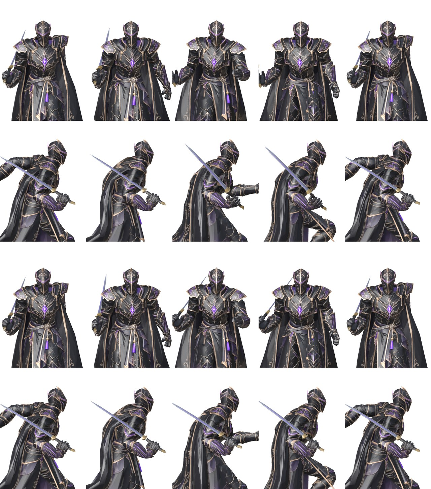

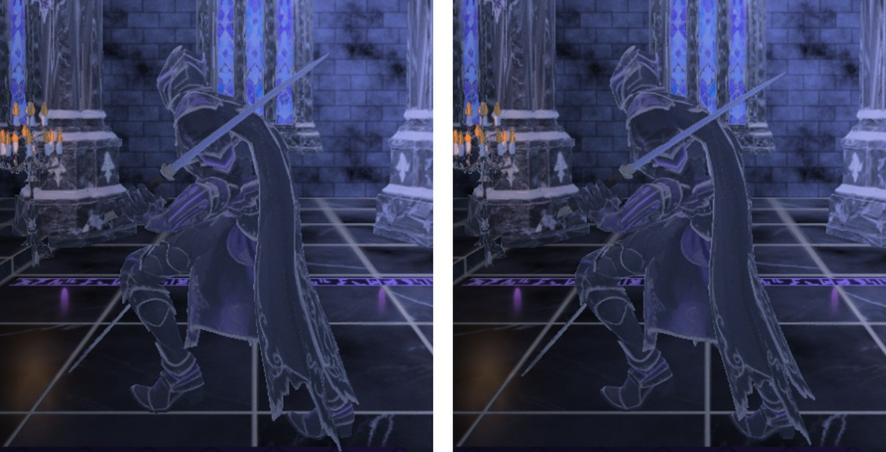

### 5. どう確かめたか

- 書き出した `Run.fbx` を Blender で読み、全部のコマで、肘 80.0°・前腕と手の角度 86.8°・0コマ目からのずれ 0.00° になったことを見た。
- ゲームは、作業用フォルダ（git worktree）に撮影用の変更（窓から Run を流したことにし、2秒後に止める。カメラを黒騎士の横に置く）だけを入れてビルドし、ゲームを最小化・透明・いちばん奥で起動して `PrintWindow` で窓だけを撮った。止まるコマはその時々なので、直す前と後で同じコマにはなっていない（ゲームの画像は、どちらも剣が肩の上にある形の参考）。撮影用の変更はコミットしていない。
- このPCでは元の FBX が `C:/00_MyData/04_dawnload/` にあるので、設定のパスだけを置き換えた作業用の設定で書き出した（設定の `D:/04_dawnload/` は変えていない）。

---

## 2026-11-18 F1 の窓に「ひじから下 前後」を足した

ひじから下を前後に動かして試したい、とのことで、窓「黒騎士のモーション」の右腕の調整に「ひじから下 前後（＋で前）」（-90〜90°）を足した。

- ひじを中心に、前腕から先（手・剣も）を、「右肩 前後」と同じ体の横の向き（左右の肩の関節を結ぶ向き）のまわりに回す。軸と回す向きが「右肩 前後」と同じなので、＋が前になる（右肩で撮って確かめた向きと同じ）。
- 回す順は、右肩 前後 → ひじから下 内・外 → ひじから下 前後 → 手首。
- 「右腕を戻す」で 0 に戻る。
- Debug / x64 でビルドが通ることを確かめた。

---

## 2026-11-18 F1 の窓で決めた右腕の角度を Run に焼き込んだ

| 以前 | 今 |
|---|---|
| 剣は右肩の上を斜め後ろへ抜けたまま（手首は止めてある）。ひじから下が体の外へ出て、剣が体に刺さって見える | 手が右胸の前、刃が兜の右へ上がり、肩の上を後ろへ抜ける。F1 の窓で決めた形 |

### 1. 現状の問題

F1 の窓「黒騎士のモーション」で右腕を動かして、ちょうどよい角度を決めてもらった（右肩 前後 41、ひじから下 内・外 -40、ひじから下 前後 34、手首 曲げ -50・横 -33・ひねり -13）。窓の角度はゲームの中だけで効き、`Run.fbx` は変わらない。

### 2. ソースコードの問題箇所

窓の回し方（`Enemy::RotateDebugArm`）は、骨のワールド行列を、肩・ひじ・手首の位置から出した軸のまわりに回す。書き出しのスクリプトには、同じ回し方がなかった（`adjust` は腰の向きから見た決まった軸で回すので、同じ値を書いても同じ形にならない）。

### 3. 直し方

- 書き出しのスクリプトに `arm_tweak` を足し、窓と同じ順・同じ軸の取り方で、全部のコマの右腕を回してキーを打つ。値は窓の数字をそのまま書く。
- 骨の姿勢は、行列を写して自分で回し、最後に親から見た回転に戻してキーを打つ。0コマ目で、キーを打った姿勢と回した行列の差が 0.000° であることを出して確かめる。
- 回す向きの符号: ゲームの画面は左右が反転して見える（剣が画面では左手にある）ので、最初は向きを逆にして焼き込んだ。すると、窓で当てた形と合わなかった（腕が体の外へ出て、剣が横を向いた）。符号をゲームと同じにすると合った。左右の反転は描くときだけに起きていて、骨のワールド行列の向きは Blender と同じ、ということになる（`GAME_SIGN = 1`）。

### 4. ソースコードの直し

[retarget_black_knight.py](../../../../tools/BlenderScripts/retarget_black_knight.py) に `apply_arm_tweak` を足し、`bake` でキーを打ったあと（剣を手に合わせる前）に呼ぶ。

```python
shoulder = pos(up_n)
rot(up_n, shoulder, shoulder - left, s * t.get("shoulder", 0.0))                       # 右肩 前後
rot(up_n, shoulder, pos(low_n) - shoulder, s * t.get("forearm_in_out", 0.0))           # ひじから下 内・外
rot(low_n, pos(low_n), shoulder - left, s * t.get("forearm_front_back", 0.0))          # ひじから下 前後
elbow, wrist = pos(low_n), pos(hand_n)
forearm = wrist - elbow
bend = (elbow - shoulder).cross(forearm)
side = forearm.cross(bend)
rot(hand_n, wrist, bend, s * t.get("wrist_bend", 0.0))                                 # 手首 曲げ
rot(hand_n, wrist, side, s * t.get("wrist_side", 0.0))                                 # 手首 横
rot(hand_n, wrist, forearm, s * t.get("wrist_twist", 0.0))                             # 手首 ひねり
```

設定の Run:

```diff
   "lock": [ ... ],
+  "arm_tweak": {"shoulder": 41, "forearm_in_out": -40, "forearm_front_back": 34,
+                "wrist_bend": -50, "wrist_side": -33, "wrist_twist": -13}
```

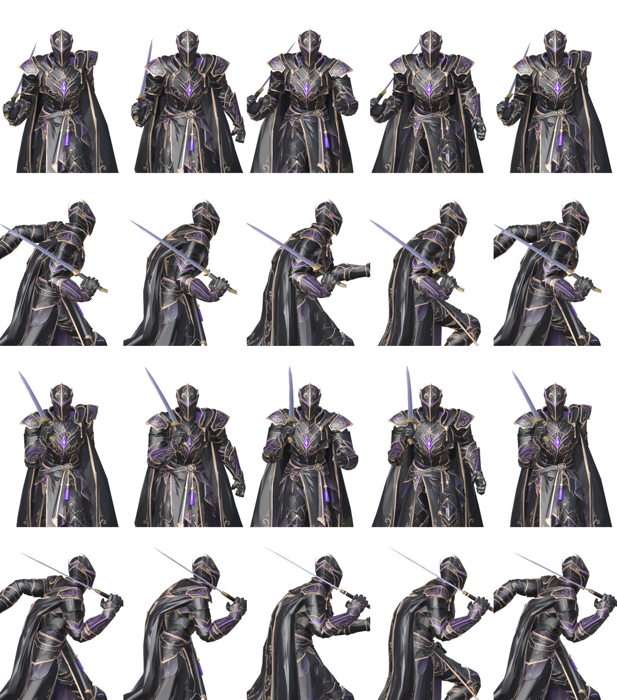

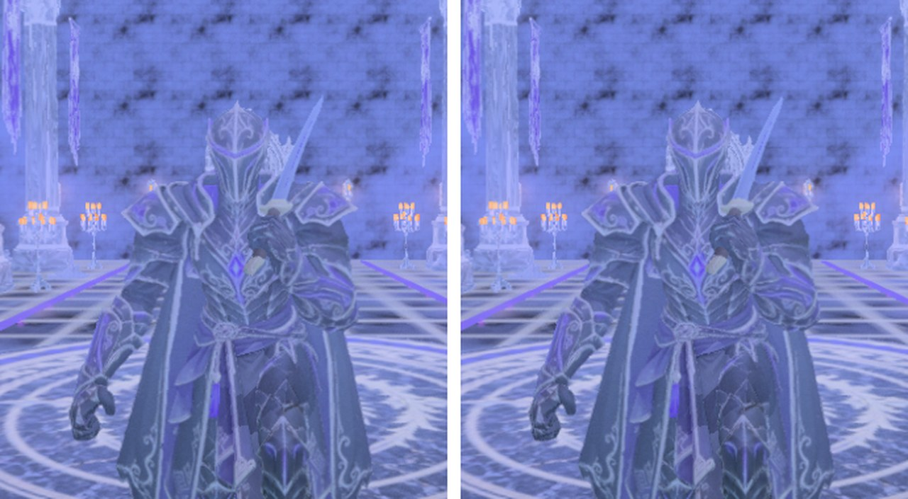

### 5. どう確かめたか

- 書き出したときに、0コマ目でキーを打った姿勢と回した行列の、手の向きの差が 0.000° と出た。
- ゲームは、作業用フォルダ（git worktree）に撮影用の変更（窓から Run を流したことにし、窓の値を入れるかを環境変数で選ぶ。2秒後に止める。カメラを黒騎士の正面・横に置く）だけを入れてビルドし、ゲームを最小化・透明・いちばん奥で起動して `PrintWindow` で窓だけを撮った。前の Run に窓の値を当てた形と、焼き込んだ Run（窓は 0）を正面から比べ、腕と剣の形が同じことを見た。撮影用の変更はコミットしていない。
- 書き出した `Run.fbx` を Blender で測ると、肘は 110〜112°（「ひじから下 前後」で 80° から曲がった）、前腕と手の角度は 30° 前後。窓の角度は、走る間の胸のねじれに合わせてコマごとに軸が変わるので、手首の向きは前腕から見て最大 6.4° 動く（ゲームの窓で見たときと同じ）。

---

## 2026-11-19 F1 の窓を、Walk で左右の腕を外へ開く形にした

歩くモーションを調整したい、とのことで、窓「黒騎士のモーション」に左右の腕を別々に外へ開くスライダーを足し、ほかの設定は全部消した。

| 以前 | 今 |
|---|---|
| 再生の速さ（スライダー・等速・ゲームの Walk の速さ）、Run の右腕（右肩 前後・ひじから下 内外・前後・手首 曲げ・横・ひねり） | 「右腕 外へ」「左腕 外へ」（-45〜45°。Walk のときだけ）と「腕を戻す」だけ |
| 再生の速さは窓で選ぶ（既定 1.0） | ゲームで流すときと同じ（Walk は 140 ÷ 229、Run は等速） |

- 外へ開く回し方: 肩の関節を中心に、上腕の向き（肩 → ひじ）を、体の外（反対の肩から離れる向き）へ倒す。軸は「上腕の向き × 外の向き」で、この軸のまわりに＋へ回すと上腕が外の向きへ近づく（外積の向きの決まりから、座標の取り方によらない）。
- 向きの確かめ: 撮影用の版（窓から Walk を流したことにし、右腕だけ＋35° にする。カメラを黒騎士の正面に置く）を作業用フォルダで作り、0° と＋35° を正面から撮った。＋35° で剣を持つ右腕が体から外へ開いた。撮影用の変更はコミットしていない。
- Run の右腕は、決めた角度を Run に焼き込み済み（`arm_tweak`）なので、窓からは外した。
- Debug / x64 でビルドが通ることを確かめた。

---

## 2026-11-19 F1 の窓で決めた左右の腕と右手首の角度を Walk に焼き込んだ

| 以前 | 今 |
|---|---|
| Walk の両腕が体の脇に寄り、剣を持つ右手は前腕のまっすぐ先で剣を下げている | 両腕が体の外へ 13° 開き、右手は、ひじから下が後ろへ引け、手首が外・前へ曲がって剣先が外へ出る。F1 の窓で決めた形 |

### 1. 現状の問題

歩く形を直すために、F1 の窓「黒騎士のモーション」の Walk に、腕と右手首のスライダーを足した（下の「窓のスライダー」）。ちょうどよい角度を決めてもらった（右腕 外へ 13、左腕 外へ 13、右肩 前後 0、ひじから下 前後 -25、右手首 外へ 22、右手首 前後 19、右手首 ひねり -14）。窓の角度はゲームの中だけで効き、`Walk.fbx` は変わらない。

**窓のスライダー**（どれも Walk を流している間だけ効く。上から回す順）:

| スライダー | 中心 | 軸 | 向き |
|---|---|---|---|
| 右腕 外へ・左腕 外へ | 肩の関節 | 上腕の向き（肩 → ひじ）× 外の向き（反対の肩 → この肩） | ＋で体の外へ |
| 右肩 前後 | 右肩の関節 | 外の向き（左右の肩を結ぶ向き） | ＋で前（Run の「右肩 前後」と同じ軸） |
| ひじから下 前後 | 右ひじ | 外の向き | ＋で前 |
| 右手首 外へ | 右手首 | 前腕の向き（ひじ → 手首）× 外の向き | ＋で手が体の外へ曲がる |
| 右手首 前後 | 右手首 | 外の向き | ＋で前 |
| 右手首 ひねり | 右手首 | 前腕の向き | ＋・－の向きは決めていない（動かして見る） |

- 手首は、剣を持つ右手だけにした（ユーザーの指示）。初めは左右の手首に「曲げ・横・ひねり」を付けたが、右手だけの「外へ」に替え、そのあと「前後」「ひねり」と、右肩・ひじから下の「前後」を足した。
- 前の Run の右腕のスライダー（`arm_tweak`）とは別に持つ（[Enemy.h](../../../../Game/Source/Enemy/Enemy.h) の `m_debugRightArmOutDeg` など7つ）。

### 2. ソースコードの問題箇所

書き出しのスクリプトにある窓と同じ回し方は、Run の右腕用の `arm_tweak` だけだった。`arm_tweak` には、腕を外へ開く回し方も、左腕もない。

### 3. 直し方

- 書き出しのスクリプトに `arm_pose` を足し、窓と同じ順・同じ軸の取り方で、全部のコマの腕を回してキーを打つ。値は窓の数字をそのまま書く。符号はゲームと同じ（`GAME_SIGN = 1`）。
- 回した行列を親から見た回転に戻してキーを打つ処理は、`arm_tweak` と同じものを使う（`key_chain` に分けた）。

### 4. ソースコードの直し

[retarget_black_knight.py](../../../../tools/BlenderScripts/retarget_black_knight.py) に `apply_arm_pose` を足し、`bake` で `apply_arm_tweak` のあとに呼ぶ。左右の腕ごとに、コマごとに次の順で回す（`rot` は、その骨と下の骨を、中心・軸・角度で回す）。

```python
shoulder = M[up_n].translation.copy()
outward = shoulder - other_pos                                                   # 外の向き（反対の肩 → この肩）
rot(up_n, shoulder, (M[low_n].translation - shoulder).cross(outward), t.get("out", 0.0))   # 外へ
rot(up_n, shoulder, outward, t.get("shoulder_front", 0.0))                       # 肩 前後
elbow = M[low_n].translation.copy()
rot(low_n, elbow, outward, t.get("elbow_front", 0.0))                            # ひじから下 前後
wrist = M[hand_n].translation.copy()
forearm = wrist - elbow
rot(hand_n, wrist, forearm.cross(outward), t.get("wrist_out", 0.0))              # 手首 外へ
rot(hand_n, wrist, outward, t.get("wrist_front", 0.0))                           # 手首 前後
rot(hand_n, wrist, forearm, t.get("wrist_twist", 0.0))                           # 手首 ひねり
```

設定の Walk:

```diff
   "adjust": [ ... ],
+  "arm_pose": {"right": {"out": 13, "shoulder_front": 0, "elbow_front": -25,
+                         "wrist_out": 22, "wrist_front": 19, "wrist_twist": -14},
+               "left": {"out": 13}}
```

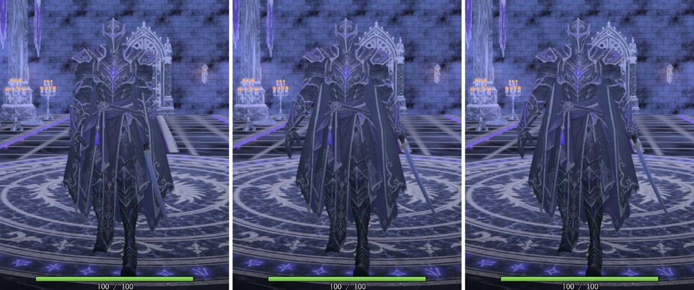

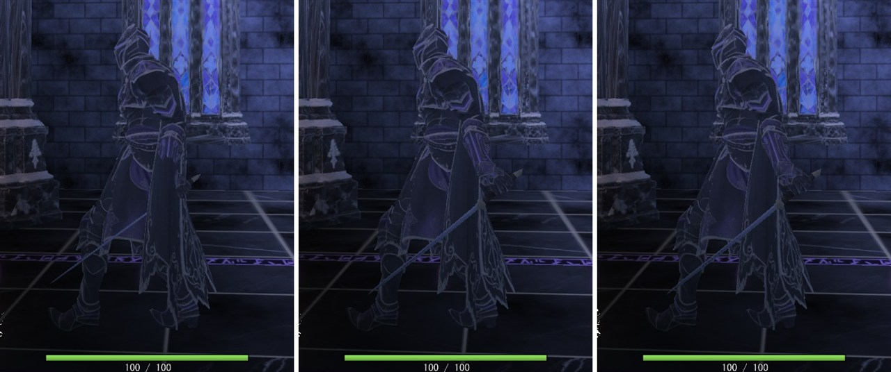

### 5. どう確かめたか

- 書き出したときに、0コマ目でキーを打った姿勢と回した行列の、手の向きの差が左右とも 0.000° と出た。
- ゲームは、作業用フォルダ（git worktree）に撮影用の変更（窓から Walk を流したことにし、窓の値を入れるかを環境変数で選ぶ。Walk の 9コマ目（0.3 秒）で止める。カメラを黒騎士の正面・右に置く）だけを入れてビルドし、ゲームを最小化・透明・いちばん奥で起動して `PrintWindow` で窓だけを撮った。前の Walk は、`Walk.fbx`・`Walk.tka` を一時的に main のものに戻して撮った。前の Walk に窓の値を当てた形と、焼き込んだ Walk（窓は 0）が、正面・右からとも同じ形であることを見た。撮影用の変更はコミットしていない。
- Debug / x64 でビルドが通ることを確かめた。
