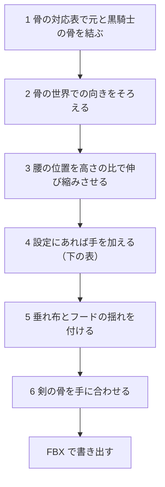

# 黒騎士のモーションの設計

作成日: 2026-11-15（更新 2026-11-18）
対象: [retarget_black_knight.py](../../../../tools/BlenderScripts/retarget_black_knight.py)、設定 [black_knight_anims.json](../../../../tools/BlenderScripts/black_knight_anims.json)、書き出し先 `Game/Assets/modelData/enemy/BlackKnight/Animation/`
経緯: [黒騎士のモーションの経緯](黒騎士のモーションの経緯.md)

敵の黒騎士のモーションを、Web で手に入れた既存のモーション（FBX）から、黒騎士の骨格へ移して作る仕組みです。

- **モーションは一から手で付けず、既存のものを移す。** 元の骨格は4種類（Kevin Iglesias・Mixamo・UE4 のマネキン・VRoid）に対応する。
- **移す設定は JSON に書く。** どの FBX のどのコマを使うか・骨をどれだけ回すかを `black_knight_anims.json` に書き、Blender で1回動かせば全部のクリップを書き出す。
- **ゲームに合わせる所はゲームのコードで持つ。** 攻撃1の踏み込みの距離・溜めのコマ・斬撃を出すコマは、書き出すときに出る値を、攻撃のクラス（`Game/Source/Attack/`）に書く。

| 用語 | 何のことか |
|---|---|
| Kevin Iglesias・Mixamo・KinemIQ・SnSAnimsetPro・Meshy | モーションの入手元の名前。1つの入手元が、いくつかの骨格の種類のモーションを配っていることがある |
| In Place | モーションの中で体が前へ進まず、その場で動く形のもの。進む分は、ゲームが体を動かして足す |
| T ポーズ | 腕を真横に伸ばして立つ、基準の姿勢 |
| 世界での向き | モデルの中での向きでなく、空間全体（世界）から見た向き。親のボーンが回っていても、見た目の向きが比べられる |
| ロール | ボーンの長さの向きを軸にした、ねじれの回転。ロールが違うと、同じ角度の回転でも見た目の向きが変わる |
| glTF（`.glb`） | 3D モデルやアニメーションを入れるファイルの形式の1つ。FBX と同じように読める |
| 間引く | 60コマのモーションから、1つおきに30コマだけを読むこと |

ばねは[用語集](../../../用語集.md#動きを近づける)にある。

---

## 1. 今のモーション

コマは 30fps で、クリップの先頭を 0コマ目と数えます。

| クリップ | 元のモーション | 元の骨格 | ゲームでの使い方 |
|---|---|---|---|
| `Idle` | Kevin Iglesias の Idle01（剣を斜めに下ろして立つ） | kevin | Idle ステート |
| `Walk` | Kevin Iglesias（Human Basic Motions FREE）の Walk01_Forward | kevin | Move ステート。歩く速さ（[移動の設計](../../キャラクター/移動/移動の設計.md)）に合わせてゆっくり再生する（2章「ゲームに合わせる値」） |
| `Run` | Kevin Iglesias の Run01_Forward に、右腕の手を加える（下の「Run の右腕」） | kevin | Run ステート |
| `Attack1` | KinemIQ の Sword - dash slash（In Place 版、48コマ） | ue4 | 左腰に構えて溜め → 一気に踏み込んで横に斬り抜ける |
| `Attack2` | KinemIQ の Sword - heavy combo（4.3秒） | ue4 | その場で重い連続斬り |
| `Attack3` | KinemIQ の Sword - slash combo（In Place） | ue4 | 剣が体の前を通る5回の振りで、斬撃を飛ばす |
| `Hit` | SnSAnimsetPro の Sword_Shield_Hit_C_1（正面からの被弾） | ue4 | ひるみ |
| `Dead` | Meshy のモーション集の Dead | mixamo | 倒れる |

**Run の右腕。** 剣を右肩に乗せたまま走るため、次の4つを順に重ねる。

1. 剣を右肩に乗せる腕のポーズを重ねる（`mask`）。
2. 右肘を、鎧がめり込まないよう 116° から 80° に開く（`bend`）。
3. 手首を、0コマ目の前腕との角度のまま止める（`lock`）。
4. F1 の窓で決めた右腕の角度（`arm_tweak`）を焼き込む。

全部のクリップで、剣を持つ右手の指を、Kevin Iglesias の手のポーズ（ObjectGripHands01）で握る形にする（`grip`）。元のモーションが手を開いていても、拳で剣を握る。

元の FBX はリポジトリに入れていない（`D:/04_dawnload/` の下）。

---

## 2. 実装方法

### 移し方（retarget_black_knight.py）

Blender をウィンドウなしで動かす（`blender -b --python retarget_black_knight.py -- black_knight_anims.json`）。

**名前:**

| ジャンル | 名前 | 何のためのもの | 何をするためのもの | どこから来たもの |
|---|---|---|---|---|
| コマンド | `blender` | Blender を、画面を出さずに動かすため | Blender の実行ファイル | 外部ライブラリ（Blender） |
| 引数 | `-b` | 窓を開かずに動かすため | ウィンドウなし（バックグラウンド）で動かす | 外部ライブラリ（Blender のコマンドライン） |
| 引数 | `--python` | Blender に Python のスクリプトを実行させるため | 続くスクリプトを、Blender の中の Python で動かす | 外部ライブラリ（Blender のコマンドライン） |
| 引数 | `--` | Blender の引数と、スクリプトへ渡す引数を分けるため | これより後ろは Blender が読まず、スクリプトが読む。ここでは設定の JSON のパス | 外部ライブラリ（Blender のコマンドライン） |
| 値 | `black_knight_anims.json` | どのクリップを、どう移すかを渡すため | クリップごとの元の FBX・骨格の種類・手を加える設定を持つ | [black_knight_anims.json](../../../../tools/BlenderScripts/black_knight_anims.json) |



1. **骨の対応。** 元の骨格の種類（`rig`）ごとに、骨の名前の対応表（`kevin_map`・`mixamo_map`・`ue4_map`・`vrm_map`）を持つ。名前の大文字・小文字の違いは許す。
2. **向きをそろえる。** 元と黒騎士は、どちらも T ポーズで、前が -Y・上が +Z。骨の**世界での向き**を「T ポーズからどれだけ回ったか」でそろえる。元に無い骨（Chest など）は、親と子の間で半分ずつ回す。
3. **腰の位置。** 腰の高さの比で伸び縮みさせる。
4. **手を加える。** 設定にあれば、下の表のものを掛ける。
5. **揺れ。** 垂れ布とフードの骨を、腰・頭の動きから、[ばね](../../../用語集.md#動きを近づける)で遅れて揺れるように後から付ける。
6. **剣。** 剣の柄が、握った指の輪の中を通るように、剣の骨を手に合わせる。
7. 元が 30fps でないとき（SnSAnimsetPro は 60fps）は 30fps に間引いて読む。glTF（`.glb`）も読める。

UE の骨（`rig` が `ue4`）は、Blender に読むと骨の Y 軸が骨の向き（次の関節への向き）にならない。そこで 2 の向きは、次の関節の位置への向きで合わせる。次の関節が無い骨（頭・つま先・指先）は親と同じだけ回す。

```
 kevin など: Y 軸が骨の向き        ue4: Y 軸は骨の向きとは別
   ●━━━━━━━━━●  → Y               ●━━━━━━━━━●  ↗ Y（ずれている）
   骨           次の関節           骨 ──→ 次の関節への向きを使う
```

### 手を加える項目（クリップに書くキー）

[black_knight_anims.json](../../../../tools/BlenderScripts/black_knight_anims.json) の `clips` の1つずつに書く。全部省略してよい。詳しい書き方は [retarget_black_knight.py](../../../../tools/BlenderScripts/retarget_black_knight.py) の冒頭にある。

| キー | 何をする | 例 |
|---|---|---|
| `mask` | 腕などのポーズだけを重ねる。ここに書いた元の骨は、元のモーションの回転の代わりに、このポーズ（`frame` コマ目）の回転を使う | `{"fbx": 腕だけのポーズの FBX, "bones": ["B-upperArm.R", ...], "frame": 0}` |
| `mirror` | 左右を反転する（左手の動きを右手にする） | `true` |
| `arms` | `"both"` なら、元の左腕の動きを左右反転で右腕にも写し、両手で同じ動きにする。体は左右対称にする | `"both"` |
| `segments` | 元の項目（`source`〜`spin`）を書いたものを並べると、順につないで1本にする。つなぎ目は `blend` コマ（既定 4）で混ぜ、腰の水平の位置は前の終わりに合わせる | `[{"source": ..., "frames": [0, 30]}, {...}]` |
| `spin` | そのコマで体ごと縦の軸まわりに何度回っているか（+ が左回り。回転斬り・横一閃用）。コマは `frames` の最初を 0 と数える。間はなめらかにつなぐ | `[[0, 0], [20, 360]]` |
| `speed` | 再生の速さ。2 なら半分のコマ数にする。`segments` の1つずつにも書ける | `2` |
| `reverse` | `true` なら逆から再生する（構える動きを逆にして下ろす）。`segments` の1つずつにも書ける | `true` |
| `adjust` | 移したあとで骨を回す。軸は体（腰の向き）から見た向き（+X が体の左、-Y が前、+Z が上）。その骨と下の骨がまとめて回る | `{"bone": "J_Bip_R_Hand", "axis": [1, 0, 0], "deg": 45}` |
| `adjust` の `bend` | 親の骨との角度をその度にする（肘の曲がりを浅くする）。曲がる軸はコマごとに出す | `{"bone": "J_Bip_R_LowerArm", "bend": 80}` |
| `lock` | `adjust` のあと、その骨を、`frame` コマ目の親の骨から見た向きのまま全部のコマで止める（その下の骨も一緒に動く） | `{"bone": "J_Bip_R_Hand", "frame": 0}` |
| `arm_tweak` | F1 の窓の右腕のスライダーの値をそのまま書くと、窓と同じ回し方で全部のコマに焼き込む | 「使い方」の「F1 の窓で決めた角度を焼き込む」 |
| `grip` | 設定全体で、剣を持つ右手の指のポーズ（`fbx` と指の `bones`）を決める。クリップに `false` を書くと、そのクリップは重ねない | `false` |
| `hold` | `parts` の骨を、全部のコマで、先に書いたクリップのそのコマの姿勢にする（一人称の腕で、体を止めておく用）。`body` は腕以外の全部、`left_arm`・`right_arm` は肩から先 | `{"clip": "Idle", "frame": 0, "parts": ["body"]}` |
| `in_place` | 腰の水平の動きを消し、コマごとに進んだ距離をログに出す（次の「ゲームに合わせる値」） | `true` |

### ゲームに合わせる値

| 値 | 出し方 | 書く所 |
|---|---|---|
| 攻撃1で腰が前へ進んだ距離（コマごと） | 設定に `"in_place": true` を書くと、腰の水平の動きを消し、`ROOT [Attack1] …` の行にコマごとの距離を出す | `DashSlashAttack.cpp` の `ROOT`。ゲームは、この差の分だけ黒騎士ごと前へ動かす（`rootMoveScale` = 100 × モデルの大きさ） |
| 攻撃1の構えのコマ | プレビューの画像で見る | `DashSlashAttack.cpp` の `DATA`（`chargeAt`）。ここでアニメーションを止めて溜める。コマと秒数は[剣の攻撃の設計](../../スキル/剣の攻撃/剣の攻撃の設計.md)の「調整用の数値」 |
| 攻撃3の斬撃を出すコマと傾き | `--preview` と `--focus` で剣先の通り道を描く | `SlashWaveAttack.cpp` の `SLASH_TIMES`（12・49.5・62・78・90コマ目）と `SLASH_ROLL_DEG` |
| Walk の足が地面を送る速さ | Blender で測る（229）。再生速度は `歩く速さ ÷ 229` | `Enemy.cpp` の `WALK_ANIM_FOOT_SPEED` |

**名前:**

| ジャンル | 名前 | 何のためのもの | 何をするためのもの | どこから来たもの |
|---|---|---|---|---|
| 値 | `in_place` | 腰が前へ進むモーションを、その場で動く形にするため | `true` のとき、腰の水平の動きを消し、コマごとに進んだ距離をログに出す | [black_knight_anims.json](../../../../tools/BlenderScripts/black_knight_anims.json) の設定（JSON のキー） |
| 変数 | `ROOT` | 攻撃1で、コマごとに前へ進んだ距離を持つため | モデルの m 単位の距離の配列。`ROOT [Attack1] …` の行の値を書き写す | ゲームの [DashSlashAttack.cpp](../../../../Game/Source/Attack/DashSlashAttack.cpp) |
| メンバー変数 | `rootMoveScale` | モーションの中で進む距離を、ゲームの距離にするため | 距離に掛ける倍率。黒騎士は 100 × モデルの大きさ（`MODEL_SCALE`） | ゲームの [EnemyState.h](../../../../Game/Source/Enemy/State/EnemyState.h)（設定の値は [Enemy.cpp](../../../../Game/Source/Enemy/Enemy.cpp) で決める） |
| 変数 | `DATA` | 攻撃1の数値をまとめるため | 流すクリップ・溜めるコマ・溜める秒数・`ROOT` を持つ `AttackData` | ゲームの [DashSlashAttack.cpp](../../../../Game/Source/Attack/DashSlashAttack.cpp) |
| メンバー変数 | `chargeAt` | アニメーションを止めて溜めるコマを決めるため | この時間（秒）のコマで、アニメーションを止める。負なら溜めない。攻撃1の値は[剣の攻撃の設計](../../スキル/剣の攻撃/剣の攻撃の設計.md)にある | ゲームの [AttackBase.h](../../../../Game/Source/Attack/AttackBase.h) の `AttackData` |
| 変数 | `SLASH_TIMES` | 攻撃3で、斬撃を出すコマを決めるため | 斬撃を出す時刻（秒）の配列。12・49.5・62・78・90コマ目 | ゲームの [SlashWaveAttack.cpp](../../../../Game/Source/Attack/SlashWaveAttack.cpp) |
| 変数 | `SLASH_ROLL_DEG` | 斬撃を、振る向きに合わせて傾けるため | 斬撃ごとの傾き（度）の配列。進む向きのまわりに回して置く | ゲームの [SlashWaveAttack.cpp](../../../../Game/Source/Attack/SlashWaveAttack.cpp) |
| 変数 | `WALK_ANIM_FOOT_SPEED` | Walk の足が滑らないようにするため | Walk を等速で再生したときに、足が地面を送る速さ（229） | ゲームの [Enemy.cpp](../../../../Game/Source/Enemy/Enemy.cpp) |

`--preview <フォルダ>` を付けると、クリップごとに決まった向き・コマ数の画像を描き、書き出す前に形を確かめられる。

---

## 3. 使い方

| やりたいこと | 書き方 |
|---|---|
| クリップを差し替える | `black_knight_anims.json` のそのクリップの `source`・`rig` を替え、Blender で `--only <名前>` を付けて書き出し直す。ゲームは次の起動で `.tka` を作り直す |
| 新しいクリップを足す | JSON の `clips` に1つ足して書き出し、`EnemyState.h` の `EnEnemyAnimClip` と `Enemy.cpp` の `MakeModelDesc` に足す |
| 左右反転・つなぐ・骨を回す・止める など、手を加える | 2章の「手を加える項目」の表のキーを、そのクリップに書く |
| F1 の窓で決めた右腕の角度を、モーションに入れる | 下の「F1 の窓で決めた角度を焼き込む」 |
| 移した形を確かめる | `--preview <フォルダ> --views 0,90 --count 12`。骨に寄るなら `--focus J_Bip_R_Hand` |
| ゲームの中で Walk・Run を確かめる | 下の「F1 の窓で Walk・Run を確かめる」 |

**名前:**

| ジャンル | 名前 | 何のためのもの | 何をするためのもの | どこから来たもの |
|---|---|---|---|---|
| 値 | `source` | クリップごとの元の FBX を指すため | 移す元のモーションのファイルのパス | [black_knight_anims.json](../../../../tools/BlenderScripts/black_knight_anims.json) の `clips` の設定（JSON のキー） |
| 引数 | `--only` | 1つだけ書き出し直すため | 書いた名前のクリップだけを書き出す（`,` で区切って複数） | [retarget_black_knight.py](../../../../tools/BlenderScripts/retarget_black_knight.py) のコマンドラインの引数 |
| 値 | `clips` | 書き出すクリップを並べるため | クリップごとの設定の配列 | [black_knight_anims.json](../../../../tools/BlenderScripts/black_knight_anims.json)（JSON のキー） |
| 型 | `EnEnemyAnimClip` | 敵のアニメーションを、番号で区別するため | クリップごとの番号の列挙型（`enEnemyAnimClip_Attack1` など） | ゲームの [EnemyState.h](../../../../Game/Source/Enemy/State/EnemyState.h) |
| 関数 | `MakeModelDesc()` | 黒騎士のモデルと、クリップごとの FBX のパスを決めるため | モデルの設定を作って返す。`desc.clips` に、クリップの番号ごとの FBX と、ループするかを書く | ゲームの [Enemy.cpp](../../../../Game/Source/Enemy/Enemy.cpp) |
| 値 | `blend` | つなぎ目を、急に切り替えないため | つなぎ目で混ぜるコマの数。省略すると 4 | [black_knight_anims.json](../../../../tools/BlenderScripts/black_knight_anims.json) の設定（JSON のキー） |
| 引数 | `--views` | プレビューを描く向きを決めるため | 向きの角度（度）を `,` で並べる。0 が正面、90 が体の左から | [retarget_black_knight.py](../../../../tools/BlenderScripts/retarget_black_knight.py) のコマンドラインの引数 |
| 引数 | `--count` | プレビューに並べるコマの数を決めるため | クリップから等間隔に取るコマの数 | [retarget_black_knight.py](../../../../tools/BlenderScripts/retarget_black_knight.py) のコマンドラインの引数 |
| 引数 | `--focus` | 手の握りなど、細かい所を確かめるため | 渡した名前の骨に寄って描く | [retarget_black_knight.py](../../../../tools/BlenderScripts/retarget_black_knight.py) のコマンドラインの引数 |
| 値 | `J_Bip_R_Hand` | 右手のボーンを指すため | 黒騎士の骨格の、右手のボーンの名前 | 黒騎士の骨格（`J_Bip_R_Hand` は `SK_Player` と同じ名前の付け方） |

### F1 の窓で決めた角度を焼き込む

1. Debug ビルドで F1 を押し、窓「黒騎士のモーション」で Run を選び、右腕のスライダーで形を決める。
2. クリップに `arm_tweak` を書き、窓のスライダーの数字をそのまま入れる（`{"shoulder": 41, "forearm_in_out": -40, "forearm_front_back": 34, "wrist_bend": -50, "wrist_side": -33, "wrist_twist": -13}`）。
3. Blender で書き出す。窓と同じ順・同じ軸の取り方で全部のコマに焼き込むので、書き出したあとは窓を 0 にして同じ形になる。

### F1 の窓で Walk・Run を確かめる

Debug ビルドで F1 を押し、窓「黒騎士のモーション」で Walk か Run を選ぶ。黒騎士が AI とステートを止めて、その場でそのクリップを繰り返す。再生の速さも変えられる。「AI」に戻すと Idle からふだんどおり動く（[Enemy.cpp](../../../../Game/Source/Enemy/Enemy.cpp) の `UpdateDebugWindow`）。

Run のときは、剣を持つ右腕を次のスライダーで回して試せる（決めた角度は Run の `adjust` に書き写す）。

| スライダー | 向き |
|---|---|
| 右肩 前後 | ＋で前 |
| ひじから下 内・外 | －で内 |
| ひじから下 前後 | ＋で前 |
| 手首 曲げ・横・ひねり | |

---

## 4. 決めたこと

| 決めたこと | 理由 |
|---|---|
| 手で付けた7本をやめ、既存のモーションを移す | CLAUDE.md の「アニメーションは一から手で付けず、Web 上にある既存のものを当てる」（#105）に合わせた |
| 骨の世界での向きでそろえる | 元と黒騎士で骨の向き（ロール）や初期の姿勢が違っても、見た目の向きが同じになる |
| 攻撃1・3は In Place 版を使い、進む分はゲームが動かす | 腰が前へ出るモーションのままだと、当たり判定とカプセルが元の場所に残る |
| 肘の曲がりは、体から見た決まった軸ではなく、コマごとの曲がる軸で変える（`bend`） | 走ると胸がねじれ、体から見た肘の軸が 40° くらい動く。決まった軸で回すと、コマごとに角度がずれ、前腕もねじれる |
| 剣を握る指を全部のクリップで重ねる | 元のモーションの多くは手を開いていて、そのままでは剣を拳で握って見えない |

---

## 5. 既知の課題

- **元の FBX がリポジトリにない。** 別のPCで書き出し直すには、同じ場所に同じファイルを置く必要がある。
- **剣が当たってもダメージはない。** 攻撃3の斬撃も、当たると消えるだけ（[敵のステートの設計](../../敵/敵のステート/敵のステートの設計.md)）。
- 入手元ごとの使ってよい条件はまだ確かめていない（商用利用はしない予定）。

---

## 6. 関連するページ

- [敵のステートの設計](../../敵/敵のステート/敵のステートの設計.md)（どのステートでどのクリップを流すか）
- [黒騎士のAIの設計](../../敵/黒騎士のAI/黒騎士のAIの設計.md)（いつ走る・どの攻撃をするか）
- [リターゲットの設計](../リターゲット/リターゲットの設計.md)（プレイヤーの骨格へ UE で移すやり方）
- [黒騎士のMeshyプロンプト](../../敵/黒騎士のMeshyプロンプト/黒騎士のMeshyプロンプト.md)（黒騎士のモデル）
