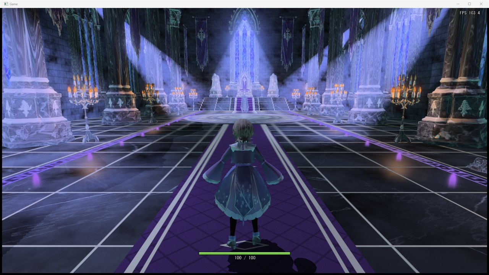
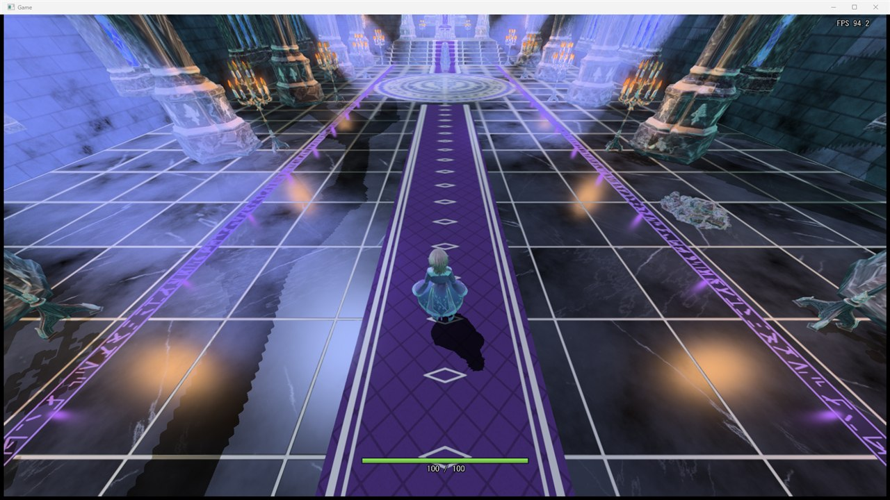

# カメラのモードの経緯

作成日: 2026-11-16
対象: [GameCamera.cpp](../../../../Game/Source/Objects/GameCamera.cpp) のモード（三人称の寄り・俯瞰・一人称）
設計: [カメラのモードの設計](カメラのモードの設計.md)
手順: [カメラのモードの手順](カメラのモードの手順.md)

---

## 2026-11-16 三人称を寄りと俯瞰の2つにし、B キーで切り替えるようにした

### やりたかったこと

一人称・三人称の寄り・三人称の俯瞰の3つのモードを持ちたい。一人称はもうある。俯瞰は今の三人称の視点のままでよく、キーボードの B で切り替えたい。寄りは、原神のように近めのカメラにしたい。

### 調べたこと

- 今までの三人称は、注視点（足元から 170 の高さ）から `(0, 250, -250)` 離れた所に置いていた。約 354 離れて 45度で見下ろし、画角は 90度。これを俯瞰としてそのまま使う。
- V キー（パッドは B ボタン）で三人称と一人称を切り替えていた。パッドの B ボタンは、エンジンでキーボードの K にも割り当てられている（`GamePad.cpp`）。
- キーボードの B は、エンジンでパッドの LB1 ボタンにも割り当てられている。ゲームでは LB1 を使っていないので、B キーを足してもぶつからない。
- 魔法を撃つ向きは、体を映しているか（一人称でないか）で決まる（`PlayerInputSource`）。三人称を2つに分けても変わらない。

### 決めたこと（ユーザーと相談して）

| 決めること | 決めたこと |
|---|---|
| 最初のモード | 寄り（原神のカメラ） |
| B キー | 寄りと俯瞰を入れ替える。基本は寄りで、押すと俯瞰、もう一度押すと寄りに戻る |
| 一人称のときに B | 俯瞰に移る |
| V で一人称から戻る先 | 入る前の三人称（寄りか俯瞰） |
| パッド | 寄りと俯瞰の切り替えは割り当てない |
| マウスホイールでの距離の調整 | 入れない |
| 壁にカメラが埋まらない処理 | 別の作業でする |

寄りの数値は、相談のときに出した案（距離 350、注視点の高さ 150、見下ろす角度 10度、画角 55度）のまま入れた。寄りと俯瞰を切り替えたときに一瞬で飛ぶと酔いやすいので、0.25秒かけてなめらかに移すことにした（一人称との間は移さない）。

### 作り方

- 三人称の数値（距離・注視点の高さ・見下ろす角度・画角）を `ThirdPersonSetting` にまとめ、モードごとに1組ずつ持つ。回し方は前の `UpdateThirdPersonCamera` のまま使う。
- 三人称へ移る所を `ChangeThirdPersonMode` の1つにし、V で一人称から戻るときと、B のときの両方から呼ぶ。もとの `ToggleCameraMode` の else にあった後片付け（体を映す・上の向きと Near を戻す）も、ここへ移した。
- 手順書を「上から足していくだけで出来上がる」形にするため、`ToggleCameraMode` は if / else の形を残し、if の条件を「一人称でなければ」に変えるだけにした。なめらかに移す所も、`ChangeThirdPersonMode` にあとから足すだけで済む形にした。

### どう確かめたか

- 作業用フォルダ（git worktree）で、Game.sln を Debug / x64 でビルドした。
- 手順書は、main の `GameCamera.h`・`GameCamera.cpp` に手順どおりに1つずつ組み込むスクリプトで作り、組み込み終わったコードが今のコードと1行も違わないことを確かめた。手順2・手順3の終わりの時点のコードでもビルドが通ることを確かめた（手順1の終わりは、もとの `ThirdPerson` が残るので通らない。手順書にそう書いた）。
- ゲームを最小化・非アクティブで起動し、窓を透明・いちばん奥にしてから `PrintWindow` で窓だけを撮った。撮ったらすぐに終了させた。
  - 寄り: 起動した直後の画面（下の左）。
  - 俯瞰: 窓をアクティブにしないとキーが効かないので、最初のモードを一時的に俯瞰にしたビルドで撮った（下の右）。前の三人称と同じ見え方になった。撮ったあと、元に戻した。

| 寄り | 俯瞰 |
|---|---|
|  |  |

- B・V キーでの切り替えと、なめらかに移る動きは、窓をアクティブにしないと試せないので、画面では確かめていない（ユーザーに確かめてもらう）。
