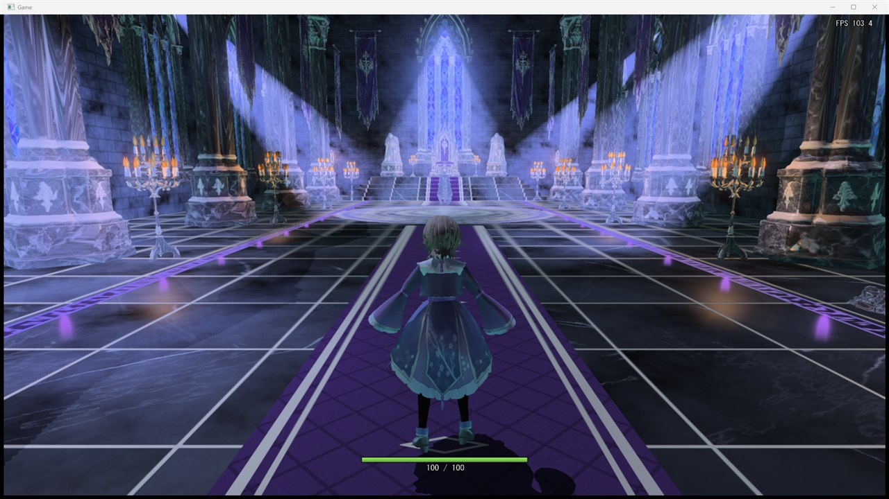
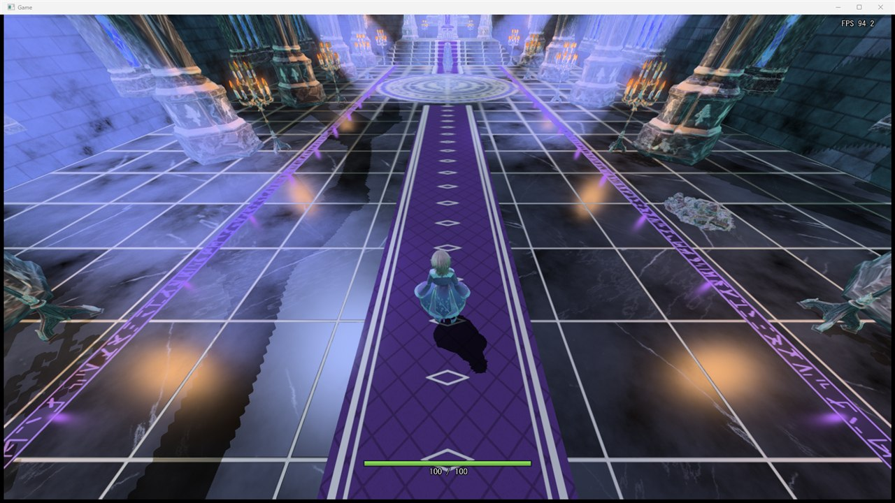
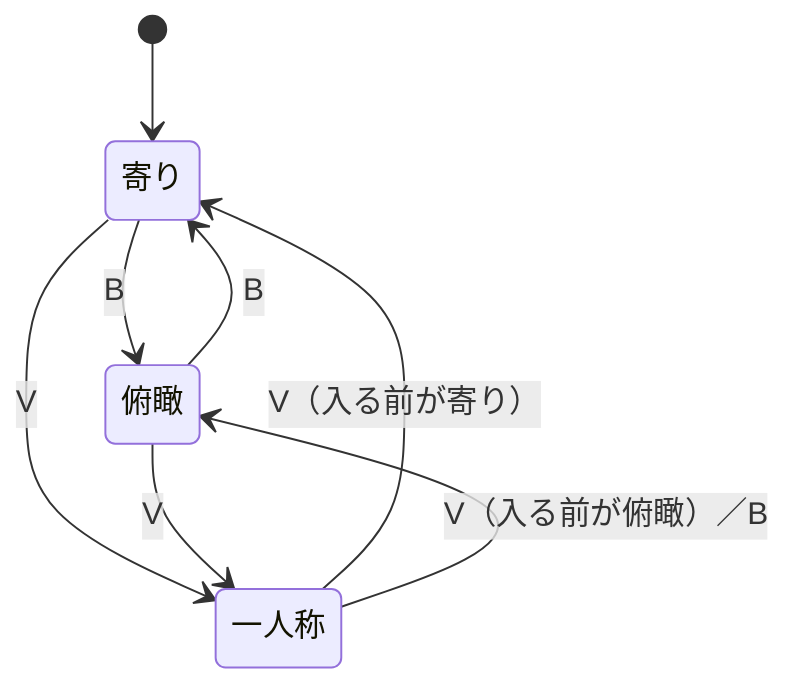

# カメラのモードの設計

作成日: 2026-11-16
対象: [GameCamera.h](../../../../Game/Source/Objects/GameCamera.h)・[GameCamera.cpp](../../../../Game/Source/Objects/GameCamera.cpp) のモード（三人称の寄り・三人称の俯瞰・一人称）と切り替え
経緯: [カメラのモードの経緯](カメラのモードの経緯.md)
手順: [カメラのモードの手順](カメラのモードの手順.md)

ゲームのカメラには、3つのモードがあります。ふだん使う**寄り**（原神のように近くから見る三人称）、上から広く見下ろす**俯瞰**（前からある三人称）、目の位置から見る**一人称**です。

- **基本は寄り。** ゲームは寄りで始まり、B キーで俯瞰に、もう一度 B キーで寄りに戻る。
- **寄りと俯瞰は、同じ回し方で数値だけを変える。** 距離・注視点の高さ・見下ろす角度・画角の4つを、モードごとに持つ。
- **V キーは一人称の出入り。** 一人称から V で戻るときは、入る前の三人称（寄りか俯瞰）に戻る。

| 用語 | 何のことか |
|---|---|
| 注視点・画角 | 注視点はカメラが見ている所。画角はカメラに映る広さの角度で、ここでは縦の角度。狭いほど望遠になり、遠近のゆがみが小さい |
| 見下ろす角度（`pitchDeg`） | 水平を 0°、真下を 90° として、カメラから注視点を見下ろす角度。距離は注視点からカメラまでの長さ |
| 上の向き（Up） | カメラの「上」がどちらかを決めるベクトル。ふだんは世界の上（`Vector3::AxisY`）。一人称の揺れでは、横に傾けて首をかしげる動きを作るために変える |
| Near | カメラに映る最も手前の距離。これより近いものは映らない。一人称では 5 に小さくして、目の前の腕や手が見切れないようにする |

| 寄り（最初のモード） | 俯瞰（B キー） |
|---|---|
|  |  |

---

## 1. 全体像



| キー | 寄り | 俯瞰 | 一人称 |
|---|---|---|---|
| B | 俯瞰へ | 寄りへ | 俯瞰へ |
| V（パッドは B ボタン、K でも可） | 一人称へ | 一人称へ | 入る前の三人称へ |

寄りと俯瞰の間は 0.25秒かけてなめらかに移り、一人称との間は一瞬で切り替わります。どのモードに移っても、カメラが向いていた左右の向きは引き継ぎます。

魔法を撃つ向きは、寄りでも俯瞰でもキャラクターの正面です（一人称だけカメラの向き。[入力の設計](../../キャラクター/入力/入力の設計.md)）。

---

## 2. 実装方法

**モードと数値の組。** `EnCameraMode` に `ThirdPersonClose`（寄り）・`ThirdPersonOverhead`（俯瞰）・`FirstPerson` の3つを置く。三人称の数値は `ThirdPersonSetting`（`distance`・`targetHeight`・`pitchDeg`・`viewAngleDeg`）にまとめ、`GetThirdPersonSetting()` が今のモードの組を返す。数値を選ぶ `if` はここ1か所だけにした。

```cpp
// GameCamera::GetThirdPersonSetting
static const ThirdPersonSetting CLOSE_SETTING = { CLOSE_DISTANCE, CLOSE_TARGET_HEIGHT, CLOSE_PITCH_DEG, CLOSE_VIEW_ANGLE_DEG };
static const ThirdPersonSetting OVERHEAD_SETTING = { OVERHEAD_DISTANCE, OVERHEAD_TARGET_HEIGHT, OVERHEAD_PITCH_DEG, OVERHEAD_VIEW_ANGLE_DEG };
if (m_cameraMode == EnCameraMode::ThirdPersonOverhead) {
	return OVERHEAD_SETTING;
}
return CLOSE_SETTING;
```

**名前:**

| ジャンル | 名前 | 何のためのもの | 何をするためのもの | どこから来たもの |
|---|---|---|---|---|
| 型 | `ThirdPersonSetting` | 三人称の数値をモードごとにまとめるため | `distance`・`targetHeight`・`pitchDeg`・`viewAngleDeg` の4つを持つ | ゲームの [GameCamera.h](../../../../Game/Source/Objects/GameCamera.h) の `GameCamera` の中 |
| 関数 | `GetThirdPersonSetting()` | 今のモードの数値を1か所で選ぶため | `m_cameraMode` が俯瞰なら俯瞰の組、それ以外は寄りの組を返す | ゲームの [GameCamera.cpp](../../../../Game/Source/Objects/GameCamera.cpp) |
| 変数 | `CLOSE_SETTING`・`OVERHEAD_SETTING` | モードごとの数値の組を持つため | 「4. 調整用の数値」の定数を、距離・高さ・角度・画角の順に入れた組 | ゲームの [GameCamera.cpp](../../../../Game/Source/Objects/GameCamera.cpp) の `GameCamera::GetThirdPersonSetting()` |
| 値 | `ThirdPersonOverhead` | 俯瞰を表すため | `EnCameraMode` の値。ほかに `ThirdPersonClose`（寄り）・`FirstPerson` | ゲームの [GameCamera.h](../../../../Game/Source/Objects/GameCamera.h) |

組は関数の中の `static`（最初に通ったときに1回だけ作られ、プログラムが終わるまで残る）にしてある。ふつうの関数の中の変数は関数を出ると消えるので、参照で返すと消えた値を指してしまう。`static` なら残るので、コピーせず参照（`const ThirdPersonSetting&`）で返せる。

**モードに入るときに、カメラを置き直す。** `ResetThirdPersonOffset(forward)` は、`forward` の水平の向きの後ろへ、モードの距離と角度でカメラのずれ `m_toCameraPos` を置く。俯瞰（353.6、45度）なら、後ろへ 250・上へ 250 になる（353.6 = √(250² + 250²)）。

```cpp
// GameCamera::ResetThirdPersonOffset
const float pitchRad = Math::DegToRad(setting.pitchDeg);
m_toCameraPos = horizontalForward * (-cosf(pitchRad) * setting.distance);
m_toCameraPos.y = sinf(pitchRad) * setting.distance;
```

**名前:**

| ジャンル | 名前 | 何のためのもの | 何をするためのもの | どこから来たもの |
|---|---|---|---|---|
| 関数 | `ResetThirdPersonOffset()` | モードに入ったときに、カメラを置き直すため | 渡した向きの水平の後ろへ、今のモードの距離と角度で `m_toCameraPos` を置く | ゲームの [GameCamera.cpp](../../../../Game/Source/Objects/GameCamera.cpp) |
| 変数 | `setting` | 今のモードの数値を読むため | `GetThirdPersonSetting()` の答え | ゲームの [GameCamera.cpp](../../../../Game/Source/Objects/GameCamera.cpp) の `GameCamera::ResetThirdPersonOffset()` |
| 変数 | `horizontalForward` | 左右の向きだけを使うため | 渡した向きの y を 0 にして長さを 1 にしたもの | ゲームの [GameCamera.cpp](../../../../Game/Source/Objects/GameCamera.cpp) の `GameCamera::ResetThirdPersonOffset()` |
| メンバー変数 | `m_toCameraPos` | 三人称のカメラの位置を決めるため | 注視点からカメラへのずれ。右スティックとマウスで回す | ゲームの [GameCamera.h](../../../../Game/Source/Objects/GameCamera.h) |
| 関数 | `Math::DegToRad()` | 度をラジアンにするため | 度 × π ÷ 180 を返す | k2EngineLow（エンジン）の [Math.h](../../../../k2EngineLow/math/Math.h) |
| 関数 | `cosf()`・`sinf()` | 角度から、水平と高さの割合を出すため | 角度（ラジアン）の cos・sin（float）を返す | C の標準ライブラリ（<math.h>。[k2EngineLowPreCompile.h](../../../../k2EngineLow/k2EngineLowPreCompile.h) で読み込み済み） |

置いたあとの回し方（右スティックとマウスで `m_toCameraPos` を回し、真上・真下を向きすぎたら戻す）は、前からある `UpdateThirdPersonCamera` のまま。注視点の高さと画角だけを、毎フレーム `GetThirdPersonSetting()` から読む。

**三人称へ移る所は1つ。** V で一人称から戻るときも、B で寄りと俯瞰を入れ替えるときも、`ChangeThirdPersonMode(mode)` を呼ぶ。中でやることは次の順。

1. 一人称から来たときだけ、体を映し、上の向きと Near を戻し、壁よけの寄せを忘れる。
2. 移す途中のための、切り替える前のカメラを覚える（次の「なめらかに移す」）。
3. モードを変え、`m_lastThirdPersonMode` に覚える。
4. 今のカメラの左右の向きで、カメラを置き直す（`ResetThirdPersonOffset`）。

一人称に入るとき（`ToggleCameraMode`）も、入る前のモードを `m_lastThirdPersonMode` に覚える。B キーは `ToggleOverheadMode` で、俯瞰なら寄りへ、それ以外なら俯瞰へ `ChangeThirdPersonMode` を呼ぶ。

| ジャンル | 名前 | 何のためのもの | 何をするためのもの | どこから来たもの |
|---|---|---|---|---|
| 関数 | `ChangeThirdPersonMode()` | 三人称への切り替えを1か所にするため | 上の 1〜4 をする | ゲームの [GameCamera.cpp](../../../../Game/Source/Objects/GameCamera.cpp) |
| 関数 | `ToggleCameraMode()` | V キーで一人称に出入りするため | 三人称なら、今のモードを覚えて一人称へ。一人称なら覚えたモードへ戻る | ゲームの [GameCamera.cpp](../../../../Game/Source/Objects/GameCamera.cpp) |
| メンバー変数 | `m_lastThirdPersonMode` | 一人称から戻る先を覚えるため | 入る前の三人称のモード（寄りか俯瞰） | ゲームの [GameCamera.h](../../../../Game/Source/Objects/GameCamera.h) |

**なめらかに移す。** `ChangeThirdPersonMode` で、切り替える前のカメラの位置・注視点・画角を覚え、`m_blendTimer` を 0.25秒にする（一人称からは 0）。`UpdateThirdPersonCamera` は、新しいモードの位置を毎フレーム決め直してから、覚えた値と混ぜる。混ぜる割合は [smoothstep](../../../用語集.md#動きを近づける) で曲げ、動き出しと止まりをゆっくりにする。画角（寄り 55度・俯瞰 90度）も位置と同じ割合で混ぜるので、切り替えのあいだに画角も少しずつ変わる。新しい位置を毎フレーム決め直すので、移す途中にプレイヤーが動いても、ずれずに追いつく。

```cpp
// GameCamera::UpdateThirdPersonCamera
const float rate = 1.0f - m_blendTimer / MODE_BLEND_SECONDS;
const float smoothRate = rate * rate * (3.0f - 2.0f * rate);
position.Lerp(smoothRate, m_blendFromPosition, position);
target.Lerp(smoothRate, m_blendFromTarget, target);
viewAngle = m_blendFromViewAngle + (viewAngle - m_blendFromViewAngle) * smoothRate;
```

**名前:**

| ジャンル | 名前 | 何のためのもの | 何をするためのもの | どこから来たもの |
|---|---|---|---|---|
| 変数 | `rate` | 切り替えてからどこまで移したかを表すため | 0（切り替えた瞬間）から 1（移し終わり） | ゲームの [GameCamera.cpp](../../../../Game/Source/Objects/GameCamera.cpp) の `GameCamera::UpdateThirdPersonCamera()` |
| メンバー変数 | `m_blendTimer` | 移す途中かを知るため | 移し終わるまでの残りの秒数。0 なら移し終わっている | ゲームの [GameCamera.h](../../../../Game/Source/Objects/GameCamera.h) |
| 値 | `MODE_BLEND_SECONDS` | 移す時間を決めるため | 0.25秒 | ゲームの [GameCamera.cpp](../../../../Game/Source/Objects/GameCamera.cpp) |
| 変数 | `smoothRate` | 動きの始めと終わりをゆっくりにするため | `rate` を smoothstep で曲げた割合 | ゲームの [GameCamera.cpp](../../../../Game/Source/Objects/GameCamera.cpp) の `GameCamera::UpdateThirdPersonCamera()` |
| 関数 | `Lerp()` | 前のカメラと新しいカメラの間を取るため | `v0` から `v1` へ、割合（0〜1）の分だけ進んだ値を自分に入れる | k2EngineLow（エンジン）の [Vector.h](../../../../k2EngineLow/math/Vector.h) |
| メンバー変数 | `m_blendFromPosition`・`m_blendFromTarget`・`m_blendFromViewAngle` | 切り替える前のカメラを覚えるため | 切り替えた瞬間のカメラの位置・注視点・画角（ラジアン） | ゲームの [GameCamera.h](../../../../Game/Source/Objects/GameCamera.h) |
| 変数 | `position`・`target`・`viewAngle` | このフレームのカメラを決めるため | 新しいモードのカメラの位置・注視点・画角。混ぜたあと、カメラに渡す | ゲームの [GameCamera.cpp](../../../../Game/Source/Objects/GameCamera.cpp) の `GameCamera::UpdateThirdPersonCamera()` |

**B キーの読み方。** `IsOverheadToggleTriggered` は、V キーの `IsToggleTriggered` と同じく、ゲームの窓がいちばん前のときだけ `GetAsyncKeyState`（Windows の API）でキーを読み、`ButtonState` で押した瞬間だけ `true` を返す。パッドには割り当てていない（`IsToggleTriggered` は V キーに加えてパッドの B ボタンも見る）。

| ジャンル | 名前 | 何のためのもの | 何をするためのもの | どこから来たもの |
|---|---|---|---|---|
| 関数 | `IsOverheadToggleTriggered()` | B キーを押した瞬間を知るため | 押した瞬間だけ `true`。ゲームの窓が前にないときは拾わない | ゲームの [GameCamera.cpp](../../../../Game/Source/Objects/GameCamera.cpp) |
| 関数 | `IsToggleTriggered()` | V キー（とパッドの B ボタン）を押した瞬間を知るため | 押した瞬間だけ `true` | ゲームの [GameCamera.cpp](../../../../Game/Source/Objects/GameCamera.cpp) |
| 関数 | `GetAsyncKeyState()` | キーが今押されているかを、窓の状態と関係なく調べるため | 押されていれば、戻り値の最上位ビット（`& 0x8000`）が 1 | Windows の API（`<Windows.h>`） |
| 型 | `ButtonState` | 押しているかから、押した瞬間・離した瞬間を出すため | `Update(押しているか)` を毎フレーム呼ぶと、`isTrigger`（押した瞬間）などが決まる | ゲームの [CharacterInput.h](../../../../Game/Source/Character/Input/CharacterInput.h) |

---

## 3. 使い方

**三人称のモードを足す（例: もっと遠くから見るモード）。**

1. `EnCameraMode` に値を足す。
2. `GameCamera.cpp` に、そのモードの距離・注視点の高さ・角度・画角の定数を足す。
3. `GetThirdPersonSetting` に、そのモードの組と、それを返す `if` を足す。
4. 入るためのキーを足し、`ChangeThirdPersonMode(新しいモード)` を呼ぶ。

---

## 4. 調整用の数値

[GameCamera.cpp](../../../../Game/Source/Objects/GameCamera.cpp) の先頭の定数です。距離と高さの単位は cm（キャラクターの背は約 170）。

| 定数 | 値 | 意味 |
|---|---|---|
| `CLOSE_DISTANCE` | 350 | 寄りの、注視点からカメラまでの距離。大きくするとキャラクターが小さく映る |
| `CLOSE_TARGET_HEIGHT` | 150 | 寄りの注視点の高さ（胸から頭）。下げるとキャラクターが画面の上寄りになる |
| `CLOSE_PITCH_DEG` | 10 | 寄りに入ったときに見下ろす角度（水平から下へ） |
| `CLOSE_VIEW_ANGLE_DEG` | 55 | 寄りの画角（縦、度）。狭いほど遠近のゆがみが小さい |
| `OVERHEAD_DISTANCE` | 353.6 | 俯瞰の距離（上へ 250・後ろへ 250 の位置までの長さ。√(250² + 250²)） |
| `OVERHEAD_TARGET_HEIGHT` | 170 | 俯瞰の注視点の高さ |
| `OVERHEAD_PITCH_DEG` | 45 | 俯瞰に入ったときに見下ろす角度 |
| `OVERHEAD_VIEW_ANGLE_DEG` | 90 | 俯瞰の画角 |
| `MODE_BLEND_SECONDS` | 0.25 | 寄りと俯瞰の間を移す時間（秒） |
| `TOGGLE_OVERHEAD_KEY` | `'B'` | 寄りと俯瞰を切り替えるキー |

上下に回せる範囲（カメラへの向きの y が −0.5〜0.8）は、寄りと俯瞰で同じです（`UpdateThirdPersonCamera`）。

---

## 5. 決めたこと

- **ふだんは寄り、広く見たいときだけ俯瞰。** 寄りは、ほぼ水平（10度）から狭い画角（55度）で見る。キャラクターが画面の下寄りに映り、後ろに奥の景色が広がる（原神くらい）。
- **B は「俯瞰のキー」。** 押せば俯瞰、もう一度押せば寄り。一人称で押したときも俯瞰に移る。
- **V で一人称から戻る先は、入る前の三人称。** 俯瞰で一人称に入ったら、俯瞰に戻る。
- **パッドには割り当てない。** パッドの B ボタンは、もう V の代わり（一人称の出入り）に使っている。
- **一人称との間はなめらかに移さない。** 目の位置から後ろへ動かすと、カメラが体の中を通り、途中で体がいきなり映るため。
- **マウスホイールでの距離の調整は入れない。**

---

## 6. 既知の課題

- **B キーは、エンジンでパッドの LB1 ボタンにも割り当てられている**（[GamePad.cpp](../../../../k2EngineLow/HID/GamePad.cpp)）。今はゲームで LB1 を使っていないのでぶつからないが、LB1 に何かを割り当てると、B キーでも動いてしまう。

---

## 7. 関連するページ

- [カメラの壁よけの設計](../カメラの壁よけ/カメラの壁よけの設計.md): 寄りと俯瞰のカメラを、壁・柱・床の手前に寄せる
- [一人称の腕の設計](../../プレイヤー/一人称の腕/一人称の腕の設計.md): 一人称のときに映す腕と手
- [一人称の揺れの設計](../../プレイヤー/一人称の揺れ/一人称の揺れの設計.md): 一人称のカメラの揺れ
- [入力の設計](../../キャラクター/入力/入力の設計.md): キーの割り当てと、撃つ向き
