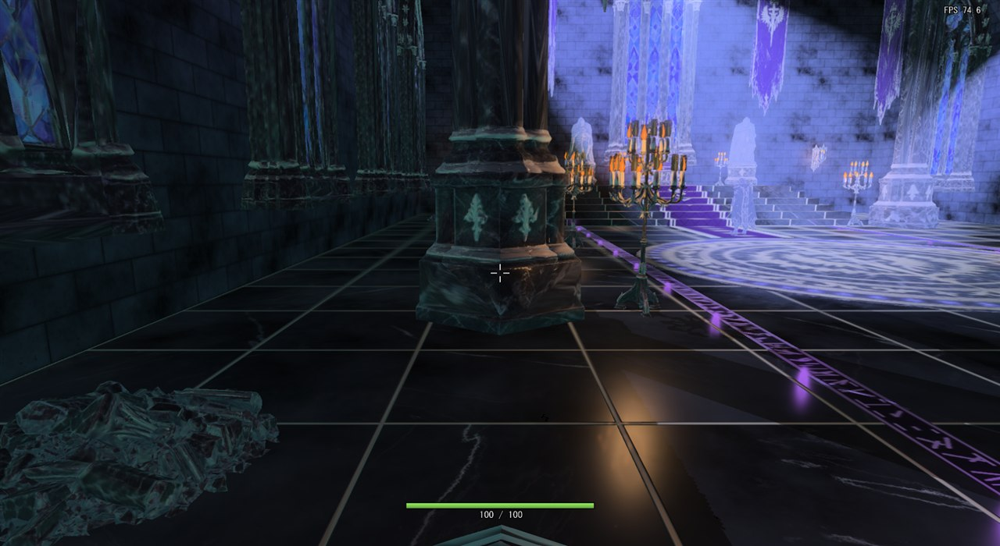
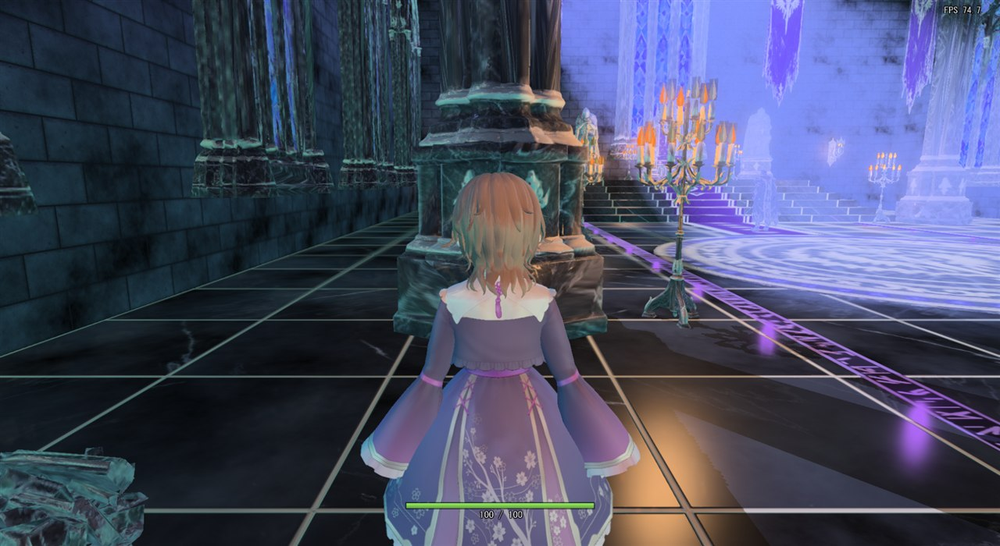
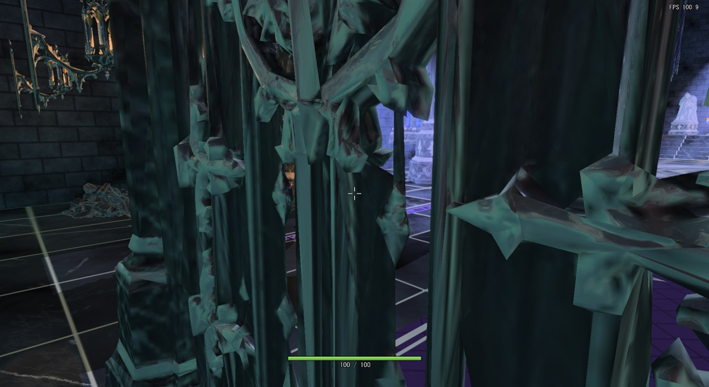
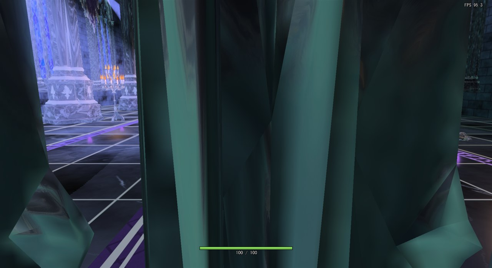

# カメラの壁よけの経緯

作成日: 2026-11-17
対象: [CameraCollision.cpp](../../../../Game/Source/Objects/CameraCollision.cpp)・[GameCamera.cpp](../../../../Game/Source/Objects/GameCamera.cpp) の三人称
設計: [カメラの壁よけの設計](カメラの壁よけの設計.md)
手順: [カメラの壁よけの手順](カメラの壁よけの手順.md)

---

## 2026-11-17 三人称のカメラが壁・柱・床に埋まらないようにした

### やりたかったこと

三人称の寄り（[カメラのモード](../カメラのモード/カメラのモードの設計.md)。距離 350・注視点の高さ 150・見下ろす角度 10度）はカメラが低く近いので、壁を背にするとカメラが壁の中に入り、何も見えなくなる。カメラと注視点の間に壁があったら、カメラを壁の手前まで寄せ、壁から離れたら元の距離へなめらかに戻したい。寄りと俯瞰の両方で効き、寄りと俯瞰の間をなめらかに移す処理（`m_blendTimer`）とも合うようにしたい。

### 調べたこと

- 前にエンジンにあった `SpringCamera`・`CameraCollisionSolver` は、2026-11-15 に消してある（[README の注意事項](../../../README.md#注意事項)）。消す前の `CameraCollisionSolver` は、球をすべらせて、当たった点から面の向きへ半径の分だけ押し出していた。キャラクターとゴーストは飛ばしていた。使っていた `SphereCollider` も一緒に消してある。
- 物理の世界（`PhysicsWorld`）には、球などをすべらせる `ConvexSweepTest` が残っている。結果を受け取る型を自分で渡せる版もあり、`CharacterController` もそれで壁を調べている。エンジンを変えずにゲーム側で作れる。
- `CharacterController` は、自分の当たり判定に `enCollisionAttr_Character` の番号を付けている。プレイヤーと黒騎士は、どちらも `CharacterController` を使う。
- ステージの当たり判定は、ボス戦の広間の `BossHallCollision.fbx`（壁・床・台座・柱・玉座・燭台・石像・がれきの箱）だけ。
- 今のカメラは、カメラへの向きの y が −0.5 まで下から見上げられるので、寄りではカメラが床の下へもぐることがあった（注視点 150 − 350 × 0.5 = −25）。
- 一人称かどうかを、体を描いているか（`IsRenderBody`）で見ている所がある（`FireMagic::OnStart` の溜めのエフェクト、`PlayerInputSource` の撃つ向き）。

### 決めたこと（ユーザーと相談して）

| 決めること | 決めたこと |
|---|---|
| 当たりの調べ方 | 半径 15cm の球をすべらせる。`CameraCollisionSolver` は戻さず、ゲーム側に `CameraCollision` を作り直す |
| 寄せる・戻る速さ | 寄せるのはすぐ（同じフレーム）、戻るのは 0.3秒（約 1秒でほぼ戻る） |
| 体 | プレイヤー・敵の体には当たらない |
| 寄りすぎたとき | 頭の中心から 60cm より近くまで寄ったら、プレイヤーの体を隠す |
| 柱 | 寄って戻るだけ。透かすのは別の項目 |
| 置き場所と名前 | `Action/docs/ゲーム/カメラ/カメラの壁よけ/`、クラスは `CameraCollision` |
| 実装する人 | Claude |

### 作り方

- 当たった点から押し出すと、柱の角でカメラが横へずれるので、進めた割合（`m_closestHitFraction`）を使い、頭の中心とカメラを結ぶ線の上に置くことにした。
- 始点は、注視点（カメラの前へ 20cm ずらしたもの）ではなく、足元 + 注視点の高さ（頭の中心）にした。注視点は、壁の方を向くと壁に入りかけ、始点で当たったことになるため。
- 寄せ具合は距離ではなく割合で覚え、なめらかに移したあとの位置に掛ける。寄りと俯瞰の置きたい位置をまっすぐ結んだ線が壁を通っても、移す途中で壁に入らない。
- 体を隠すのは一人称もしているので、壁よけで隠したかを別の印（`m_isBodyHiddenByCollision`）で覚え、壁よけで隠した体だけを映し直すようにした。隠す距離（60cm）と映す距離（70cm）を離して、境目で点滅しないようにした。
- 手順書を「上から足していくだけで出来上がる」形にするため、`Solve` の距離を覚える行（`m_distance`）や `Reset` は、あとから足すだけで済む位置に書いた。

### どう確かめたか

- 作業用フォルダ（git worktree）で、Game.sln を Debug / x64 でビルドした。
- 手順書は、main（#182）の `GameCamera.h`・`GameCamera.cpp` に小手順の順に1つずつ組み込むスクリプトで作り、組み込み終わった4つのファイル（`CameraCollision.h`・`CameraCollision.cpp`・`GameCamera.h`・`GameCamera.cpp`）が今のコードと1行も違わないことを確かめた。手順1・手順2の終わりの時点のコードでもビルドが通ることを確かめた（手順1-8〜1-13の間は `Solve` に `return` がないので通らない。手順書にそう書いた）。
- ゲームを最小化・非アクティブで起動し、窓を透明・いちばん奥にしてから `PrintWindow` で窓だけを撮った。撮ったらすぐに終了させた。窓をアクティブにしないとカメラを回せないので、プレイヤーの始めの位置（`BossStage.cpp` の `PLAYER_START_POSITION`）を一時的に変えたビルドで撮り、撮ったあと元に戻した。直す前は、`Solve` を呼ぶ1行を一時的に外したビルドで撮った。

**柱を背にする**（始めの位置を (−900, 100, −700) にした。真後ろに z = −1000 の柱がある）。直す前はカメラが柱の中に入り、プレイヤーが映らない（下の左）。直した後は、柱の手前で止まり、プレイヤーが映る（下の右）。

| 直す前 | 直した後 |
|---|---|
|  |  |

**入口の扉を背にする**（始めの位置を (0, 100, −2250) にした。真後ろに入口の壁と扉がある）。直す前は、カメラが入口の壁を抜けて外に出て、扉の模型を裏から見ている（下の左）。直した後は、カメラは入口の壁の手前で止まるが、扉の模型の中が映る（下の右）。扉の模型は当たり判定の形に入っていないので、カメラは扉の奥の壁の手前まで下がり、扉の中に入る。広間を書き出すスクリプト（[make_boss_stage.py](../../../../tools/BossStage/make_boss_stage.py)）で、扉は見た目（`visual`）にだけ置き、当たり判定の箱（`col`）を作っていないのを確かめた。設計の「既知の課題」に書いた。

| 直す前 | 直した後 |
|---|---|
|  |  |

- 壁から離れたときになめらかに戻る動き、寄りと俯瞰を移す途中、体を隠す・映す動き、床の手前で止まる動きは、窓をアクティブにしてカメラやプレイヤーを動かさないと試せないので、画面では確かめていない（ユーザーに確かめてもらう）。
