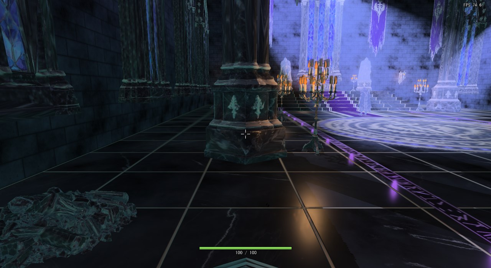
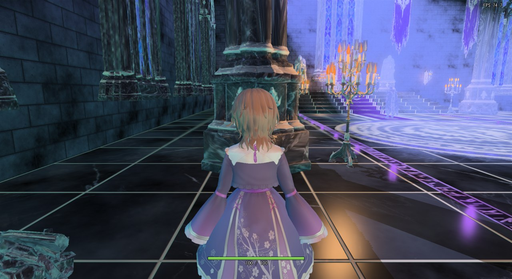
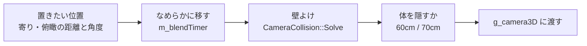

# カメラの壁よけの設計

作成日: 2026-11-17
対象: [CameraCollision.h](../../../../Game/Source/Objects/CameraCollision.h)・[CameraCollision.cpp](../../../../Game/Source/Objects/CameraCollision.cpp) と、それを使う [GameCamera.cpp](../../../../Game/Source/Objects/GameCamera.cpp) の三人称（寄り・俯瞰）
経緯: [カメラの壁よけの経緯](カメラの壁よけの経緯.md)
手順: [カメラの壁よけの手順](カメラの壁よけの手順.md)

三人称のカメラが、壁・柱・床の中に入らないようにする仕組みです。頭の中心からカメラを置きたい位置へ小さな球をすべらせ、間に壁があれば、カメラを壁の手前まで寄せます。

- **寄せるのはすぐに、戻るのはゆっくり。** 壁の中が1フレームでも映らないよう、寄せるのは同じフレームで。離れたら約 1秒かけて、なめらかに元の距離へ戻す。
- **寄りと俯瞰の両方に、同じものを掛ける。** なめらかに移したあとの位置に掛けるので、寄りと俯瞰を移す途中でも壁に入らない。
- **体には当たらない。** プレイヤー・敵の体は飛ばす。カメラが頭のすぐ近くまで寄ったら、プレイヤーの体を隠す。

| 柱を背にする: 直す前（カメラが柱の中） | 直した後（柱の手前で止まる） |
|---|---|
|  |  |

---

## 1. 全体像



`GameCamera::UpdateThirdPersonCamera` は、今までどおり置きたい位置を決め、寄りと俯瞰を切り替えた直後ならなめらかに移します。その位置を最後に `CameraCollision::Solve` へ通し、返ってきた位置にカメラを置きます。注視点は変えません。一人称には掛けません（目は体の中にあり、体は壁から 20cm 離れているため）。

| 当たるもの | 扱い |
|---|---|
| 壁・柱・床・玉座の台座と階段・燭台・石像・がれき・入口の扉 | ステージの当たり判定（`BossHallCollision`）に入っているものに当たり、その手前に寄る |
| プレイヤー・黒騎士の体 | 当たらない |
| 壁の灯り・柱の垂れ幕・窓 | 当たり判定に入っていないので、当たらない（「5. 既知の課題」） |

---

## 2. 実装方法

**球をすべらせて、進めた割合を使う。** `Solve(start, position, deltaTime)` は、頭の中心 `start` から置きたい位置 `position` へ、半径 15cm の球（`btSphereShape`）をすべらせます（`PhysicsWorld::ConvexSweepTest`）。結果は Bullet の `ClosestConvexResultCallback` を継いだ `SweepCallback` が受け取り、いちばん手前で当たった所まで進めた割合（`m_closestHitFraction`、0〜1）を残します。

```cpp
// CameraCollision::Solve
SweepCallback callback;
PhysicsWorld::GetInstance()->ConvexSweepTest(&m_sphere, from, to, callback);
const float hitRate = callback.hasHit() ? callback.m_closestHitFraction : 1.0f;
```

当たった点そのものではなく割合を使い、カメラを「頭の中心とカメラを結ぶ線の上」に置きます。当たった点から面の向きへ押し出すと（前にエンジンにあった `CameraCollisionSolver` のやり方）、柱の角でカメラが横へずれて、がたつくためです。線ではなく球にしたのは、柱の角をかすめたときに Near の面（カメラの前の、描き始める面）の端が壁に入らないようにするためです。

**体を飛ばす。** `SweepCallback::addSingleResult` は、当たったものの番号（`getUserIndex`）が `enCollisionAttr_Character`（`CharacterController` が付ける番号）なら、覚えずに 1 を返します。始点はプレイヤーの体の中なので、飛ばさないと必ず始点で当たります。

**寄せるのはすぐに、戻るのはゆっくり。** 今カメラを置いている割合を `m_rate` に覚えます。当たった割合 `hitRate` が `m_rate` より小さければ、すぐに `m_rate = hitRate`。大きければ、残りの差に `1 - e^(-経過秒数 / 0.3)` を掛けて近づけます。

```cpp
// CameraCollision::Solve
if (m_isReset || hitRate < m_rate) {
	m_rate = hitRate;
	m_isReset = false;
}
else {
	m_rate += (hitRate - m_rate) * (1.0f - expf(-deltaTime / RETURN_SECONDS));
}
m_distance = length * m_rate;
return start + toCamera * m_rate;
```

距離（cm）ではなく割合で覚えるので、寄り（350）と俯瞰（353.6）で距離が違っても、なめらかに移す途中でも、そのまま引き継げます。一人称の間は `Solve` を呼ばないので、一人称から戻るとき（`ChangeThirdPersonMode`）に `Reset()` で印 `m_isReset` を立て、次の `Solve` で当たった割合にすぐ置きます。

**始点は頭の中心。** `GameCamera` は、プレイヤーの足元に注視点の高さ（寄り 150・俯瞰 170）を足した所を始点にします。注視点はカメラの前へ 20cm ずらしてあり、壁の方を向くと壁に入りかけるので使いません。

**名前:**

| ジャンル | 名前 | 何のためのもの | 何をするためのもの | どこから来たもの |
|---|---|---|---|---|
| 型 | `CameraCollision` | 壁よけの計算をまとめるため | 球をすべらせ、カメラを壁の手前に寄せる | ゲームの [CameraCollision.h](../../../../Game/Source/Objects/CameraCollision.h) |
| 関数 | `Solve` | カメラを壁の手前に寄せるため | 頭の中心と置きたい位置を受け取り、寄せた位置を返す | ゲームの [CameraCollision.cpp](../../../../Game/Source/Objects/CameraCollision.cpp) |
| 型 | `SweepCallback` | 球をすべらせた結果を受け取るため | いちばん手前の当たりを残し、キャラクターは飛ばす | ゲームの [CameraCollision.cpp](../../../../Game/Source/Objects/CameraCollision.cpp) |
| 型 | `btSphereShape` | すべらせる球の形 | 半径だけを持つ球 | 外部ライブラリ（Bullet Physics） |
| 型 | `ClosestConvexResultCallback` | いちばん手前の当たりを残す仕組みを借りるため | 当たったものが渡されるたびに、手前のものだけを覚える | 外部ライブラリ（Bullet Physics）の `btCollisionWorld` |
| 関数 | `ConvexSweepTest` | 球をすべらせて当たりを調べるため | 形を始めの位置から終わりの位置へ動かし、途中で当たったものを結果の型に渡す | k2EngineLow（エンジン）の [Physics.h](../../../../k2EngineLow/physics/Physics.h) |
| メンバー変数 | `m_closestHitFraction` | どこまで進めたかを知るため | いちばん手前で当たった所までの割合（0〜1） | 外部ライブラリ（Bullet Physics） |
| 値 | `enCollisionAttr_Character` | キャラクターの当たり判定の印 | `CharacterController` が自分の当たり判定に付ける番号 | k2EngineLow（エンジン）の [CollisionAttr.h](../../../../k2EngineLow/physics/CollisionAttr.h) |
| メンバー変数 | `m_rate`・`m_isReset` | 今どこまで寄せているか・次はすぐ置くか | `m_rate` は始点から置きたい位置までのうちカメラを置いている割合 | ゲームの [CameraCollision.h](../../../../Game/Source/Objects/CameraCollision.h) |
| 関数 | `expf` | FPS によらず同じ速さで戻すため | e の累乗を返す | C++ の標準ライブラリ（`<math.h>`） |

**用語:**

| 用語 | 何のことか |
|---|---|
| スイープ（すべらせる） | 形（ここでは球）を始めの位置から終わりの位置へ動かしたときに、途中で何かに当たるかを調べること。線（レイ）で調べるより、太さの分だけ余白が取れる |
| Near の面 | カメラの前の、ここより手前は描かないという面。この面が壁に入ると、壁が欠けて向こう側が見える |

**体を隠す。** `Solve` は返した位置の頭の中心からの距離を `m_distance` に覚え、`GetDistance()` で返します。`GameCamera::UpdateBodyHiddenByCollision` は、60cm より近ければ体を隠し（`SetRenderBody(false)`）、隠していて 70cm より離れたら映します。隠す距離と映す距離を離して、境目で点滅しないようにしました。体を隠すのは一人称もしているので、壁よけで隠したかを `m_isBodyHiddenByCollision` に分けて覚え、壁よけで隠した体だけを映し直します（一人称に入るときは印を消し、プレイヤーが倒れたら映す）。

---

## 3. 調整用の数値

| 定数 | 場所 | 値 | 意味 |
|---|---|---|---|
| `SPHERE_RADIUS` | [CameraCollision.cpp](../../../../Game/Source/Objects/CameraCollision.cpp) | 15 | すべらせる球の半径（cm）。大きいほど壁から離れて止まる。プレイヤーの体の半径（20）より小さくする（始点が壁に触れないように） |
| `RETURN_SECONDS` | [CameraCollision.cpp](../../../../Game/Source/Objects/CameraCollision.cpp) | 0.3 | 戻る速さ（秒）。残りの差が、この秒数で約 37% になる。約 1秒でほぼ戻る |
| `HIDE_BODY_DISTANCE` | [GameCamera.cpp](../../../../Game/Source/Objects/GameCamera.cpp) | 60 | 頭の中心からカメラまでがこれより近いと、体を隠す（cm） |
| `SHOW_BODY_DISTANCE` | [GameCamera.cpp](../../../../Game/Source/Objects/GameCamera.cpp) | 70 | 隠した体を、これより離れたら映す（cm） |

---

## 4. 決めたこと

- **消した `CameraCollisionSolver` は戻さず、ゲーム側に作り直した。** エンジンは変えていない。押し出し方（当たった点 + 面の向き × 半径）は柱の角でがたつくので、割合を使う形にした。使っていた `SphereCollider` も消してあるので、`btSphereShape` を直接持つ。
- **寄せるのはすぐ、戻るのは 0.3秒。** すぐ戻すと、柱を過ぎるたびにカメラが飛び出して酔う。
- **体には当たらない。** 黒騎士がカメラの前を通るたびにカメラが寄ると、戦いの最中に画面が大きく揺れる。カメラはプレイヤーの後ろにあるので、敵の体に埋まることは少ない。
- **柱は「寄って戻る」だけ。** 柱を透かして見せることはしない（するなら別の項目）。
- **頭から 60cm より近くまで寄ったら、体を隠す。** 原神は半透明にするが、今の描画は「描く・描かない」の2つなので隠す。

---

## 5. 既知の課題

- **壁の灯り・柱の垂れ幕・窓には当たらない。** どれも当たり判定の形（`BossHallCollision`）に入っていない。壁や柱の表に付いた薄いものなので、カメラが入っても少し欠けて見える程度。入口の扉は、当たり判定に箱を足した（[ボス戦の広間の経緯](../../ステージ/ボス戦の広間/ボス戦の広間の経緯.md) の 2026-11-17）。
- **壁よけで体を隠している間に炎魔法を溜めると、一人称用の溜めのエフェクトになる。** `FireMagic::OnStart` が、体を描いているか（`IsRenderBody`）で一人称かどうかを見ているため。カメラが頭のすぐ近くにあるので、画面を覆わない一人称用の方が見やすいことが多い。
- **柱がカメラと頭の間を横切ると、一瞬寄ってから戻る。** 原神と同じ動き。気になるなら、柱を透かすか、戻る速さ（`RETURN_SECONDS`）を変える。

---

## 6. 関連するページ

- [カメラのモードの設計](../カメラのモード/カメラのモードの設計.md): 寄り・俯瞰・一人称と、寄りと俯瞰の間をなめらかに移す処理
- [ボス戦の広間の設計](../../ステージ/ボス戦の広間/ボス戦の広間の設計.md): 見た目と当たり判定の形の分け方
- [キャラクターの構成](../../キャラクター/キャラクターの構成/キャラクターの構成.md): 体を描くかどうか（`SetRenderBody`）
