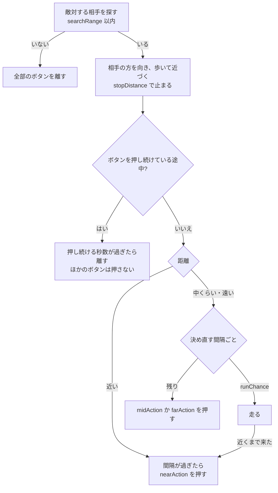

# NPCのAIの設計

作成日: 2026-11-07（[入力の設計](../入力/入力の設計.md) から分けた。2026-11-17 に、距離の3段の形に作り直した）
対象: [NpcInputSource.h](../../../../Game/Source/Character/Input/NpcInputSource.h)、[NpcInputSource.cpp](../../../../Game/Source/Character/Input/NpcInputSource.cpp)
経緯: [NPCのAIの経緯](NPCのAIの経緯.md)
手順: [NPCのAIの手順](NPCのAIの手順.md)（何もない状態から、どのファイルに何を足すか）

NPC の AI は、プレイヤーと同じ `CharacterInput` を作る入力元（`NpcInputSource`）です。敵対する相手を見つけたら近づき、相手との距離を「近い・中くらい・遠い」の3段に分けて、段ごとに決めたボタンを押します。

**今は、どのキャラクターもこの AI を使っていません。** 敵の黒騎士は、同じ3段の分け方の専用の AI（[黒騎士のAIの設計](../../敵/黒騎士のAI/黒騎士のAIの設計.md)）で動きます。`NpcInputSource` は、魔法を撃つ敵や、味方・中立の NPC を作るときの土台として残してあります。

- **AI はボタンを押すだけ。** 動くのはキャラクターの部品で、押したボタンで何が起きるかは、キャラクターが `SkillController` に登録したスキルで決まる（剣の攻撃でも魔法でもよい）。
- **相手はクラスでなく陣営で探す。** Player を直接は知らない。
- **段ごとに、押すボタンと押し続ける秒数を決める。** 溜める魔法（炎魔法）は、押し続けてから離して撃つ。

---

## 1. 流れ



| 距離 | すること |
|---|---|
| 近い（`nearRange` 以内） | `actionInterval` ごとに、`nearAction` のボタンを押す |
| 中くらい（`midRange` 以内）・遠い（`searchRange` 以内） | 歩きながら、`decideInterval` ごとに `runChance` の確率で走る。残りは、その段のボタン（`midAction`・`farAction`）を押す |
| 走っている | 押さない。近くまで来たら歩きに戻し、すぐに `nearAction` を押す |

相手は `HitTargetRegistry::FindNearestHostile` で、当たり判定の一覧から探す（[陣営と当たり判定の設計](../陣営と当たり判定/陣営と当たり判定の設計.md)）。照準は相手の胸（足元から `castHeight` の高さから、相手の当たり判定の中心へ）。

---

## 2. 実装方法

- **毎フレーム入力を作り直す。** まず移動・向き・走る・ジャンプ・ダッシュ・狙いを「何もしない」にしてから、必要なものだけ埋める。
- **高低差は無視して水平に追う。** 相手への向きの y を 0 にする。
- **段は `ClassifyRange` で決め、段ごとのボタンは `GetRangeAction` で取り出す。** 設定は `RangeAction`（`button` と `holdSeconds`）を3つ（`nearAction`・`midAction`・`farAction`）持つ。
- **押すボタンは `DecideButton` が決める。** 押さないなら `ActionButton::Num` を返す。押すと決めたら、次に押せるまで（`actionInterval`）と、押し続ける秒数（`holdSeconds`）を数え始める。
- **押している途中は、ほかのボタンを押さない。** 離したフレームも「使っている」と数える。炎魔法は離した瞬間に撃つので、同じフレームに別のボタンを押すと、溜めた魔法と重なってしまう。
- **全部のボタンを毎フレーム `Update` する。** 押すボタンだけ `true`、残りは `false` を渡す。押した瞬間・離した瞬間が、人が操作するのと同じ形で起きる。

```cpp
ActionButton pressButton = ActionButton::Num;  // このフレームに押しているボタン。Num なら押さない。
if (m_holdButton != ActionButton::Num) {
	m_holdTimer -= context.deltaTime;
	if (m_holdTimer > 0.0f) { pressButton = m_holdButton; }   // 押し続ける
	else { m_holdButton = ActionButton::Num; }                // 離す。このフレームはほかも押さない
}
else {
	const Range range = ClassifyRange(distance);
	pressButton = DecideButton(range, context.deltaTime);
	if (pressButton != ActionButton::Num) {
		m_actionTimer = m_settings.actionInterval;
		m_holdButton = pressButton;
		m_holdTimer = GetRangeAction(range).holdSeconds;
	}
}
for (int button = 0; button < static_cast<int>(ActionButton::Num); button++) {
	input.actions[button].Update(button == static_cast<int>(pressButton));
}
```

（実際のコードは、このほかに `m_decideTimer` も戻している。上は流れを見やすくするために省いた。）

名前:

| ジャンル | 名前 | 何のためのもの | 何をするためのもの | どこから来たもの |
|---|---|---|---|---|
| 型 | `RangeAction` | 1つの段で押すボタンを表すため | `button`（押すボタン。`Num` なら押さない）と `holdSeconds`（押し続ける秒数。0 なら1フレーム）を持つ構造体 | ゲームの [NpcInputSource.h](../../../../Game/Source/Character/Input/NpcInputSource.h) の `NpcInputSource` |
| 型 | `Range` | 相手との距離の分け方を表すため | `Near`・`Middle`・`Far` を持つ `enum class` | ゲームの `NpcInputSource.h` |
| 関数 | `DecideButton` | 押すボタンを決めるため | 段と秒数を渡すと、押すボタンを返す（走る・決め直す間隔の処理もここ） | ゲームの `NpcInputSource.cpp`（private） |
| メンバー変数 | `m_holdButton`・`m_holdTimer` | 押し続けている途中を覚えるため | 押し続けているボタンと、残り秒数 | ゲームの `NpcInputSource.h` |
| 型 | `ActionButton` | 攻撃や魔法のボタンを区別するため | `Action1`〜`Action3` と、数を表す `Num` を持つ `enum class` | ゲームの [CharacterInput.h](../../../../Game/Source/Character/Input/CharacterInput.h) |

---

## 3. 使い方（魔法を撃つ敵を作る）

1. キャラクターの `OnStart` で、使うスキルをボタンに登録する（強さは [魔法の調整値の設計](../../魔法/魔法の調整値/魔法の調整値の設計.md)）。
   ```cpp
   m_skillController.Register<IceMagic>(ActionButton::Action1, MagicConfig::GetIce().cooldown);
   m_skillController.Register<FireMagic>(ActionButton::Action2, MagicConfig::GetFire().cooldown);
   ```
2. `NpcInputSource::Settings` で、段ごとのボタンを決める。
   ```cpp
   NpcInputSource::Settings settings;
   settings.nearAction.button = ActionButton::Action1;     // 近い: 氷魔法
   settings.midAction.button = ActionButton::Action1;      // 中くらい: 氷魔法
   settings.farAction.button = ActionButton::Action2;      // 遠い: 炎魔法（溜め撃ち）
   settings.farAction.holdSeconds = MagicConfig::GetFire().maxChargeSeconds;  // 最大まで溜める
   settings.actionInterval = 4.0f;                         // 凍結（2.5秒）より長くして、凍らされ続けないように
   ```
3. キャラクターが `GetDefaultInputSource()` で、この設定を渡した `NpcInputSource` を返すようにする（[入力の設計](../入力/入力の設計.md)）。
4. `castHeight`（AI の狙う高さ）と、キャラクターの魔法を撃つ高さ（[魔法の設計](../../魔法/魔法の設計.md) の `castHeight`）を、その敵の胸の高さに合わせる。

これは使い方の例で、今のコードにはこの敵はいない。

---

## 4. 調整用の数値（`NpcInputSource.h` の `Settings` の既定の値）

使うキャラクターが、`Settings` を作って `NpcInputSource` に渡します。黒騎士の AI の `Settings`（`BlackKnightInputSource.h`）の既定の値と同じです（黒騎士は `Enemy.cpp` で、探す範囲 1800・中くらい 1200・攻撃の間隔 5.4秒に変えている）。

| 内容 | 値 |
|---|---|
| 相手を探す範囲（`searchRange`。ここまでが「遠い」） | 900 |
| 「近い」・「中くらい」の距離（`nearRange`・`midRange`） | 220・600 |
| 止まる距離（`stopDistance`） | 150（剣が届くところ） |
| 移動入力の大きさ（`moveRate`） | 1 |
| 決め直す間隔（`decideInterval`） | 2秒 |
| 走る確率（`runChance`） | 0.5 |
| ボタンを押してから次に押せるまで（`actionInterval`） | 3.5秒 |
| 見つけてから最初に押せるまで（`firstActionDelay`） | 0.6秒 |
| 狙う高さ（`castHeight`） | 60 |
| 段ごとのボタン（`nearAction`・`midAction`・`farAction`） | 初めは `Num`（何も押さない） |

---

## 5. 決めたこと

| 決めたこと | 理由 |
|---|---|
| 黒騎士の AI と同じ、距離の3段で押すボタンを決める形にした | 黒騎士の動き（近づく・走る・攻撃を選ぶ）を、そのまま魔法を撃つ敵にも使うため。段ごとのボタンを設定にしたので、剣でも魔法でも同じ AI で動く |
| 黒騎士の AI（`BlackKnightInputSource`）は、そのまま残した | 攻撃のボタンが決まっていて、狙う高さも違う。汎用の AI に置き換えると、黒騎士の動きを確かめ直すことになる |
| 以前の「射程に入ったら `Action1` を撃つだけ」の形はやめた | 近づくだけで間合いによる使い分けがなく、剣も魔法も1つのボタンに限られていた |
| 押し続けている間と、離したフレームは、ほかのボタンを押さない | 炎魔法は離した瞬間に撃つので、同じフレームに剣を振ると、溜めた魔法と剣が重なるため |
| 押し続ける秒数は、段ごとに決める | 溜める魔法は、遠い段だけで使いたいことがある |

---

## 6. 既知の課題

- **今は、この AI を使っているキャラクターがない。** 手順書もビルドが通ることまでで、動かして確かめていない。魔法を撃つ敵を作るときに確かめる。
- **走る・歩く以外の動き（よける・逃げる）はない。** 相手に近づいて、段のボタンを押すだけ。

---

## 7. 関連するページ

- [入力の設計](../入力/入力の設計.md)・[黒騎士のAIの設計](../../敵/黒騎士のAI/黒騎士のAIの設計.md)・[スキルの設計](../../スキル/スキルの設計.md)
- [陣営と当たり判定の設計](../陣営と当たり判定/陣営と当たり判定の設計.md)（相手の探し方）
- [魔法の調整値の設計](../../魔法/魔法の調整値/魔法の調整値の設計.md)（魔法の強さ）
