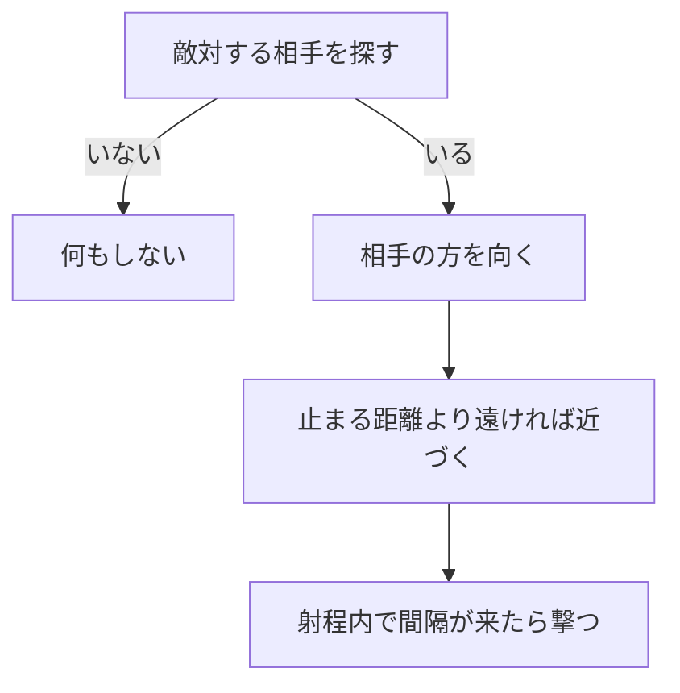

# NPCのAIの設計

作成日: 2026-11-07（[入力の設計](入力の設計.md) から分けた）
対象: [NpcInputSource.cpp](../../../Game/Source/Character/Input/NpcInputSource.cpp)
経緯: [入力の経緯](入力の経緯.md)
手順: [NPCのAIの手順](NPCのAIの手順.md)（何もない状態から、どのファイルに何を足すか）

NPC の AI は、プレイヤーと同じ `CharacterInput` を作る入力元（`NpcInputSource`）です。

- **AI はボタンを押すだけ。** 動くのはキャラクターの部品なので、人が操作するのと同じ動きになる。
- **相手はクラスでなく陣営で探す。** Player を直接は知らない。

---

## 1. 流れ

相手は `HitTargetRegistry::FindNearestHostile` で、当たり判定の一覧から探す（[陣営と当たり判定の設計](陣営と当たり判定の設計.md)）。照準は相手の胸。

---

## 2. 実装方法

- **毎フレーム入力を作り直す。** まず全部「何もしない」にしてから、必要なものだけ埋める。
- **高低差は無視して水平に追う。** 相手への向きの y を 0 にする。
- **撃つときは `fireHoldSeconds` の間「押している」を続けてから離す。** 人と同じ押す・離すが起きるので、溜め撃ちの魔法でも同じ入力で動く。
- 撃つ間隔はタイマーで数える。相手を見つけた直後は `firstFireDelay` だけ待つ。

---

## 3. 調整用の数値（`Enemy.cpp` の `MakeAiSettings`）

| 内容 | 値 |
|---|---|
| 相手を探す範囲 | **0（今は敵を止めている）**。動かすときは 900 |
| 止まる距離 | 90 |
| 撃つ射程 / 間隔 | 700 / 4秒（凍結 2.5秒より長くして、凍らされ続けないように） |
| 見つけてから最初に撃つまで | 1.5秒 |
| 撃つか（`canFire`） | true |
