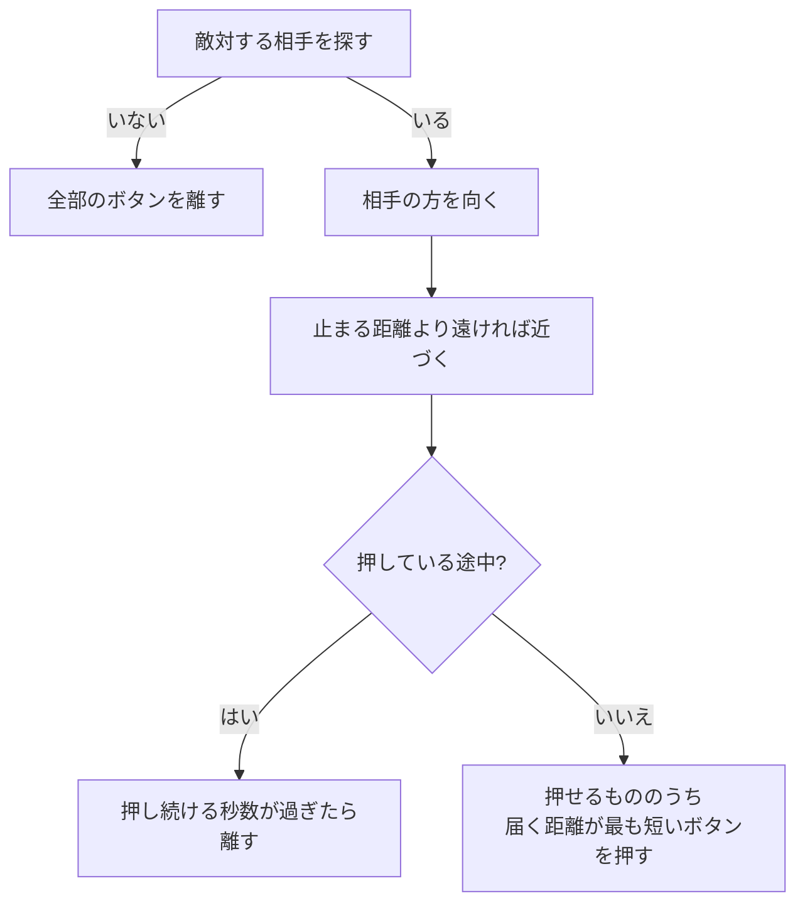

# NPCのAIの設計

作成日: 2026-11-07（[入力の設計](入力の設計.md) から分けた）
対象: [NpcInputSource.h](../../../Game/Source/Character/Input/NpcInputSource.h)、[NpcInputSource.cpp](../../../Game/Source/Character/Input/NpcInputSource.cpp)
経緯: [入力の経緯](入力の経緯.md)
手順: [NPCのAIの手順](NPCのAIの手順.md)（何もない状態から、どのファイルに何を足すか）、[NPCの攻撃と魔法の使い分けの手順](NPCの攻撃と魔法の使い分けの手順.md)（ボタン3つを使い分ける）

NPC の AI は、プレイヤーと同じ `CharacterInput` を作る入力元（`NpcInputSource`）です。

- **AI はボタンを押すだけ。** 動くのはキャラクターの部品なので、人が操作するのと同じ動きになる。何の魔法が出るかは、キャラクターの `MagicCaster` に登録したもので決まる。
- **相手はクラスでなく陣営で探す。** Player を直接は知らない。
- **ボタンは3つ（`attack`・`fire`・`subFire`）。** 届く距離がいちばん短いものから押す（剣が届くなら剣、届かなければ魔法）。

---

## 1. 流れ



相手は `HitTargetRegistry::FindNearestHostile` で、当たり判定の一覧から探す（[陣営と当たり判定の設計](陣営と当たり判定の設計.md)）。照準は相手の胸（足元から `castHeight` の高さから、相手の当たり判定の中心へ）。

| ボタン | 何が起きるか | 黒騎士 |
|---|---|---|
| `attack` | 近接攻撃。敵のステートが `Attack` へ移る（[敵のステートの設計](../敵/敵のステートの設計.md)） | 剣を振る |
| `fire` | メインの魔法（`MagicCaster::AddMagic`） | 使わない |
| `subFire` | サブの魔法（`MagicCaster::SetSubMagic`） | 使わない |

---

## 2. 実装方法

- **毎フレーム入力を作り直す。** まず全部「何もしない」にしてから、必要なものだけ埋める。
- **高低差は無視して水平に追う。** 相手への向きの y を 0 にする。
- **ボタンごとの押し方は `ActionSettings` の5つの値で決める。** 使うか（`isEnabled`）・届く距離（`range`）・押す間隔（`interval`）・見つけてから最初に押すまで（`firstDelay`）・押し続ける秒数（`holdSeconds`）。
- **ボタンごとの状態は `ActionState` の配列で持つ。** 次に押せるまでの秒数、押し続ける残り秒数、押している最中か。
- **押している途中は、ほかのボタンを押さない。** 離したフレームも「使っている」と数える。炎魔法は離した瞬間に撃つので、同じフレームで剣を振ると、溜めた魔法と剣が重なるため。
- **押し続ける秒数のあいだ「押している」を続けてから離す。** 人と同じ押す・離すが起きるので、溜め撃ちの魔法でも同じ入力で動く。`holdSeconds` が 0 なら、押した次のフレームで離す。

```cpp
// 押せるもののうち、届く距離がいちばん短いものを押す。
for (int i = 0; i < ACTION_NUM; i++) {
    const ActionSettings& settings = GetActionSettings(i);
    const bool canPress = settings.isEnabled
        && m_actions[i].waitTimer <= 0.0f
        && distanceSq <= settings.range * settings.range;
    if (canPress && settings.range < chosenRange) { chosen = i; chosenRange = settings.range; }
}
```

---

## 3. 使い方（魔法を撃つ敵を作る）

1. 敵の `OnStart` で魔法を登録する（強さは [魔法の調整値の設計](../魔法/魔法の調整値の設計.md)）。
   ```cpp
   m_magicCaster.AddMagic(std::make_unique<IceMagic>(MagicSettings::GetIce()));
   ```
2. `MakeAiSettings` で、そのボタンの押し方を決める。
   ```cpp
   settings.fire.isEnabled = true;
   settings.fire.range = 700.0f;      // この距離以内なら撃つ
   settings.fire.interval = 4.0f;     // 凍結（2.5秒）より長くして、凍らされ続けないように
   settings.fire.firstDelay = 1.5f;
   settings.fire.holdSeconds = 0.0f;  // 炎魔法なら 1.2（最大まで溜める）
   ```
3. `MakeConfig` の `caster`（撃つ高さ）と、`NpcInputSource::Settings::castHeight` をその敵の胸の高さに合わせる。

---

## 4. 調整用の数値（`Enemy.cpp` の `MakeAiSettings`、黒騎士）

| 内容 | 値 |
|---|---|
| 相手を探す範囲 | 900 |
| 止まる距離 | 150（剣が届くところ） |
| `attack` の届く距離 / 間隔 / 最初に押すまで | 220 / 2.5秒 / 0.6秒 |
| `fire`・`subFire` | 使わない（魔法を持たない） |
