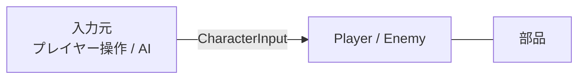

# キャラクターの構成

作成日: 2026-11-05（2026-11-07 に移動を [移動の設計](移動の設計.md) へ分けた）
対象: `Game/Source/Objects/Player.*`、`Game/Source/Objects/Enemy.*`、`Game/Source/Character/`
経緯: [キャラクターの構成の経緯](キャラクターの構成の経緯.md)

> **見直し予定:** Actor → Character の基底クラスを作り、フォルダも分け直す（[プレイヤーの構成の設計](../プレイヤー/プレイヤーの構成の設計.md)）。このページは今のコードの形。

Player と Enemy が**どの部品を持ち、どの順で Init し、1フレームにどの順で呼ぶか**をまとめた入口のページです。

- **キャラクターは入力を受け取って動くだけ。** パッド・マウス・AI のことは知らない。
- **継承より部品の組み合わせ。** 共通の処理は部品にして両方に持たせる。
- **キャラクターに残すのはデータと組み立てだけ。** 調整値やモデルのパスは `.cpp` の `Make〇〇()` に書く。

---

## 1. 全体像



| 部品 | 役割 | 持ち主 | ページ |
|---|---|---|---|
| `IInputSource` | そのフレームの入力を作る | 両方 | [入力の設計](入力の設計.md)、[NPCのAIの設計](NPCのAIの設計.md) |
| `PlayerStateMachine` | 歩く・走る・跳ぶなどの切り替え | Player | [プレイヤーのステートの設計](../プレイヤー/プレイヤーのステートの設計.md) |
| `CharacterModel` | モデルとアニメーション | 両方 | [キャラクターモデルの設計](キャラクターモデルの設計.md) |
| `CharacterMover` | 移動・ジャンプ・重力・向き | 両方 | [移動の設計](移動の設計.md) |
| `StatusEffects` | 凍結・燃焼 | 両方 | [状態異常の設計](状態異常の設計.md) |
| `HitTarget` | 弾に当たる判定と陣営 | 両方 | [陣営と当たり判定の設計](陣営と当たり判定の設計.md) |
| `MagicCaster` | 魔法を持ち、切り替えて撃つ | 両方 | [魔法と弾の設計](../魔法/魔法と弾の設計.md) |

部品はメンバー変数として値で持つ（`new` しない）。入力元だけはポインタで、差し替えられる。

---

## 2. 初期化（Start）

決まりは1つだけ: **`CharacterModel` を、`ModelRender` を使う部品（剣・`StatusEffects`・ステート）より先に Init する。**

```cpp
m_mover.Init(MakeMoveSettings());
m_model.Init(MakeModelDesc());                    // ① モデル
InitSword();                                      // ② 以降はモデルを使う
m_statusEffects.Init(&m_model.GetModelRender());
m_stateMachine.Init(stateContext);
m_hitTarget.Init(this, Faction::Player, ...);
m_magicCaster.Init(this, Faction::Player, MakeCasterSettings());
```

---

## 3. 1フレームの流れ（Update）

| 順 | Player | Enemy |
|---|---|---|
| ① 入力 | `m_inputSource->Update()` | 同じ |
| ② 状態異常 | `m_statusEffects.Update()` | 同じ |
| ③ 動く | `m_stateMachine.Update()` | `m_mover.Update(input)` とアニメーションの切り替え（凍結中は空の入力） |
| ④ 魔法 | `m_magicCaster.Update()` | 同じ |
| ⑤ 落下 | Y < -1000 でリスポーン | - |
| ⑥ 位置を合わせる | 当たり判定・モデル・剣 | 当たり判定・モデル |

Player だけの処理: 剣を右手のボーンに追従させる（ボーンは名前で探し、なければ別名で探し直す）、リスポーン、一人称で体を消す。

---

## 4. 使い方

| やりたいこと | 触る場所 | ページ |
|---|---|---|
| 新しい種類のキャラクター | 1章の部品から必要なものをメンバーにし、2章の順で Init | このページ |
| プレイヤーの新しい動き | `PlayerState` を継承する | [プレイヤーのステートの設計](../プレイヤー/プレイヤーのステートの設計.md) |
| モデル・アニメーション | 各キャラクターの `MakeModelDesc()` | [キャラクターモデルの設計](キャラクターモデルの設計.md) |
| 新しい弾・撃ち方 | `BulletBase`・`MagicBase` を継承する | [魔法と弾の設計](../魔法/魔法と弾の設計.md) |
| 味方・中立のNPC | `Enemy::SetFaction` | [陣営と当たり判定の設計](陣営と当たり判定の設計.md) |
| AI の動き方・操作の割り当て | `NpcInputSource`・`PlayerInputSource` | [NPCのAIの設計](NPCのAIの設計.md)、[入力の設計](入力の設計.md) |

---

## 5. 決めたこと

| 決めたこと | 理由 |
|---|---|
| 基底クラスを作らない（今の形） | 基底に処理を集めると種類が増えるたびに大きくなる。部品なら単独で読める・直せる |
| ダッシュは `CharacterMover` に入れない | Player だけの動きなので、`PlayerDashState` に置く |
| 調整値は持ち主の `.cpp` の無名名前空間の関数に書く | 部品は既定値つきの構造体だけを持ち、キャラクターごとの数値を1か所にまとめる |

---

## 6. 既知の課題

- **ダメージ・HP はまだない。** Status として足す予定（[プレイヤーの構成の設計](../プレイヤー/プレイヤーの構成の設計.md)）。
- **デバッグ表示はまだない。** `GetInput()`・`GetStateName()`・`HitTargetRegistry::GetTargets()` で値は取れる。
