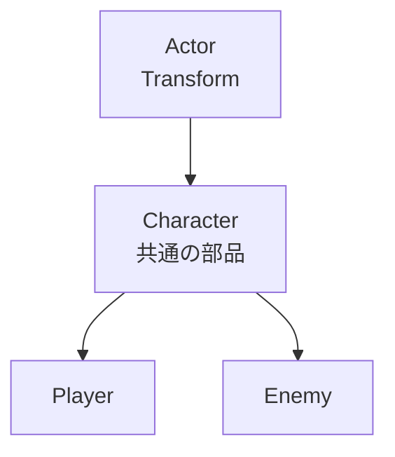
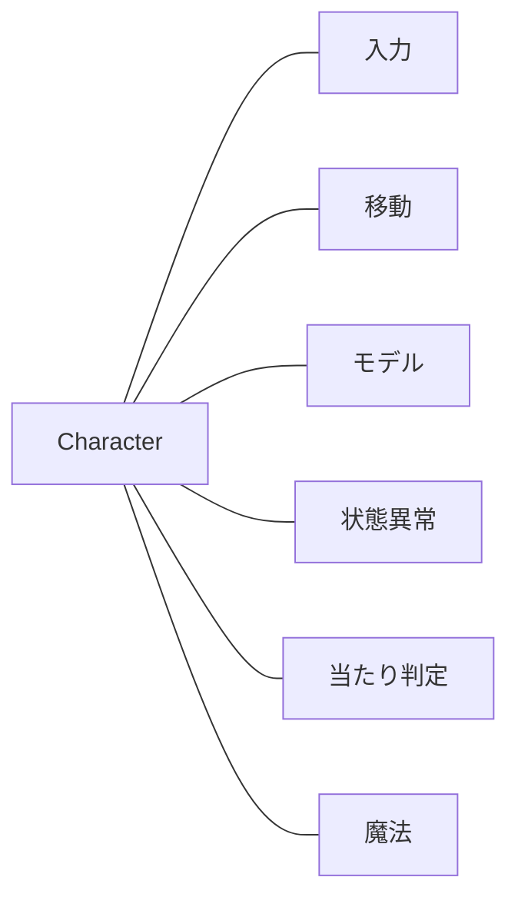
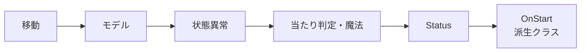
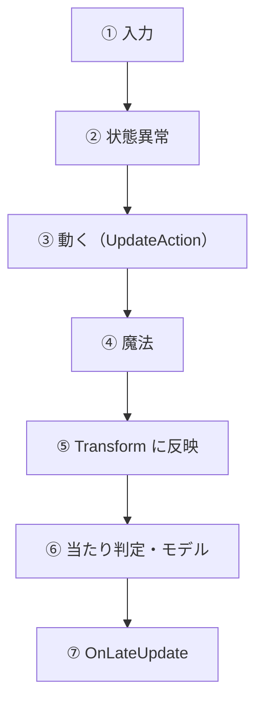

# キャラクターの構成

作成日: 2026-11-05（2026-11-07 に基底クラス Actor・Character を作った）
対象: `Game/Source/Actor/`、`Game/Source/Character/`、`Game/Source/Player/`、`Game/Source/Enemy/`
経緯: [キャラクターの構成の経緯](キャラクターの構成の経緯.md)

Player と Enemy が**どの部品を持ち、どの順で Init し、1フレームにどの順で呼ぶか**をまとめた入口のページです。Player だけの部品は [プレイヤーの構成の設計](../プレイヤー/プレイヤーの構成の設計.md) にあります。

- **継承は Actor → Character → Player / Enemy の3段まで。** 機能は部品（メンバー）で足す。
- **順番は Character が決める。** 派生クラスは「動く」部分（`UpdateAction`）と自分だけの部品を書く。
- **位置は Actor の Transform が正。** キャラコンが動いた結果を、毎フレーム Transform に書く。

---

## 1. 継承



ModelRender は Actor に持たせない（範囲・トリガー・音など、モデルのない Actor もあるため）。

---

## 2. Character が持つ部品



| 部品 | 役割 | ページ |
|---|---|---|
| `IInputSource` → `CharacterInput` | そのフレームの入力 | [入力の設計](入力の設計.md)、[NPCのAIの設計](NPCのAIの設計.md) |
| `CharacterMover` | 移動・ジャンプ・重力・向き（キャラコン） | [移動の設計](移動の設計.md) |
| `CharacterModel` | モデルとアニメーション | [キャラクターモデルの設計](キャラクターモデルの設計.md) |
| `StatusEffects` | 凍結・燃焼 | [状態異常の設計](状態異常の設計.md) |
| `HitTarget` | 弾に当たる判定と陣営 | [陣営と当たり判定の設計](陣営と当たり判定の設計.md) |
| `MagicCaster` | 魔法を持ち、切り替えて撃つ | [魔法と弾の設計](../魔法/魔法と弾の設計.md) |
| `Status`（派生が持つ） | HP など、遊んでいる間に変わる値 | このページの 5章 |

調整値は `CharacterConfig`（移動・モデル・魔法を撃つ位置・当たり判定・HP）にまとめ、派生クラスが `MakeConfig()` で返す。

---

## 3. 初期化（Character::Start）



決まりは1つ: **モデルを、ModelRender を使う部品より先に Init する。** 派生クラスの部品（剣・ステートなど）は `OnStart()` で Init するので、モデルはもうできている。

---

## 4. 1フレーム（Character::Update）



| | Player | Enemy |
|---|---|---|
| ③ 動く | ステートマシン、落ちたら戻す | ステートマシン（Idle・Move・Frozen） |
| ⑦ モデルのあと | 剣をボーンに合わせる | なし |

`Start`・`Update`・`Render` は `final` にして、順番を派生クラスで変えられないようにしている。

ステートマシンは Player と Enemy で共通のテンプレート（[ステートマシンの設計](ステートマシンの設計.md)）。各キャラクターは自分のステートを登録するだけ。

---

## 5. Status（変わる値）

`Character` は `virtual Status& GetStatus() = 0` を持ち、実体は派生クラスが持つ。Player は戻り値を `PlayerStatus&` にしている（共変戻り値）ので、Player からはキャストなしで Player だけの値を触れる。

```cpp
Character& chara = player;
chara.GetStatus().Damage(10.0f);   // 共通の処理は Status で書ける
PlayerStatus& s = player.GetStatus();  // Player からは PlayerStatus が返る
```

今は HP（`Damage`・`Heal`・`IsHpEmpty`）だけ。スタミナなどは使うときに `PlayerStatus` に足す。

---

## 6. 使い方

| やりたいこと | すること |
|---|---|
| 新しい種類のキャラクター | `Character` を継承し、`MakeConfig`・`GetDefaultInputSource`・`UpdateAction`・`GetStatus` を書く。自分だけの部品は `OnStart` で Init |
| 味方・中立のNPC | `Enemy::SetFaction`（[陣営と当たり判定の設計](陣営と当たり判定の設計.md)） |
| 入力元を差し替える | `SetInputSource()`（`nullptr` で既定に戻る） |

---

## 7. 決めたこと

| 決めたこと | 理由 |
|---|---|
| 部品はメンバーで持つ（汎用のコンポーネントのリストにしない） | 順番がコードに見える。付け忘れがコンパイルエラーになる。確保は1体1回 |
| 1フレームの順番は Character の1か所に書く | Player と Enemy で同じ順番を2回書かない |
| 基底クラスは Character までにする | 基底に処理を集めすぎると、種類が増えるたびに大きくなる |

---

## 8. 既知の課題

- **ダメージはまだ HP を減らさない。** 弾が当たったときに `Status::Damage` を呼ぶのは、これから。
- **デバッグ表示はまだない。** `GetInput()`・`Player::GetStateName()`・`HitTargetRegistry::GetTargets()` で値は取れる。
