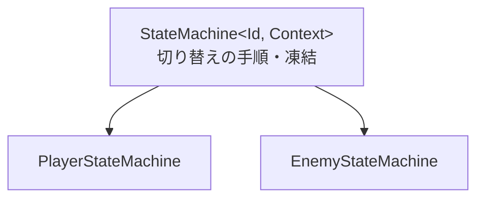
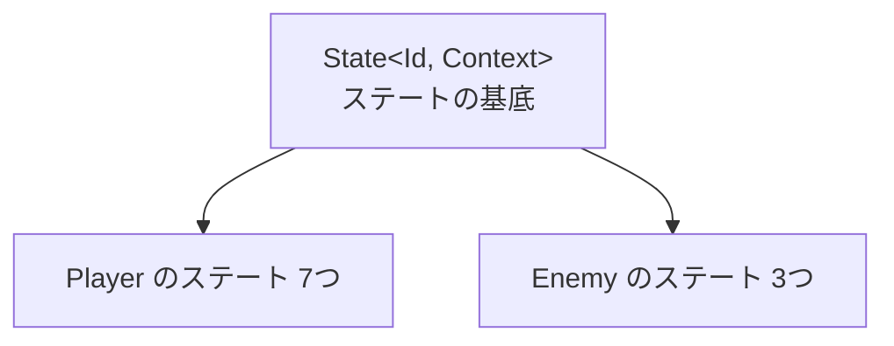

# ステートマシンの設計

作成日: 2026-11-07
対象: `Game/Source/Character/StateMachine/`
経緯: [ステートマシンの経緯](ステートマシンの経緯.md)
手順: [ステートマシンの手順](ステートマシンの手順.md)（何もない状態から、どのファイルに何を足すか）

キャラクターが「今なにをしているか（ステート）」を1つ持ち、条件で切り替える仕組みです。Player と Enemy で同じものを使います。各キャラクターのステートは [プレイヤーのステートの設計](../../プレイヤー/プレイヤーのステート/プレイヤーのステートの設計.md)・[敵のステートの設計](../../敵/敵のステート/敵のステートの設計.md) にあります。

- **切り替えの手順は1か所（テンプレート）に書く。** キャラクターごとに書くのは、ステートの種類（Id）と、ステートが触ってよいもの（Context）だけ。
- **凍結したら、どのステートからでも Frozen へ移す。** これも共通で行う。
- **ステートは持ち主のクラスを知らない。** Context に入れたものだけを触る。

---

## 1. 全体像





| クラス | 役割 | ファイル |
|---|---|---|
| `State<Id, Context>` | ステートの基底。`Enter`・`CheckTransition`・`Update`・`Exit` | [State.h](../../../../Game/Source/Character/StateMachine/State.h) |
| `StateMachine<Id, Context>` | ステートの登録・切り替え・凍結の扱い | [StateMachine.h](../../../../Game/Source/Character/StateMachine/StateMachine.h) |
| `PlayerStateMachine` / `EnemyStateMachine` | 自分のステートを登録する（Player は前処理も1つ持つ） | 各キャラクターの `State/` |

テンプレートなので、型を埋めるたびに別のクラスになる。Player 用と Enemy 用を同じ型の変数では受け取れない。

---

## 2. Id と Context の決まり

| 型 | 持っていなければならないもの |
|---|---|
| `Id`（enum class） | `Frozen`（行動できないときのステート）、`Num`（種類の数。最後に置く） |
| `Context`（struct） | `statusEffects`（`const StatusEffects*`。行動できるかを見る）、`previousId`（`Id`。ひとつ前のステートが入る） |

ないとコンパイルエラーになる。

---

## 3. 実装方法

**登録: ステート自身に番号を聞いて、番号で引く配列に入れる。**

```cpp
template <class T>
void Register()
{
    auto state = std::make_unique<T>();
    const int index = static_cast<int>(state->GetId());
    K2_ASSERT(m_states[index] == nullptr, "同じ番号のステートを2回登録しています。");
    m_states[index] = std::move(state);
}
```

**名前:**

| ジャンル | 名前 | 何のためのもの | 何をするためのもの | どこから来たもの |
|---|---|---|---|---|
| 関数 | `Register()` | ステートを登録するため | ステートを1つ作り、`GetId()` の番号の場所に入れる。同じ番号に2回入れると、エラーで止める | ゲームの [StateMachine.h](../../../../Game/Source/Character/StateMachine/StateMachine.h) の `StateMachine` クラス |
| テンプレートの引数 | `T` | 登録するステートのクラスを、呼ぶ側が決められるようにするため | `Register<クラス>()` と書くと、そのクラスのステートが作られる | ゲームの StateMachine.h（`Register()` のテンプレートの引数） |
| 関数 | `std::make_unique` | ステートを作って `std::unique_ptr` に入れるため | `new` で作ったものを、`std::unique_ptr` に入れて返す | C++ の標準ライブラリ（<memory>。[k2EngineLowPreCompile.h](../../../../k2EngineLow/k2EngineLowPreCompile.h) で読み込み済み） |
| 関数 | `GetId()` | ステート自身に、自分の番号を聞くため | ステートの `Id`（種類の番号）を返す純粋仮想関数 | ゲームの [State.h](../../../../Game/Source/Character/StateMachine/State.h) の `State` クラス |
| メンバー変数 | `m_states` | ステートを番号で引けるようにするため | `Id::Num` 個の `std::unique_ptr` の配列。登録するまでは `nullptr` | ゲームの StateMachine.h の `StateMachine` クラス |
| 関数 | `std::move` | `std::unique_ptr` を配列へ渡すため | `std::unique_ptr` はコピーできないので、持ち主を `m_states` の側へ移す | C++ の標準ライブラリ（<utility>） |

- 番号と中身を取り違えない（`Register(Id::Move, new IdleState)` のような間違いが書けない）。
- `Init` で配列に空きがないかを確かめる。登録し忘れは Debug ビルドの起動時に止まる。
- ステートは最初に全部作って使い回す。切り替えのたびに `new` しない。データは残るので `Enter` で必ず初期化する。

**1フレーム: 遷移を決めてから動く。**

**用語:**

| 用語 | 何のことか |
|---|---|
| 遷移 | ステートが別のステートに切り替わること。「Idle から Move へ遷移する」のように使う |

```cpp
OnBeforeUpdate(m_context, input);                     // キャラクターだけの前処理
const Id next = CanAct() ? m_current->CheckTransition(m_context, input) : Id::Frozen;
if (next != m_current->GetId()) { ChangeState(next, input); }  // Exit → previousId → Enter
m_current->Update(m_context, input, deltaTime);
```

**名前:**

| ジャンル | 名前 | 何のためのもの | 何をするためのもの | どこから来たもの |
|---|---|---|---|---|
| 関数 | `OnBeforeUpdate()` | キャラクターだけの前処理を、遷移の前に挟むため | 遷移を決める前に毎フレーム呼ばれる仮想関数。何もしないのが既定 | ゲームの StateMachine.h の `StateMachine` クラス |
| メンバー変数 | `m_context` | ステートが触ってよいものを持つため | `Context` 型の値。`Init()` で渡されたものを持ち、全部のステートに渡す | ゲームの StateMachine.h の `StateMachine` クラス |
| 引数 | `input` | そのフレームの入力をステートに渡すため | `CharacterInput` の const 参照（[入力の設計](../入力/入力の設計.md)） | ゲームの [CharacterInput.h](../../../../Game/Source/Character/Input/CharacterInput.h) |
| 関数 | `CanAct()` | 凍結中かを調べるため | `statusEffects` が `nullptr` か、`StatusEffects::CanAct()` が true なら true を返す | ゲームの StateMachine.h の `StateMachine` クラス（private） |
| メンバー変数 | `m_current` | 今のステートを覚えるため | 今のステートへのポインター | ゲームの StateMachine.h の `StateMachine` クラス |
| 関数 | `CheckTransition()` | 次にどのステートへ移るかを決めるため | 次のステートの `Id` を返す。移らないなら自分の `GetId()` を返す | ゲームの State.h の `State` クラス |
| 関数 | `ChangeState()` | ステートを切り替えるため | 今のステートの `Exit()`、`previousId` の更新、次のステートの `Enter()` の順に行う | ゲームの StateMachine.h の `StateMachine` クラス（private） |

- 押したフレームに動き始める。1フレームに移るのは1回だけ。
- 凍結だけはステートマシンが先に見る（全ステートに同じ行を書かないため）。

---

## 4. 使い方（新しいキャラクターにステートマシンを持たせる）

1. `〇〇State.h` に、`Id`（enum class）・調整値・`Context` を書き、`using 〇〇State = State<Id, Context>;` を置く。
2. ステートを `〇〇State` の派生として作る（`GetId`・`CheckTransition`・`Update` は必須）。
3. `〇〇StateMachine` を `StateMachine<Id, Context>` の派生として作り、コンストラクタで全部のステートを `Register<クラス>()` する。
4. 持ち主の `OnStart` で Context を作って `Init(context, 最初のId)`、`UpdateAction` で `Update(m_input, deltaTime)` を呼ぶ。

**用語:**

| 用語 | 何のことか |
|---|---|
| コンストラクタ | クラスのインスタンスを作るときに、自動で呼ばれる関数。クラスと同じ名前で、戻り値がない |

例は [EnemyStateMachine.cpp](../../../../Game/Source/Enemy/State/EnemyStateMachine.cpp)（登録だけ、約10行）。

ステートが Context に書いた値を持ち主が読みたいときは、派生クラスに `GetContext()` を使う関数を足す（例: `PlayerStateMachine::IsAttackFire()`。攻撃のステートが立てた「撃つ合図」を Player が読む。[3段攻撃の設計](../../プレイヤー/3段攻撃/3段攻撃の設計.md)）。

---

## 5. 決めたこと

| 決めたこと | 理由 |
|---|---|
| テンプレートにする（Id を int にした基底クラスにしない） | Id や Context を取り違えるとコンパイルエラーになる |
| Id は enum にする（文字列のハッシュにしない） | 書き間違いがコンパイルで、登録し忘れが起動時にわかる。ステートはコードで決めていて、データから決める予定はない。必要になったら Id に int を入れ、配列を map に替えれば済む |
| 登録は各ステートマシンのコンストラクタに書く | ステートの一覧がステートのフォルダで完結する。Player.cpp・Enemy.cpp は増えない |
| テンプレートではない共通の基底（`IStateMachine`）は作らない | 種類を区別せずに受け取る場所がまだない。デバッグ表示を作るときに足す |

**用語:**

| 用語 | 何のことか |
|---|---|
| ハッシュ | 文字列を、決まった長さの数字に変える計算。同じ文字列からは同じ数字が出る。数字で比べると速い |

---

## 6. 既知の課題

- **エラーメッセージが長い。** テンプレートなので、Id や Context の決まりを満たしていないと読みにくいエラーになる。2章の表を先に確かめる。
