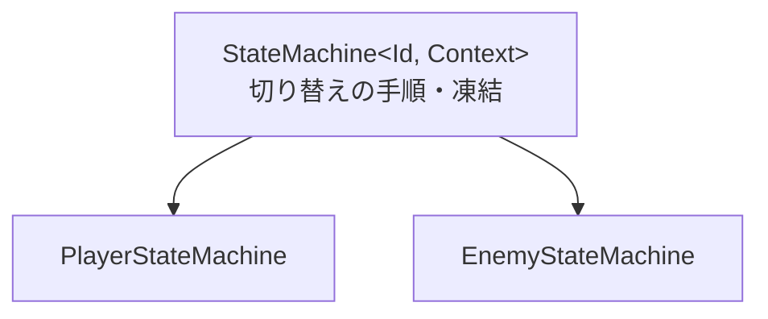
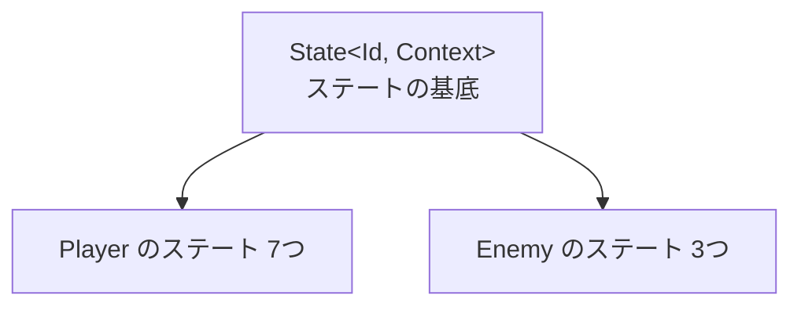

# ステートマシンの設計

作成日: 2026-11-07
対象: `Game/Source/Character/StateMachine/`
経緯: [ステートマシンの経緯](ステートマシンの経緯.md)
手順: [ステートマシンの手順](ステートマシンの手順.md)（何もない状態から、どのファイルに何を足すか）

キャラクターが「今なにをしているか（ステート）」を1つ持ち、条件で切り替える仕組みです。Player と Enemy で同じものを使います。各キャラクターのステートは [プレイヤーのステートの設計](../プレイヤー/プレイヤーのステートの設計.md)・[敵のステートの設計](../敵/敵のステートの設計.md) にあります。

- **切り替えの手順は1か所（テンプレート）に書く。** キャラクターごとに書くのは、ステートの種類（Id）と、ステートが触ってよいもの（Context）だけ。
- **凍結したら、どのステートからでも Frozen へ移す。** これも共通で行う。
- **ステートは持ち主のクラスを知らない。** Context に入れたものだけを触る。

---

## 1. 全体像





| クラス | 役割 | ファイル |
|---|---|---|
| `State<Id, Context>` | ステートの基底。`Enter`・`CheckTransition`・`Update`・`Exit` | [State.h](../../../Game/Source/Character/StateMachine/State.h) |
| `StateMachine<Id, Context>` | ステートの登録・切り替え・凍結の扱い | [StateMachine.h](../../../Game/Source/Character/StateMachine/StateMachine.h) |
| `PlayerStateMachine` / `EnemyStateMachine` | 自分のステートを登録する（Player は前処理も1つ持つ） | 各キャラクターの `State/` |

テンプレートなので、型を埋めるたびに別のクラスになる。Player 用と Enemy 用を同じ型の変数では受け取れない。

---

## 2. Id と Context の決まり

| 型 | 持っていなければならないもの |
|---|---|
| `Id`（enum class） | `Frozen`（行動できないときのステート）、`Num`（種類の数。最後に置く） |
| `Context`（struct） | `statusEffects`（`const StatusEffects*`。行動できるかを見る）、`previousId`（`Id`。ひとつ前のステートが入る） |

ないとコンパイルエラーになる。

---

## 3. 実装方法

**登録: ステート自身に番号を聞いて、番号で引く配列に入れる。**

```cpp
template <class T>
void Register()
{
    auto state = std::make_unique<T>();
    const int index = static_cast<int>(state->GetId());
    K2_ASSERT(m_states[index] == nullptr, "同じ番号のステートを2回登録しています。");
    m_states[index] = std::move(state);
}
```

- 番号と中身を取り違えない（`Register(Id::Move, new IdleState)` のような間違いが書けない）。
- `Init` で配列に空きがないかを確かめる。登録し忘れは Debug ビルドの起動時に止まる。
- ステートは最初に全部作って使い回す。切り替えのたびに `new` しない。データは残るので `Enter` で必ず初期化する。

**1フレーム: 遷移を決めてから動く。**

```cpp
OnBeforeUpdate(m_context, input);                     // キャラクターだけの前処理
const Id next = CanAct() ? m_current->CheckTransition(m_context, input) : Id::Frozen;
if (next != m_current->GetId()) { ChangeState(next, input); }  // Exit → previousId → Enter
m_current->Update(m_context, input, deltaTime);
```

- 押したフレームに動き始める。1フレームに移るのは1回だけ。
- 凍結だけはステートマシンが先に見る（全ステートに同じ行を書かないため）。

---

## 4. 使い方（新しいキャラクターにステートマシンを持たせる）

1. `〇〇State.h` に、`Id`（enum class）・調整値・`Context` を書き、`using 〇〇State = State<Id, Context>;` を置く。
2. ステートを `〇〇State` の派生として作る（`GetId`・`GetName`・`CheckTransition`・`Update` は必須）。
3. `〇〇StateMachine` を `StateMachine<Id, Context>` の派生として作り、コンストラクタで全部のステートを `Register<クラス>()` する。
4. 持ち主の `OnStart` で Context を作って `Init(context, 最初のId)`、`UpdateAction` で `Update(m_input, deltaTime)` を呼ぶ。

例は [EnemyStateMachine.cpp](../../../Game/Source/Enemy/State/EnemyStateMachine.cpp)（登録だけ、約10行）。

---

## 5. 決めたこと

| 決めたこと | 理由 |
|---|---|
| テンプレートにする（Id を int にした基底クラスにしない） | Id や Context を取り違えるとコンパイルエラーになる |
| Id は enum にする（文字列のハッシュにしない） | 書き間違いがコンパイルで、登録し忘れが起動時にわかる。ステートはコードで決めていて、データから決める予定はない。必要になったら Id に int を入れ、配列を map に替えれば済む |
| 登録は各ステートマシンのコンストラクタに書く | ステートの一覧がステートのフォルダで完結する。Player.cpp・Enemy.cpp は増えない |
| テンプレートではない共通の基底（`IStateMachine`）は作らない | 種類を区別せずに受け取る場所がまだない。デバッグ表示を作るときに足す |

---

## 6. 既知の課題

- **エラーメッセージが長い。** テンプレートなので、Id や Context の決まりを満たしていないと読みにくいエラーになる。2章の表を先に確かめる。
