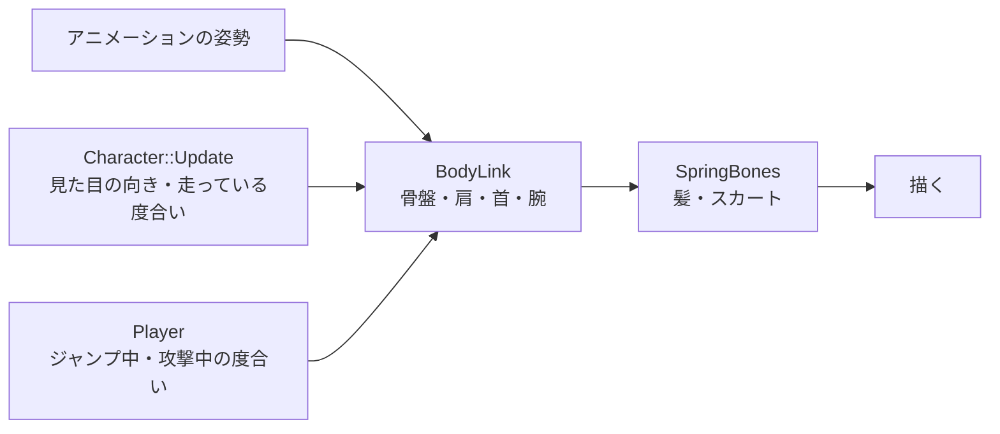

# 体の連動の設計

作成日: 2026-11-15
対象: [BodyLink.h](../../../../Game/Source/Character/Components/BodyLink.h)、[BodyLink.cpp](../../../../Game/Source/Character/Components/BodyLink.cpp)、調整値は [player.json](../../../../Game/Assets/data/player.json) の `bodyLink`
経緯: [体の連動の経緯](体の連動の経緯.md)

走る・歩くときに、脚の動きに合わせて骨盤・背骨・肩・首を連動させ、腕の振りを整える部品です。Character が持ち、Player だけが使います。

- **アニメーションの脚の形から、毎フレーム求めて足す。** 走り・歩きのモーションは横から見た角度だけで作ってあり、背中が固まって見えるため。
- **骨盤を回した分だけ脚を戻す。** 足の位置はほとんど変わらない。
- **走るときだけの調整は、走っている度合いで効かせる。** 立ち止まり・歩きは、アニメーションのまま。ジャンプ中・攻撃中は、腕の調整を外す。

---

## 1. 全体像



`Character::Start` で、骨の調整の層（[骨の調整の層の設計](../骨の調整の層/骨の調整の層の設計.md)）に、体の連動 → 派生クラスの層 → 揺れ物（[揺れ物の設計](../揺れ物/揺れ物の設計.md)）の順に足す。層は、骨のワールド行列を計算したあと（`Skeleton::SetOnPostUpdateWorldMatrix`）に、足した順に呼ばれる。

| 渡すもの | 渡す所 | 使い方 |
|---|---|---|
| 見た目の向き（`SetRotation`） | `Character::Update` の ⑥ | 体の前・左右の向き |
| 走っている度合い（`SetRunWeight`） | 同上。歩く速さで 0、走る速さで 1 | 走るときだけの調整を効かせる強さ |
| ジャンプ中の度合い（`SetJumpWeight`） | Player（[ジャンプの設計](../../プレイヤー/ジャンプ/ジャンプの設計.md)） | 腕の調整を外し、膝をそろえる・腕を上げすぎない・つま先を外へ向ける |
| 攻撃中の度合い（`SetAttackWeight`） | Player（[3段攻撃の設計](../../プレイヤー/3段攻撃/3段攻撃の設計.md)） | 胴をまっすぐに戻すのと腕の調整を外し、顔を前へ向ける |

---

## 2. 実装方法

`Update` は次の順に、骨のワールド行列を書き換える。どれも「関節を中心に、その骨と子孫をまとめて回す」（`RotateAround`）で書く。

| 順 | すること | 書き方 |
|---|---|---|
| 1 | 脚の振りと、浮いている足を読む | 振り = 左右の膝の前後の差 ÷ 太もも2本分（右の膝が前で正）。浮き = 左右の足の高さの差 ÷ 脚の長さの 0.4 倍 |
| 2 | 胴をまっすぐに戻す（`levelTorso`） | 骨盤の線（左右の太ももの付け根）と肩の線（左右の上腕の付け根）を、キャラクターの左右の向きにそろえる。脚と首は回し返す |
| 3 | 頭を前へ・足をそろえる（`symmetrize`） | 走っている度合いで、頭の左右の向きを前へ、左右の足の横の位置を両足の平均へ |
| 4 | 骨盤と肩をひねる | 骨盤を `pelvisYawDeg × 振り` だけ縦の軸まわりに回し（前に出た脚の側の腰が前へ）、脚を回し返す。肩は逆向きに `shoulderYawDeg × 振り`。骨盤からの差を背骨（Spine 0.4・Chest 0.3・UpperChest 0.3）に分ける。首で `1 - headFollow` だけ戻して頭を前に向ける |
| 5 | 骨盤を傾ける | 浮いている脚の側の腰を `pelvisRollDeg × 浮き` だけ下げ、肩は `chestRollRatio` 倍だけ逆へ。頭は水平に戻す |
| 6 | 攻撃中は顔を前へ | 攻撃中の度合いで、頭の左右の向きを前へ |
| 7 | 腕を整える（走るとき） | 上腕の前後の振りを `armSwingScale` 倍にし、前・後ろの最大の角度で抑え、肩・ひじの関節を前後へ回し、上腕を外へ開く |
| 8 | ジャンプ中だけ | 高く上がる腕を抑え、膝をそろえ、つま先の向きを変える |
| 9 | 左右の腕をそろえる（`symmetrize`） | 腕の形を、1歩前（脚の前後が今と逆だったとき）の反対の腕を左右に映した形と、半分ずつ混ぜる |

```cpp
// 4. ひねり
const float pelvisYaw = Math::DegToRad(m_settings.pelvisYawDeg) * swing * yawSign;
RotateAround(skeleton, enBone_Hips, up, pelvisYaw);
RotateAround(skeleton, enBone_UpperLegL, up, -pelvisYaw);  // 脚は戻して足の位置を保つ
RotateAround(skeleton, enBone_UpperLegR, up, -pelvisYaw);
const float shoulderYaw = -Math::DegToRad(m_settings.shoulderYawDeg) * swing * yawSign;
```

**名前:**

| ジャンル | 名前 | 何のためのもの | 何をするためのもの | どこから来たもの |
|---|---|---|---|---|
| 型 | `Math` | 数学の関数をまとめて使うため | `DegToRad()` など、数学の関数を持つクラス | k2EngineLow（エンジン）の [Math.h](../../../../k2EngineLow/math/Math.h)（`nsK2EngineLow`） |
| 関数 | `Math::DegToRad()` | 度を、計算で使うラジアンに直すため | 度（`float`）を受け取り、ラジアンを返す | k2EngineLow（エンジン）の [Math.h](../../../../k2EngineLow/math/Math.h) |
| メンバー変数 | `m_settings` | 調整用の数値を持つため | `BodyLinkSettings`。ひねりの量などが入っている | ゲームの [BodyLink.h](../../../../Game/Source/Character/Components/BodyLink.h) の `BodyLink` クラス |
| メンバー変数 | `pelvisYawDeg`・`shoulderYawDeg` | ひねりの量を調整するため | 脚の振りが 1 のときの、骨盤のひねりと、肩のひねり（度）。数値は「4. 調整用の数値」の表にある | ゲームの [BodyLink.h](../../../../Game/Source/Character/Components/BodyLink.h) の `BodyLinkSettings` |
| 変数 | `swing` | 脚の振りを、-1〜1 の値で持つため | 右の膝が前に出ているほど正の値（2 本の太もも分で割って、-1〜1 にそろえてある）。この抜き出しの前で求めている | ゲームの [BodyLink.cpp](../../../../Game/Source/Character/Components/BodyLink.cpp) の `Update()` の中 |
| 変数 | `yawSign` | 回す向きを、骨の位置から決めるため | `1` か `-1`。正に回すと、骨が前へ動くかで決める（`SignToward()` の結果） | ゲームの [BodyLink.cpp](../../../../Game/Source/Character/Components/BodyLink.cpp) の `Update()` の中 |
| 変数 | `up` | 回す軸（縦の軸）を持つため | 上向きの `Vector3`（`Vector3::AxisY`） | ゲームの [BodyLink.cpp](../../../../Game/Source/Character/Components/BodyLink.cpp) の `Update()` の中 |
| 関数 | `RotateAround()` | 関節を中心に、骨と子孫をまとめて回すため | 骨・軸・角度（ラジアン）を受け取り、その骨の位置を中心に、骨と子孫のワールド行列を回す | ゲームの [BodyLink.cpp](../../../../Game/Source/Character/Components/BodyLink.cpp) の `BodyLink` クラス |
| 引数 | `skeleton` | 回す骨を持つスケルトンを渡すため | モデルのスケルトン（`Skeleton&`） | k2EngineLow（エンジン）の [Skeleton.h](../../../../k2EngineLow/graphics/Skeleton.h) |
| 値 | `enBone_Hips`・`enBone_UpperLegL`・`enBone_UpperLegR` | 回す骨を、名前で指すため | 骨盤・左の太もも・右の太ももを表す `EnBone` の値 | ゲームの [BodyLink.h](../../../../Game/Source/Character/Components/BodyLink.h) の `BodyLink` クラスの `EnBone` |

**回す向きは骨の位置で決める。** `SignToward` で「この軸まわりに正に回すと、骨がこの向きへ動くか」を確かめて符号を決める。モデルの骨の軸の向きに頼らない。

**腕の振りの抑え方。** 上腕の真下からの角度が、最大の角度の半分まではそのまま、そこから最大に近づくほど進まなくなり、超えない（`LimitArmSwing`）。

**左右の腕のそろえ方。** 腕の向きを、キャラクターから見た座標で毎フレーム記録し（`m_armHistory`）、脚の前後が入れ替わる間隔から1歩の時間を求める。1歩前の記録の反対の腕を左右に映し、今の腕と半分ずつ混ぜる。走りは1歩ごとに左右が入れ替わるので、左右の腕が同じ形で振れる。そろえる強さは、急に変わらないように少しずつ上げ下げする。

---

## 3. 使い方

| やりたいこと | 書き方 |
|---|---|
| ひねり・傾きの量を変える | player.json の `bodyLink` |
| 走っているときの腕の振りを変える | `armSwingScale`・`armFrontMaxDeg`・`armBackMaxDeg`・`shoulderJointOffsetDeg`・`elbowJointOffsetDeg`・`upperArmSpreadDeg` |
| 新しい動きで、連動を外したい | Player から、その動きの間の度合いを渡し、`Update` で外す処理に掛ける（攻撃中の `m_attackWeight` と同じ形） |
| ほかのキャラクターにも使う | `MakeConfig` で `config.bodyLink` を作る。骨の名前は VRoid の `J_Bip_*` を前提にしている |

**用語:**

| 用語 | 何のことか |
|---|---|
| VRoid・`J_Bip_*` | VRoid は、キャラクターのモデルを作るソフト。そのモデルの体の骨の名前は `J_Bip_` で始まる（例: `J_Bip_C_Hips`） |

---

## 4. 調整用の数値（player.json の `bodyLink`）

| 名前 | 値 | 意味 |
|---|---|---|
| `pelvisYawDeg` | 18° | 脚の振りが 1 のときの骨盤のひねり（走りで振りは 0.5〜0.6 くらい） |
| `shoulderYawDeg` | 22° | 肩のひねり（骨盤と逆向き） |
| `headFollow` | 0.2 | 頭が肩のひねりについていく割合。0 で前を向いたまま |
| `pelvisRollDeg` | 5° | 浮いている脚の側の骨盤が下がる角度 |
| `chestRollRatio` | 0.5 | 肩を骨盤と逆へ傾ける割合 |
| `levelTorso` | true | アニメーションの胴の傾き・ひねりを、まっすぐに戻してから足す |
| `armFrontMaxDeg` / `armBackMaxDeg` | 60° / 40° | 上腕を前まで出す・後ろまで引く角度（真下を 0°） |
| `armSwingScale` | 0.56 | 走るときの上腕の前後の振りの倍率 |
| `shoulderJointOffsetDeg` / `elbowJointOffsetDeg` | -28° / 22° | 走るときに肩・ひじの関節を前後へ回す角度（正で前） |
| `upperArmSpreadDeg` | 11° | 走るときに上腕を外へ開く角度 |
| `symmetrize` | true | 走るときに左右の腕・足をそろえ、頭を前に向ける |
| `jumpCloseLegs` / `jumpLeftArmMaxRaiseDeg` / `jumpFootYawDegL`・`R` | true / 68° / 24°・0° | ジャンプ中の調整（[ジャンプの設計](../../プレイヤー/ジャンプ/ジャンプの設計.md)） |

---

## 5. 決めたこと

| 決めたこと | 理由 |
|---|---|
| モーションを作り直さず、ゲームで足す | 走り・ダッシュ・止まるは、もとのクリップの1コマの胴の姿勢を全コマに残していて、骨盤が約 10° 傾き、約 14° ひねれたままだった。脚の形から毎フレーム求めれば、どのクリップにも同じように効く |
| 腕の後ろへの振りを 40° までにする | 走りのクリップは上腕が後ろへ最大約 100° まで振れていた。原神は 40° くらい |
| 腕の4つの値を、開発用の画面で決めた | 原神の走りと見比べながら、スライダーで決めた（窓は #123 で消した） |
| 左右をそろえる | 走りのクリップは、左腕が右腕より約 11° 外へ開いて約 9° 後ろへ振れ、右足だけが内へ入り、頭が約 5° 横を向いていた |

---

## 6. 既知の課題

- 骨の名前は VRoid の `J_Bip_*` を前提にしている。1本でも見つからない骨があれば、`Init` で何もしない形になる。
- 脚の前後の入れ替わりを見のがすと、1歩の時間を長く見積もる。今の1歩より長すぎる間隔は使わず、2回続いたら歩幅が変わったとみなして使う。
