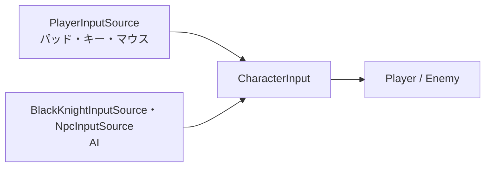

# 入力の設計

作成日: 2026-11-05（2026-11-07 に AI を [NPCのAIの設計](../NPCのAI/NPCのAIの設計.md) へ分けた）
対象: `Game/Source/Character/Input/`（`CharacterInput.h`、`PlayerInputSource.*`）、エンジンの `k2EngineLow/HID/GamePad.*`（パッドとキーボードを合わせるところ）
経緯: [入力の経緯](入力の経緯.md)
手順: [入力の手順](入力の手順.md)（何もない状態から、どのファイルに何を足すか）

プレイヤーの操作と NPC の AI が、同じ形の入力（`CharacterInput`）を作る仕組みです。

- **デバイスを読むのは入力元だけ。** キャラクターは `CharacterInput` を受け取って動くだけ。
- **AI も同じ形の入力を作る。** 入力元を差し替えれば、敵を手で操作したり、プレイヤーを AI で動かしたりできる。

---

## 1. 全体像



入力元が知ってよいのは `InputSourceContext` だけ。

| `InputSourceContext` の項目 | 型 | 一言 |
|---|---|---|
| `self` | `const IGameObject*` | 操作対象。AI が自分を狙わないように使う |
| `faction` | `Faction` | 陣営（[陣営と当たり判定の設計](../陣営と当たり判定/陣営と当たり判定の設計.md)） |
| `position` | `Vector3` | 足元の位置 |
| `forward` | `Vector3` | 正面の向き |
| `deltaTime` | `float` | 前のフレームからの経過秒数 |
| `isFirstPerson` | `bool` | 一人称視点か。プレイヤーの照準をカメラに合わせるのに使う |
| `action1UseCount` | `int` | `Action1` のスキルを撃った回数。一人称で右手と左手から交互に撃つのに使う |
| `isThirdPersonAim` | `bool` | 三人称で溜め撃ちを構えているか。true なら画面の真ん中へ撃つ |
| `chargePosition` | `Vector3` | 溜めている火の玉を置く位置（両手の前） |
| `castForward` | `float` | スキルを撃つ位置を前に出す距離 |

| `CharacterInput` | 意味 |
|---|---|
| `moveDirection` | 移動したい方向（[**ワールド座標**](../../../用語集.md#左右と向き)の XZ）。長さ 0〜1 が速さの割合 |
| `lookDirection` | 向きたい方向。毎フレーム、ゼロでなければその方向を向く。ゼロなら、移動しているときだけ移動方向を向く（止まっていれば向きを変えない） |
| `attackDirection` | 攻撃を始めた瞬間（1回だけ）に、その方向を向く（水平）。プレイヤーはカメラの向き。ゼロなら、攻撃を始めても向きを変えない |
| `isRun` | 走る（プレイヤーではダッシュボタンを押しっぱなし） |
| `jump` / `dash` | ボタン（`ButtonState`: 押した瞬間・押している・離した瞬間） |
| `actions` | 何に使うかを知らないボタン（`ActionButton::Action1`〜`Action3`。Player は `Action3` を読まない）。`input.Action(ActionButton::Action1)` で読む。どのボタンで何を使うかは `SkillController` の登録で決まる（[スキルの設計](../../スキル/スキルの設計.md)） |
| `hasAim` / `aimOrigin` / `aimDirection` | 照準。false ならキャラクターの正面へ撃つ |
| `aimOffsets` | `hasAim` のとき、ボタンごとに撃つ位置をずらす量。`input.AimOffset(ActionButton::Action1)` で読む。一人称で、氷魔法を右手・左手から、炎魔法を画面の下から撃つ |

---

## 2. プレイヤーの操作（遊ぶ人向け）

コード: [PlayerInputSource.cpp](../../../../Game/Source/Character/Input/PlayerInputSource.cpp)

| 操作 | キーボード・マウス | パッド |
|---|---|---|
| 移動 | WASD | 左スティック |
| ダッシュ / 走る | 左Shift（押すとダッシュ、押しっぱなしで走る） | X |
| ジャンプ | スペース（J でも可） | A |
| [`Action1`](../../../用語集.md#キャラクター)（Player は氷魔法） | マウス左 / I | Y |
| [`Action2`](../../../用語集.md#キャラクター)（Player は炎魔法） | マウス右 / 8 | RB2（右トリガー） |
| 一人称の出入り | V / K | B |
| 三人称の寄りと俯瞰の切り替え（[カメラのモードの設計](../../カメラ/カメラのモード/カメラのモードの設計.md)） | B | なし |

エンジンは、パッドのボタンにキーボードのキーも割り当てている（A=J、X=L、Y=I、RB2=8 など）。パッドが繋がっていてもいなくても両方の入力を合わせるので、コントローラーを繋いだままキーボードとマウスで操作できる。

F1 で開発用の画面（ImGui）を出している間は、マウスのクリックを ImGui に使うので、`Action1`・`Action2` をマウスでは押せない。

---

## 3. 実装方法

**`ButtonState` は前のフレームの「押している」と比べるだけ。** 入力元には前のフレームの値が入ったままの `CharacterInput` が渡るので、毎フレーム `Update(押しているか)` を呼べば瞬間が決まる。

```cpp
isTrigger = isPressNow && !isPress;
isRelease = !isPressNow && isPress;
isPress   = isPressNow;
```

**名前:**

| ジャンル | 名前 | 何のためのもの | 何をするためのもの | どこから来たもの |
|---|---|---|---|---|
| 関数 | `CanUseMouse()` | ゲームの窓が前面か、開発用の画面を出していないかを見るため | 両方を満たすときだけ true。マウスのボタンを読む前に使う | ゲームの [PlayerInputSource.cpp](../../../../Game/Source/Character/Input/PlayerInputSource.cpp) の `PlayerInputSource` クラス（private） |
| 値 | `FIRST_PERSON_HAND_OFFSET` | 一人称で氷魔法を撃つ手の位置を決めるため | カメラから見て右 16・下 15 の `Vector3`。左手で撃つときは x の向きを逆にする | ゲームの PlayerInputSource.cpp（名前のない `namespace` の中） |
| 値 | `FIRST_PERSON_CHARGE_OFFSET` | 一人称で炎魔法を溜める位置を決めるため | カメラから見て下 44 の `Vector3`。火の玉で前が見えなくならないように下げる | ゲームの PlayerInputSource.cpp（名前のない `namespace` の中） |
| メンバー変数 | `isTrigger` | ボタンを押した瞬間を持つため | そのフレームで押されたときだけ true | ゲームの [CharacterInput.h](../../../../Game/Source/Character/Input/CharacterInput.h) の `ButtonState` |
| 引数 | `isPressNow` | そのフレームに押しているかを渡すため | `ButtonState::Update()` に渡す、今押しているか | ゲームの CharacterInput.h の `ButtonState::Update()` |
| メンバー変数 | `isPress` | ボタンを押している間を持つため | 押している間は true。前のフレームの値としても使う | ゲームの CharacterInput.h の `ButtonState` |
| メンバー変数 | `isRelease` | ボタンを離した瞬間を持つため | そのフレームで離されたときだけ true | ゲームの CharacterInput.h の `ButtonState` |

**スティックはカメラの水平な前・右でワールドの向きにする。** カメラが下を向いていても速さが落ちない。

**ボタンはパッドとキーボードを OR でまとめる。** ダッシュと走るは、同じボタンの「押した瞬間」と「押している」を別のメンバーに入れるだけ。

- マウスのボタンは、ゲームのウィンドウが前面で、開発用の画面（ImGui）を出していないときだけ見る（`CanUseMouse`）。
- 一人称のときだけ `hasAim = true` にして、照準をカメラの位置と向きにする。`Action1` は撃った回数が偶数なら右手、奇数なら左手の前へ、`Action2` は画面の下へ、撃つ位置をずらす（`FIRST_PERSON_HAND_OFFSET`・`FIRST_PERSON_CHARGE_OFFSET`）。

**パッドとキーボードは、エンジンの `GamePad::Update` で合わせる。** 流れは次の4つ。
1. 繋がっているパッドを探す。
2. 前のフレームの「押している」（`m_press`）を `prevPress` に取っておく。
3. パッドを読む（繋がっていなければ `m_press` を 0 にする）。
4. 繋がっていてもいなくても `UpdateKeyboard` でキーボードを重ね、合わせたあとの「押している」と `prevPress` を比べて、押した瞬間（`m_trigger`）を出す。

```cpp
// GamePad::Update
int prevPress[enButtonNum];
memcpy(prevPress, m_press, sizeof(prevPress));  // パッドを読む前に取っておく
// ……パッドを読む（繋がっていなければ m_press を 0 にする）……
UpdateKeyboard(prevPress);

// UpdateKeyboard: 割り当てたキーが押されていれば m_press を 1 にし、最後に押した瞬間を出す
m_trigger[i] = (m_press[i] != 0 && prevPress[i] == 0) ? 1 : 0;
```

**名前:**

| ジャンル | 名前 | 何のためのもの | 何をするためのもの | どこから来たもの |
|---|---|---|---|---|
| 関数 | `UpdateKeyboard()` | キーボードの入力をパッドの値に重ねるため | 割り当てたキーが押されていれば `m_press` を 1 にし、スティックをキーの値で置き換える。最後に押した瞬間を出す | k2EngineLow（エンジン）の [GamePad.h](../../../../k2EngineLow/HID/GamePad.h) の `GamePad` クラス（private） |
| 変数 | `prevPress` | 前のフレームの「押している」を取っておくため | ボタンごとの、パッドを読む前の `m_press` のコピー | k2EngineLow（エンジン）の `GamePad.cpp` の `GamePad::Update()` の中 |
| 値 | `enButtonNum` | ボタンの数を、配列の大きさにするため | `EnButton` の最後の値。ボタンの数（16）と同じ | k2EngineLow（エンジン）の [GamePad.h](../../../../k2EngineLow/HID/GamePad.h) |
| 関数 | `memcpy` | 配列をそのまま写すため | 指した場所から、指定したバイト数を別の場所へ写す | C++ の標準ライブラリ（<cstring>） |
| メンバー変数 | `m_press` | ボタンを押しているかを持つため | ボタンごとの、押している間は 0 以外になる値の配列 | k2EngineLow（エンジン）の GamePad.h の `GamePad` クラス |

スティックは、キー（WASD・矢印）が押されているときだけ、パッドのスティックの値をキーの値で置き換える。押していなければパッドの値のまま。

---

## 4. 使い方

| やりたいこと | 書き方 |
|---|---|
| 入力元を差し替える | そのキャラクターの `GetDefaultInputSource()` が返す入力元を替える（例: 黒騎士を `PlayerInputSource` で手で動かす。黒騎士の AI は [黒騎士のAIの設計](../../敵/黒騎士のAI/黒騎士のAIの設計.md)。魔法を撃つ敵などに使える汎用の AI は [NPCのAIの設計](../NPCのAI/NPCのAIの設計.md)） |
| ボタンを足す | `CharacterInput` に `ButtonState` を足し、`PlayerInputSource::Update` で `Update(押しているか)` を呼ぶ。AI にも押させるなら、その AI の入力元（`BlackKnightInputSource`・`NpcInputSource` など）も。2章の表に1行足す |
| 記録した入力を再生する | `IInputSource` を継承し、`Update` で記録した `CharacterInput` を1フレームずつ渡す |

---

## 5. 決めたこと

| 決めたこと | 理由 |
|---|---|
| ボタンを3つの状態で持つ | 長押しの魔法を足しても入力元を変えずに済む |
| 値だけの構造体にする | 画面に表示したり、記録して再生したりしやすい |
| パッドが繋がっていてもキーボードを読む | コントローラーを繋いだまま、キーボードとマウスでも操作したい。どちらか片方に切り替える仕組みは要らない |

---

## 6. 既知の課題

- **ウィンドウを前に出すクリックでも撃つ。** 裏にあるウィンドウを左クリックで前に出すと、1発出る。
- **入力の記録・再生はまだない。**
