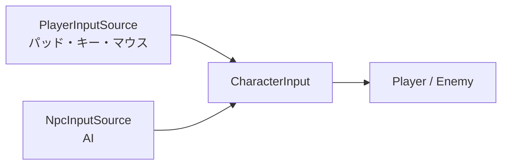

# 入力の設計

作成日: 2026-11-05（2026-11-07 に AI を [NPCのAIの設計](NPCのAIの設計.md) へ分けた）
対象: `Game/Source/Character/Input/`（`CharacterInput.h`、`PlayerInputSource.*`）
経緯: [入力の経緯](入力の経緯.md)

プレイヤーの操作と NPC の AI が、同じ形の入力（`CharacterInput`）を作る仕組みです。

- **デバイスを読むのは入力元だけ。** キャラクターは `CharacterInput` を受け取って動くだけ。
- **AI も同じ形の入力を作る。** 入力元を差し替えれば、敵を手で操作したり、プレイヤーを AI で動かしたりできる。

---

## 1. 全体像



入力元が知ってよいのは `InputSourceContext`（自分・陣営・位置・正面・経過時間・一人称か）だけ。

| `CharacterInput` | 意味 |
|---|---|
| `moveDirection` | 移動したい方向（**ワールド**の XZ）。長さ 0〜1 が速さの割合 |
| `lookDirection` | 向きたい方向。ゼロなら移動方向を向く |
| `isRun` | 走る（プレイヤーではダッシュボタンを押しっぱなし） |
| `jump` / `dash` / `fire` / `subFire` | ボタン（`ButtonState`: 押した瞬間・押している・離した瞬間） |
| `magicSwitch` | -1: 前の魔法へ、+1: 次の魔法へ |
| `hasAim` / `aimOrigin` / `aimDirection` | 照準。false ならキャラクターの正面へ撃つ |

---

## 2. 操作の割り当て

コード: [PlayerInputSource.cpp](../../../Game/Source/Character/Input/PlayerInputSource.cpp)

| 操作 | キーボード・マウス | パッド |
|---|---|---|
| 移動 | WASD | 左スティック |
| ダッシュ / 走る | 左Shift（押すとダッシュ、押しっぱなしで走る） | X |
| ジャンプ | スペース（J でも可） | A |
| 発射（氷魔法） | マウス左 / I | Y |
| サブの発射（炎魔法） | マウス右 / 8 | RB2 |
| 魔法の切り替え | Q / E | LB / RB |
| 視点の切り替え | K | B |

パッドがないときは、エンジンがパッドのボタンをキーボードで代用する（A=J、X=L、Y=I、RB2=8 など）。

---

## 3. 実装方法

**`ButtonState` は前のフレームの「押している」と比べるだけ。** 入力元には前のフレームの値が入ったままの `CharacterInput` が渡るので、毎フレーム `Update(押しているか)` を呼べば瞬間が決まる。

```cpp
isTrigger = isPressNow && !isPress;
isRelease = !isPressNow && isPress;
isPress   = isPressNow;
```

**スティックはカメラの水平な前・右でワールドの向きにする。** カメラが下を向いていても速さが落ちない。

**ボタンはパッドとキーボードを OR でまとめる。** ダッシュと走るは、同じボタンの「押した瞬間」と「押している」を別のメンバーに入れるだけ。

- マウスのボタンは、ゲームのウィンドウが前面のときだけ見る。
- 一人称のときだけ `hasAim = true` にして、照準をカメラの位置と向きにする。

---

## 4. 使い方

| やりたいこと | 書き方 |
|---|---|
| 入力元を差し替える | `player->SetInputSource(&src);`（`nullptr` で既定に戻る） |
| ボタンを足す | `CharacterInput` に `ButtonState` を足し、`PlayerInputSource::Update` で `Update(押しているか)` を呼ぶ。AI にも押させるなら `NpcInputSource` も。2章の表に1行足す |
| 記録した入力を再生する | `IInputSource` を継承し、`Update` で記録した `CharacterInput` を1フレームずつ渡す |

---

## 5. 決めたこと

| 決めたこと | 理由 |
|---|---|
| ボタンを3つの状態で持つ | 長押しの魔法を足しても入力元を変えずに済む |
| 値だけの構造体にする | 画面に表示したり、記録して再生したりしやすい |

---

## 6. 既知の課題

- **ウィンドウを前に出すクリックでも撃つ。** 裏にあるウィンドウを左クリックで前に出すと、1発出る。
- **入力の記録・再生はまだない。**
