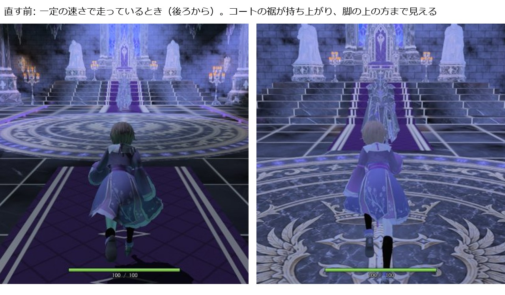
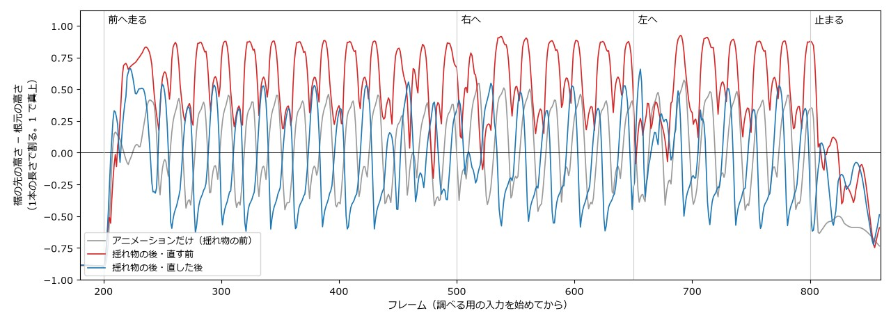
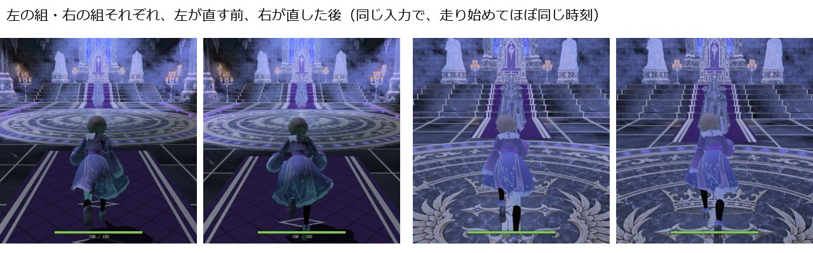

# 揺れ物の経緯

作成日: 2026-11-22
対象: [SpringBones.h](../../../../Game/Source/Character/Components/SpringBones.h)、[SpringBones.cpp](../../../../Game/Source/Character/Components/SpringBones.cpp)
設計: [揺れ物の設計](揺れ物の設計.md)

揺れ物（髪・スカート）を何のために・どう変えてきたかの記録です。作ったときと、ジャンプ中のスカートの抑え方の記録は、[移動の経緯](../移動/移動の経緯.md)・[ジャンプの経緯](../../プレイヤー/ジャンプ/ジャンプの経緯.md) にあります。

---

## 2026-11-22 走るとスカートがめくれるのを直す

### 1. 現状の問題

三人称で走っていると、スカートとコートの裾がめくれ上がっていた。止まらずに一定の速さ（毎秒 960cm）で走っているだけでも起きた。



### 2. ソースコードの問題箇所

**どの段階でずれているかを測った。** 調べる用のコードで、走らせ続けたまま（前へ 300フレーム → 右へ 150 → 左へ 150 → 止まる）、毎フレーム、次の3つの段階で裾の形を書き出した。

- 体の連動の前（アニメーションだけ）
- 揺れ物の前（体の連動の後）
- 揺れ物の後

測る量は、裾1本ごとの「先の高さ − 根元の高さ」を1本の長さで割ったものの、いちばん大きい値。1 で裾が真上を向き、0 で水平、-1 で真下。

| 段階 | 走っている間の中央 | 最大 |
|---|---|---|
| アニメーションだけ | 0.05 | 0.57 |
| 揺れ物の前（体の連動の後） | 0.04 | 0.57 |
| 揺れ物の後 | **0.59** | **0.92** |



- **ずれている段階**: 揺れ物（`SpringBones`）だった。
- アニメーションだけでも、裾は1歩ごとに水平近くまで上がる。走りのクリップで、裾の骨が太ももに振られているため。
- 揺れ物の後（赤）は、それよりいつも上にいて、1歩ごとに 0.9 近くまで上がっていた。

問題は、揺れの先の位置をワールドの位置のまま持ち越していたことだった。

```cpp
// SpringBones::Update（直す前）
const Vector3 animVelocity = (animTail - joint.prevAnimTail) * (1.0f / deltaTime);
const float omega = Math::PI2 * joint.group->frequency;
const Vector3 acceleration =
    (animTail - joint.tail) * (omega * omega) +
    (animVelocity - joint.velocity) * (2.0f * joint.group->dampingRatio * omega);
```

- `joint.tail`（揺れている先の位置）は、前のフレームのワールドの位置のまま残る。
- そのため、アニメーションの中で骨が動いた分（太ももに振られる裾）も、全部「先が遅れた」ことになる。
- 裾のばねは1秒に 2.5〜3回の速さで、1歩ごとに大きく振られる動きに付いていけない。
- 遅れは骨1本ごとの上限（コートの裾 35°、スカート 25°）に当たる。
- 根元の骨が上限まで曲がると、その先の骨は曲がったあとの向きからさらに上限まで曲がる。こうして根元から先へ積み重なって、真上近くまで向いていた。

**切り分けで試したこと**

| 試したこと | 走っている間の中央 | わかったこと |
|---|---|---|
| 直す前 | 0.59 | |
| 揺れの先を、骨それぞれのアニメーションでの動きに付いていかせる（今回の直し） | -0.04 | アニメーションだけ（0.03）とほぼ同じになった |

最初に、腰の骨だけを基準にして揺れを計算する形を試した。しかし、その測り方には間違いがあった。調べる用の入力が、ダッシュのボタンを1フレームに2回（離す → 押す）更新しており、毎フレーム「押した瞬間」になってダッシュが出続けていた。前に報告した「走りのクリップの腰の揺さぶりが原因」という見立ても、この入力で取った数値に基づいていた。

入力を「押しっぱなし」（普通の走り）に直してから測り直したのが、上の表とグラフ。腰だけを基準にする形は、ダッシュが出続ける入力で 0.46 → 0.45 とほとんど下がらなかった。そのため、各骨の動きに付いていかせる形に広げた。

### 3. 直し方

骨ごとのばねを動かす前に、前のフレームの揺れの先の位置・速さを、**その骨がアニメーションで動いた分だけ運ぶ**。

- キャラクターそのものの動き（モデルのワールド行列の変化。走り出す・止まる・向きを変える）は運ばない。これだけが遅れになって揺れる。
- アニメーションの中の動き（走りの腰の揺さぶり、太ももに振られる裾）には、そのまま付いていく。

これが、実際の服の揺れ方に近い。服は体と一緒に動き、体全体が速さや向きを変えたときに遅れる。

運ぶ割合は `animInertia`（0〜1）で変えられるようにした。

- 0: アニメーションに完全に付いていく。今の値。
- 1: 前の作りと同じ計算になる。

### 4. ソースコードの直し

[SpringBones.cpp](../../../../Game/Source/Character/Components/SpringBones.cpp) に `CarryWithAnimation` を足し、`Update` の骨ごとのばねの前で呼ぶ。

```diff
 void SpringBones::Update(Skeleton& skeleton)
 {
 	const float deltaTime = min(g_gameTime->GetFrameDeltaTime(), MAX_DELTA_TIME);
 	if (deltaTime <= 0.0f) {
 		return;
 	}
+	CarryWithAnimation(skeleton);
 
 	for (Joint& joint : m_joints) {
```

```diff
+void SpringBones::CarryWithAnimation(Skeleton& skeleton)
+{
+	if (m_modelRender == nullptr) {
+		return;
+	}
+	const Matrix& modelWorld = m_modelRender->GetModel().GetWorldMatrix();
+	Matrix modelBack;  // キャラクターが動いた分を戻す（今のモデル → 前のモデル）。
+	modelBack.Inverse(modelWorld);
+	modelBack = modelBack * m_prevModelWorld;
+	const float follow = 1.0f - max(0.0f, min(1.0f, m_settings.animInertia));
+	for (Joint& joint : m_joints) {
+		const Matrix& animWorld = skeleton.GetBone(joint.boneNo)->GetWorldMatrix();
+		if (!m_isFirstFrame) {
+			Matrix carry;
+			carry.Inverse(joint.prevAnimWorld);
+			carry = carry * animWorld * modelBack;
+			Vector3 tail = joint.tail;
+			carry.Apply(tail);
+			joint.tail += (tail - joint.tail) * follow;
+			// prevAnimTail も同じように運ぶ。velocity は Apply3x3 で向きだけ運ぶ。
+		}
+		joint.prevAnimWorld = animWorld;
+	}
+	m_prevModelWorld = modelWorld;
+}
```

| ジャンル | 名前 | 何のためのもの | 何をするためのもの | どこから来たもの |
|---|---|---|---|---|
| 関数 | `GetModel().GetWorldMatrix()` | キャラクターの位置・向きを読むため | モデルのワールド行列を返す。`ModelRender::Update` で骨の行列より先に更新されるので、揺れ物の中で今のフレームの値が読める | k2Engine（エンジン）の [ModelRender.h](../../../../k2Engine/graphics/ModelRender.h)・k2EngineLow の [Model.h](../../../../k2EngineLow/graphics/Model.h) |
| 関数 | `Matrix::Inverse` | 「前へ戻す」行列を作るため | 渡した行列の逆行列を自分に入れる | k2EngineLow（エンジン）の [Matrix.h](../../../../k2EngineLow/math/Matrix.h) |
| 関数 | `Matrix::Apply`・`Apply3x3` | 先の位置・速さを動かすため | `Apply` は位置に行列を掛ける。`Apply3x3` は移動を除いて掛ける | k2EngineLow（エンジン）の [Matrix.h](../../../../k2EngineLow/math/Matrix.h) |

`carry` は「前のフレームの骨から見た位置 → 今のフレームの骨から見た位置」に運び、最後にキャラクターが動いた分（今のモデル → 前のモデル）を戻す。骨がモデルに対して動いていなければ、何もしない行列になる。

- [SpringBones.h](../../../../Game/Source/Character/Components/SpringBones.h): `Joint` に `prevAnimWorld`、`SpringBonesSettings` に `animInertia`、`SpringBones` に `m_modelRender`・`m_prevModelWorld` を足した。
- [PlayerConfig.cpp](../../../../Game/Source/Player/PlayerConfig.cpp): `springBone.animInertia` を読む。
- [player.json](../../../../Game/Assets/data/player.json): `"animInertia": 0.0` を足した。



### 5. どう確かめたか

- **数値で比べた。**
  - 測り方: 同じ調べる用の入力で走らせ、裾の先の高さ（2の表と同じもの）を比べた。
  - 一定の速さで走っている間（中央 / 最大）:
    - 直す前: 0.59 / 0.92
    - 直した後: -0.04 / 0.66
    - アニメーションだけ: 0.03 / 0.57
  - 直した後も最大 0.66 になるのは、走り出しのダッシュの直後と、右から左へ向きを変えたときだけだった。キャラクターそのものの動きでの揺れなので、残した。
- **キャラクターの動きが原因かを確かめた。** キャラクターが動いた分も運ぶように一時的に変えると、揺れ物の後の値がアニメーションだけと同じになった。残った揺れは、キャラクターそのものの動きから来ていることを確かめた。この変更は残していない。
- **画像で比べた。** ゲームの窓だけを撮り、直す前と直した後で、走り始めてほぼ同じ時刻の画像を並べた（4の画像）。
- Debug / x64 でビルドが通ることを確かめた。

## 2026-11-23 走るとめくれる・裾がチラチラするのを、真下からの角度で抑えて直す

### 1. 現状の問題

2026-11-22 の直しのあとも、走るとスカートがめくれた。さらに、裾のひらひらがチラチラして見えるようになった。

### 2. ソースコードの問題箇所

- **めくれ**は揺れ物の前の段（モデルとアニメーション）で起きていた。Blender で走りのクリップ（Run.fbx）を読むと、スカートの付け根の骨の一部が腰ではなく太もも・すねの骨の子になっていた。クリップにスカートのキーはなく、前のスカートは太ももと一緒に上がり、Run の 13コマ目（左ももが一番上がる）で真下から 108° まで上がる。ゲームの中でも、揺れ物の前で裾の先が水平よりかなり上にある時間が約3割あった。
- **チラチラ**は 2026-11-22 の直し（`animInertia` 0）で増えていた。裾1本ずつの、1フレームで向きが変わる量の最大は次のとおり。

| 段階 | 1フレームの最大の変化 |
|---|---|
| アニメーションだけ | 29° |
| 揺れ物の後（11-22 の直しの前） | 48° |
| 揺れ物の後（11-22 の直しの後） | 130° |

  大きく跳ぶのは、ダッシュの蹴り出し（1フレームで 0cm → 46cm 進む）など、キャラクターが急に動き出すときだった。揺れがキャラクターそのものの動きだけから来るので、急に速さが変わると曲がる上限まで一気に振られ、フレームごとに反対側へばたついた。

### 3. 直し方

1. `animInertia` を 1 に戻し、チラチラを 11-22 の前の程度に戻す。
2. ジャンプ中だけだった「真下から何度より上へ上げない」を、地面にいる間も行う（`maxAngleFromDownDeg`）。65° ではまだめくれて見えたので 50° にした。
3. 50° に下げると、上げた太ももがスカートを突き抜けた。下げたあとに先の1点を脚から押し出すと、先が太ももの下側へ回ったときに下側へ押し出してしまったため、付け根から先までの線分で脚に当たるかを調べ（`HitsLegs`）、当たるときは下げる前の向きへ半分ずつ戻して、当たらない一番低い向きにした。

### 4. ソースコードの直し

- [SpringBones.cpp](../../../../Game/Source/Character/Components/SpringBones.cpp): 真下からの角度を抑える処理を、ジャンプ中に限らず行うようにし、線分と線分の距離（`SegmentDistance`）と `HitsLegs` を足した。
- [SpringBones.h](../../../../Game/Source/Character/Components/SpringBones.h)・[PlayerConfig.cpp](../../../../Game/Source/Player/PlayerConfig.cpp)・[player.json](../../../../Game/Assets/data/player.json): `maxAngleFromDownDeg`（50）を足し、`animInertia` を 1 にした。

### 5. どう確かめたか

- 走りのクリップを Blender で読み、太ももとスカートの骨の角度をコマごとに出した（2の 108°）。
- ゲームの中で裾1本ずつの向きを毎フレーム記録し、1フレームの変化を段階ごとに比べた（2の表）。
- ユーザーがゲームで走り、めくれ・チラチラ・足の突き抜けがないことを確かめた。比較画像はまだ撮っていない。
- Debug / x64 でビルドが通ることを確かめた。
