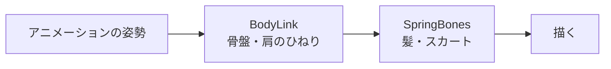

# 揺れ物の設計

作成日: 2026-11-15
対象: [SpringBones.h](../../../../Game/Source/Character/Components/SpringBones.h)、[SpringBones.cpp](../../../../Game/Source/Character/Components/SpringBones.cpp)
経緯: [揺れ物の経緯](揺れ物の経緯.md)、[移動の経緯](../移動/移動の経緯.md)、ジャンプ中のスカートは [ジャンプの経緯](../../プレイヤー/ジャンプ/ジャンプの経緯.md)

髪・スカートなどの揺れ物の骨を、体の動きから遅れて付いてくるように揺らす部品です。Character が持ち、Player だけが使います。

- **アニメーションの形を正とし、そこへ[ばね](../../../用語集.md#動きを近づける)で引き戻す。** 体が動くと先が遅れ、止まると揺り返す。
- **揺らすのは、キャラクターそのものの動き（走り出す・止まる・向きを変える）だけ。** アニメーションの中での骨の動き（走りの腰の揺さぶり・太ももに振られる裾）には、そのまま付いていく。
- **揺らすのは骨の先の位置。** 骨の長さを保ち、アニメーションの形から曲がりすぎないように抑える。
- **ゲームの中で揺らす。** 揺れ物の骨（VRoid のモデルの [`J_Sec_*`](../../../用語集.md#左右と向き)）はモーションに入っていない。

VRoid は、キャラクターのモデルを作るソフトです。ばね・減衰・臨界減衰は [用語集](../../../用語集.md#動きを近づける) を見てください。

---

## 1. 全体像



`Character::Start` で、骨の調整の層（[骨の調整の層の設計](../骨の調整の層/骨の調整の層の設計.md)）に、体の連動（[体の連動の設計](../体の連動/体の連動の設計.md)）→ 派生クラスの層 → 揺れ物の順に足す。揺れ物は、連動した体の動きに遅れて付いてくる。揺れ物は体の動きで変わるので、焼き込まない層にしてある。

| まとまり | 骨の名前に入る文字 | 揺れの速さ（`frequency`） | 止まりやすさ（`dampingRatio`） | 曲がる上限（`maxAngleDeg`） | ジャンプ中に上げない（`noLiftInJump`） |
|---|---|---|---|---|---|
| 髪 | `Hair` | 3.5 回/秒 | 0.6 | 20° | |
| コートのすそ | `CoatSkirt` | 2.5 | 0.4 | 35° | ○ |
| スカート | `Skirt` | 3.0 | 0.5 | 25° | ○ |
| 胸 | `Bust` | 4.0 | 0.25 | 8° | |

骨の名前にいくつも当てはまるときは、長い方のまとまりにする（`CoatSkirt` は `Skirt` より先）。

---

## 2. 実装方法

**骨を集める。** `Init` で、名前が `J_Sec_` で始まり、まとまりの文字が入り、子のある骨を集め、根元からの段数で並べる（親の揺れを子に伝えてから子を揺らす）。先の位置は最初の子の骨の位置。`legRadius` が 0 より大きければ、太もも・すねの骨の組を[カプセル](../../../用語集.md#キャラクター)にする（骨の始まりと終わりの線分のまわりに半径 `legRadius` をとった形。脚の太さを表し、先がこの中に入らないよう押し出す）。

**骨ごとに、先の位置をばねで動かす。** 親の揺れを反映したあとの、アニメーションどおりの先の位置へ引き戻す。減衰は、先の速さ（`velocity`）とアニメーションどおりの先の速さ（`animVelocity`）の差に掛ける。体ごと同じ速さで走っている間は差が 0 になるので、揺れ物だけが遅れたままにならない。

この式は、[ばね＋減衰](../../../用語集.md#動きを近づける)の式（加速 = ω²×（目標との差）＋ 2×減衰比×ω×（速さの差））そのままで、目標がアニメーションどおりの先、「速さの差」が上の差にあたる。`dampingRatio` が 1 なら[臨界減衰](../../../用語集.md#動きを近づける)で、揺り返さずに戻る。1 より小さいほど何度も揺れる。

```cpp
// SpringBones::Update
const float omega = Math::PI2 * joint.group->frequency;
const Vector3 acceleration =
    (animTail - joint.tail) * (omega * omega) +
    (animVelocity - joint.velocity) * (2.0f * joint.group->dampingRatio * omega);
joint.velocity += acceleration * deltaTime;
```

**名前:**

| ジャンル | 名前 | 何のためのもの | 何をするためのもの | どこから来たもの |
|---|---|---|---|---|
| 変数 | `joint` | 骨1本ぶんの揺れの状態を使うため | 骨の番号・先の位置・先の速さ・属するまとまり（`group`）を持つ `Joint` | ゲームの [SpringBones.h](../../../../Game/Source/Character/Components/SpringBones.h) の `SpringBones` クラスの `Joint` |
| 値 | `Math::PI2` | 1周ぶんの角度（2π）を使うため | `2π`（ラジアン）。これに、揺れの速さ（回/秒）を掛けると、角速度になる | k2EngineLow（エンジン）の [Math.h](../../../../k2EngineLow/math/Math.h) |
| 変数 | `omega` | ばねの強さを、式に使うため | 角速度（ラジアン/秒）。大きいほど硬く、すぐ引き戻す | ゲームの [SpringBones.cpp](../../../../Game/Source/Character/Components/SpringBones.cpp) の `Update()` の中 |
| メンバー変数 | `frequency`・`dampingRatio` | 揺れ方を、まとまりごとに調整するため | 揺れの速さ（1秒に何回揺れるか）と、揺れの止まりやすさ。`group` から読む | ゲームの [SpringBones.h](../../../../Game/Source/Character/Components/SpringBones.h) の `SpringBoneGroupSettings` |
| 変数 | `animTail` | アニメーションどおりの先の位置へ引き戻すため | 親の揺れを反映したあとの、アニメーションどおりの先の位置（ワールド）。この抜き出しの前で求めている | ゲームの [SpringBones.cpp](../../../../Game/Source/Character/Components/SpringBones.cpp) の `Update()` の中 |
| メンバー変数 | `tail` | 揺れている先の位置を持つため | 揺れている先の位置（ワールド）。毎フレーム更新する | ゲームの [SpringBones.h](../../../../Game/Source/Character/Components/SpringBones.h) の `Joint` |
| 変数 | `animVelocity` | アニメーションどおりの先の速さとの差に、減衰を掛けるため | アニメーションどおりの先の速さ。前のフレームとの位置の差を時間で割ったもの | ゲームの [SpringBones.cpp](../../../../Game/Source/Character/Components/SpringBones.cpp) の `Update()` の中 |
| メンバー変数 | `velocity` | 先の速さを、次のフレームへ持ち越すため | 揺れている先の速さ | ゲームの [SpringBones.h](../../../../Game/Source/Character/Components/SpringBones.h) の `Joint` |
| 変数 | `acceleration` | ばねと減衰が先に与える加速を持つため | `Vector3`。引き戻す力（位置の差 × `omega²`）と、減衰（速さの差 × `2 × dampingRatio × omega`）の合計 | ゲームの [SpringBones.cpp](../../../../Game/Source/Character/Components/SpringBones.cpp) の `Update()` の中 |
| 変数 | `deltaTime` | 1フレームの時間を使うため | 前のフレームからの時間（秒）。1/20 秒までにしてある | ゲームの [SpringBones.cpp](../../../../Game/Source/Character/Components/SpringBones.cpp) の `Update()` の中 |

**アニメーションでの骨の動きに付いていかせることもできる（今は使っていない、`animInertia` 1）。** 骨ごとのばねの前に `CarryWithAnimation` で、前のフレームの先の位置・速さを、その骨がアニメーションで動いた分だけ運ぶ。キャラクターが動いた分（モデルのワールド行列の変化）は運ばないので、それだけが遅れ（揺れ）になる。

```cpp
// SpringBones::CarryWithAnimation（骨を揺らす前、アニメーションと体の連動だけの姿勢で呼ぶ）
Matrix modelBack;                       // 今のモデル → 前のモデル（キャラクターが動いた分を戻す）
modelBack.Inverse(modelWorld);
modelBack = modelBack * m_prevModelWorld;
// 骨ごと: 前のフレームの骨 → 今の骨 へ運び、キャラクターが動いた分は戻す
Matrix carry;
carry.Inverse(joint.prevAnimWorld);
carry = carry * animWorld * modelBack;
Vector3 tail = joint.tail;
carry.Apply(tail);
joint.tail += (tail - joint.tail) * follow;   // follow = 1 - animInertia
```

骨がモデルに対して止まっていれば `carry` は何もしない行列になり、前の作りと同じ計算になる。先の位置と同じように、前のフレームのアニメーションどおりの先の位置（`prevAnimTail`）と速さ（`velocity`、`Apply3x3` で向きだけ）も運ぶ。

**名前:**

| ジャンル | 名前 | 何のためのもの | 何をするためのもの | どこから来たもの |
|---|---|---|---|---|
| 関数 | `CarryWithAnimation` | アニメーションでの骨の動きを、揺れにしないため | 揺れの先・速さを、骨がアニメーションで動いた分だけ運ぶ | ゲームの [SpringBones.cpp](../../../../Game/Source/Character/Components/SpringBones.cpp) |
| 変数 | `modelWorld` | キャラクターの位置・向きを使うため | モデルのワールド行列。`ModelRender::GetModel().GetWorldMatrix()` で読む。骨の行列より先に更新されている | k2Engine（エンジン）の [ModelRender.h](../../../../k2Engine/graphics/ModelRender.h)・[Model.h](../../../../k2EngineLow/graphics/Model.h) |
| 関数 | `Matrix::Inverse` | 「戻す」行列を作るため | 渡した行列の逆行列を、自分に入れる | k2EngineLow（エンジン）の [Matrix.h](../../../../k2EngineLow/math/Matrix.h) |
| メンバー変数 | `prevAnimWorld` | 前のフレームの骨の位置・向きと比べるため | 前のフレームの、揺らす前の骨のワールド行列 | ゲームの [SpringBones.h](../../../../Game/Source/Character/Components/SpringBones.h) の `Joint` |
| 関数 | `Matrix::Apply`・`Apply3x3` | 位置・速さを行列で動かすため | `Apply` は位置に行列を掛ける。`Apply3x3` は回転・拡大だけを掛ける（向きの量に使う） | k2EngineLow（エンジン）の [Matrix.h](../../../../k2EngineLow/math/Matrix.h) |
| 変数 | `follow` | アニメーションの動きを、どれだけ揺れにしないかを決めるため | `1 - animInertia`。1 で全部運ぶ | ゲームの [SpringBones.cpp](../../../../Game/Source/Character/Components/SpringBones.cpp) |

そのあと、次の順に抑える。

1. 骨の長さをそろえ、アニメーションの形から `maxAngleDeg` より曲がらないようにする。
2. ジャンプ中（`noLiftInJump` のまとまり）は、揺れでアニメーションの形より上へ上がらないようにする。
3. 脚のカプセルから `legRadius` 押し出す（アニメーションの形がもとから近いときは、その近さまでは許す）。
4. `noLiftInJump` のまとまり（スカート・コートの裾）は、真下から `maxAngleFromDownDeg`（ジャンプ中は `jumpMaxAngleFromDownDeg`）より上へ上げない（スカートの中が見えないように）。下げた裾の付け根から先までの線分が太もも・すねを横切るときは、下げる前の向きへ半分ずつ戻して（`LEG_SEARCH_STEPS` 回）、脚に当たらない一番低い向きにする（`HitsLegs`）。上げた太ももに当たる裾は、太ももに乗る形になる。
5. 骨とその子孫のワールド行列を、根元を中心に回して、先を求めた位置へ向ける（`PoseLayers::RotateBoneTree`）。

**時間を抑える。** 1フレームの時間は 1/20 秒までにする（止まった直後などに暴れないように）。先が 200 より動いたらワープとみなし、揺れをなくしてアニメーションの形に戻す。

**ジャンプ中の度合いは持ち主が渡す。** Player が `Character::SetJumpWeight()` で 0〜1 を渡す（[ジャンプの設計](../../プレイヤー/ジャンプ/ジャンプの設計.md)）。

---

## 3. 使い方

| やりたいこと | 書き方 |
|---|---|
| 揺れ方を変える | player.json の `springBone.groups` の値 |
| 揺らす骨を足す（新しい服） | `groups` に、骨の名前に入る文字（`match`）と値を足す |
| ほかのキャラクターに揺れ物を付ける | `MakeConfig` で `config.springBones` を作る。骨の名前の頭が `J_Sec_` でなければ `bonePrefix` を変える |

---

## 4. 調整用の数値（player.json の `springBone`）

| 名前 | 値 | 意味 |
|---|---|---|
| `enabled` | true | 使うか |
| `legRadius` | 8 | 太もも・すねの太さ。揺れ物の先がこれより脚に近づかない |
| `jumpMaxAngleFromDownDeg` | 50° | ジャンプ中、スカートを真下からこれより上へ上げない |
| `maxAngleFromDownDeg` | 50° | 地面にいる間も、スカート・コートの裾を真下からこれより上へ上げない（太ももに当たる裾は太ももの表面まで上がる） |
| `animInertia` | 1 | アニメーションでの骨の動きのうち、揺れとして残す割合（0〜1）。0 でアニメーションに完全に付いていき、1 で全部揺れになる |
| `groups.<名前>.frequency` | 1章の表 | 1秒に何回揺れるか。大きいほど硬い |
| `groups.<名前>.dampingRatio` | 1章の表 | 1 で揺り返さずに戻る。小さいほど何度も揺れる |
| `groups.<名前>.maxAngleDeg` | 1章の表 | アニメーションの形から曲がってよい角度 |
| `groups.<名前>.noLiftInJump` | 1章の表 | ジャンプ中に上へ上げないか |

---

## 5. 決めたこと

| 決めたこと | 理由 |
|---|---|
| 髪は硬め（3.5・0.6・20°） | 2.5・0.35・40° では揺れすぎた |
| アニメーションでの骨の動きも揺れにする（`animInertia` 1） | 0 にすると、揺れがキャラクターそのものの動きだけから来るので、ダッシュの蹴り出しのように急に速さが変わると裾が1フレームで最大 130° 振られ、チラチラして見えた（[揺れ物の経緯](揺れ物の経緯.md)） |
| 走るときのめくれは、真下からの角度で抑える（`maxAngleFromDownDeg` 50°） | スカートの付け根の骨の一部は太もも・すねの子で、走りのクリップで太ももと一緒に真下から 108° まで上がる。揺れ物の前の段で起きているので、ばねの調整では直らない。65° ではまだ上がって見えた |
| 下げた裾が脚を横切るときは、線分で調べて戻す | 先の1点だけを押し出すと、先が太ももの下側へ回ったときに下側へ押し出し、足がスカートを突き抜けた |

---

## 6. 既知の課題

- 太ももを大きく上げたとき、太ももに当たる裾は太ももの表面まで上がるので、そこはめくれて見えることがある。
