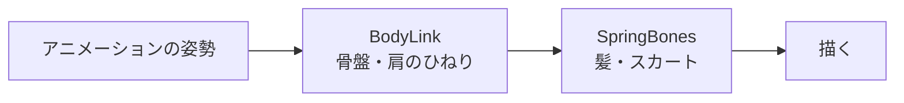

# 揺れ物の設計

作成日: 2026-11-15
対象: [SpringBones.h](../../../Game/Source/Character/Components/SpringBones.h)、[SpringBones.cpp](../../../Game/Source/Character/Components/SpringBones.cpp)
経緯: [移動の経緯](移動の経緯.md)、ジャンプ中のスカートは [ジャンプの経緯](../プレイヤー/ジャンプの経緯.md)

髪・スカートなどの揺れ物の骨を、体の動きから遅れて付いてくるように揺らす部品です。Character が持ち、Player だけが使います。

- **アニメーションの形を正とし、そこへばねで引き戻す。** 体が動くと先が遅れ、止まると揺り返す。
- **揺らすのは骨の先の位置。** 骨の長さを保ち、アニメーションの形から曲がりすぎないように抑える。
- **ゲームの中で揺らす。** 揺れ物の骨（VRoid の `J_Sec_*`）はモーションに入っていない。

---

## 1. 全体像



`Character::Start` で、骨のワールド行列を計算したあと（`Skeleton::SetOnPostUpdateWorldMatrix`）に、体の連動（[体の連動の設計](体の連動の設計.md)）→ 揺れ物の順に呼ぶ。揺れ物は、連動した体の動きに遅れて付いてくる。

| まとまり | 骨の名前に入る文字 | 揺れの速さ | 止まりやすさ | 曲がる上限 | ジャンプ中に上げない |
|---|---|---|---|---|---|
| 髪 | `Hair` | 3.5 回/秒 | 0.6 | 20° | |
| コートのすそ | `CoatSkirt` | 2.5 | 0.4 | 35° | ○ |
| スカート | `Skirt` | 3.0 | 0.5 | 25° | ○ |
| 胸 | `Bust` | 4.0 | 0.25 | 8° | |

骨の名前にいくつも当てはまるときは、長い方のまとまりにする（`CoatSkirt` は `Skirt` より先）。

---

## 2. 実装方法

**骨を集める。** `Init` で、名前が `J_Sec_` で始まり、まとまりの文字が入り、子のある骨を集め、根元からの段数で並べる（親の揺れを子に伝えてから子を揺らす）。先の位置は最初の子の骨の位置。`legRadius` が 0 より大きければ、太もも・すねの骨の組をカプセルにする。

**骨ごとに、先の位置をばねで動かす。** 親の揺れを反映したあとの、アニメーションどおりの先の位置へ引き戻す。減衰は、アニメーションどおりの先の速さとの差に掛ける（同じ速さで走っている間は遅れたままにならない）。

```cpp
// SpringBones::Update
const float omega = Math::PI2 * joint.group->frequency;
const Vector3 acceleration =
    (animTail - joint.tail) * (omega * omega) +
    (animVelocity - joint.velocity) * (2.0f * joint.group->dampingRatio * omega);
joint.velocity += acceleration * deltaTime;
```

そのあと、次の順に抑える。

1. 骨の長さをそろえ、アニメーションの形から `maxAngleDeg` より曲がらないようにする。
2. ジャンプ中（`noLiftInJump` のまとまり）は、揺れでアニメーションの形より上へ上がらないようにする。
3. 脚のカプセルから `legRadius` 押し出す（アニメーションの形がもとから近いときは、その近さまでは許す）。
4. ジャンプ中は、真下から `jumpMaxAngleFromDownDeg` より上へ上げない（スカートの中が見えないように）。
5. 骨とその子孫のワールド行列を、根元を中心に回して、先を求めた位置へ向ける（`RotateBoneTree`）。

**時間を抑える。** 1フレームの時間は 1/20 秒までにする（止まった直後などに暴れないように）。先が 200 より動いたらワープとみなし、揺れをなくしてアニメーションの形に戻す。

**ジャンプ中の度合いは持ち主が渡す。** Player が `Character::SetJumpWeight()` で 0〜1 を渡す（[ジャンプの設計](../プレイヤー/ジャンプの設計.md)）。

---

## 3. 使い方

| やりたいこと | 書き方 |
|---|---|
| 揺れ方を変える | player.json の `springBone.groups` の値 |
| 揺らす骨を足す（新しい服） | `groups` に、骨の名前に入る文字（`match`）と値を足す |
| ほかのキャラクターに揺れ物を付ける | `MakeConfig` で `config.springBones` を作る。骨の名前の頭が `J_Sec_` でなければ `bonePrefix` を変える |

---

## 4. 調整用の数値（player.json の `springBone`）

| 名前 | 値 | 意味 |
|---|---|---|
| `enabled` | true | 使うか |
| `legRadius` | 8 | 太もも・すねの太さ。揺れ物の先がこれより脚に近づかない |
| `jumpMaxAngleFromDownDeg` | 50° | ジャンプ中、スカートを真下からこれより上へ上げない |
| `groups.<名前>.frequency` | 1章の表 | 1秒に何回揺れるか。大きいほど硬い |
| `groups.<名前>.dampingRatio` | 1章の表 | 1 で揺り返さずに戻る。小さいほど何度も揺れる |
| `groups.<名前>.maxAngleDeg` | 1章の表 | アニメーションの形から曲がってよい角度 |
| `groups.<名前>.noLiftInJump` | 1章の表 | ジャンプ中に上へ上げないか |

---

## 5. 決めたこと

| 決めたこと | 理由 |
|---|---|
| 髪は硬め（3.5・0.6・20°） | 2.5・0.35・40° では揺れすぎた |
