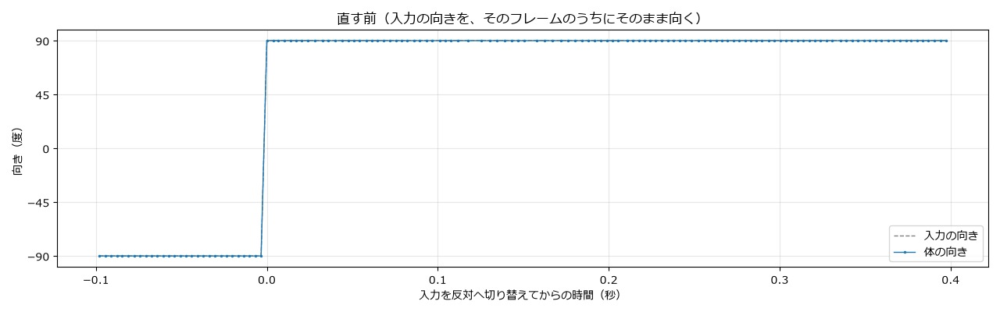
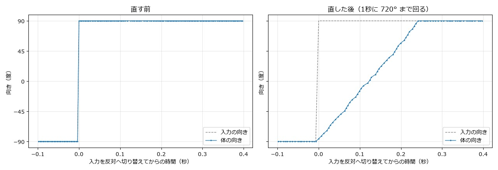
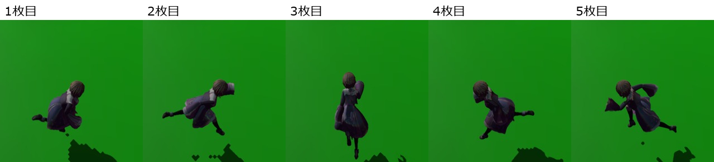

# 方向転換の経緯

設計: [方向転換の設計](方向転換の設計.md)
手順: [方向転換の手順](方向転換の手順.md)

何をして、なぜ今の形になったかの記録です。日付ごとに書き足します。

---

## 2026-11-09 方向転換で、ぱっと向かずにぐるっと回るようにした

### 1. 現状の問題

「方向転換したときにぐるっと回るのではなく、ぱっと向いてしまう」とのことだった。

撮影用の版（1秒ごとにカメラの右 ↔ 左へ走る入力にし、プレイヤーの向きをフレームごとにファイルへ書く）を作業用フォルダーでビルドし、裏で起動して測った。入力を反対へ切り替えたフレームのうちに、体の向きが −90° から 90° へ変わっていた。



直す前の版は、撮った窓の多くにプレイヤーが映らず、回る所の画面は撮れなかった（向きが一瞬で変わるので、間のコマもない）。そのため、向きのグラフを載せる。

### 2. ソースコードの問題箇所

[CharacterMover.cpp](../../../Game/Source/Character/Components/CharacterMover.cpp) の `MoveByInput()` は、毎フレーム、入力の向きへ `FaceTo()` で向けていた。`FaceTo()` は、渡された向きをそのまま `m_rotation` に入れる。

```cpp
else if (horizontalVelocity.LengthSq() > MOVE_DEAD_ZONE_SQ) {
    FaceTo(horizontalVelocity);   // ← 入力の向きを、そのフレームのうちにそのまま向く
}
...
void CharacterMover::FaceTo(const Vector3& direction)
{
    ...
    m_rotation.SetRotationYFromDirectionXZ(horizontal);
}
```

ダッシュも、始めたとき（[PlayerDashState.cpp](../../../Game/Source/Player/State/PlayerDashState.cpp) の `Begin()`）に `FaceTo()` で一瞬で向いていた。

### 3. 直し方

2つの案から、A にした。

| 案 | 内容 | 選んだか |
|---|---|---|
| A | 体の向きだけを、1秒に何度までと決めた速さで目標へ回す。進む向きは入力のとおりにすぐ変わる | 選んだ |
| B | A に加えて、進む向きも体の向きと一緒に回す（曲がるときに弧を描く） | 操作が重くなるので選ばなかった |

- `CharacterMover` に、決まった速さで回る `TurnTo()` を足し、`MoveByInput()` とダッシュはそれで回る。
- 回る速さは `CharacterMoveSettings::turnSpeedDeg`。プレイヤーは `player.json` から 720°/秒（180° の切り返しで約0.25秒）を読む。敵は 0 のままで、今までどおり一瞬で向く。
- ダッシュは「回して」とのことで、始めたときの `FaceTo()` をやめ、毎フレーム `TurnTo()` で回る。

### 4. ソースコードの直し

```diff
 	else if (horizontalVelocity.LengthSq() > MOVE_DEAD_ZONE_SQ) {
-		FaceTo(horizontalVelocity);
+		TurnTo(horizontalVelocity, deltaTime);
 	}
```

```diff
 		m_duration = context.settings.dashDistance / context.settings.dashSpeed;
-		context.mover->FaceTo(m_direction);
 	}
 ...
+	context.mover->TurnTo(m_direction, deltaTime);
 	context.mover->Move(velocity, deltaTime);
```

`TurnTo()` の中身と、`player.json` に足した `move.turnSpeedDeg` は、[手順](方向転換の手順.md) の手順2・5にある。

直す前（左）は入力を切り替えたフレームに向きが飛び、直した後（右）は約0.25秒かけて −90° から 90° へ回る。



直した後に、右へ走っていて左へ切り替えたところを、撮った順に並べた。体が左向き → 後ろ向き（カメラの反対） → 右向きへ回っている。



### 5. どう確かめたか

- 向きは、撮影用の版（入力を1秒ごとに右 ↔ 左、左Shift 押しっぱなしにし、`MoveByInput()` でプレイヤーの向きと入力の向きをファイルに書く）を、直す前（main）と直した後でそれぞれビルドし、ゲームを最小化・非アクティブ・透明・いちばん奥で起動して、起動から20秒後に終了させて測った。撮影用の変更はコミットしていない。
- 直した後は、180° の切り返しで 0.24〜0.25秒かけて回った（1秒に 720°）。
- [手順](方向転換の手順.md) は、作業用フォルダーで main を取り出し、手順1〜5を1つずつ当てて、そのたびに Game.sln を Release x64 でビルドして、すべて通った。最後は TurnSmooth ブランチのコードと差がなくなった。
- ダッシュを横や後ろへ出したときの見た目と、手で操作したときの感じは、ユーザーに確かめてもらう。
