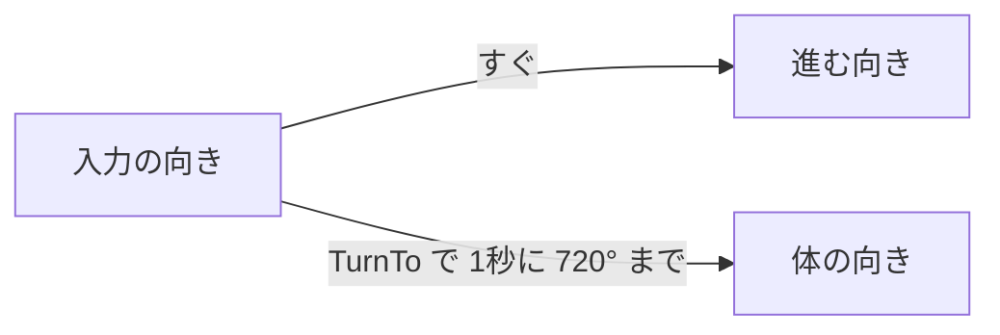

# 方向転換の設計

作成日: 2026-11-09
対象: [CharacterMover.h](../../../Game/Source/Character/Components/CharacterMover.h)、[CharacterMover.cpp](../../../Game/Source/Character/Components/CharacterMover.cpp)、[PlayerDashState.cpp](../../../Game/Source/Player/State/PlayerDashState.cpp)
経緯: [方向転換の経緯](方向転換の経緯.md)
手順: [方向転換の手順](方向転換の手順.md)（0〜22 を済ませた形から、どのファイルに何を足すか）

入力の向きが変わったとき、キャラクターの体を一瞬で向けずに、決まった速さで回して向ける仕組みです。[移動の設計](移動の設計.md) の `CharacterMover` に入っています。

- **体の向きだけが、決まった速さで追いつく。** 進む向きは、今までどおり入力のとおりにすぐ変わる。
- **回る速さは `turnSpeedDeg`（1秒に何度まで回るか）。** 0 なら今までどおり一瞬で向く。プレイヤーは 720、敵は 0。

---

## 1. 全体像

| 関数 | 何をするか | 使っているところ |
|---|---|---|
| `TurnTo(direction, deltaTime)` | `direction` へ、1フレームで `turnSpeedDeg × deltaTime` までだけ回す | `MoveByInput()`（歩く・走る・空中、敵の `Update()`）、ダッシュの `Update()` |
| `FaceTo(direction)` | 一瞬で `direction` を向く | `TurnTo()`（速さが 0 のとき） |



---

## 2. 実装方法

向きはクォータニオン（`m_rotation`）で持っていますが、回るのは Y軸まわりだけなので、角度にして計算します。

```cpp
const Vector3 forward = GetForward();
const float currentYaw = atan2f(forward.x, forward.z);        // 今の向き
const float targetYaw = atan2f(horizontal.x, horizontal.z);   // 目標の向き
float diff = targetYaw - currentYaw;                          // -180〜180° に直して、近い方へ回る
...
const float maxStep = Math::DegToRad(m_settings.turnSpeedDeg) * deltaTime;
if (fabsf(diff) <= maxStep) {
    m_rotation.SetRotationY(targetYaw);                       // 回り切れるなら、ぴったり合わせる
    return;
}
m_rotation.SetRotationY(currentYaw + (diff > 0.0f ? maxStep : -maxStep));
```

- 角度は `SetRotationYFromDirectionXZ()` と同じ `atan2f(x, z)` で測るので、`FaceTo()` で向けた向きとずれません。
- 目標の向きを覚えておかず、毎フレーム「今の向き」と「そのフレームの入力の向き」から回します。入力が途中で変わっても、そのフレームの入力へ回ります。
- ちょうど 180° の切り返しは、差が 180° か −180° かで回る向きが決まります（どちらへ回っても同じ時間）。
- ダッシュは、始めたときに一瞬で向いていたのをやめ、毎フレーム `TurnTo(m_direction)` で回ります。進む向き（`m_direction`）は最初からダッシュの向きです。

---

## 3. 使い方

回る速さを変えるときは、[player.json](../../../Game/Assets/data/player.json) の `move.turnSpeedDeg` を変えます。敵を回らせたいときは、[Enemy.cpp](../../../Game/Source/Enemy/Enemy.cpp) の `CharacterMoveSettings` に `turnSpeedDeg` を入れます。

一瞬で向けたい所（リスポーンなど）では、`TurnTo()` でなく `FaceTo()` を呼びます。

---

## 4. 調整用の数値

| 設定 | 値 | 意味 |
|---|---|---|
| `move.turnSpeedDeg`（プレイヤー） | 720 | 1秒に 720° まで回る。180° の切り返しで約0.25秒、90° で約0.13秒 |
| `turnSpeedDeg`（敵） | 0 | 一瞬で向く（`CharacterMoveSettings` の最初の値） |

---

## 5. 決めたこと

| 決めたこと | 理由 |
|---|---|
| 体の向きだけを回し、進む向きは入力のとおりにする | 進む向きも一緒に回すと、曲がるときに弧を描いて操作が重くなる。体の向きだけなら、操作の反応は今までと同じ |
| ダッシュも回す | 「回して」とのことだった。進む向きは最初からダッシュの向きなので、操作の反応は変わらない |
| 敵は 0（一瞬で向く）のままにする | 敵のふるまいを変えないため |
| `FaceTo()` を残す | 一瞬で向けたい所（速さが 0 のときなど）で使う |

---

## 6. 既知の課題

- **回っている途中に止まると、その時の体の向きへ滑って止まる。** 止まる（[走りから止まる設計](../プレイヤー/走りから止まる設計.md)）は、止め始めた時の体の向きへ進むため。0.25秒より短い間に切り返して止めたときだけ起きる。
- **ダッシュを横や後ろへ出すと、出だしの約0.1〜0.25秒は、体の向きと進む向きがずれる。**

---

## 関連するページ

[移動の設計](移動の設計.md) ／ [ダッシュの設計](../プレイヤー/ダッシュの設計.md) ／ [プレイヤーの調整値の設計](../プレイヤー/プレイヤーの調整値の設計.md)
