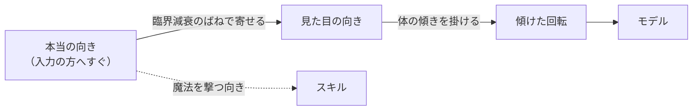

# 移動の設計

作成日: 2026-11-07（[キャラクターの構成](../キャラクターの構成/キャラクターの構成.md) から分けた。2026-11-15 に、見た目の向き・加速と減速を書き足した）
対象: [CharacterMover.h](../../../../Game/Source/Character/Components/CharacterMover.h)、[CharacterMover.cpp](../../../../Game/Source/Character/Components/CharacterMover.cpp)
経緯: [移動の経緯](移動の経緯.md)
手順: [移動の手順](移動の手順.md)（何もない状態から、どのファイルに何を足すか。手順書で作るのは、歩く・走る・跳ぶ・向くまで。見た目の向きをばねで回す処理と、加速・減速は、まだ手順書に入っていない）

`CharacterController` を包み、移動・ジャンプ・重力・向きを処理する部品です。Player と Enemy が持ちます。

- **使い方は2通り。** 入力どおりに動かす（Enemy）か、1つずつ操作する（Player のステート）。
- **1フレームに `Move` 系を1回だけ呼ぶ。** 重力はそこでかかる。
- **向きは2つ持つ。** 本当の向き（移動・魔法を撃つ向き）は入力の方へすぐ変え、見た目の向き（モデルの向き）だけ、[ばね](../../../用語集.md#動きを近づける)でなめらかに回す。

向きは、次の順に回転が重なってモデルに渡ります。



---

## 1. 関数

| 使い方 | 関数 | 使っているところ |
|---|---|---|
| 入力どおりに動かす | `Update(input)` | Enemy |
| 水平の速度で動かす | `Move(velocity)` | ダッシュ・止まる・凍結・黒騎士の攻撃 |
| 入力の方向へ動かして向く | `MoveByInput(input, speed)` | 歩く・走る・空中 |
| 跳ぶ / 向く / 止める | `Jump(speed)` / `FaceTo(dir)` / `Stop()` | ステート・リスポーン |
| 本当の向き / 見た目の向き | `GetRotation()`・`GetForward()` / `GetVisualRotation()` | 魔法を撃つ向き / モデルの向き（Character） |

向き（`MoveByInput`）: `lookDirection` があればそちら、なければ移動方向を、本当の向きとしてすぐ向く。`FaceTo` は見た目の向きも一緒にすぐ変える（ダッシュ・攻撃で、その方へ一気に向くとき）。

---

## 2. 実装方法

**横の速さは毎フレーム上書きし、縦の速さだけ持ち越す。**

```cpp
void CharacterMover::Move(const Vector3& horizontalVelocity, float deltaTime)
{
    UpdateVisualRotation(deltaTime);                 // 見た目の向きを本当の向きへ回す
    m_moveSpeed.x = horizontalVelocity.x;            // 横はそのフレームの値で上書き
    m_moveSpeed.z = horizontalVelocity.z;
    m_moveSpeed.y -= m_settings.gravity * deltaTime; // 縦は前のフレームから重力で減らす
    m_position = m_charaCon.Execute(m_moveSpeed, deltaTime);
    if (m_charaCon.IsOnGround()) { m_moveSpeed.y = 0.0f; }  // 着地したら縦の速さを捨てる
}
```

**名前:**

| ジャンル | 名前 | 何のためのもの | 何をするためのもの | どこから来たもの |
|---|---|---|---|---|
| 関数 | `CharacterMover::Move()` | 重力と、横の速さをまとめて反映するため | 横の速さを受け取り、重力をかけて、キャラクターを動かす | ゲームの [CharacterMover.h](../../../../Game/Source/Character/Components/CharacterMover.h) |
| 引数 | `horizontalVelocity` | 横の速さを渡すため | 水平の速度（`Vector3`。`y` は使わない） | `Move()` の引数 |
| 引数 | `deltaTime` | 1フレームの長さを渡すため | 前のフレームからの時間（秒） | `Move()` の引数 |
| 関数 | `UpdateVisualRotation()` | 見た目の向きを、本当の向きへ寄せるため | 見た目の向きを、1フレームぶんだけ回す | ゲームの [CharacterMover.h](../../../../Game/Source/Character/Components/CharacterMover.h)・[CharacterMover.cpp](../../../../Game/Source/Character/Components/CharacterMover.cpp) |
| メンバー変数 | `m_moveSpeed` | 縦の速さを、次のフレームへ持ち越すため | 今の速度（`Vector3`）。横は毎フレーム上書きし、縦（`y`）だけ重力で変わる | ゲームの [CharacterMover.h](../../../../Game/Source/Character/Components/CharacterMover.h) の `CharacterMover` クラス |
| メンバー変数 | `m_settings` | 調整用の数値をまとめて持つため | `CharacterMoveSettings`。重力・向きの速さなどが入っている | ゲームの [CharacterMover.h](../../../../Game/Source/Character/Components/CharacterMover.h) の `CharacterMover` クラス |
| メンバー変数 | `gravity` | 重力の強さを決めるため | 毎秒、下向きに足す速さ（`980`） | ゲームの [CharacterMover.h](../../../../Game/Source/Character/Components/CharacterMover.h) の `CharacterMoveSettings` |
| メンバー変数 | `m_position` | 今の位置を持つため | `CharacterController` が返した位置（`Vector3`） | ゲームの [CharacterMover.h](../../../../Game/Source/Character/Components/CharacterMover.h) の `CharacterMover` クラス |
| メンバー変数 | `m_charaCon` | 壁や床との当たり判定をしながら動くため | `CharacterController`。`Execute()` で動かし、`IsOnGround()` で地面の上かを返す | ゲームの [CharacterMover.h](../../../../Game/Source/Character/Components/CharacterMover.h) の `CharacterMover` クラス |

- `Jump()` は `m_moveSpeed.y` に初速を入れるだけ。次の `Move()` から重力で減る。
- 重力をかけるのは `Move()` の中だけなので、「1フレームに1回だけ」が決まりになる。

**見た目の向きは、[臨界減衰](../../../用語集.md#動きを近づける)のばねで本当の向きへ寄せる。** 見た目の向きと本当の向きの差（Y 軸まわりの角度、-180°〜180°）を、ばねの式の1フレーム分の答えを `expf` で直接計算して 0 へ近づける。回り始めと終わりがゆっくりで、行き過ぎない。式を少しずつ足していく形ではないので、1フレームの時間が長くても暴れない。回る速さは `turnSpeedDeg` を超えない。ここでのばねは、揺れ物のような本当の力ではなく、「向きを目標へ引き戻す動き」のたとえ（[揺れ物の設計](../揺れ物/揺れ物の設計.md)と同じ式）。

```cpp
// CharacterMover::UpdateVisualRotation
const float omega = m_settings.turnStiffness;
const float decay = expf(-omega * deltaTime);
const float temp = (m_visualYawVelocity + omega * offset) * deltaTime;
float nextOffset = (offset + temp) * decay;
float nextVelocity = (m_visualYawVelocity - omega * temp) * decay;
```

**名前:**

| ジャンル | 名前 | 何のためのもの | 何をするためのもの | どこから来たもの |
|---|---|---|---|---|
| 変数 | `omega` | ばねの強さを式に使うため | ばねの強さ（1/秒）。`turnStiffness` の値 | ゲームの [CharacterMover.cpp](../../../../Game/Source/Character/Components/CharacterMover.cpp) の `UpdateVisualRotation()` の中 |
| メンバー変数 | `turnStiffness` | 向きの回りやすさを調整するため | 見た目の向きを寄せるばねの強さ。大きいほど早く向く。0 ならすぐ向く | ゲームの [CharacterMover.h](../../../../Game/Source/Character/Components/CharacterMover.h) の `CharacterMoveSettings` |
| 関数 | `expf()` | 時間がたつと減っていく割合を求めるため | `e` の累乗（`float`）を返す。`decay` は、`deltaTime` 秒たったあとに残る割合 | C++ の標準ライブラリ（`<math.h>`。[k2EngineLowPreCompile.h](../../../../k2EngineLow/k2EngineLowPreCompile.h) で読み込み済み） |
| 変数 | `offset` | 本当の向きから見た、見た目の向きのずれを持つため | ずれの角度（ラジアン、-π〜π）。0 になれば向き終わり。この抜き出しの前で求めている | ゲームの [CharacterMover.cpp](../../../../Game/Source/Character/Components/CharacterMover.cpp) の `UpdateVisualRotation()` の中 |
| メンバー変数 | `m_visualYawVelocity` | 回る速さを、次のフレームへ持ち越すため | 見た目の向きが回っている速さ（ラジアン/秒） | ゲームの [CharacterMover.h](../../../../Game/Source/Character/Components/CharacterMover.h) の `CharacterMover` クラス |
| 変数 | `decay` | 1フレームで、ずれと速さがどれだけ減るかを持つため | `expf(-omega * deltaTime)`。0〜1 の値で、小さいほど強く減る | ゲームの [CharacterMover.cpp](../../../../Game/Source/Character/Components/CharacterMover.cpp) の `UpdateVisualRotation()` の中 |
| 変数 | `temp` | 式の途中の値を使い回すため | `(速さ + omega × ずれ) × 時間`。`nextOffset`・`nextVelocity` の両方に使う | ゲームの [CharacterMover.cpp](../../../../Game/Source/Character/Components/CharacterMover.cpp) の `UpdateVisualRotation()` の中 |
| 変数 | `nextOffset`・`nextVelocity` | 次のフレームの、ずれと速さを求めるため | 1フレーム進めたあとの、ずれ（ラジアン）と回る速さ（ラジアン/秒） | ゲームの [CharacterMover.cpp](../../../../Game/Source/Character/Components/CharacterMover.cpp) の `UpdateVisualRotation()` の中 |

**切り返しはその場で回る。** `MoveByInput` で、見た目の向きが入力の方向から `turnInPlaceAngleDeg` より離れているあいだは進まない（回りながら進むと、体だけ遅れて横や後ろへ滑って見える）。斜めや 90° の向き変えは走りながら回る。

**速さは加速・減速で少しずつ変える。** `MoveByInput` は、目標の速度へ、速くなるときは `acceleration`、遅くなるときは `deceleration` の速さで近づける（`ApproachVelocity`）。`Move` は渡された速度をそのまま使うので、ダッシュや止まるのステートは自分で速さを決める。

`turnSpeedDeg`・`turnStiffness`・`acceleration` が 0 なら、すぐ向き、すぐその速さになる（Enemy はこの形）。

見た目の向きには、さらに体の傾き（[体の傾きの設計](../体の傾き/体の傾きの設計.md)）が掛かってモデルに渡る。

---

## 3. 調整用の数値（`CharacterMoveSettings`）

Player は [player.json](../../../../Game/Assets/data/player.json) の `move`、Enemy は [Enemy.cpp](../../../../Game/Source/Enemy/Enemy.cpp) の `MakeMoveSettings` で決める。

| 設定 | Player | Enemy |
|---|---|---|
| `walkSpeed` | 170 | 140 |
| `runSpeedMultiplier` | 960 / 170（走る速さ 960。player.json には `runSpeed` で書く） | 2.75（走る速さ 385） |
| `jumpSpeed` | 400 | 0（跳べない） |
| `gravity` | 980 | 980 |
| カプセルの半径 / 高さ | 20 / 100 | 約32 / 約151（30 / 140 を、黒騎士の大きさ 1.4 ÷ 1.3 倍） |
| `turnStiffness` | 20（ずれが 5% まで縮むのは、`ω × 秒数` が約 4.7 になるとき。4.7 ÷ 20 = 約 0.24秒） | 0（すぐ向く） |
| `turnSpeedDeg` | 1296°/秒 | 0 |
| `turnInPlaceAngleDeg` | 100° | 0（いつも進む） |
| `acceleration` / `deceleration` | 4800 / 6000（走る速さ 960 まで 0.2秒） | 0（すぐその速さ） |

---

## 4. 決めたこと

| 決めたこと | 理由 |
|---|---|
| 本当の向きはすぐ変え、見た目だけ回す | 原神のように、入力した方へはすぐ進み、体はなめらかに回って見せたい。本当の向きまで遅らせると、魔法が入力した方へ飛ばない |
| ばねの強さを 20 にした | 原神の走りの向き変え（90° に 0.2〜0.3秒、回り始めと終わりがゆっくり）に合わせた |
| 切り返し（100° より大きい）だけその場で回る | 回りながら進むと、体だけ遅れて横や後ろへ滑って見える。小さい向き変えまで止まると、走りが途切れる |
