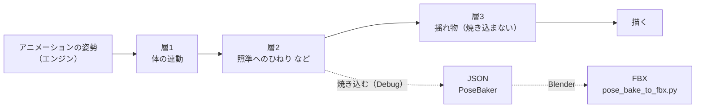

# 骨の調整の層の設計

作成日: 2026-11-19
対象: [PoseLayers.h](../../../../Game/Source/Character/Components/PoseLayers.h)・[PoseLayers.cpp](../../../../Game/Source/Character/Components/PoseLayers.cpp)、[PoseBaker.h](../../../../Game/Source/Character/Components/PoseBaker.h)・[PoseBaker.cpp](../../../../Game/Source/Character/Components/PoseBaker.cpp)、[pose_bake_to_fbx.py](../../../../tools/BlenderScripts/pose_bake_to_fbx.py)
経緯: [骨の調整の層の経緯](骨の調整の層の経緯.md)

アニメーションの姿勢に、あとから骨の調整（体の連動・揺れ物・照準へのひねりなど）を重ねる部品 `PoseLayers` と、重ねた姿勢をクリップに焼き込む `PoseBaker` のページです。Player・黒騎士・一人称の腕が持っています。

- **骨に手を加える処理は、全部「層」として1か所に並べる。** 持ち主は層を足すだけで、呼ぶ順番は部品が持つ。
- **毎回同じ形になる層は、焼き込んでクリップにできる。** 揺れ物のように、そのときの動きで変わる層は焼き込まない。
- **焼き込みは開発用で、Debug ビルドだけに入れる。** 焼き込んだ形は、焼き込むコードの方を正とする。

**用語:**

| 用語 | 何のことか |
|---|---|
| 層 | アニメーションの姿勢の上に重ねる、骨の調整1つ分。ここでは、骨のワールド行列を書き換える関数1つ。エンジンの「アニメーションの層」（クリップを重ねるもの。[アニメーションの上半身の層の設計](../../../エンジン/アニメーションの上半身の層/アニメーションの上半身の層の設計.md)）とは別のもの |
| 焼き込み | 層を重ねた結果の姿勢を、コマごとに記録してクリップ（FBX）にすること。焼き込んだあとは、層の計算をしなくても同じ姿勢になる |

---

## 1. 全体像



| 持ち主 | 層（重ねる順） |
|---|---|
| Player | 体の連動（BodyLink）→ 照準へのひねり（溜め撃ち。焼き込まない）→ 揺れ物（SpringBones。焼き込まない） |
| 黒騎士 | 剣を持つ右腕（F1 の窓「黒騎士のモーション」から Run を流すとき） |
| 一人称の腕 | 腕以外を見せない → 歩き・走りの腕の揺れ（どちらも焼き込まない） |

使わない部品（黒騎士の体の連動・揺れ物）は層に入れない。

---

## 2. 実装方法

**骨の計算のあとに1回だけ呼ばれる。** エンジンの `Skeleton` は、骨のワールド行列を計算したあとに呼ぶ関数を1つだけ持てる（`SetOnPostUpdateWorldMatrix`）。前は Character・黒騎士・一人称の腕がそれぞれ登録していて、黒騎士は Character の登録を上書きしていた。`PoseLayers::Init` がこれを登録し、中で層を足した順に呼ぶ。

```cpp
// PoseLayers::Update
if (m_isSuspended) {
    return;
}
for (Layer& layer : m_layers) {
    if (m_isBaking && !layer.isBakeable) {
        continue;
    }
    layer.apply(skeleton);
}
```

| ジャンル | 名前 | 何のためのもの | 何をするためのもの | どこから来たもの |
|---|---|---|---|---|
| 型 | `Layer` | 層1つ分を持つため | 呼ぶ関数（`apply`）と、焼き込みに入れるか（`isBakeable`）を持つ | このゲームの `PoseLayers.h`（`PoseLayers` の中） |
| メンバー変数 | `apply` | 層の中身を、持ち主が決められるようにするため | 骨のワールド行列を書き換える関数。`std::function<void(Skeleton&)>` | このゲームの `PoseLayers.h` |
| メンバー変数 | `m_isBaking`・`m_isSuspended` | 焼き込みと確かめのときに、重ねる層を変えるため | 焼き込み中は焼き込まない層を飛ばす。確かめ中は全部飛ばす | このゲームの `PoseLayers.h` |

**層の足し方。** Character が `Start` で、体の連動 → 派生クラスの層（`OnAddPoseLayers()`）→ 揺れ物 の順に足す。派生クラスは `OnAddPoseLayers()` で `layers.Add(関数, 焼き込むか)` を呼ぶ。

**骨を回す関数はここにまとめた。** 前は `SpringBones::RotateBoneTree` と黒騎士の `RotateBoneTreeAround` が別々にあった。`PoseLayers::RotateBoneTree`（骨とその子孫に行列を掛ける）・`RotateBoneTreeAround`（中心と軸と角度で回す）・`BonePosition`（骨の位置）に1つずつ置き、BodyLink・SpringBones・Player・黒騎士・一人称の腕はこれを使う（一人称の腕の形を作る `FirstPersonArmsPoser` の指を回す関数は、指の3本の骨だけを回す別のもの）。

**焼き込み（PoseBaker。Debug ビルドだけ）。** クリップを 30fps で1コマずつ止めて流し、焼き込みに入れる層だけを重ねた骨の行列を、モデルの根元から見た行列にして JSON に書く。

```cpp
// PoseBaker の SamplePose（抜き出し）
modelRender.SetAnimationSpeed(0.0f);
modelRender.PlayAnimationAtTime(clipNo, t);
modelRender.Update();   // t 秒の姿勢を作る
modelRender.Update();   // その姿勢から骨のワールド行列を作る（ここで層が重なる）
Matrix toModel;
toModel.Inverse(modelRender.GetWorldMatrix(0));
pose[boneNo] = skeleton.GetBone(boneNo)->GetWorldMatrix() * toModel;
```

`ModelRender::Update` は、骨のワールド行列を作ってからアニメーションを進めるので、2回呼んではじめて t 秒の姿勢に層が重なる。モデルの位置・向き・大きさを外して書くので、焼き込んだときにキャラクターやカメラがどこを向いていても、同じクリップになる。

| ジャンル | 名前 | 何のためのもの | 何をするためのもの | どこから来たもの |
|---|---|---|---|---|
| 関数 | `PlayAnimationAtTime()` | クリップの決まった時間の姿勢を作るため | クリップを t 秒の位置に置く（補間なし） | k2Engine（エンジン）の [ModelRender.h](../../../../k2Engine/graphics/ModelRender.h) |
| 関数 | `GetWorldMatrix()` | モデルの位置・向き・大きさを外すため | モデルのワールド行列（上の向きの補正も入ったもの）を返す | k2Engine（エンジン）の [ModelRender.h](../../../../k2Engine/graphics/ModelRender.h) |
| マクロ | `_DEBUG` | 焼き込みを Debug ビルドだけに入れるため | Debug ビルドのときだけ決まっている名前。`#ifdef _DEBUG` で囲んだ所は、Release ビルドでは作られない | Visual Studio（C++ のコンパイラーの設定） |

**JSON から FBX へ（Blender）。** `pose_bake_to_fbx.py` が骨格の FBX を読み、骨ごとに「バインドポーズから今の姿勢への動き」を Blender の座標に直してポーズにし、位置・回転・大きさのキーを打つ。ゲームの座標と Blender の座標の対応は、ゲームのバインドポーズの位置と Blender の骨の頭の位置から最小二乗で求めるので、FBX の軸の向きや単位を知らなくても合う。書き出しの設定は [黒騎士のモーション](../../アニメーション制作/黒騎士のモーション/黒騎士のモーションの設計.md) のスクリプトと同じ。

**確かめる（Compare）。** 焼き込んだクリップを層を重ねずに流し、JSON の姿勢と骨の位置を比べて、いちばん大きいずれを返す。

---

## 3. 使い方

| やりたいこと | 書き方 |
|---|---|
| キャラクターに層を足す | 派生クラスの `OnAddPoseLayers(PoseLayers& layers)` で `layers.Add([this](Skeleton& s) { ... }, 焼き込むか)` |
| 層の効果を見比べる | その層の `Add` の行をコメントアウトしてビルドする |
| JSON を FBX にする | `blender -b --python tools/BlenderScripts/pose_bake_to_fbx.py -- <骨格の FBX> <出力フォルダ> <JSON>...` |
| 一人称の腕を焼き直す | [一人称の腕の設計](../../プレイヤー/一人称の腕/一人称の腕の設計.md) の「使い方」 |

---

## 4. 決めたこと

| 決めたこと | 理由 |
|---|---|
| 焼き込みはゲームの中で姿勢を作り、Blender で FBX にする | 層の計算（一人称の腕の指の IK など）を Blender に写すと、2か所を直すことになる。ゲームで作った姿勢をそのまま記録すれば、見た目が必ず同じになる |
| 焼き込んだ形は、焼き込むコードを正とする | Blender で FBX を直しても、焼き直すとその直しは消える。直す所を1つにする |
| 焼き込みは Debug ビルドだけ | 開発のときにだけ使う。遊ぶ版（Release）には要らない |
| JSON にはモデルの根元から見た行列を書く | 親から見た行列だと、骨格の読み方（ゲームと Blender）の違いがそのまま出る。根元から見た行列とバインドポーズがあれば、骨ごとの動きが座標の違いによらず決まる |
| 座標の対応を骨の位置から求める | ゲームが FBX をどの軸・単位で読んだかを知らなくてよい。ずれ（今は 0.0006 以下）を出すので、合わないときに気づける |
| F1 の窓で層を切る・焼き込む仕組みは入れない | ユーザーと相談して外した（[経緯](骨の調整の層の経緯.md)）。焼き込みは一人称の腕だけで、起動の指定から行う |

---

## 5. 既知の課題

- 今焼き込んで使っているのは一人称の腕だけ。Player・黒騎士の層を焼き込むときは、焼き込む状態（走る速さ・向きなど）を決めて、一人称の腕と同じように焼き込む処理を書く。

---

## 6. 関連するページ

- [体の連動の設計](../体の連動/体の連動の設計.md)・[揺れ物の設計](../揺れ物/揺れ物の設計.md)（層の中身）
- [一人称の腕の設計](../../プレイヤー/一人称の腕/一人称の腕の設計.md)（焼き込んだクリップを使う）
- [アニメーションの上半身の層の設計](../../../エンジン/アニメーションの上半身の層/アニメーションの上半身の層の設計.md)（エンジンのアニメーションの層。こちらはクリップを重ねるもの）
