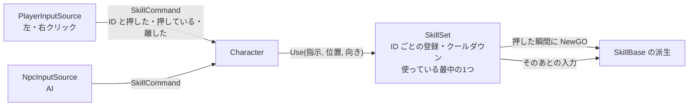

# スキルの設計

作成日: 2026-11-14
対象: `Game/Source/Skill/SkillBase.*`、`SkillSet.*`、`SkillId.h`、`CharacterInput` の `SkillCommand`、`Character` のスキルを使うところ
経緯: [スキルの経緯](スキルの経緯.md)

キャラクターが使う技（スキル）の共通の仕組みのページです。スキルの基底クラス `SkillBase` と、スキルを登録して使う部品 `SkillSet` を説明します。
魔法（`MagicBase`）は `SkillBase` の派生で、[魔法の設計](../魔法/魔法の設計.md) にあります。剣の攻撃（`AttackBase`）も同じ派生にする予定です（まだない）。

- **スキル = 1回使うごとの1つ。** 使うたびに `NewGO` し、終わったら自分で消える。
- **入力は指示（`SkillCommand`）にしてから渡す。** キーを読むのは入力元（`PlayerInputSource`・AI）だけ。スキルはキーを知らない。
- **入力を受け取ったあとの判断は `SkillBase` に書く。** 押している間・離した・中断、の扱いは派生クラスごとに書かない。
- **スキルは ID で呼ぶ。** 「氷魔法を使う」のように、入力も登録も `SkillId` で書く。

---

## 1. 全体像



```
SkillBase（基底。使うたびに1つ NewGO する）
├─ MagicBase   … 飛んでいく1発
│   ├─ IceMagic・FireMagic・SlashMagic
└─ AttackBase  … 剣の1振り（あとで作る）
```

| クラス | 役割 |
|---|---|
| `SkillCommand` | 入力元が作る指示。どのスキルを（`SkillId`）、押し始めた・押している・離した（`ButtonState`） |
| `SkillSet` | ID ごとにスキルを登録する。指示が来たら作り、使っている最中のスキルに入力を渡す。クールダウンを測る |
| `SkillBase` | 1回ぶんのスキル。入力を受け取ったあとの判断（溜める・離す・中断）と、キャラクターがまだ手を離せないか（`IsOwnerBusy`） |

---

## 2. 指示の流れ

| # | どこで | 何をする |
|---|---|---|
| 1 | `PlayerInputSource` | 左クリックを `SkillId::IceMagic`、右クリックを `SkillId::FireMagic` の指示にする。両方押したら、先に押した方を離すまで出し続ける |
| 2 | `Character::UpdateSkill()` | 動けなければ `SkillSet::CancelAll()`。動ければ撃つ位置と向きを作り（照準があればその方向、なければ足元から `castHeight` の高さで正面へ、`castForward` だけ前に出す）、指示と一緒に `SkillSet::Use()` へ渡す |
| 3 | `SkillSet::Use()` | 使っている最中のスキルがあれば、その ID の入力だけを渡す（ほかの指示は受け付けない）。なければ、押した瞬間にクールダウンを見て `NewGO` する |
| 4 | `SkillBase::ReceiveInput()` | 押している間は位置と向きを合わせ、溜め撃ちなら溜める。離したら飛ばす（使う） |
| 5 | `SkillSet` | スキルが手を離したら（`IsOwnerBusy()` が false）、その時刻からクールダウンを数え、次の指示を受け付ける |

- 同時に使えるスキルは1つです。溜めている間や、剣を振っている間（あとで作る）は、ほかの指示を受け付けません。
- 中断（凍ったとき）したスキルは、クールダウンを始めません。

---

## 3. SkillBase

| 関数 | 誰が呼ぶ | やること |
|---|---|---|
| `Init(使った人, 陣営, 位置, 向き)` | `SkillSet` | `NewGO` の直後に呼ぶ |
| `ReceiveInput(ボタン, 位置, 向き)` | `SkillSet` | 入力を受け取ったあとの判断。基底クラスに書き、派生クラスは書かない |
| `Cancel()` | `SkillSet` | 中断する |
| `IsOwnerBusy()` | `SkillSet` | キャラクターがまだ手を離せないか。溜めている間（攻撃なら振っている間）は true |

派生クラスが上書きするもの:

| 関数・定数 | 書くこと |
|---|---|
| `COOLDOWN` | 手を離してから、次に使えるまでの秒数（既定は 0） |
| `IsChargeType()` | 溜めるなら true |
| `OnCharge(秒)` | 溜めている間、毎フレーム |
| `OnRelease()` | 離した（溜めない技は、作った直後に呼ばれる） |
| `OnCancel()` | 溜めている途中で中断された |
| `OnSkillStart()`・`OnSkillUpdate()` | 使い始めてからの動き（魔法なら飛ぶ・当たる・消える） |

`SkillBase` は、`IsOwnerBusy()` が true の間は自分を消しません（`SkillSet` が指しているため）。

---

## 4. 実装方法

### 入力を受け取ったあとは基底クラスで決める

```cpp
void SkillBase::ReceiveInput(const ButtonState& button, const Vector3& origin, const Vector3& direction)
{
    if (!IsCharging()) { return; }        // 溜めていなければ、あとの入力は関係ない
    if (button.isPress) {
        SetPose(origin, direction);       // 手元に合わせる
    }
    else {
        m_isReleased = true;              // 次の Update で OnRelease()
    }
}
```

離した・中断は合図だけ立てて、次の `Update()` で扱います。作った直後（`Start()` より前）に離されても、読み込む前に使ってしまうことがありません。

### SkillSet は ID ごとに「作る関数」とクールダウンを持つ

```cpp
template <class T>
void Register(SkillId id)
{
    Entry& entry = m_entries[id];
    entry.create = [] { return NewGO<T>(1, SkillBase::OBJECT_NAME); };
    entry.cooldown = T::COOLDOWN;
}
```

使っている最中のスキルは1つだけ（`m_active`）持ちます。クールダウンは「手を離した時刻」と `GameClock::Now()` の差で測ります。溜めた秒数も、溜め始めた時刻との差です。
`GameClock` はゲームが始まってからの秒数で、`Game`（優先度0）が毎フレーム、キャラクター（優先度1）より先に進めます。PC の時計ではなくフレームの経過時間を足すので、一時停止を入れるときは進めなければ、クールダウンも溜めも止まります。

### 指示は1つ、先に押した方を優先する

```cpp
struct SkillCommand
{
    SkillId id = SkillId::None;   // 使いたいスキル。None なら指示なし
    ButtonState button;           // そのボタンの、押した瞬間・押している・離した瞬間
};
```

`PlayerInputSource` は、左・右クリックそれぞれの `ButtonState` を自分で持ち、先に押された方を、離した瞬間のフレームまで指示にします。

---

## 5. 使い方（スキルを持たせる）

```cpp
void Player::OnStart()
{
    m_skillSet.Register<IceMagic>(SkillId::IceMagic);
    m_skillSet.Register<FireMagic>(SkillId::FireMagic);
}
```

新しいスキルを足すときは、[SkillId.h](../../../Game/Source/Skill/SkillId.h) に ID を足し、派生クラスを作って登録し、入力元にその ID の指示を出させます。
キーの割り当てを変えるときは、`PlayerInputSource` だけを直します。

---

## 6. 決めたこと

| 決めたこと | 理由 |
|---|---|
| 魔法と攻撃の上に `SkillBase` を置いた | 指示の受け取り・溜め・クールダウン・同時に1つ、の決まりを、魔法と剣の攻撃で1か所にまとめるため |
| `fire`・`subFire` をやめ、`SkillCommand` 1つにした | キャラクターが「どのボタンか」を知らなくてよいように。AI も同じ指示で、どのスキルでも使える |
| スキルを番号（枠）でなく `SkillId` で呼ぶ | 入力・登録・AI のどれを読んでも、何を使うかが分かる |
| 同時に使えるのは1つ | 溜めている間・振っている間の扱いを、`SkillSet` の1か所で決められる |
| 黒騎士の剣は、入力を `attack` に分ける | 魔法の指示が剣の攻撃に化けないように。`AttackBase` にするのはあと |

---

## 7. 既知の課題

- 黒騎士の剣の攻撃は、まだ `SkillBase` の派生ではない。入力の `attack` と、攻撃のステート（`EnemyAttackState`）で動いている。
- 斬撃（`SlashMagic`）は、攻撃のステートが直接 `NewGO` する。`SkillSet` を通らないので、クールダウンなどはない。

---

## 8. 関連するページ

- [魔法の設計](../魔法/魔法の設計.md)（`MagicBase`。飛ぶ・当たる・消える）
- [入力の設計](../キャラクター/入力の設計.md)（`CharacterInput`・`PlayerInputSource`）
- [状態異常の設計](../キャラクター/状態異常の設計.md)（凍ったらスキルを中断する）
