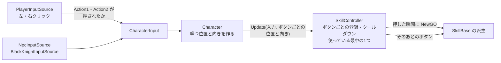
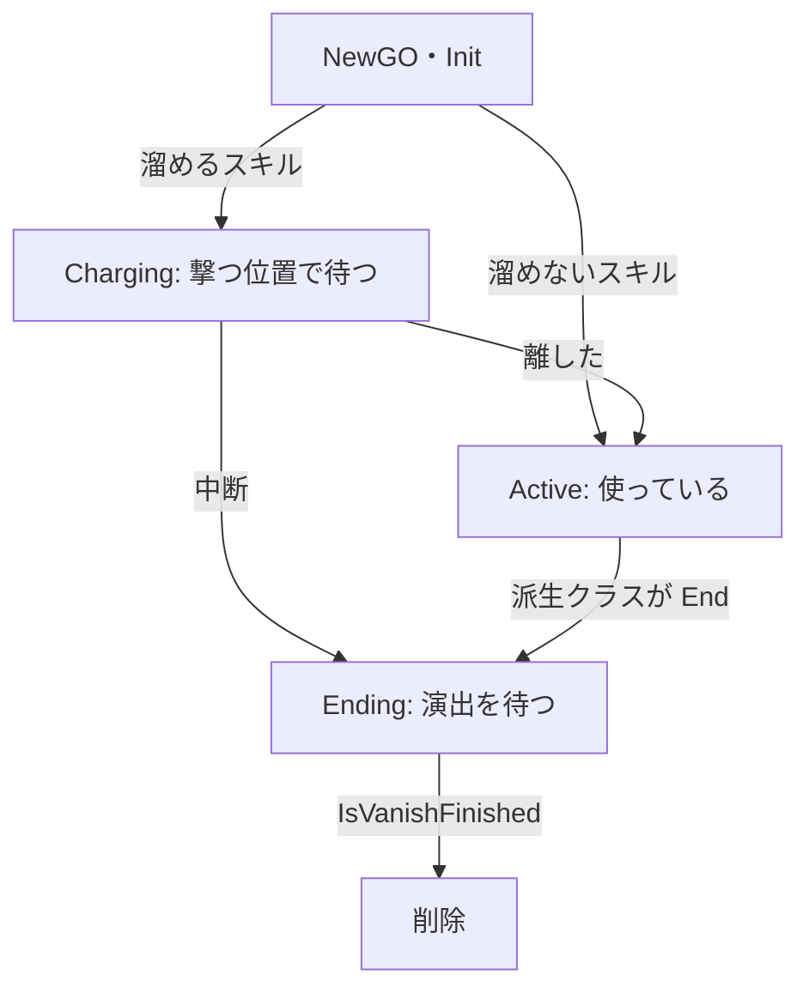

# スキルの設計

作成日: 2026-11-14
対象: `Game/Source/Skill/SkillBase.*`、`SkillController.*`、`CharacterInput` の `ActionButton`・`actions`、`Character` のスキルを使うところ
経緯: [スキルの経緯](スキルの経緯.md)

キャラクターが使う技（スキル）の共通の仕組みのページです。スキルの基底クラス `SkillBase` と、スキルをボタンに登録して使う部品 `SkillController` を説明します。
魔法（`MagicBase`）は `SkillBase` の派生で、[魔法の設計](../魔法/魔法の設計.md) にあります。剣の攻撃（`AttackBase`）も同じ派生で、[剣の攻撃の設計](剣の攻撃/剣の攻撃の設計.md) にあります。

- **入力は「どのボタンが押されたか」だけ。** キーを読むのは入力元（`PlayerInputSource`・AI）で、スキルのことは知らない。
- **どのボタンで何を使うかは `SkillController` が持つ。** `Register<IceMagic>(ActionButton::Action1, 間隔)` の1行で決まる。
- **スキル = 1回使うごとの1つ。** 使うたびに `NewGO` し、終わったら自分で消える。
- **入力を受け取ったあとの判断は `SkillBase` に書く。** 押している間・離した・中断の扱いは、派生クラスごとに書かない。

| 用語 | 何のことか |
|---|---|
| `SkillPose` | 1つのボタンのスキルを撃つ位置（`origin`）と向き（`direction`）を持つ構造体（[SkillController.h](../../../Game/Source/Skill/SkillController.h)）。ボタンごとに1つ作る |
| `FilterSkillInput()` | `Character` の仮想関数。スキルに渡す入力の写しを、派生クラスが書き換える口（攻撃のモーションに合わせて `Action1` を押したことにする、など）。元の入力 `m_input` は変わらない（[Character.h](../../../Game/Source/Character/Character.h)） |
| ステート・`Action1`・`Action2`・カプセル | [用語集の「キャラクター」](../../用語集.md#キャラクター) |

---

## 1. 全体像



```
SkillBase（基底。使うたびに1つ NewGO する）
├─ MagicBase   … 飛んでいく1発
│   ├─ IceMagic・FireMagic・SlashMagic
└─ AttackBase  … 剣の1振り（振り終わるまで持ち主の体を使う）
    ├─ DashSlashAttack・HeavyComboAttack・SlashWaveAttack
```

| もの | 知っていること | 知らないこと |
|---|---|---|
| `PlayerInputSource` | キー・マウス・パッド → `Action1`・`Action2` | スキル |
| `CharacterInput` | ボタンが押されたか（`actions`） | 何に使うか |
| `SkillController` | どのボタンでどのスキルを使うか、クールダウン、使っている最中の1つ | キー・マウス |
| `SkillBase` | 押している間・離した・中断したらどうするか | どのボタンか |

`CharacterInput` を間に置くので、AI も「`Action1` を押す」と入れるだけで同じスキルを使えます。入力元を差し替えても、溜めやクールダウンは `SkillController` に残ります。

---

## 2. ボタンの割り当て

| ボタン | Player（マウス・キーボード / パッド） | Player が登録しているスキル | 黒騎士 |
|---|---|---|---|
| `Action1` | 左クリック（I）/ Y | 氷魔法 | 攻撃1（`DashSlashAttack`） |
| `Action2` | 右クリック（8）/ RB2 | 炎魔法 | 攻撃2（`HeavyComboAttack`） |
| `Action3` | 読まない | なし | 攻撃3（`SlashWaveAttack`） |

キーの割り当ては [PlayerInputSource.cpp](../../../Game/Source/Character/Input/PlayerInputSource.cpp)、スキルの登録は [Player.cpp](../../../Game/Source/Player/Player.cpp)・[Enemy.cpp](../../../Game/Source/Enemy/Enemy.cpp) の `OnStart()` にあります。

---

## 3. 1フレームの流れ

| # | どこで | 何をする |
|---|---|---|
| 1 | 入力元 | ボタンの状態を `CharacterInput::actions` に入れる |
| 2 | `Character::UpdateSkill()` | 動けなければ `SkillController::CancelAll()`。動ければボタンごとの撃つ位置と向き（`SkillPose`）を作り、入力の写しを `FilterSkillInput()` で派生クラスに書き換えさせてから、`SkillController::Update()` へ渡す |
| 3（使っている最中） | `SkillController::Update()` | 使っているスキルのボタンの状態だけを渡す（ほかのボタンは受け付けない） |
| 3（使っていない） | `SkillController::Update()` | 登録したボタンが押された瞬間に、クールダウンを見て `NewGO` する |
| 4 | `SkillBase::ReceiveInput()` | 溜めている間は、押している間は位置と向きを合わせ、離したら次の `Update()` で使い始める。体を動かすスキルを使っている間は、ボタンを見ずに位置と向きだけを合わせる |
| 5 | `SkillController` | スキルが手を離したら（`IsOwnerBusy()` が false）、その時刻からクールダウンを数え、次のボタンを受け付ける |

- 同時に使えるスキルは1つです。溜めている間は、ほかのボタンを押しても何も起きません。
- 中断（凍ったとき）したスキルは、クールダウンを始めません。
- 一人称のときは、入力の `aimOffsets` で、そのボタンのスキルだけ撃つ位置をずらします（Player は `Action1` の氷魔法を右手から撃つ）。向きは照準の先の点へ向け直すので、画面の真ん中に飛びます。
- Player は 3段攻撃の間、`FilterSkillInput()` で「手を突き出したコマでだけ `Action1` を押した」ことにしています（[3段攻撃の設計](../プレイヤー/3段攻撃/3段攻撃の設計.md)）。

---

## 4. SkillBase の流れ

コード: [SkillBase.h](../../../Game/Source/Skill/SkillBase.h)、[SkillBase.cpp](../../../Game/Source/Skill/SkillBase.cpp)



派生クラスが書くもの:

| 関数・定数 | 呼ばれるとき | 書くこと |
|---|---|---|
| `COOLDOWN` | （`SkillController` が、引数1つの `Register<T>(button)` で読む） | 手を離してから、次に使えるまでの秒数。既定は 0。氷魔法・炎魔法は持たず、`magic.json` の値を `Register<T>(button, 間隔)` で渡す |
| `PRIORITY` | （`SkillController` が `NewGO` に使う） | 優先度。既定は 1。体を動かすスキル（`AttackBase`）は 0 にして、キャラクターより先に動かす |
| `IsChargeType()` | 作った直後 | 溜めるなら true |
| `UsesOwnerBody()` | （`IsOwnerBusy()` が読む） | 持ち主の体を動かすなら true。使い終わるまで手を離さず、使っている途中でも中断される。体は `GetBody()`（`SkillController::SetBody()` で渡したもの） |
| `OnStart()` | 最初のフレーム | エフェクトやモデルの読み込み。失敗なら false |
| `OnCharge(秒)` | 溜めている間、毎フレーム | 溜めの見た目 |
| `OnRelease()` | 使い始める瞬間 | 溜め具合で性能を変える、など |
| `OnCancel()` | 溜めている途中（体を動かすスキルは使っている途中も）で中断された | 溜めの見た目を片付ける |
| `OnSkillUpdate()` | 使っている間、毎フレーム | 動き（魔法なら飛ぶ）。終わったら `End()` |
| `IsVanishFinished()` | 終わったあと、毎フレーム | 演出が終わったか |

---

## 5. 実装方法

### 入力を受け取ったあとは基底クラスで決める

```cpp
void SkillBase::ReceiveInput(const ButtonState& button, const Vector3& position, const Vector3& direction)
{
    if (!IsOwnerBusy()) { return; }       // 手を離せる状態なら、あとの入力は関係ない
    if (m_state == EnState::Active) {
        SetPose(position, direction);     // 体を動かすスキルを使っている間: ボタンは見ず、位置と向きだけ合わせる
        return;
    }
    if (button.isPress) {
        SetPose(position, direction);     // 溜めていて押している間: 手元に合わせる
    }
    else {
        m_isReleased = true;              // 離した: 次の Update で使い始める
    }
}

bool SkillBase::IsOwnerBusy() const
{
    if (m_isCanceled) { return false; }
    if (UsesOwnerBody()) {
        return m_state != EnState::Ending && !m_isFailed;   // 体を動かすスキル: 使い終わるまで手を離さない
    }
    return m_state == EnState::Charging && !m_isReleased;   // それ以外: 溜めている間だけ
}
```

**名前:**

| ジャンル | 名前 | 何のためのもの | 何をするためのもの | どこから来たもの |
|---|---|---|---|---|
| 型 | `ButtonState` | 1つのボタンの状態を、まとめて渡すため | 押した瞬間（`isTrigger`）・押している間（`isPress`）・離した瞬間（`isRelease`）を持つ構造体 | ゲームの [CharacterInput.h](../../../Game/Source/Character/Input/CharacterInput.h) |
| 関数 | `IsOwnerBusy()` | キャラクターがまだ手を離せないかを答えるため | 溜めている間（体を動かすスキルは、使い終わるまで）は true を返す。中断されたら false。true の間、`SkillController` はほかのスキルを使わない | ゲームの [SkillBase.h](../../../Game/Source/Skill/SkillBase.h) の `SkillBase` |
| メンバー変数 | `isPress` | 押している間かを見分けるため | 押されているなら true。押している間は、撃つ位置と向きを手元に合わせる | ゲームの `CharacterInput.h` の `ButtonState` |
| 関数 | `SetPose()` | 撃つ位置と向きを、まとめて更新するため | 位置を覚え、向きを正規化し、その向きの回転（`m_rotation`）も作る。`SkillBase` の private の関数 | ゲームの `SkillBase.h` の `SkillBase` |
| メンバー変数 | `m_isReleased` | 離されたことを覚えておき、次の `Update()` で使い始めるため | 離されたら true。溜めないスキルは、作った時点で true | ゲームの `SkillBase.h` の `SkillBase` |
| メンバー変数 | `m_state` | スキルが今どの段階かを覚えるため | `EnState` の値（`Charging`・`Active`・`Ending`）のどれかが入る | ゲームの `SkillBase.h` の `SkillBase` |
| 値 | `EnState::Charging` | 「撃つ位置で待っている」段階を表すため | 溜めている間の値。溜めないスキルも、使い始めるまではこの値 | ゲームの `SkillBase.h` の `SkillBase`（private の `enum class EnState`） |
| 関数 | `UsesOwnerBody()` | 体を動かすスキルかを答えるため | 派生クラスが上書きする。true なら `IsOwnerBusy()` は使い終わるまで true | ゲームの `SkillBase.h` の `SkillBase`（`AttackBase` が true にする） |
| メンバー変数 | `m_isFailed` | 読み込みに失敗したことを覚えるため | `OnStart()` が false なら true。体を動かすスキルでも、すぐ手を離す | ゲームの `SkillBase.h` の `SkillBase` |
| メンバー変数 | `m_isCanceled` | 中断されたことを覚えておくため | 中断されたら true。次の `Update()` で消え始める | ゲームの `SkillBase.h` の `SkillBase` |

体を動かすスキル（`UsesOwnerBody()` が true）は、溜めずに `Active` になりますが、使い終わるまで `IsOwnerBusy()` が true なので、その間は位置と向きだけが合わされます。溜めないスキルは、`Init()` の時点で「離した」ことにするので、作った直後から `IsOwnerBusy()` が false です。離した・中断は合図だけ立てて、次の `Update()` で扱います。作った直後（`Start()` より前）に離されても、読み込む前に使ってしまうことがありません。読み込みに失敗したスキルも、`IsOwnerBusy()` が true の間は消えません（`SkillController` が指しているため）。

### SkillController はボタンごとに「作る関数」とクールダウンを持つ

```cpp
template <class T>
void Register(ActionButton button)                  // 間隔は T::COOLDOWN（剣の攻撃）
{
    Register<T>(button, T::COOLDOWN);
}

template <class T>
void Register(ActionButton button, float cooldown)  // 間隔を渡す（氷魔法・炎魔法。値は magic.json）
{
    Entry& entry = m_entries[static_cast<int>(button)];
    entry.create = [] { return NewGO<T>(T::PRIORITY, SkillBase::OBJECT_NAME); };
    entry.cooldown = cooldown;
}
```

**名前:**

| ジャンル | 名前 | 何のためのもの | 何をするためのもの | どこから来たもの |
|---|---|---|---|---|
| 関数 | `Register<T>()` | ボタンとスキルを結びつけるため | そのボタンの `Entry` に、スキル `T` を作る関数とクールダウンを入れる。引数は、ボタンだけ（間隔は `T::COOLDOWN`）か、ボタンと間隔 | ゲームの [SkillController.h](../../../Game/Source/Skill/SkillController.h) の `SkillController` |
| テンプレートの引数 | `T` | 登録するスキルのクラスを、呼ぶ側が決められるようにするため | `Register<IceMagic>(...)` のように、スキルのクラスを入れる | 使う側が決める |
| 型 | `ActionButton` | どのボタンかを表すため | `Action1`〜`Action3` の3つと、数を表す `Num` を持つ `enum class` | ゲームの [CharacterInput.h](../../../Game/Source/Character/Input/CharacterInput.h) |
| 型 | `Entry` | ボタン1つぶんの登録をまとめるため | 作る関数（`create`）・クールダウン（`cooldown`）・前に手を離した時刻・使った回数を持つ構造体 | ゲームの `SkillController.h` の `SkillController`（private） |
| メンバー変数 | `m_entries` | ボタンごとの登録を持つため | `Entry` の配列。添字は `ActionButton` の番号 | ゲームの `SkillController.h` の `SkillController` |
| メンバー変数 | `create` | 押されたときに、スキルを1つ作る処理を覚えておくため | 関数を入れておける `std::function<SkillBase*()>`（「引数なしで `SkillBase*` を返す」の意味）。呼ぶと `NewGO` したスキルが返る。空なら、そのボタンは登録なし | ゲームの `SkillController.h` の `Entry` |
| メンバー変数 | `cooldown` | 次に使えるまでの秒数を覚えるため | `T::COOLDOWN`、または `Register` の引数で渡された値を入れる | ゲームの `SkillController.h` の `Entry` |

```cpp
void SkillController::Update(const CharacterInput& input, const SkillPose (&poses)[Num])   // ボタンごとの撃つ位置と向き
{
    if (m_active != nullptr) {                         // 使っている最中は、そのボタンだけを見る
        const SkillPose& pose = poses[m_activeButton];
        m_active->ReceiveInput(input.actions[m_activeButton], pose.origin, pose.direction);
        if (!m_active->IsOwnerBusy()) { FinishActive(); }   // 手を離した → クールダウンを始める
        return;
    }
    for (int button = 0; button < Num; button++) {    // 押された瞬間のボタンのスキルを作る
        if (!entry.create || !input.actions[button].isTrigger || !IsReady(entry)) { continue; }
        m_active = entry.create();
        m_active->Init(poses[button].origin, poses[button].direction, m_owner, m_faction);
        if (!m_active->IsOwnerBusy()) { FinishActive(); }   // 溜めないスキルは、すぐ手を離す
        return;
    }
}
```

**名前:**

| ジャンル | 名前 | 何のためのもの | 何をするためのもの | どこから来たもの |
|---|---|---|---|---|
| 型 | `CharacterInput` | 1フレームぶんの入力をまとめて渡すため | ボタンの状態（`actions`）や移動の向きなどを持つ、値だけの構造体 | ゲームの `CharacterInput.h` |
| メンバー変数 | `actions` | ボタンごとの状態を持つため | `ButtonState` の配列。添字は `ActionButton` の番号 | ゲームの `CharacterInput.h` の `CharacterInput` |
| 引数 | `origin`・`direction` | 撃つ位置と向きを渡すため | スキルの位置と向き。今のコードでは、ボタンごとの `SkillPose`（`origin`・`direction`）を並べた配列 `poses` で受け取る | ゲームの [SkillController.h](../../../Game/Source/Skill/SkillController.h)（`SkillPose`） |
| メンバー変数 | `m_active` | 使っている最中のスキルを指すため | `SkillBase` へのポインター。使っていなければ `nullptr` | ゲームの `SkillController.h` の `SkillController` |
| メンバー変数 | `m_activeButton` | 使っているスキルのボタンを覚えるため | `m_active` を使ったボタンの番号。使っていなければ -1 | ゲームの `SkillController.h` の `SkillController` |
| 関数 | `FinishActive()` | 手を離したスキルの後始末をするため | 手を離した時刻を覚えてクールダウンを始め、使った回数を増やし、`m_active` を空にする | ゲームの `SkillController.cpp` の `SkillController`（private） |
| 値 | `Num` | ボタンの数を数えるため | `ActionButton` の最後の値。ボタンの数（今は 3）になる | ゲームの `CharacterInput.h` の `ActionButton` |
| メンバー変数 | `isTrigger` | 押された瞬間だけを見分けるため | このフレームで押されたら true | ゲームの `CharacterInput.h` の `ButtonState` |
| 関数 | `IsReady()` | クールダウンが明けたかを調べるため | 一度も使っていないか、前に手を離した時刻から `cooldown` 以上たっていれば true | ゲームの `SkillController.cpp` の `SkillController`（private） |
| 関数 | `Init()`（`SkillBase` のメンバー） | 作った直後に、撃つ位置・向き・持ち主・陣営を渡すため | 位置と向きを覚え、溜めないスキルは作った時点で「離した」ことにする | ゲームの `SkillBase.h` の `SkillBase` |
| メンバー変数 | `m_owner`・`m_faction` | スキルに、持ち主と陣営を渡すため | `m_owner` はスキルを使うキャラクター、`m_faction` はその陣営（`Faction`）。スキルの当たり判定から持ち主を外すのに使う | ゲームの `SkillController.h` の `SkillController`（`Faction` は [Faction.h](../../../Game/Source/Character/Faction.h)） |

クールダウンは「手を離した時刻」と `GameClock::Now()` の差で測ります。溜めた秒数も、溜め始めた時刻との差です。`GameClock` はゲームが始まってからの秒数で、`Game`（優先度0）が毎フレーム、キャラクター（優先度1）より先に進めます。

### 名前をそろえて、ゲームの終わりにまとめて消す

どのスキルも `SkillBase::OBJECT_NAME`（`"skill"`）で作ります。[Game.cpp](../../../Game/Source/Core/Game.cpp) のデストラクタで、その名前のものを種類を問わずまとめて消します。

---

## 6. 使い方

### スキルを持たせる

```cpp
void Player::OnStart()
{
    m_skillController.Register<IceMagic>(ActionButton::Action1, MagicConfig::GetIce().cooldown);
    m_skillController.Register<FireMagic>(ActionButton::Action2, MagicConfig::GetFire().cooldown);
}
```

**名前:**

| ジャンル | 名前 | 何のためのもの | 何をするためのもの | どこから来たもの |
|---|---|---|---|---|
| 関数 | `Player::OnStart()` | Player だけの部品の準備（スキルの登録も）を書くため | 共通の部品を `Init` したあとに1回呼ばれる。`Character::OnStart()` を上書きしている | ゲームの [Player.h](../../../Game/Source/Player/Player.h)（[Character.h](../../../Game/Source/Character/Character.h) の `Character::OnStart()`） |
| メンバー変数 | `m_skillController` | キャラクターが使うスキルを持つため | `SkillController`。登録（`Register<T>()`）と、毎フレームの `Update()` に使う | ゲームの `Character.h` の `Character` |
| 型 | `IceMagic`・`FireMagic` | Player が使う魔法を表すため | 氷魔法・炎魔法。どちらも `MagicBase`（`SkillBase` の派生）を継承している | ゲームの [IceMagic.h](../../../Game/Source/Magic/IceMagic.h)・[FireMagic.h](../../../Game/Source/Magic/FireMagic.h) |
| 値 | `ActionButton::Action1`・`Action2` | スキルを使うボタンを選ぶため | 1つ目・2つ目のボタン。Player はマウスの左・右クリック | ゲームの `CharacterInput.h` |

### 撃った・溜めているを見る

`SkillController::GetUseCount(ボタン)`（使った回数）と `IsHolding(ボタン)`（溜めている最中か）で見ます。一人称の腕（`FirstPersonArms`。[一人称の腕の設計](../プレイヤー/一人称の腕/一人称の腕の設計.md)）は、前のフレームより回数が増えたら手を突き出し、溜めている間は両手を上げます。

### キーの割り当てを変える・ボタンを増やす

- 割り当てを変えるときは、`PlayerInputSource` の `input.Action(ActionButton::Action1).Update(...)` の行だけを直す。
- ボタンを増やすときは、[CharacterInput.h](../../../Game/Source/Character/Input/CharacterInput.h) の `ActionButton` に `Action3` を足し、`PlayerInputSource` でキーを読み、`Register<...>(ActionButton::Action3)` する。

### AI に使わせる

入力元で `input.Action(ActionButton::Action1).Update(押すか);` とする。溜めるスキルなら、押し続けてから離す（`NpcInputSource` は、段ごとの `holdSeconds` の間押し続ける。今は `NpcInputSource` を使うキャラクターはいない。[NPCのAIの設計](../キャラクター/NPCのAI/NPCのAIの設計.md)）。

---

## 7. 決めたこと

| 決めたこと | 理由 |
|---|---|
| 魔法と攻撃の上に `SkillBase` を置いた | 入力の受け取り・溜め・クールダウン・同時に1つ、の決まりを、魔法と剣の攻撃で1か所にまとめるため |
| 入力は何に使うかを知らないボタン（`ActionButton`）にした | 入力元にスキルのことを書かないため。キーの割り当ては入力元、スキルの割り当ては `SkillController` |
| `SkillController` が `PlayerInputSource` を直接読まない | AI も同じ道でスキルを使え、入力元を差し替えてもスキルの状態が残る。押した瞬間の判定もキーの事情（窓が前にあるか、ImGui を開いているか）も入力元の1か所で済む |
| 同時に使えるのは1つ | 溜めている間・振っている間の扱いを、`SkillController` の1か所で決められる |
| ボタンの名前は `Action1`〜`Action3` | 増やすときに番号を足せる（仮の名前。変えるなら `ActionButton` だけを直す） |

---

## 8. 既知の課題

- 攻撃3の斬撃（`SlashMagic`）は、攻撃（`SlashWaveAttack`）が直接 `NewGO` する。`SkillController` を通らないので、クールダウンなどはない。

---

## 9. 関連するページ

- [魔法の設計](../魔法/魔法の設計.md)（`MagicBase`。飛ぶ・当たる・消える）
- [剣の攻撃の設計](剣の攻撃/剣の攻撃の設計.md)（`AttackBase`。持ち主の体を動かす）
- [入力の設計](../キャラクター/入力/入力の設計.md)（`CharacterInput`・`PlayerInputSource`）
- [3段攻撃の設計](../プレイヤー/3段攻撃/3段攻撃の設計.md)（攻撃のコマに合わせて `Action1` を書き換える）
- [状態異常の設計](../キャラクター/状態異常/状態異常の設計.md)（凍ったらスキルを中断する）
